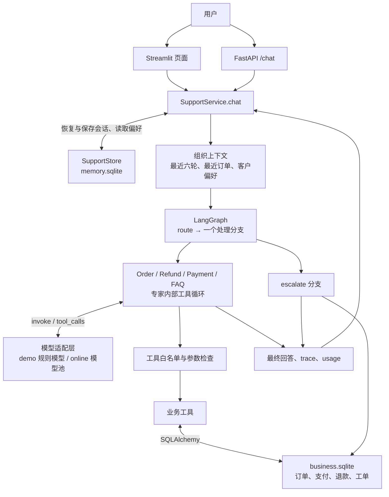
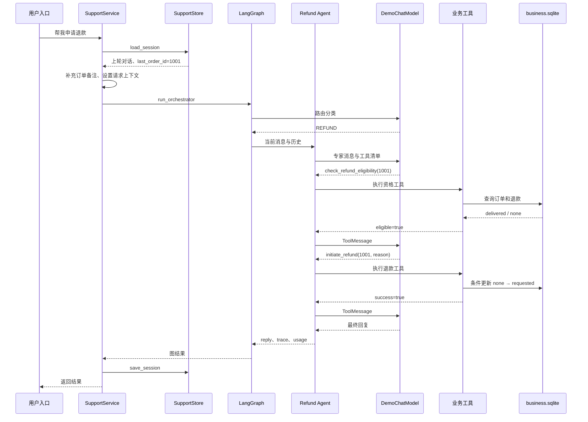
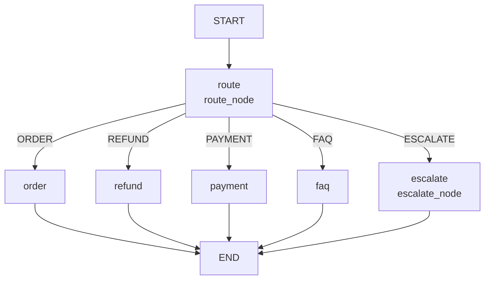

# ecommerce-support-agent 架构说明

本项目是一个基于 LangGraph 的电商客服演示应用：应用服务恢复会话并组织上下文，路由节点选择一位专家，专家通过受限工具读取或修改本地样例数据，最后保存完整对话轮次。

理解整个项目，先抓住三个层次：

1. **Service 管理一次用户请求和跨轮记忆。**
2. **LangGraph 决定本轮由哪个专家处理。**
3. **专家提出工具调用，普通 Python 代码执行工具和业务规则。**



图中页面与 API 是两个独立入口。**Streamlit 不通过 HTTP 调用 FastAPI**，两者都直接调用 `SupportService`。依据：[app.py](app.py) 的 `service()` 与聊天提交逻辑、[api.py](api.py) 的 `chat()`、[src/service.py](src/service.py) 的 `SupportService.chat()`。

本文基于全部 33 个 Python 文件、依赖与部署配置、测试、[README.md](README.md) 以及 [Ecommerce_Agent_Deep_Dive.docx](docs/Ecommerce_Agent_Deep_Dive.docx) 的静态分析，以源码为准。未启动应用、导入项目模块或执行测试；文中的请求过程为源码推演，历史验证记录不视为本次环境的实测结果。

## 1. Project Overview

### 1.1 核心目标

项目展示如何把自然语言客服请求连接到可验证的业务操作，并在连续对话中保持订单指代。

例如：

- 用户先说“查询订单 1002 的物流”，进入 Order Agent。
- 下一轮说“帮我申请退款”，服务补入最近讨论的订单，改由 Refund Agent 处理。
- 退款工具检查真实的本地订单状态，拒绝未送达订单。

跨轮衔接由 `SupportService.chat()` 和 `ConversationMemory` 完成；专家切换由 LangGraph 完成。依据：[src/service.py](src/service.py) 的 `SupportService.chat()`、[src/memory.py](src/memory.py) 的 `ConversationMemory`、[src/orchestrator.py](src/orchestrator.py) 的 `build_graph()`。

### 1.2 技术栈

下表是依赖文件声明，未核验当前机器实际安装版本。

| 层次 | 技术 | 用途 |
|---|---|---|
| 运行环境 | Python；Docker 基础镜像为 Python 3.11 | 应用与业务逻辑 |
| 页面 | Streamlit | 聊天、会话切换、偏好编辑、轨迹展示 |
| API | FastAPI、Pydantic、Uvicorn | HTTP 入口和请求校验 |
| 工作流 | LangGraph `StateGraph` | 意图路由与专家节点编排 |
| 消息与工具 | LangChain Core | 消息对象、工具 Schema、tool calling |
| 在线模型 | Gemini、可选 Groq | 分类、工具选择、回答生成 |
| 业务存储 | SQLAlchemy + SQLite | 订单、支付、退款、工单 |
| 记忆存储 | Python `sqlite3` | 会话快照与客户偏好 |
| 验证 | pytest、Streamlit AppTest、自定义脚本 | 回归与演示检查 |

依赖快照包括 LangGraph `1.2.16`、LangChain Core `1.6.12`、Streamlit `1.66.0`。依据：[requirements.txt](requirements.txt)、[requirements.in](requirements.in)、[Dockerfile](Dockerfile)。

### 1.3 已实现与未实现的能力

| 能力 | 当前实现 | 边界 |
|---|---|---|
| 订单查询 | 状态、详情、物流状态描述 | 没有真实物流接口或运单轨迹 |
| 退款 | 资格查询、创建本地退款申请 | 只到 `requested`，没有审批和实际退款 |
| 支付 | 查询状态、将本地 `pending` 改为 `paid` | 没有支付网关或真实扣款 |
| FAQ | 固定字典、关键词与中文别名匹配 | 没有文档检索、向量库或 RAG |
| 升级处理 | 保存本地 `pending` 工单 | 没有通知、客服分配或接单系统 |
| 会话记忆 | 保存最近 50 轮、最近订单、累计 Token | 不能恢复本轮执行中间步骤 |
| 客户偏好 | 用户手动保存，按用户跨会话读取 | 不会自动学习或训练模型 |
| 多 Agent | 每轮选择一位专家 | 没有同轮多专家协作与汇总 |

业务能力依据：[src/tools.py](src/tools.py) 中各业务函数。存储依据：[src/storage.py](src/storage.py) 的 `SupportStore`、[src/service.py](src/service.py) 的 `SupportService.chat()`。

**全部订单、客户、资金状态与政策均为演示样例，不连接真实电商、支付、物流或人工客服平台。**

## 2. Directory Structure

### 2.1 文件结构

```text
ecommerce-support-agent/
├── ARCHITECTURE.md
├── app.py
├── api.py
├── src/
│   ├── __init__.py
│   ├── service.py
│   ├── orchestrator.py
│   ├── agents/
│   │   ├── __init__.py
│   │   ├── base.py
│   │   ├── order_agent.py
│   │   ├── refund_agent.py
│   │   ├── payment_agent.py
│   │   └── faq_agent.py
│   ├── tools.py
│   ├── llm.py
│   ├── demo_model.py
│   ├── runtime_context.py
│   ├── memory.py
│   ├── storage.py
│   ├── errors.py
│   ├── logging_config.py
│   └── backend/
│       ├── __init__.py
│       ├── db.py
│       └── seed.py
├── tests/
│   ├── __init__.py
│   ├── test_agent_base.py
│   ├── test_api.py
│   ├── test_memory_errors.py
│   ├── test_revision.py
│   ├── test_routing.py
│   └── test_tools.py
├── scripts/
│   ├── demo.py
│   ├── check_restart.py
│   └── check_ui.py
├── eval/
│   ├── run_eval.py
│   └── eval_dataset.json
├── docs/
│   ├── Ecommerce_Agent_Deep_Dive.docx
│   ├── architecture.png
│   ├── tool_loop.png
│   ├── memory.png
│   └── refund.png
├── README.md
├── requirements.in
├── requirements.txt
├── Dockerfile
├── pytest.ini
├── .env.example
├── .gitignore
├── .dockerignore
├── NOTICE.md
└── LICENSE
```

各包的 `__init__.py` 基本为空。分析时项目中没有运行数据库；默认启动后才会创建 `data` 目录及数据库。依据：[src/backend/db.py](src/backend/db.py) 的 `get_engine()`、[src/storage.py](src/storage.py) 的 `SupportStore.__init__()`。

### 2.2 核心模块与函数

| 文件 | 职责 | 核心入口 |
|---|---|---|
| [app.py](app.py) | 页面、输入、历史展示、偏好表单 | `service()`、页面顶层逻辑 |
| [api.py](api.py) | 请求模型、健康检查、聊天接口 | `ChatRequest`、`health()`、`chat()` |
| [src/service.py](src/service.py) | 校验、恢复记忆、注入上下文、执行与保存 | `SupportService.chat()`、`snapshot()`、`validate()` |
| [src/orchestrator.py](src/orchestrator.py) | 图状态、路由、节点编排、整图重试 | `SupportState`、`build_graph()`、`run_orchestrator()` |
| [src/agents/base.py](src/agents/base.py) | 所有专家共用的工具循环 | `run_tool_agent()`、`as_text()`、`sum_usage()` |
| [src/agents/order_agent.py](src/agents/order_agent.py) | 订单工具包装与提示词 | `ORDER_TOOLS`、`run_order_agent()` |
| [src/agents/refund_agent.py](src/agents/refund_agent.py) | 退款工具包装与提示词 | `REFUND_TOOLS`、`run_refund_agent()` |
| [src/agents/payment_agent.py](src/agents/payment_agent.py) | 支付工具包装与提示词 | `PAYMENT_TOOLS`、`run_payment_agent()` |
| [src/agents/faq_agent.py](src/agents/faq_agent.py) | 政策工具包装与提示词 | `FAQ_TOOLS`、`run_faq_agent()` |
| [src/tools.py](src/tools.py) | 实际业务规则、数据库读写、FAQ、工单 | 各业务工具函数 |
| [src/backend/db.py](src/backend/db.py) | ORM 模型、数据库连接与建表 | `Order`、`Payment`、`Refund`、`Ticket`、`get_engine()` |
| [src/backend/seed.py](src/backend/seed.py) | 十笔初始样例数据 | `seed()` |
| [src/llm.py](src/llm.py) | 模式选择、在线模型池、usage 提取 | `get_llm()`、`RotatingChatModel.invoke()`、`extract_usage()` |
| [src/demo_model.py](src/demo_model.py) | 用规则模拟标准模型消息和工具请求 | `route_query()`、`DemoChatModel.invoke()` |
| [src/memory.py](src/memory.py) | 本轮使用的历史消息和最近订单 | `ConversationMemory` |
| [src/storage.py](src/storage.py) | 会话与偏好的 SQLite 持久化 | `load_session()`、`save_session()`、`profile()`、`save_profile()` |
| [src/runtime_context.py](src/runtime_context.py) | 请求期间的模式与偏好 | `active_mode`、`active_profile` |
| [src/errors.py](src/errors.py) | 失败后重试、耗尽后建工单 | `call_with_retry()` |
| [src/logging_config.py](src/logging_config.py) | JSON 格式日志 | `JsonFormatter.format()`、`configure_logging()` |

### 2.3 辅助文件

- [scripts/demo.py](scripts/demo.py)：在临时目录运行真实图、工具和数据库操作。
- [scripts/check_restart.py](scripts/check_restart.py)：用两个独立进程验证会话与偏好恢复。
- [scripts/check_ui.py](scripts/check_ui.py)：用 AppTest 检查页面交互。
- [eval/run_eval.py](eval/run_eval.py)：运行路由数据集，打印准确率与混淆统计；存在模式选择问题，见第 6 节。
- [pytest.ini](pytest.ini)：设置测试路径和 Python 导入路径。
- [.env.example](.env.example)：模型密钥、模型名称、数据目录和业务库连接配置。
- [Dockerfile](Dockerfile)：默认只启动 Streamlit，不同时启动 FastAPI。
- [NOTICE.md](NOTICE.md)、[LICENSE](LICENSE)：整理范围与许可信息。

## 3. System Architecture

### 3.1 前端和后端的真实关系

前端使用 Streamlit，界面代码和 Python 服务调用运行在同一应用中。没有 React、Next.js 或独立前端工程。

FastAPI 提供另一个访问方式：

- `GET /health`：固定返回健康状态。
- `POST /chat`：调用共享的应用服务逻辑。

页面通过 `@st.cache_resource` 复用一个服务对象；API 在模块加载时创建自己的服务对象。因此，共用的是实现及可配置的数据库文件，**不是跨进程共享同一个 Python 对象或锁**。

依据：[app.py](app.py) 的 `service()`、[api.py](api.py) 的模块级 `service` 与 `chat()`。

### 3.2 Service 和 Orchestrator 的职责边界

`SupportService.chat()` 负责一次完整应用请求：

1. 校验用户、会话、模式和消息。
2. 从存储中恢复会话。
3. 取最近六轮构造消息历史。
4. 必要时补充最近订单备注。
5. 设置请求级运行模式和客户偏好。
6. 调用 Orchestrator。
7. 从工具轨迹更新最近订单。
8. 保存本轮结果、最多 50 轮历史和累计 Token。

`run_orchestrator()` 负责执行图、重试和记录本轮决策，不负责加载或保存用户会话。

依据：[src/service.py](src/service.py) 的 `SupportService.chat()`、[src/orchestrator.py](src/orchestrator.py) 的 `run_orchestrator()`。

所以，直接调用 `run_orchestrator()` 并不会自动获得持久化 Memory；调用方必须自己提供历史和请求上下文。

### 3.3 Agent 和 Tools 的关系

每个专家文件包含三部分：

- 用 `@tool` 声明的工具包装函数。
- 当前专家的工具列表。
- 系统提示词与 `run_*_agent()` 入口。

包装函数继续调用业务工具。例如：

```text
src/agents/refund_agent.py：initiate_refund 包装工具
    → src/tools.py：initiate_refund
    → SQLAlchemy 查询、条件更新、提交
```

包装层向模型暴露工具名称、描述和参数 Schema；业务层执行实际规则和数据库操作。

依据：[src/agents/refund_agent.py](src/agents/refund_agent.py) 的 `initiate_refund()`、[src/tools.py](src/tools.py) 的 `initiate_refund()`。

模型只能提出 `tool_calls`。实际执行发生在 `run_tool_agent()` 中，模型没有直接操作数据库的代码路径。依据：[src/agents/base.py](src/agents/base.py) 的 `run_tool_agent()`。

### 3.4 Context 的三种形态

项目没有独立的通用 Context Manager。上下文由以下三种机制组合而成：

| 类型 | 内容 | 注入位置 |
|---|---|---|
| 对话历史 | 最近六轮用户消息与最终回复 | 专家的消息列表 |
| 最近订单备注 | `last_order_id` 对应的英文 Context 文本 | 当前用户消息前面 |
| 请求上下文 | 模式、客户偏好 | `ContextVar`；偏好进一步进入专家系统提示 |

`SupportService.chat()` 用四至八位独立数字判断本轮是否包含显式编号。有编号就不补旧订单备注；没有编号才调用 `context_note()`。

这是一套数字匹配规则，不能保证区分订单号、金额或其他编号。依据：[src/service.py](src/service.py) 的 `SupportService.chat()`、[src/memory.py](src/memory.py) 的 `ConversationMemory.context_note()`。

专家实际看到的消息顺序为：

```text
SystemMessage：专家提示词 + 通用规则 + 客户偏好
HumanMessage / AIMessage：最近六轮历史
HumanMessage：本轮消息，可能包含最近订单备注
AIMessage / ToolMessage：本轮循环产生
```

依据：[src/agents/base.py](src/agents/base.py) 的 `run_tool_agent()`。

**路由节点不读取完整历史和客户偏好。** 它只读取当前 `user_message`，其中可能已由 Service 补入订单备注。依据：[src/orchestrator.py](src/orchestrator.py) 的 `route_node()`。

### 3.5 Memory 的四个边界

| 数据 | 位置 | 生命周期与隔离 |
|---|---|---|
| 本轮图状态 | `SupportState` | 一次图调用 |
| 本轮工具消息 | `run_tool_agent()` 局部 `messages` | 一次专家调用 |
| 对话与最近订单 | `sessions` 表 | 按 `user_id + mode + session_id` 隔离 |
| 客户偏好 | `profiles` 表 | 按 `user_id` 隔离，跨会话和模式共用 |

会话保存的是 JSON payload，主要包含：

- `turns`：用户原始消息、最终回复、专家、工具轨迹、缓存标记。
- `last_order_id`。
- `total_tokens`。

模型下轮只读取最近六轮的用户与最终回复，不重新载入旧轮次的完整工具消息。`run_tool_agent()` 返回的内部 `messages` 也没有被专家节点放进图结果。

依据：[src/storage.py](src/storage.py) 的 `SupportStore`、[src/service.py](src/service.py) 的 `SupportService.chat()`、[src/orchestrator.py](src/orchestrator.py) 的 `_make_agent_node()`。

最近订单从工具轨迹的参数或返回值提取；包含 `error` 的结果会被跳过。它不要求业务操作成功：合法订单的资格拒绝也可以成为“最近讨论订单”。依据：[src/memory.py](src/memory.py) 的 `update_last_order_id()`。

### 3.6 两个数据库

默认业务库文件名为 `business.sqlite`，包含：

| 表 | ORM 模型 | 主要字段或约束 |
|---|---|---|
| `orders` | `Order` | 订单编号、客户姓名、商品、状态、日期、金额 |
| `payments` | `Payment` | 订单编号唯一、支付状态、方式、金额 |
| `refunds` | `Refund` | 订单编号唯一、退款状态、原因 |
| `tickets` | `Ticket` | 工单编号、原因、上下文、状态 |

订单表没有用于授权的 `customer_id`，只有展示性的 `customer_name`。依据：[src/backend/db.py](src/backend/db.py) 的 `Order`、`Payment`、`Refund`、`Ticket`。

默认记忆库文件名为 `memory.sqlite`，包含：

- `sessions`：用户、模式、会话联合主键。
- `profiles`：用户主键。
- 两表都保存 JSON payload 和更新时间。

依据：[src/storage.py](src/storage.py) 的 `SupportStore.__init__()`。

两库默认位于 `SUPPORT_DATA_DIR`；未配置时使用项目下的 `data`。`SUPPORT_AGENT_DB_URL` 只替换业务库连接，不替换记忆库。**业务数据不按 demo/online 或用户编号分库。**

依据：[src/backend/db.py](src/backend/db.py) 的 `DEFAULT_DB_PATH`、`get_engine()`，以及 [src/service.py](src/service.py) 的 `SupportService.__init__()`。

### 3.7 demo 与 online

`get_llm()` 根据 `active_mode` 选择模型：

- `demo`：返回 `DemoChatModel`。
- `online`：按配置创建 Gemini 客户端，可追加 Groq 客户端，包装为 `RotatingChatModel`。

Demo 模型用关键词分类、正则提取订单号、构造标准工具请求；实际图、工具循环和 SQL 仍正常执行。它不是固定回答页面，也不会模拟客户偏好的文风变化。

依据：[src/llm.py](src/llm.py) 的 `get_llm()`、[src/demo_model.py](src/demo_model.py) 的 `DemoChatModel.invoke()`。

在线模型遇到包含 `429` 或 `RESOURCE_EXHAUSTED` 的异常时尝试模型池中的其他客户端；非配额异常直接抛出。模型池共享进程内的当前索引。依据：[src/llm.py](src/llm.py) 的 `_is_quota_error()`、`RotatingChatModel.invoke()`。

## 4. Request Lifecycle

下面按种子数据初始状态，静态追踪一个两轮请求：

```text
第一轮：查询订单 1001 的详情
第二轮：帮我申请退款
```

模式设为 `demo`，用户和会话编号保持一致。以下是源码推演，未实际执行；在线模型的具体工具顺序不能仅凭提示词保证。

### 4.1 第一轮建立最近订单

第一轮经过：

```text
src/service.py：SupportService.chat()
→ src/orchestrator.py：run_orchestrator()
→ route_node()：ORDER
→ order 节点
→ src/agents/order_agent.py：run_order_agent()
→ src/agents/base.py：run_tool_agent()
→ DemoChatModel：请求 get_order_details(1001)
→ 订单工具包装函数
→ src/tools.py：get_order_details(1001)
→ 读取 orders
→ ToolMessage 回传
→ DemoChatModel 形成最终回复
→ Service 保存轮次与 last_order_id=1001
```

Demo 在普通订单查询中默认选择详情工具；种子数据中订单 1001 为 `delivered`，初始退款状态为 `none`。依据：[src/demo_model.py](src/demo_model.py) 的 `DemoChatModel.invoke()`、[src/backend/seed.py](src/backend/seed.py) 的 `ORDERS` 与 `REFUNDS`。

### 4.2 第二轮的实际调用链



**步骤 1：入口接收请求。**

页面直接调用 `svc.chat()`；API 则先通过 `ChatRequest` 校验，再调用 `service.chat()`。API 未提供 `session_id` 时会生成新编号，因此连续请求必须复用原会话编号。

依据：[app.py](app.py) 的聊天提交逻辑、[api.py](api.py) 的 `ChatRequest` 与 `chat()`。

**步骤 2：恢复会话和构造上下文。**

`SupportService.chat()` 载入相同用户、模式、会话的 payload，恢复 `last_order_id=1001`，把上一轮转成一条 `HumanMessage` 和一条 `AIMessage`。

第二轮没有显式编号，因此构造的当前消息为：

```text
(Context: the customer was last discussing order 1001.)
帮我申请退款
```

随后设置 `active_mode`、`active_profile`。调用结束时通过 `finally` 恢复原值。

依据：[src/service.py](src/service.py) 的 `SupportService.chat()`、[src/memory.py](src/memory.py) 的 `add_turn()` 与 `context_note()`。

**步骤 3：执行图并选择退款节点。**

`run_orchestrator()` 调用已经编译的 `_GRAPH.invoke()`，初始输入包括当前消息、历史和空 trace。

`route_node()` 调用模型获得分类；Demo 路由规则忽略开头的 Context 备注，识别“退款”并返回 `REFUND`。`parse_route()` 接受唯一合法标签，条件边选择 `refund`。

依据：[src/orchestrator.py](src/orchestrator.py) 的 `run_orchestrator()`、`route_node()`、`parse_route()`，以及 [src/demo_model.py](src/demo_model.py) 的 `route_query()`。

**步骤 4：进入退款专家。**

`refund` 节点是 `_make_agent_node()` 创建的闭包。它调用：

```text
run_refund_agent(user_message, history)
→ run_tool_agent("refund", SYSTEM_PROMPT, REFUND_TOOLS, ...)
```

依据：[src/orchestrator.py](src/orchestrator.py) 的 `_make_agent_node()`、[src/agents/refund_agent.py](src/agents/refund_agent.py) 的 `run_refund_agent()`。

**步骤 5：模型提出资格查询，程序执行。**

Demo 从当前消息提取 1001，先产生 `check_refund_eligibility` 工具请求。

`run_tool_agent()` 检查工具在白名单中、没有额外参数，再执行工具包装函数，最后进入 `tools.check_refund_eligibility()`。

业务工具读取订单和退款行，确认：

```text
order.status == delivered
refund.status == none
```

返回 `eligible=true`。

依据：[src/demo_model.py](src/demo_model.py) 的 `DemoChatModel.invoke()`、[src/agents/base.py](src/agents/base.py) 的 `run_tool_agent()`、[src/tools.py](src/tools.py) 的 `check_refund_eligibility()`。

**步骤 6：工具结果回传，模型提出退款申请。**

执行结果被 JSON 序列化成 `ToolMessage`，通过原始 `tool_call_id` 配对。

Demo 看到资格通过，且用户包含“申请”等办理关键词，产生 `initiate_refund` 请求。原因参数由 Demo 根据当前查询文本构造。

依据：[src/agents/base.py](src/agents/base.py) 的 `run_tool_agent()`、[src/demo_model.py](src/demo_model.py) 的 `DemoChatModel.invoke()`。

**步骤 7：写工具重新检查业务条件并提交。**

`tools.initiate_refund()` 再次检查订单存在且已送达；对已有退款行，只允许：

```sql
UPDATE refunds
SET status = 'requested', reason = :reason
WHERE order_id = 1001 AND status = 'none';
```

上面是对应 ORM 操作的等价 SQL 示意。匹配一行后提交，返回成功、订单号、退款编号和 `requested` 状态。

因此，是否允许退款并非只依赖模型先前的判断。依据：[src/tools.py](src/tools.py) 的 `initiate_refund()`。

**步骤 8：形成最终回复并返回图结果。**

Demo 返回带“离线规则演示”说明的工具结果文本。在线模式则由模型根据工具结果生成最终回答。

专家节点提取 `reply`、`trace`、`agent`、`cached`，将专家 usage 与路由 usage 相加，然后到达 `END`。没有额外的总结 Agent。

依据：[src/demo_model.py](src/demo_model.py) 的 `DemoChatModel.invoke()`、[src/orchestrator.py](src/orchestrator.py) 的 `_make_agent_node()`。

**步骤 9：保存应用级 Memory。**

Service 从 trace 更新最近订单，保存原始用户消息、回复、专家和轨迹，保留最近 50 轮，累加 Token。

Demo 没有模型 usage，因此累计值不增加。API 最后返回会话信息和 `reply / agent / trace / usage / cached`；页面重新运行并从快照展示历史。

依据：[src/service.py](src/service.py) 的 `SupportService.chat()`、[api.py](api.py) 的 `chat()`、[app.py](app.py) 的历史展示逻辑。

### 4.3 拒绝和异常走不同路径

如果最近订单是 1002，资格查询会返回 `eligible=false`；Demo 不会继续请求退款写工具。**业务拒绝是正常工具结果，不会自动转人工。**

如果图执行抛出异常，`call_with_retry()` 默认等待三秒后重跑整张图；两次都失败时调用 `escalate_to_human()` 保存工单。

依据：[src/demo_model.py](src/demo_model.py) 的 `DemoChatModel.invoke()`、[src/errors.py](src/errors.py) 的 `call_with_retry()`。

## 5. Multi-Agent Design

### 5.1 LangGraph 的真实节点架构

`build_graph()` 注册六个普通节点：



其中：

- `route` 是模型分类节点。
- 四个专家节点都是 `_make_agent_node()` 创建的包装函数。
- `escalate` 是直接建工单的程序节点，不调用专家模型。
- `START`、`END` 是图的入口与结束标记。
- 图在模块加载时通过 `_GRAPH = build_graph()` 编译一次。

依据：[src/orchestrator.py](src/orchestrator.py) 的 `build_graph()`、`_make_agent_node()`、`escalate_node()`。

**工具不是独立的 LangGraph 节点。** 图中没有 `ToolNode`、专家子图或图级的模型—工具回边；工具循环位于专家节点内部的 Python `while` 循环。

依据：[src/orchestrator.py](src/orchestrator.py) 的 `build_graph()`、[src/agents/base.py](src/agents/base.py) 的 `run_tool_agent()`。

### 5.2 图状态如何传递

`SupportState` 定义八个字段：

| 字段 | 作用 |
|---|---|
| `user_message` | 当前增强后的用户消息 |
| `history` | Service 提供的跨轮历史 |
| `route` | 路由标签 |
| `reply` | 最终回复 |
| `trace` | 工具调用轨迹 |
| `agent` | 实际处理分支 |
| `usage` | Token 使用量 |
| `cached` | 缓存标记 |

节点返回部分字段更新。这里没有 `add_messages` 或自定义 reducer：

- 历史由 Service 显式提供。
- trace 由专家本轮生成。
- usage 由代码调用 `sum_usage()` 合并。
- 图不会自动累计长期对话。

依据：[src/orchestrator.py](src/orchestrator.py) 的 `SupportState`、`_make_agent_node()`。

### 5.3 各专家的分工

| 分支 | 工具清单 | 主要职责 |
|---|---|---|
| Order | `get_order_status`、`get_order_details`、`track_shipment` | 查询订单和样例物流状态 |
| Refund | `check_refund_eligibility`、`initiate_refund`、`get_order_status` | 查询资格、申请退款 |
| Payment | `get_payment_status`、`process_payment` | 查询支付、办理本地状态变更 |
| FAQ | `answer_faq` | 获取固定政策文本 |
| Escalate | 直接调用 `escalate_to_human` | 保存本地待处理工单 |

工具集合依据：[src/agents/order_agent.py](src/agents/order_agent.py) 的 `ORDER_TOOLS`、[src/agents/refund_agent.py](src/agents/refund_agent.py) 的 `REFUND_TOOLS`、[src/agents/payment_agent.py](src/agents/payment_agent.py) 的 `PAYMENT_TOOLS`、[src/agents/faq_agent.py](src/agents/faq_agent.py) 的 `FAQ_TOOLS`。

这些专家可以使用相同模型。角色差异来自提示词、工具集合和节点身份，代码没有给每位专家配置独立模型或独立 Memory。

### 5.4 Agent 如何通信和共享状态

当前没有 Agent 间直接消息传递，也没有专家调用另一个专家的工具。

跨专家衔接发生在不同用户轮次：

```text
第一轮 Order Agent
→ Service 保存回复、轨迹和最近订单
→ 第二轮 Service 恢复历史与最近订单
→ Router 选择 Refund Agent
```

共享信息有两个来源：

1. Service 传入的会话历史、订单备注和客户偏好。
2. 所有业务工具读取的同一业务数据库。

Order Agent 不会直接把控制权交给 Refund Agent；专家节点完成后都直接进入 `END`。依据：[src/service.py](src/service.py) 的 `SupportService.chat()`、[src/orchestrator.py](src/orchestrator.py) 的 `build_graph()`。

因此，这个项目的 Multi-Agent 更准确地说是：**单路由、多专家、每轮单分支的工作流。**

### 5.5 专家内部的工具循环

`run_tool_agent()` 的执行顺序是：

```text
建立工具白名单
→ bind_tools
→ 构建系统提示、历史和当前消息
→ 首次模型调用
→ 若有 tool_calls：
    检测重复批次
    检查本批次工具数量
    逐个验证与执行工具
    添加 ToolMessage
    再次调用模型
→ 提取最终文本
```

关键约束：

- 默认最多执行四轮工具批次。
- 单批超过六个工具请求会抛出异常。
- 同批工具按 `for` 循环顺序执行，没有并行执行。
- 工具名必须属于当前专家白名单。
- 额外参数会被拒绝，参数类型和必填项交给工具 Schema 校验。
- 工具执行中的 `ValueError`、`TypeError` 转成错误结果回传。
- 相同调用批次再次出现时停止循环。
- 若最终文本为空且已有 trace，回退到最后一个工具结果。

依据：[src/agents/base.py](src/agents/base.py) 的 `run_tool_agent()`。

正常单次图执行中，专家最多进行五次模型调用，加上一次路由调用，共最多六次上层 `invoke`。模型池切换和整图重试可能进一步增加实际服务请求，四轮限制不等于费用预算。

“必须先调用工具”“只有明确办理才执行写操作”包含提示词约束，执行器没有强制要求模型至少调用一次工具，也没有独立的用户授权证明校验。依据：[src/agents/base.py](src/agents/base.py) 的 `run_tool_agent()` 通用规则与循环。

### 5.6 未接入的图能力

当前没有：

- Checkpointer 或逐节点持久化。
- `interrupt`、`Command(resume=...)`。
- 人工确认节点。
- 动态 handoff。
- 同轮多专家任务拆解、并行和结果汇总。
- 图级消息自动累计。

依据：[src/orchestrator.py](src/orchestrator.py) 中 `build_graph()` 的完整构建逻辑。

依赖中存在 checkpoint 相关包，不代表应用已使用这些能力。

## 6. Design Evaluation

### 6.1 当前架构的优点

**分层清楚，容易沿调用链理解。** 入口、会话管理、路由、工具循环和业务规则各自集中在较小模块中。四位专家共用一个循环，协议处理不必重复实现。依据：[src/service.py](src/service.py) 的 `SupportService.chat()`、[src/agents/base.py](src/agents/base.py) 的 `run_tool_agent()`。

**关键业务条件在写工具中重新检查。** 退款工具检查送达状态，并结合唯一约束和条件更新防止重复状态变化；支付工具限制方式并只更新 `pending`。这些规则不只存在于提示词。依据：[src/tools.py](src/tools.py) 的 `initiate_refund()`、`process_payment()`。

**记忆生命周期明确。** 会话、偏好和业务事实分开保存；最近订单来自实际工具轨迹；跨轮只传完整用户与回复消息，避免把旧工具协议片段带给另一专家。依据：[src/memory.py](src/memory.py) 的 `ConversationMemory`、[src/service.py](src/service.py) 的 `SupportService.chat()`。

**离线模式能验证执行结构。** Demo 仍使用真实图、工具和 SQL，适合学习、重复演示和回归验证。依据：[src/demo_model.py](src/demo_model.py) 的 `DemoChatModel`。

### 6.2 局限与潜在风险

| 问题 | 影响 | 源码依据 |
|---|---|---|
| 没有认证与订单归属授权 | 手填用户编号只隔离会话，不能阻止访问其他样例订单 | [api.py](api.py) 的 `ChatRequest`；[src/backend/db.py](src/backend/db.py) 的 `Order`；[src/tools.py](src/tools.py) 的 `get_order_details()` |
| 写操作意图主要由模型判断 | 业务条件通过，不等于用户已经授权该动作 | [src/agents/base.py](src/agents/base.py) 的 `run_tool_agent()`；[src/tools.py](src/tools.py) 的写工具 |
| 整图重试包含已提交的工具动作 | 写入成功后回答失败，重跑可能返回“已申请”，丢失第一次成功语义 | [src/orchestrator.py](src/orchestrator.py) 的 `run_orchestrator()`；[src/errors.py](src/errors.py) 的 `call_with_retry()` |
| 业务提交和会话保存分属两个数据库 | 业务成功后进程退出或记忆保存失败，会话可能没有这次成功记录 | [src/tools.py](src/tools.py) 的 `initiate_refund()`；[src/service.py](src/service.py) 的 `SupportService.chat()` |
| 同一服务对象用一把锁包住整个请求 | 不同会话也会等待模型调用与重试完成；多进程又不共享这把锁 | [src/service.py](src/service.py) 的 `SupportService.chat()` |
| 会话采用读 JSON、修改、整体覆盖 | 两个服务对象同时更新同一会话时可能丢失更新 | [src/storage.py](src/storage.py) 的 `load_session()`、`save_session()` |
| 只有一个最近订单，采用数字正则 | 多订单、金额混杂或复杂指代可能绑定错误对象 | [src/service.py](src/service.py) 的 `SupportService.chat()`；[src/memory.py](src/memory.py) 的 `update_last_order_id()` |
| 客户偏好拼入系统提示 | “偏好是数据”的说明仍是提示词约束，不能代替权限控制 | [src/agents/base.py](src/agents/base.py) 的 `run_tool_agent()` |
| 金额使用 `Float` | 接入真实金额计算前需要明确精度与金额单位 | [src/backend/db.py](src/backend/db.py) 的 `Order`、`Payment` |

以上是根据执行结构作出的风险分析，不表示本次已经复现这些故障。

另外，退款工具目前只把申请状态改成 `requested`，不改变支付状态；支付工具只更新支付记录，不推进订单履约状态。系统没有完整资金与订单状态机。依据：[src/tools.py](src/tools.py) 的 `initiate_refund()`、`process_payment()`。

### 6.3 路由、回复和失败处理的限制

`parse_route()` 要求文本中只出现一个合法标签，但不强制输出严格等于单个标签。例如包含唯一 `FAQ` 标签的解释文本也会被接受。这个解析能约束分支范围，不能保证分类语义正确。依据：[src/orchestrator.py](src/orchestrator.py) 的 `parse_route()`。

循环耗尽后的回退只返回最后一个工具结果，不能保证完整回答多项需求；没有 trace 且模型文本为空时，当前实现仍可能返回空字符串。依据：[src/agents/base.py](src/agents/base.py) 的 `run_tool_agent()`。

专家工具清单不包含 `escalate_to_human`，因此专家不能主动通过工具转人工。当前建工单发生在路由选择 `ESCALATE` 或整图异常耗尽重试时。工单写入本身失败也没有额外兜底机制。依据：[src/orchestrator.py](src/orchestrator.py) 的 `escalate_node()`、[src/errors.py](src/errors.py) 的 `call_with_retry()`。

### 6.4 缓存与可观测性

`answer_faq()` 使用进程内 `lru_cache(maxsize=128)` 缓存纯政策查询结果，匹配本质上仍是固定关键词。

FAQ 专家的完整模型回复不缓存，`run_faq_agent()` 明确返回 `cached=False`。因此，API 的 `cached` 字段不能反映内部 FAQ 查询是否命中，也不能用它推断跳过了模型调用。

依据：[src/tools.py](src/tools.py) 的 `answer_faq()`、[src/agents/faq_agent.py](src/agents/faq_agent.py) 的 `run_faq_agent()`。

现有 trace 包含专家、工具、参数和结果；日志记录消息长度、路由、专家、工具名称和 usage。尚未实现统一请求编号、阶段耗时、完整重试成本和业务审计事件。失败尝试的 usage 也没有完整累计。

依据：[src/agents/base.py](src/agents/base.py) 的 `run_tool_agent()`、[src/orchestrator.py](src/orchestrator.py) 的 `run_orchestrator()`、[src/llm.py](src/llm.py) 的 `extract_usage()`。

### 6.5 初始化存在导入副作用

导入业务工具模块时，会立即：

```text
get_engine()
→ init_db()
→ 创建 Session 工厂
→ _ensure_seeded()
→ 订单表为空时 seed()
```

因此，导入 Orchestrator、启动 API、运行某些测试或评估脚本，都可能创建数据库和填充数据。即使评估使用 `--dry-run`，它也会先导入 Orchestrator。

单独执行 `seed()` 使用 `merge()`，可以覆盖已有样例行；它不是无副作用的查看命令。

依据：[src/tools.py](src/tools.py) 的模块初始化与 `_ensure_seeded()`、[src/backend/seed.py](src/backend/seed.py) 的 `seed()`、[eval/run_eval.py](eval/run_eval.py) 的顶层导入。

### 6.6 评估脚本与说明存在差异

评估脚本的注释声称默认调用真实 LLM，但实际调用链为：

```text
eval/run_eval.py：main()
→ classify()
→ src/orchestrator.py：route_node()
→ src/llm.py：get_llm()
→ active_mode 默认 demo
→ DemoChatModel
```

脚本没有设置 `active_mode='online'`，也没有模式参数。仅配置 API Key 不会切换运行模式。

所以，**按当前独立脚本调用路径，非 dry-run 评估仍运行离线分类规则，不能据其结果评价在线模型准确率。**

依据：[eval/run_eval.py](eval/run_eval.py) 的 `classify()`、`main()`，[src/runtime_context.py](src/runtime_context.py) 的 `active_mode`，以及 [src/llm.py](src/llm.py) 的 `get_llm()`。

### 6.7 验证证据的边界

静态统计现有测试，参数展开后共 49 项，与 README 的数量描述一致。主要覆盖：

| 范围 | 代表测试 |
|---|---|
| 工具规则与写入 | [tests/test_tools.py](tests/test_tools.py) 的 `test_initiate_refund_succeeds_when_eligible()` |
| 路由解析与图连线 | [tests/test_routing.py](tests/test_routing.py) 的 `test_orchestrator_routes_to_correct_agent()` |
| 工具循环与重复检测 | [tests/test_agent_base.py](tests/test_agent_base.py) 的 `test_run_tool_agent_stops_on_repeated_identical_call()` |
| API 会话历史 | [tests/test_api.py](tests/test_api.py) 的 `test_chat_reuses_provided_session_id_and_carries_history()` |
| 服务重建与订单指代 | [tests/test_revision.py](tests/test_revision.py) 的 `test_restart_and_reference_resolution()` |
| 并发状态变化 | [tests/test_revision.py](tests/test_revision.py) 的 `test_concurrent_refund_at_most_one_change()` |
| 历史窗口与保留上限 | [tests/test_revision.py](tests/test_revision.py) 的 `test_history_window_and_storage_limit()` |

本次没有执行这些测试，不能将 README 的历史通过记录视为当前环境验证结果。33 个 Python 文件均可被 AST 解析，这只说明语法可解析，不证明依赖、运行行为或部署可用。

### 6.8 建议的扩展顺序

以下均为建议或文档中提出的方向，当前没有完整实现。

| 优先级 | 方向 | 主要落点与验收目标 |
|---|---|---|
| 1 | 身份认证和订单授权 | 从可信身份取得客户编号；所有业务工具检查订单归属 |
| 2 | 写操作确认和请求级幂等 | 引入待确认动作、稳定请求编号、动作记录与结果回放 |
| 3 | 精确重试与失败恢复 | 区分模型失败和业务提交；需要中断恢复时再接 Checkpointer |
| 4 | 会话并发和存储改造 | 按会话协调请求；增加版本检查；分别迁移业务库和记忆库 |
| 5 | 评估与观测 | 修正评估模式；分别测路由、参数、事实忠实度和副作用 |
| 6 | 上下文增强 | 多订单候选、显式澄清、偏好来源与版本、Token 预算 |
| 7 | 政策 RAG | 资料导入、检索、引用与政策版本；同步执行规则 |
| 8 | 多专家协作 | 为已确认的多意图需求增加规划、子任务状态和汇总节点 |

现有建议来源与能力边界可对照 [README.md](README.md) 第 12 节。

不宜仅为增加节点数量而扩展图；先确认单专家架构在哪些任务上无法完成目标，再决定是否需要协作。

## 7. Learning Roadmap

建议沿“入口 → 数据流 → 决策 → 工具 → 状态”阅读。每一步都以能回答一个具体问题为完成标准。

| 顺序 | 阅读位置 | 重点函数或对象 | 读完应能回答 |
|---|---|---|---|
| 1 | [app.py](app.py)、[api.py](api.py) | `service()`、`ChatRequest`、`chat()` | 用户输入如何进入系统？会话编号从哪里来？ |
| 2 | [src/service.py](src/service.py) | `SupportService.chat()` | 一次请求前后分别读取、修改、保存什么？ |
| 3 | [src/orchestrator.py](src/orchestrator.py) | `SupportState`、`build_graph()`、`route_node()` | 图有哪些节点？每轮经过几个专家？ |
| 4 | [src/agents/order_agent.py](src/agents/order_agent.py) | `ORDER_TOOLS`、`run_order_agent()` | 一个 Agent 在代码中由哪些部分组成？ |
| 5 | [src/agents/base.py](src/agents/base.py) | `run_tool_agent()` | 模型请求如何变成函数执行？结果如何回传？ |
| 6 | [src/tools.py](src/tools.py)、[src/backend/db.py](src/backend/db.py) | `check_refund_eligibility()`、`initiate_refund()`、`process_payment()` | 哪些规则由程序强制？什么操作真正提交数据库？ |
| 7 | [src/memory.py](src/memory.py)、[src/storage.py](src/storage.py)、[src/runtime_context.py](src/runtime_context.py) | `update_last_order_id()`、`load_session()`、`save_session()` | 跨轮、跨会话、跨用户、跨模式的边界是什么？ |
| 8 | [src/demo_model.py](src/demo_model.py)、[src/llm.py](src/llm.py) | `DemoChatModel.invoke()`、`get_llm()`、`RotatingChatModel.invoke()` | 两种模式替换了哪一层？共享哪些行为？ |
| 9 | [src/errors.py](src/errors.py)、[src/tools.py](src/tools.py) | `call_with_retry()`、`escalate_to_human()` | 业务成功但回答失败时，会发生什么？ |
| 10 | [tests/test_revision.py](tests/test_revision.py)、[eval/run_eval.py](eval/run_eval.py) | 指代、并发、历史窗口、模式选择相关测试 | 哪些结论有断言支持？哪些还缺验证？ |

阅读时建议手动画出三条链：

1. **只读链**：“查询订单 1002 的物流”——跟踪数据从数据库到回复的过程。
2. **跨轮写入链**：“查询订单 1001”后“帮我申请退款”——跟踪最近订单来源、专家切换与业务提交。
3. **失败链**：写工具提交成功后模型调用异常——区分业务事实、整图重试和会话保存。

读完这三条链，再回看 LangGraph 节点图，就能理解它在项目中的准确位置：图负责本轮分支编排，Service 负责请求与记忆，工具负责业务事实和状态变化。
