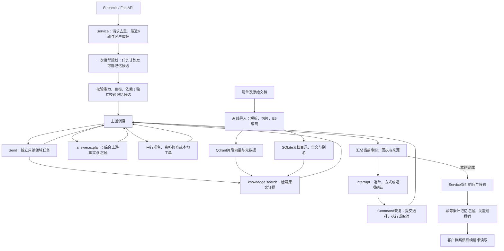

# 电商客服架构（阶段5）

阶段5在原有唯一持久化主图上增加本地知识检索、自动回复记忆及转换展示。DeepSeek `deepseek-flash`负责规划与资料回答，保持非思考、非流式；本地E5 Small负责向量编码，Qdrant负责检索。订单、支付、退款、工单及随附知识资料均为模拟数据，没有真实资金或人工通知渠道。

## 当前调用链

图中检索和综合说明均是既有`expert`节点内按operation分支执行的任务，不是新增的独立LangGraph节点；记忆写入在Service中完成，不是另起Memory Agent。DIRECT或CLARIFY没有业务任务，也沿原主图汇总并在完成后处理候选。

## 模块与能力边界

- `planning.py`：能力登记、Pydantic任务契约及规划提示；格式错误最多修复3次。附带最多两条经过独立校验的记忆候选，错误项丢弃，不使业务计划失效。
- `orchestrator.py`：唯一主图；只读任务按需并行，准备和写入业务串行。查询事实先取数，`answer.explain`综合依赖证据；`knowledge.search`只检索，不调用回答模型。
- `service.py`：请求记录、展示快照、图启动与恢复、客户偏好快照和完成后的记忆写入；持有同目录知识库的共享文件锁。
- `actions.py` / `tools.py`：金额、订单归属与资格重查，动作幂等及事务更新；本地FAQ保留旧五类和system帮助，规划提示要求平台/商品问题走知识检索。
- `memory.py` / `storage.py`：成对历史消息、候选校验、四类偏好、三次观察阈值、证据去重与撤销。手动回复/联系偏好与自动记忆分开存储。
- `knowledge.py`：四类文件解析、离线清单同步、商品别名定位、SQLite目录及本地E5/Qdrant；`scripts/ingest_knowledge.py`是同一逻辑的命令入口。
- `dialogue.py`：复用回答风格、DeepSeek联网搜索、基于资料回答及知识来源校验；不是通用事实证明器。
- `app.py` / `api.py`：共用Service。页面展示任务、来源、记忆进度和资料全文；API另提供记忆读取/撤销、文档分页/详情，不提供上传发布。

完整订单详情由订单、支付两个领域取数，单查物流或支付只调用必要领域。旧的独立Agent工具循环、独立确认图和退款解析辅助组件保留，当前聊天入口不经过它们。

## 任务、确认与业务事实

任务包含task_id、operation、targets或target_from、source_text、depends_on、conditions及intent；知识任务另含query、knowledge_kind、product_ref和category。前置引用只指向已排列在前的任务，禁止循环；同内容任务合并。知识检索必须有后置`answer.explain`依赖，平台/商品问题是否正确被规划仍需检查轨迹，不能仅靠结构校验保证语义识别。

独立只读任务通过Send并行，结果按task_id合并。准备、工单及资金执行串行；条件不满足、事实不足或前置未成功时跳过依赖项，保留独立任务结果。任务成功值为succeeded；请求completed只表示本轮结束，不表示每项成功。

支付方式共用card、visa、alipay、wechat_pay、paypal选项表，模型不选择method。当前任务的必要选择完成后才可逐项按钮确认；聊天“确认”不执行资金动作。无编号的独立退款先选本人订单，不用历史订单号自动代办。选单可退者优先、同组编号升序，默认前三笔；尚未提交的页面草稿不跨进程保存。

order_status和payment_status分开解释，placed不代表未付款。退款仍只检查本人订单、已付款、正余额、无已有退款及placed/delivered，不检查文档中的七日、品类和包装要求。知识政策不直接修改后端资格。退款requested仅表示申请已记录，只有明确人工/投诉诉求才创建本地工单。

## 知识库与证据回答

清单是整套当前知识库的声明：登记文档才导入，未登记的旧文档从目录和向量索引移除，原文件不删除。支持TXT、MD、文字PDF、DOCX，没有OCR、在线上传、混合检索或重排序。随附200条政策和200件商品全部虚构，十笔业务订单没有因此扩充。

E5 Small在CPU上输出384维归一化向量；文档使用passage前缀、问题使用query前缀。模型缓存在数据目录models中，导入可下载，运行时只读本地缓存；Qdrant是独立数据库服务，不是另一个语言模型。Compose只启动Qdrant，应用Dockerfile另行定义，配置与持久卷说明统一见[README第3、11节](README.md#3-环境准备)。

商品身份按规范化后的名称、型号、编号和登记别名精确匹配，歧义或缺少商品引用时要求明确对象；可复用上游订单结果中唯一的商品名称。普通向量查询召回12项，按文档/章节去重最多留6项，预算允许时补全短章节。每次检索及跨任务综合分别限制知识内容到6000个E5 tokenizer tokens，不是整份DeepSeek输入的精确预算。分类概览只各取一条示例，不声称覆盖全部细则。

综合任务传入原文和必要业务事实，去除整份工具轨迹的重复内容。知识回答要求answer/source_ids/insufficient结构，检查来源编号属于本轮证据及部分UUID引用一致性；失败返回可核验回答生成失败提示。来源合法仍不能证明每句推论忠实。模型使用命中片段在线回答，整个系统不是完全离线。

应用共享锁与导入独占锁要求维护窗口。校验、解析、模型准备先行；索引写入阶段记录importing，异常后failed，核对片段数后ready；搜索只接受ready。前期校验失败可保留旧ready索引。未变化文件跳过编码，失败后重试或指纹变化按代码重新编码/重建。版本字段仅作标签，没有按生效日期或历史版本隔离。

## 短期记忆与长期偏好

展示最近50条聊天请求，规划输入取其中最近6个completed轮次，最多12条用户/助手消息，不带完整工具消息；请求记录不因展示裁剪而删除。新会话不继承旧聊天及订单指代，同一客户的偏好继续读取。

同次规划提取detail、format、language、tone候选，证据必须逐字来自本轮用户原话；表单保存不计观察次数。完成原聊天请求后，明确set可直接生效，observed按同一用户/类别/值的三个不同请求证据升级；初次、第二次保留candidate，同一请求不重复计数。每类只有一个当前状态，归一同义值依赖模型，不是语义聚类或历史画像版本库。

较旧时间不覆盖较新设置，观察记录不覆盖明确设置或撤销状态；新观察未满阈值不替换已生效记忆。forget保留revoked，后续新明确设置可重新启用。手动字段与自动记忆一起作为数据传给模型，尚无统一的字段级冲突解析器；偏好不授予业务权限。

响应中的memory.status=applied表示已检查候选，不等于全部升级。记忆写入失败保留pending并记录日志，重放原请求可补写，不回滚已完成业务；没有后台补写队列。资金原请求须等全部确认或取消结束后才处理记忆。

记忆页展示候选1/3、2/3、有效/撤销记录及原话、自然语言表达示例和最近六条请求的提取状态。没有实际候选时为空，不写入演示数据。五组77轮脚本留在前端，资料路径和导入说明统一到README。

## 持久化、初始化与限制

业务库保存订单、支付、退款、工单、requests与pending_actions；记忆库保存会话、手动档案、memories及memory_evidence；检查点库按客户/会话/原请求派生thread_id；知识SQLite保存全文、别名与索引状态，向量另在Qdrant。配置与清理列表见[README第9～10节](README.md#9-memory-的设计)。

主图采用SqliteSaver与sync持久化，选择和确认通过Command恢复原计划，等待节点无业务副作用。动作编号绑定稳定任务/订单/类型，业务变更和动作结果同事务提交；响应丢失时可恢复，旧卡不推进下一项。未完成节点内模型和只读调用可能重做，不承诺逐模型调用断点恢复。

停止服务并手动删除业务、记忆、检查点库后，启动新建当前结构并在订单表为空时填十笔样例；正常重启不重置。删除知识目录或向量数据后另行导入，删除模型缓存还需重新下载；清空整个data前也需停止Qdrant。没有旧库迁移、归属回填、归档或历史版本隔离。

客户A拥有1001～1007、B拥有1008～1010；编号是可编辑演示身份，无真实认证。进程内RLock不能保护多实例并发；Unix文件锁使原生Windows当前不可直接运行。没有真实资金、真人通知、在线知识发布或十万片段性能保证。

## 验证与未验证范围

当前离线回归记录为161项通过：含原业务、恢复、权限、记忆证据/进度/撤销和文档导入/检索测试。离线测试使用假模型、固定向量和Qdrant SDK本地内存模式，不证明实际服务性能。[阶段5问答记录](eval/results/memory-rag-live.json)保存三组真实E5＋DeepSeek问答及一条偏好记录；本地Qdrant容器另已检查400份资料导入、政策/商品检索和页面ready。

阶段4的22组及36次重复报告是历史证据。`eval/run_eval.py --dry-run`只检查操作登记，非dry-run会调用真实模型；该脚本尚未初始化临时知识库，不能直接视为阶段5完整RAG评估。五组77轮是手工脚本，未标为全部真实执行通过。应用Docker镜像构建、完整应用容器流程、原生Windows和十万片段压测均未完成验证。
