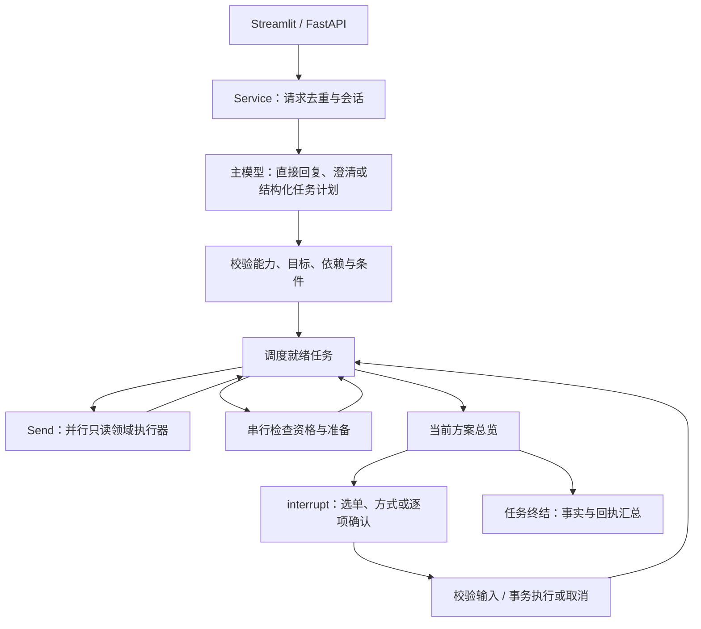

# 电商客服架构（阶段4）

使用DeepSeek `deepseek-flash`，保持非思考、非流式与现有密钥配置。所有订单、支付、退款和工单均为本地模拟。

## 模块与能力边界

- `planning.py`：Pydantic任务契约与能力登记。入口模型一次拆解完整请求，格式错误最多修复3次；引用只允许指向前置任务，不能有循环。
- `orchestrator.py`：唯一持久化主图。领域执行器先确定性调用订单、支付、退款工具，保证本轮确实查数。FAQ与搜索取资料后使用模型组织说明；`answer.explain`根据上游证据进行跨任务解释，不增加业务写权限。
- `service.py`：请求记录、最近6个完成轮次、图启动和恢复、结果与快照；不再单独解释混合请求或启动第二套业务流程。
- `actions.py`：后端金额、资格及归属重查、动作幂等、支付退款与动作结果的同事务提交。
- `dialogue.py`：共享回复风格、依据资料组织回答、DeepSeek搜索。
- 页面与API共用Service。参与者和任务轨迹来自实际执行结果，不把每个程序节点称为自主模型Agent。

完整订单详情由订单和支付两个领域取数后汇总；单查物流或支付只调用必要领域。退款资格规则内部继续读取所需业务表，不因表数量而拆分专家。旧的独立专家工具循环函数保留为底层组件，生产聊天不经过旧单路由图；`confirmation.py`仅保留底层确认组件测试，主流程确认由主图负责。

## 任务与调度

任务有稳定task_id、operation、targets或target_from、source_text、depends_on、conditions和intent。条件只比较受支持字段，不执行模型代码；任务成功状态固定为succeeded。领域与操作白名单由程序验证，资金准备只接受prepare意图。

独立只读任务通过Send并行；准备、工单和资金执行串行。结果按task_id合并，避免覆盖回复和Token。单项业务拒绝、查询错误不抹掉独立结果；条件不满足或前置失败时跳过依赖项。上游订单列表与资格结果可以作为后续目标，不为11～16号样例单独编写流程。

## 事实与交互

- order_status与payment_status分开解释，placed只表示已下单。状态、金额、支付方式和动作回执由程序构造；模型说明不能替代业务事实。
- 支付方式只有一份选项表：card、visa、alipay、wechat_pay、paypal。模型不提供method；用户在窗口选择，随后逐项按钮确认。支付表method是记录值，不限制新选择。
- 收集当前所有必要选择后才开放确认；总览列出各动作，只有当前动作可确认。未来依赖项先显示等待，前置执行后自动继续。
- 无编号的独立退款先选本人订单；原条件任务已绑定的订单不重新猜测。只查询不准备，取消一项不执行该项。
- 候选可退款优先、同组编号升序，默认前三笔；不合格项无开关。绿色为符合条件或处理中，拒绝红色，其他蓝色。
- 聊天“确认”不是资金执行入口。工单必须有明确人工/投诉授权，技术失败不升级。

## 持久化与恢复

每条原请求对应稳定的客户/会话/请求thread_id。整张主图使用SQLite Checkpointer与sync持久化，选择和确认通过Command恢复同一计划；等待节点没有业务副作用。

业务库保存requests、pending_actions和业务事实；记忆库保存偏好、当前会话和展示快照；检查点库保存计划和节点进度。动作编号同时包含稳定任务/订单/类型位置，已执行结果重放，旧卡不推进下一项。执行重查资格与归属，不新增版本或改价分支。

恢复到节点/任务边界；未完成节点内的只读查询或模型调用可能重做。资金操作依赖事务结果防重。响应丢失可从检查点恢复，不再规划订单或方式。展示50轮、模型历史6个完成轮次，Token按聊天请求累计。

## 初始化与限制

用户手动删除全部数据库后启动：创建当前结构并填一次初始样例。正常重启、刷新、切换客户/会话：保留订单、聊天、已提交选择及待确认退款，不覆盖seed。

不实现旧数据库迁移、结构修复、归属回填、历史归档或版本隔离。客户编号仍是演示身份，A拥有1001～1007，B拥有1008～1010；不是生产认证。仅支持单进程。没有真实资金、真实人工通知、完整RAG或Docker端到端保证。

## 验证

`python -m pytest -q`为离线测试，不使用真实API。`python eval/run_eval.py --dry-run`只检查样例能力；去掉dry-run使用全新临时合成库调用真实DeepSeek。`--case 11 12 --repeats 3 --report /tmp/results.json`用于指定组合重复评估，报告保留全部任务、轨迹、动作与断言。样例11～16用于验收，不限定组合能力。
