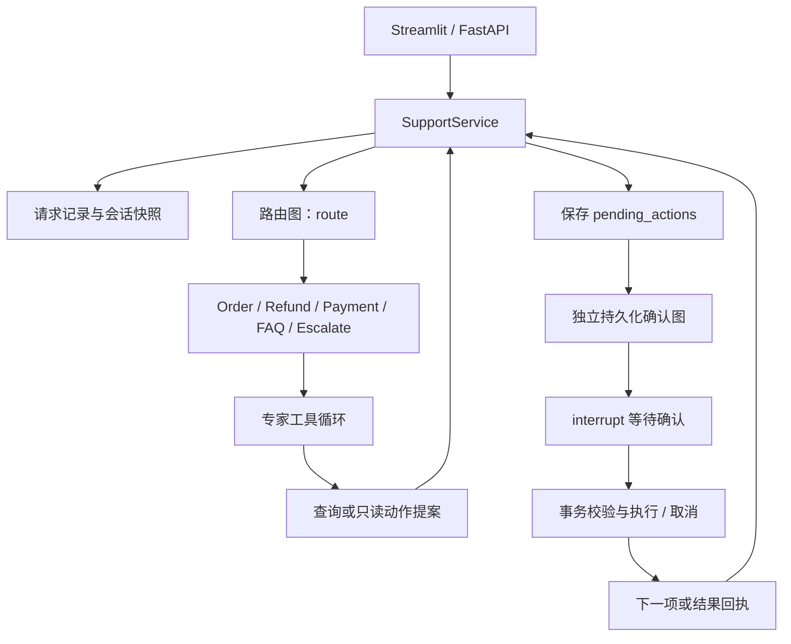

# 电商客服架构

应用仅调用 DeepSeek `deepseek-flash`，以 ChatOpenAI 使用 OpenAI 格式 Chat Completions。固定非思考、非流式，SDK不重试。订单、资金与人工工单都是本地样例。

## 核心模块

- app.py：聊天气泡、偏好编辑、逐项确认卡；直接调用Service，不通过HTTP。
- api.py：聊天、请求查询、恢复决定接口。
- src/service.py：请求编号、输入冲突检查、历史组织、模型调用、动作准备、图启动与恢复、结果存储。
- src/orchestrator.py：原始单路由专家图，一轮只选一个专家；异常立即重试一次。
- src/agents/base.py：模型和工具循环，无数量或重复限制；保留白名单、参数校验与ToolMessage配对。
- src/agents：专家提示词与受限工具。退款/支付只暴露prepare工具，不能直接写业务状态。
- src/actions.py：稳定动作编号、后端金额、方案版本、确认前业务校验、事务执行和结果回放。
- src/confirmation.py：wait → execute → wait或summarize；使用interrupt，取消也只处理当前项。
- src/backend/db.py：业务ORM、PendingAction与RequestRecord；src/tools.py包含业务操作及FAQ。
- src/storage.py：不含mode的会话快照、偏好、旧空表升级。
- src/llm.py：DeepSeek单客户端工厂、usage提取。

## 请求生命周期

1. `SupportService.chat`按用户和request_id查重，核对相同输入；新请求进入requests。
2. 恢复最近订单与最近6个已完成轮次，临时注入用户偏好。
3. `run_orchestrator`选择一个专家；`run_tool_agent`执行查询或prepare工具。
4. 无提案直接保存结果；有提案时`prepare_action`从数据库读取金额并幂等保存动作。
5. Service启动独立确认图，以服务端派生thread_id绑定SQLite Checkpointer；interrupt返回当前卡。
6. `SupportService.resume`校验请求、动作、版本与决定，保存决定记录后恢复对应图。
7. `decide_action`在同一业务事务内校验、写入、保存终态结果；重复执行返回原结果。
8. 金额变化时动作版本递增并重新中断；否则逐项推进。最终回执不再调用模型。

两个图由Service连接：路由图本身没有节点级持久化；确认图有。路由失败可能重新进行只读模型规划，确认后则根据检查点和动作结果恢复，不重新决定业务参数。

## 存储边界

- business.sqlite：业务表、requests、pending_actions。动作终态result承担业务执行日志，和资金状态同一事务提交。
- memory.sqlite：sessions展示快照和profiles。requests是聊天与响应的权威来源；快照可重建。
- checkpoints.sqlite：确认图状态。Service拥有连接，通过close释放。

每条聊天一个request_id，每次确认一个操作request_id。图thread_id由用户和原聊天编号稳定派生；客户端不能直接选择。相同编号不同内容拒绝；旧卡重放不推进下一项。展示保留50轮，请求日志不随展示裁剪，Token按聊天记录汇总。

## 能力与验证边界

模型使用语义路由和工具选择，FAQ内容是五个固定topic共15组样例问答，没有RAG。退款必须送达且无已有申请，支付只允许pending及card/paypal。金额变更需重新确认，不使用模型提供的权威金额。

客户编号不是认证，订单没有归属鉴权。支持单进程部署，不能依赖本轮设计协调多个应用实例。工具循环没有总费用上限。自动测试不联网，真实DeepSeek与Docker验收需另行进行。docs下旧Word和图片不表示当前实现。
