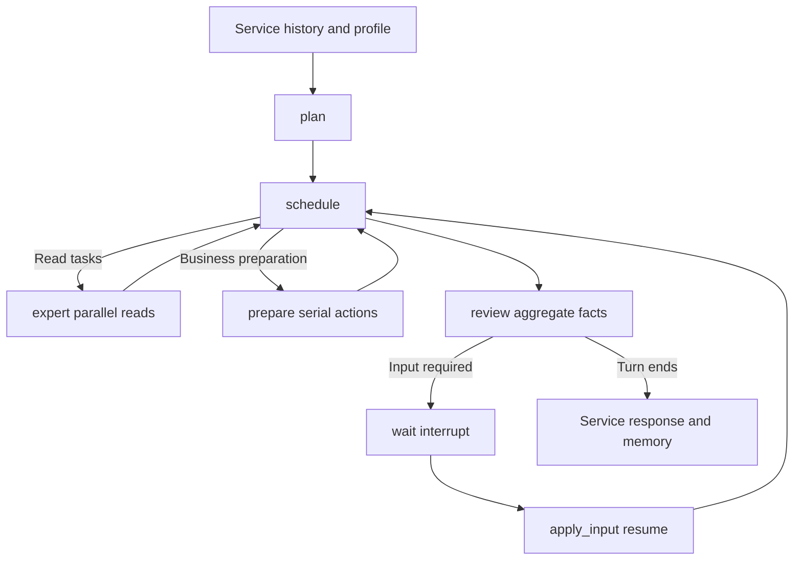

# Ecommerce Support Assistant

English · [中文](README.md)

A local Streamlit and FastAPI application built around one persistent LangGraph workflow. DeepSeek plans requests; controlled domain executors query orders, prepare payments and refunds, retrieve knowledge, search the web, or create local tickets. Users confirm financial actions individually.

**All customers, orders, payments, refunds, tickets and supplied documents are fictional. No real money or notifications are sent.** Architecture is described in sections 8–9. The [implementation deep dive](docs/Ecommerce_Agent_Deep_Dive.en.docx) explains business flows in detail.

## 1 What the application provides

- Order and payment facts, shipment queries and refund eligibility checks.
- Independent read-only tasks in parallel, conditional dependencies, and continuation after confirmation.
- Customer-scoped conversations, persistent preferences and evidence-backed memory.
- Local multilingual E5 embeddings and Qdrant retrieval, with source excerpts.
- Read-only document browsing and DeepSeek web search.

Editable customer IDs simulate identities; there is no authentication. Platform policies explain rules but do not change the local refund eligibility implementation. A recorded refund request is not proof of settlement.

## 2 Files and reading order

### 2.1 Current files and responsibilities

```text
ecommerce-support-agent/
  app.py                    Streamlit configuration, identity/session controls and page assembly
  api.py                    FastAPI request models and service endpoints
  ui/
    chat.py                 Messages, order selection, payment methods and confirmation cards
    memory.py               Preference categories, evidence, revocation and manual profile form
    knowledge.py            Catalog filters, pagination and document reading
    guide.py                Loads Markdown usage and acceptance scenarios
    i18n.py                 Chinese/English presentation translations
    __init__.py             Package marker
  src/
    service.py              Shared application service, request replay and graph recovery
    orchestrator.py         The single persistent collaboration graph
    planning.py             Capability registry, task validation and model planning
    tools.py                Order/payment/refund tools, FAQ adapter and local tickets
    actions.py              Prepared actions, transactional execution and replay
    dialogue.py             Grounded composition, reply checks and web search
    payment_methods.py      Shared payment method identifiers and labels
    llm.py                  DeepSeek client and token usage extraction
    errors.py               Local retry helper
    storage.py              SQLite sessions, profiles, evidence and preference state
    memory.py               Paired history, candidate validation and observation threshold
    knowledge.py            Parsing, manifest import, product identity and E5/Qdrant search
    runtime_context.py      Request, customer and profile ContextVars
    logging_config.py       Optional JSON logging; not enabled automatically by the entrypoints
    confirmation.py         Retained independent confirmation graph; unused by the main graph
    refund_flow.py          Retained refund intent and explicit-order parsing helpers
    agents/
      base.py               Text/token helpers and standalone tool loop
      order_agent.py        Standalone order agent and tool wrappers
      payment_agent.py      Standalone payment agent and tool wrappers
      refund_agent.py       Standalone refund agent and tool wrappers
      faq_agent.py          Policy lookup and standalone FAQ entrypoint
    backend/
      db.py                 SQLAlchemy tables, connections and initialization
      seed.py               Ten sample orders and their initial states
    __init__.py             Package marker; agents/backend also have package markers
  tests/                    Isolated offline business, API, recovery and UI regressions
  scripts/                  Import, live UI and cross-process checks
  eval/                     Scenario runner and historical evaluation reports
  knowledge/                Manifest and 400 fictional policy/product documents
  docs/                     Current implementation guides, usage scenarios and reference images
  README.md / README.en.md  Setup and behavior
  IMPROVE*.md               Phase history and verification results
  requirements.in          Top-level dependency ranges
  requirements.txt         Pinned dependency snapshot
  pytest.ini               Test paths
  Dockerfile               Application image
  compose.yaml             Qdrant service only
  .streamlit/config.toml    Light theme
  .env.example              Configuration template
  .gitignore/.dockerignore  Local secrets and runtime exclusions
  LICENSE / NOTICE.md       Licensing and modification notice
```

### 2.2 Suggested reading order

Start with app/API, then service, planner and orchestrator. Read tools/actions for permissions and state transitions, storage/memory for persistence, and knowledge/dialogue for retrieval and citations. Tests show expected behavior.

### 2.3 Active and retained components

The current app and API use `SupportService` and `build_workflow()`. The standalone agents and independent confirmation graph remain for reference and tests; they do not execute the main request workflow. Shared helpers and FAQ policy lookup are reused.

## 3 Environment setup

Use Python 3.11 on macOS/Linux. Native Windows is not supported because the service and importer use Unix file locks; use WSL2. The complete WSL2 flow has not been verified.

### 3.1 Install and start

Configure DeepSeek as described in section 6. Start Docker before importing knowledge.

```bash
python3.11 -m venv .venv
source .venv/bin/activate
python -m pip install -r requirements.txt
docker compose up -d qdrant
python -m scripts.ingest_knowledge --root ./knowledge
python -m streamlit run app.py
```

Wait for import success before starting the app. The importer downloads missing E5 weights, creates embeddings and synchronizes the knowledge stores. The app alone does not initialize RAG. Open [the local UI](http://127.0.0.1:8501).

### 3.2 Windows

Run the Linux commands inside WSL2 with access to Docker. Do not run this dependency snapshot as a native Windows installation.

### 3.3 Using uv

```bash
uv venv --python 3.11
uv pip install --python .venv/bin/python -r requirements.txt
uv run --no-project --python .venv/bin/python streamlit run app.py
```

Qdrant and knowledge import are still required.

### 3.4 Verify the interpreter

```bash
python --version
python -c "import sys; print(sys.executable)"
```

Install and run with the same virtual environment.

### 3.5 Reset and rebuild

For a business/conversation reset, stop Streamlit and FastAPI, then manually remove `business.sqlite`, `memory.sqlite`, `checkpoints.sqlite` and any associated WAL/SHM/journal files from the configured data locations. Keep the knowledge SQLite, model cache, lock file and Qdrant data. Restarting alone preserves state; a new conversation does not reset orders.

Before clearing the entire data directory, also stop Qdrant. Restart Qdrant, run the import command, wait for `ready`, then start the app. Removing model caches requires a download again. The supplied corpus imports 400 documents and 200 products.

## 4 A walkthrough

Use `customer_a`: query order 1002's shipment and order 1003's payment; prepare payment for 1003, choose a method and confirm; then query its details and refund eligibility. Request a refund only when ready and confirm the current action. Ask a platform policy question and inspect its sources. Save a lasting response or shopping preference, start a new conversation, and verify it persists. Inspect task progress and tool traces throughout.

Use the sidebar language selector for Chinese or English controls. It does not translate stored replies, evidence or source documents, and it does not change the customer's lasting response-language preference.

## 5 Verify without opening a browser

```bash
python -m pytest -q
python scripts/check_ui.py
python scripts/check_restart.py
python eval/run_eval.py --dry-run
```

Pytest uses offline doubles and isolated data. The two check scripts use real models and incur requests.  Manual scenario instructions are not a report that every step passed.

The evaluation runner creates temporary business/session data but does not import a temporary knowledge corpus. It is not a complete RAG evaluation. Historical model reports are under `eval/results/`.

Run three long conversations with `python eval/run_long_conversations.py --report eval/results/long-conversations-new.json`. This uses the real API, existing Chinese knowledge index and isolated synthetic business data, including interactions and replay. Import the corpus first; calls incur charges. See the [records](eval/results/README.en.md).

## 6 Connect the online model

Copy `.env.example` to `.env` only on first setup; edit existing files rather than overwriting secrets.

```dotenv
DEEPSEEK_API_KEY=your-key
DEEPSEEK_BASE_URL=https://api.deepseek.com
DEEPSEEK_MODEL=deepseek-flash
```

DeepSeek handles planning and grounded answers; E5 handles local embeddings. The client uses Chat Completions, temperature 0, a 60-second timeout and disabled thinking. Technical calls have local retries, and invalid plans can receive three repair attempts. Availability and pricing depend on the provider.

Web search shares the key and base URL and requires `/v1/tools/search`. Chat Completions compatibility alone does not guarantee search support. Search requests allow five results with a 15-second timeout.

| Variable | Default and purpose |
| --- | --- |
| `SUPPORT_DATA_DIR` | Project `data/`; default business/session/checkpoint/knowledge files and model cache |
| `SUPPORT_AGENT_DB_URL` | Empty; overrides only the business database |
| `SUPPORT_QDRANT_URL` | `http://127.0.0.1:6333` |

Export data settings **before Python starts**. Database imports can occur before dotenv loading; editing only `.env` cannot reliably relocate all stores. Import and app must use the same configuration. Compose's `./data/qdrant` volume is configured separately.

```bash
SUPPORT_DATA_DIR=/absolute/path/support-data python -m streamlit run app.py
```

Restart after configuration changes. Never commit `.env`.

## 7 Use FastAPI

```bash
python -m uvicorn api:app --host 127.0.0.1 --port 8000
```

See [interactive API documentation](http://127.0.0.1:8000/docs). Health checks do not test the model or index.

| Endpoint | Purpose |
| --- | --- |
| `POST /chat` | Start a request; return reply, tasks, sources and action state |
| `GET /requests/{request_id}` | Read a saved request using customer and session IDs |
| `POST /requests/{chat_request_id}/select-orders` | Submit or cancel order selection |
| `POST /requests/{chat_request_id}/select-payment-method` | Select or cancel a payment method |
| `POST /requests/{chat_request_id}/resume` | Confirm or cancel the current action |
| `GET /users/{user_id}/memories` | Read profile and memory evidence/state |
| `DELETE /users/{user_id}/memories/{key}` | Revoke one of the seven memory categories |
| `GET /knowledge/documents` | Filter and paginate the catalog |
| `GET /knowledge/documents/{document_id}` | Read document metadata and full text |

```bash
curl -X POST http://127.0.0.1:8000/chat \
  -H 'Content-Type: application/json' \
  -d '{"user_id":"customer_a","session_id":"case_api","request_id":"query_001","message":"Track order 1002"}'
```

New messages use new request IDs; retries reuse the original. Deduplication is per customer and request ID, even across sessions. Messages allow up to 2000 characters; POST bodies reject extra fields.

Selections reference the returned input ID. Confirmation references the current action ID. Recovery URLs retain the original chat request ID, while each decision has its own request ID. Available methods are `card`, `visa`, `alipay`, `wechat_pay`, `paypal`. Selecting a method is not payment authorization.

Processing chat responses use 202; most saved responses use 200. Request validation typically uses 422, conflicts 409, chat service validation 400 and propagated runtime errors 503. Business refusal can still use 200: inspect tasks and actions. Invalid IDs on memory reads are not consistently mapped to client errors. There is no authentication or upload endpoint; avoid concurrent writers to the same session.

## 8 How LangGraph collaboration works

### 8.1 Planning and scheduling

`SupportService.chat()` first checks customer/request replay, then supplies six completed turns and the profile. The graph runs plan → schedule → expert or prepare → schedule → review. Review ends the turn or interrupts in wait; Command resumes through apply_input and returns to schedule. Duplicate tasks are merged; dependencies reference earlier tasks and current-input quotes support task intent.




The model directly answers, clarifies or creates validated domain tasks. Independent reads can run in parallel; action preparation is serial. Dependencies must succeed and conditions must hold. Knowledge retrieval returns evidence for a later synthesis task. Model plans are not business facts.

### 8.2 Confirmation and rules

Refunds require an owned, paid order with a positive balance, no existing refund and a `placed` or `delivered` order state. Payments require `pending`. Tools recheck eligibility during preparation and execution. Only the current action can be confirmed. Business changes and action results commit together; duplicate decisions replay saved results.

### 8.3 State layers

A completed request may contain failed or skipped tasks. Cancellation does not satisfy a success dependency. Order progress and payment state are separate. Policies do not automatically change tool eligibility. Explicit human intervention or a formal complaint creates a local ticket; technical errors do not.

### 8.4 Local knowledge and citations

The supplied corpus contains 200 fictional policies and 200 fictional products. Multilingual E5 Small runs on CPU with 384-dimensional normalized vectors; Qdrant stores vectors and excerpts, while SQLite stores full documents and aliases. Product identity matches normalized IDs, names, models and aliases exactly; semantic retrieval does not replace identity matching.

Ordinary search retrieves 12 candidates and keeps up to six distinct document/section results. Evidence is limited to 6000 E5 tokenizer tokens per retrieval and synthesis budget, not the entire model prompt. Citation checks verify source IDs, not sentence-level truthfulness. Missing knowledge is not silently replaced by web search.

### 8.5 Import external material

Support UTF-8 TXT/Markdown, text PDFs and DOCX. There is no OCR or spreadsheet importer. Register product IDs/names/models/aliases and document IDs/files/titles/kinds/categories/versions in `manifest.json`. Product documents reference registered product IDs. Paths must stay inside the source directory.

```json
{"products":[{"id":"MY-001","name":"Headphones","model":"H01","aliases":["Wireless Headphones"]}],"documents":[{"id":"MY-DOC-001","file":"headphones.md","title":"Headphones manual","kind":"product","category":"Headphones","version":"1","product_id":"MY-001"}]}
```

Stop the app and API, keep Qdrant running, then import:

```bash
python -m scripts.ingest_knowledge --root ./my_knowledge
```

The manifest describes the **entire current corpus**. Documents omitted from it are removed from the catalog and vector index; source files are not deleted. Reimport after edits. Unchanged documents skip encoding. Failed index writes block search until repaired; earlier validation failures can leave an old ready index available. Version labels do not implement historical policy isolation.

Chinese and English questions share the existing Chinese corpus and manifest. The existing planning call can split compound questions and produce equivalent Chinese search queries, without a separate translation call. Product references still require exact IDs, models, registered names or aliases; an optional English article is ignored. English policy overviews are supported. Generated answers follow explicit current-turn language instructions, then active language preferences, otherwise the question's main language. Source titles and original text stay Chinese; interface language only changes controls. Cross-language retrieval can still miss evidence and must acknowledge gaps.

## 9 Memory design

### 9.1 Separate stores

Business SQLite holds orders, payments, refunds, tickets, requests and pending actions. Memory SQLite holds session snapshots, current sessions, profiles and evidence. Graph checkpoints are separate. Knowledge SQLite and Qdrant serve different retrieval roles.

### 9.2 Recent orders

Recent order IDs come from accessible tool facts, not generated prose. A single recent order can produce a last-order value; multiple orders do not imply a unique target.

### 9.3 New sessions

New sessions do not inherit order references or conversation history. Preferences remain customer-scoped. Unspecified standalone refund requests require explicit order selection rather than automatically using a historical order.

### 9.4 Context window

The UI retains the latest 50 turns; planning uses the latest six completed turns. Request records are not deleted by UI trimming. There is no automatic summary or exact full-prompt token budget.

### 9.5 Preferences are data

Preferences cannot authorize payment, bypass ownership or prove business facts. Manual response/contact settings are stored separately from automatically extracted memories. Unsubmitted UI drafts are not durable across processes.

### 9.6 Response preferences

Candidates are extracted during the existing planning call. Categories cover detail, structure, language and tone; shopping memory includes three categories. Each candidate needs a quote from the current input; at most one per category and seven total are accepted.

Explicit lasting requests activate immediately. Observed same-category/same-value evidence needs three distinct requests. Synonym normalization depends on the model. Observations do not override explicit or revoked settings. Writes occur after the whole original request completes, including confirmations. Failures retain a pending write for original-request replay without rolling back business actions.

### 9.6.1 Shopping preferences

Brand, category and budget each have one current summary. Active shopping preferences require an explicit change. Temporary requirements, gifts and purchases should not create permanent preferences. Current requirements take precedence. Budget retains its stated scope; product data has no brand/price fields to prove a match. 

## 10 Initialization and reset

Importing tools initializes tables and seeds ten orders only when the order table is empty. A owns 1001–1007; B owns 1008–1010. Initially A can refund 1001/1006 and pay 1003; B can refund 1009 and pay 1008. Sample amounts have no currency column. Running the seed module explicitly overwrites the sample rows; it is not a routine restart command.

Use the reset procedure in section 3.5. Preserve the complete E5 cache, not isolated weight files. Qdrant is a database service, not a language model; DeepSeek weights are not downloaded locally.

## 11 Deployment

Use a persistent absolute data directory and a single application writer. Public deployment requires authentication, HTTPS, backups and operational controls that are not implemented here.

Compose starts only Qdrant, with host port 6333 and `./data/qdrant` storage. The Dockerfile separately builds the Streamlit application on port 8501; it neither starts Qdrant nor imports knowledge. Containers must access Qdrant through a Docker network and share the complete initialized data directory. Full application-image deployment has not been verified.

Hosted Python platforms need persistent storage and long-running connections. Multi-instance operation requires shared business/session/checkpoint storage and concurrency control. Supabase is not a replacement for the Python runtime; PostgreSQL adaptation has not been implemented. Vercel would require a separate web frontend and hosted Python API.

## 12 Further improvements

Authentication; real payment providers and reconciliation; preference normalization and correction; reproducible RAG quality/scale evaluation; observability and full input budgeting; deployment compatibility.

## 13 Troubleshooting

- Dependency failures: check the interpreter and install using that interpreter.
- Missing knowledge: stop the app, start Qdrant and reimport; check matching data settings.
- Unchanged answers after source edits: reimport the manifest.
- Locked input: finish selection, confirmation or cancellation; retry the original processing request when needed.
- Unexpected eligibility: inspect current payment/refund facts and previous demo changes.
- Missing conversations: restore the same customer, session and data directory.
- Model/search errors: check configuration, provider access and network; errors do not create human tickets.
- Qdrant version warnings: the pinned client and Compose server differ; alignment still needs verification.

## 14 Project description

This is an ecommerce support application backed by fictional local data. The model interprets requests and composes explanations; code controls ownership, eligibility, confirmation and state updates. Knowledge documents support explanations, and preferences guide conversation. No real payment, logistics or human notification service is connected.

This README describes use, architecture and data relationships. The [implementation deep dive](docs/Ecommerce_Agent_Deep_Dive.en.docx) explains business logic and implementation. Static images are reference material; the current source and this document define actual behavior. See LICENSE and NOTICE.md for licensing and modification information.
