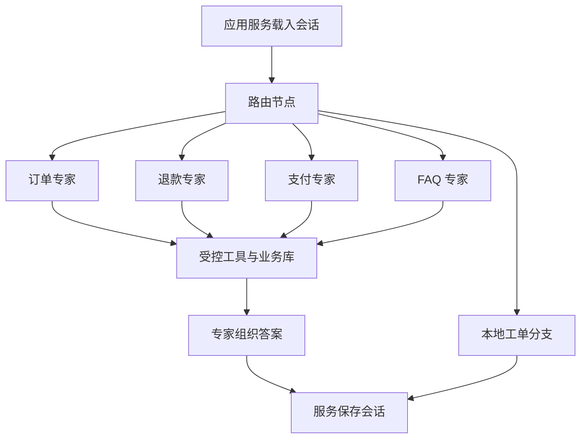

# 电商订单与售后助手

一个可以本地运行的小型多 Agent 业务应用。用户询问订单、退款、支付或商店规则时，LangGraph 路由器选择相应专家，专家通过工具查询或修改 SQLite 业务数据。应用按会话保存最近讨论订单组，未指定订单的退款先查询本人全部订单并通过开关选单；客户偏好则独立保存，供新会话继续读取。

应用仅使用 DeepSeek `deepseek-flash` 在线模型，通过 OpenAI 格式的 Chat Completions 判断意图、选择工具并生成回答。已移除 demo 和运行模式切换。支付、退款先生成待确认方案，用户逐项确认后才修改本地样例数据；等待选单或确认时当前会话暂停输入，其他客户会话不受影响。

**所有订单、客户、支付和退款均为本地样例，不连接真实电商、支付、物流或人工客服平台。** 操作会改变样例数据库，但不会产生真实扣款、退款或通知。

## 1 先理解项目提供什么

| 能力 | 当前实现 | 边界 |
| --- | --- | --- |
| 多 Agent | 路由器选择订单、退款、支付、FAQ 专家 | 每轮选择一个专家，不是并行团队 |
| 工具调用 | 专家循环调用受限工具，再组织答案 | 模型仍可能选错参数；工具负责校验 |
| 业务规则 | 退款统一检查付款、已有退款、余额及已下单/已签收状态；支付只接受 pending | 不是完整真实商家退款规则 |
| 会话 Memory | 展示最近 50 轮，保存最近订单与累计 Token；请求记录独立保留 | 路由图不做节点恢复；确认图另有持久化检查点 |
| 长期客户偏好 | 按客户编号保存回复与联系偏好 | 用户明确填写，模型不自动更新；不会实际发消息 |
| 上下文 | 最近 6 个完整用户轮次与会话内订单组 | 不是精确 Token 预算或摘要系统 |
| 异常升级 | 重试后生成本地工单并保存 | 没有真人接单或外部通知 |
| 客户范围 | 页面、当前会话、偏好及订单按客户隔离 | 编号可编辑，仅为本地身份切换，没有登录认证 |
| FAQ | 模型选择配送、退货、取消、退款、联系五类 topic，读取 15 组样例问答 | 不是文档 RAG 或语义搜索 |
| 操作确认与幂等 | 支付、退款逐项确认，按请求编号和动作结果重放 | 单实例验证，不等于真实资金渠道的完整幂等 |

可以把本项目理解为“业务工具可验证、多角色切换可观察、记忆生命周期清楚”的独立应用。不要把它当成已经可以公开处理真实客户订单的生产系统。

## 2 目录与阅读顺序

```text
ecommerce-support-agent/
  app.py                      中文 Streamlit 页面
  api.py                      FastAPI 接口
  src/
    orchestrator.py            LangGraph 路由与专家节点
    agents/
      base.py                 通用工具调用循环
      order_agent.py          订单专家
      refund_agent.py         退款专家
      payment_agent.py        支付专家
      faq_agent.py            规则问答专家
    llm.py                    DeepSeek 客户端与 Token 提取
    actions.py                待确认动作、事务执行与结果回放
    confirmation.py           持久化确认图与暂停恢复
    service.py                请求去重、上下文组织、确认恢复与结果保存
    storage.py                会话与客户档案 SQLite 存储
    memory.py                 历史消息与最近订单逻辑
    runtime_context.py        请求标识与客户偏好上下文
    tools.py                  业务工具与本地工单
    errors.py                 重试与升级
    backend/
      db.py                   数据表与连接
      seed.py                 10 笔样例订单及状态
  tests/                      业务、协议、确认恢复与页面回归用例
  scripts/check_ui.py         真实模型页面交互检查
  scripts/check_restart.py    真实模型跨进程会话检查
  eval/                       路由评估脚本与基线样例
  docs/                       历史深挖文档与架构图
  ARCHITECTURE.md              当前架构与调用链
  improve.md                   本轮改进需求与验收依据
  requirements.txt            本次验证的精确依赖
  requirements.in             顶层依赖范围
  Dockerfile                  单实例容器入口
  .env.example                配置模板
  LICENSE                     必要版权与开源许可
  NOTICE.md                   修改范围与版本标识
```

建议先运行，再按 `service.py → orchestrator.py → agents/base.py → tools.py → storage.py` 阅读。先确定数据从哪里来、写到哪里，再研究提示词。

## 3 环境准备

推荐使用 Python 3.11，首次安装需要可用的包下载网络和数百 MB 空间；正常使用需要 DeepSeek API Key 和模型服务网络。本轮已在 macOS 的独立 Python 3.11 临时环境完成依赖安装与自动化测试。

解压后进入包含 `app.py` 的目录，后续命令均从这个目录运行。不要在另一个虚拟环境安装依赖后，又用系统解释器启动页面。

### 3.1 macOS 或 Linux

```bash
python3.11 -m venv .venv
source .venv/bin/activate
python -m pip install --upgrade pip
python -m pip install -r requirements.txt
python -m streamlit run app.py
```

### 3.2 Windows PowerShell

```powershell
py -3.11 -m venv .venv
.\.venv\Scripts\Activate.ps1
python -m pip install --upgrade pip
python -m pip install -r requirements.txt
python -m streamlit run app.py
```

如果激活脚本被执行策略阻止，直接使用解释器即可：

```powershell
.\.venv\Scripts\python.exe -m pip install -r requirements.txt
.\.venv\Scripts\python.exe -m streamlit run app.py
```

依赖快照对 `uvloop` 增加了 Windows 排除标记。Windows 的完整安装未在本次环境实测；如遇原生扩展安装问题，先确认 Python 版本、CPU 架构与可用 wheel。

### 3.3 使用 uv

```bash
uv venv --python 3.11
uv pip install --python .venv/bin/python -r requirements.txt
uv run --no-project --python .venv/bin/python streamlit run app.py
```

Windows 将解释器路径换成 `.venv/Scripts/python.exe`。没有 uv 时使用标准 venv 即可，不必额外引入依赖管理工具。

### 3.4 检查实际解释器

```bash
python --version
python -c "import sys; print(sys.executable)"
python -c "import langgraph, streamlit, sqlalchemy; print('依赖导入成功')"
```

第二条应显示当前 `.venv` 中的解释器。建议始终使用 `python -m pip`、`python -m streamlit`，减少命令指向不同环境的问题。

按第 6 节填写模型配置后，启动并访问 `http://localhost:8501`。客户编号默认为 `customer_a`，会话编号为 `case_1`。按 Ctrl+C 停止服务。默认会在项目 `data` 目录自动创建数据库并填入样例，不需要单独执行初始化。

## 4 第一遍完整体验

### 4.1 保存客户偏好

进入“记忆与客户偏好”，填写：

- 回复偏好：简洁，先结论后解释。
- 联系偏好：优先站内文字联系。

点击“保存客户偏好”。下方 JSON 应显示刚保存的值。它由应用直接写库，不需要模型抽取。在线模型每次执行专家前读取档案，也不会因为联系偏好而发送消息。

### 4.2 查询订单与跨专家指代

进入“客服对话”，依次输入：

> 查询订单 1002 的物流。

> 帮我申请退款。

第一轮返回订单 1002 的 shipped 状态。第二轮未指定退款订单，因此查询本人全部订单并展示选择列表，不自动沿用 1002。可退款订单按订单号优先排列，其余订单按订单号排列；默认显示前三笔，勾选“查看我的全部订单”后显示全部。不可退款订单只显示信息及原因，不提供开关。

可以反复切换可退款订单的开关；选择后点击准备，或先取消选单，再输入明确的订单退款请求。

### 4.3 明确新编号覆盖旧上下文

继续输入：

> 帮我申请订单 1001 的退款。

显式编号优先于最近订单组。样例订单 1001 已送达且没有已有申请，系统会先在当前消息下显示订单、金额和动作。点击“确认办理”后，对应退款行才从 `none` 改成 `requested`；点击“取消本项”则不修改退款。再次申请不应生成第二条同订单退款。

确认卡跟随当前聊天消息显示，等待期间禁用该会话输入。一个专家可为多个订单准备方案，系统逐项确认；取消只影响当前项。刷新或重启后可继续处理。待确认方案的金额和参数固定，当前个人验证不支持外部修改支付金额，因此不再使用操作版本号。订单归属已由后端校验；公开部署前仍需增加真实身份认证。

### 4.4 查看与办理本地支付

输入：

> 查询订单 1003 的支付状态。

预期为 `pending`。再输入：

> 帮我付款。

系统沿用 1003，查询后通过 `prepare_payment` 准备方案；点击“确认办理”后，执行节点才调用业务写入，将样例状态改为 `paid`。重复确认回放已有结果。这里只改变本地数据库，没有支付网关、银行卡扣款或资金清算。

### 4.5 规则问答与工单

输入：

> 退货政策是什么？

FAQ 专家调用规则工具，返回样例规则。本次已将退货说明与实际执行规则对齐：统一检查支付已完成、有可退余额、无已有退款，且订单为已下单或已签收，没有实现完整退货期限、商品类别和包装状态判断。

再输入：

> 我要投诉这个问题。

预期进入升级分支，生成并保存一条本地待处理工单。页面会明确说尚未连接人工通知渠道。生成编号不等于真人已接单。

### 4.6 验证 Memory 生命周期

停止并重启页面，保持相同数据目录、客户编号和会话编号。已保存的对话、最近订单、Token 累计及待确认操作应能恢复。

点击“新建会话”：旧对话与最近订单不自动继承，但客户偏好仍然存在。这样可以避免新问题在没有明确编号时，错误地沿用上一次售后事项中的订单。

将客户编号改为 `customer_b`：首次显示 B 的空白独立页面，只能访问 1008–1010。A 只能访问 1001–1007。切回 A 恢复 A 最后使用的会话与待确认退款，再回 B 恢复 B 的会话。新建会话只影响当前客户；客户当前会话指针持久保存。


### 4.7 多订单退款与可反复切换的选择

查询“1001和1006”后输入“退款”：查询本人全部订单，可退款优先、同组按订单号排列，默认只显示前三笔；可退款订单的开关默认不选，可反复切换，其他订单只展示原因。勾选“查看我的全部订单”后显示全部。选择后点击“准备所选订单退款”，仅此时生成待确认动作；零选择不能提交。选单期间可切换客户，回到原客户保留草稿；完整刷新或进程重启后草稿默认全不选，选单阶段仍可恢复。

直接输入“退款1006和1005”：1006 自动准备并等待确认，1005 返回 ALREADY_REFUNDED。同轮逐单汇总，确认后仍保留被拒绝订单的原因。询问“1006能退款吗”只查询，不准备申请。

## 5 不打开页面也能验证

```bash
python -m pytest -q
python scripts/check_ui.py
python scripts/check_restart.py
```

`pytest` 使用测试模型或模拟 HTTP，并在隔离数据库中验证业务逻辑，不调用真实 DeepSeek。`check_ui.py` 和 `check_restart.py` 使用临时数据目录，但会调用真实模型，需要配置 Key，并会产生模型请求。

本轮在隔离数据目录完成 100 项自动化测试，全部通过；第一阶段原有 78 项测试已按客户身份与新退款政策调整，并新增权限、多选、批量结果及客户页面切换测试。具体结果见 improve.md。覆盖业务工具与 API、Memory 恢复、显式订单覆盖、工具参数校验，以及新增的逐项确认、取消、请求重放、并发确认、检查点恢复、响应丢失恢复和页面交互。

上述自动化测试不调用真实在线模型，不能据此推导真实模型的路由准确率、退款意图识别率或响应费用。真实 DeepSeek 调用、真实电商渠道、Docker 镜像与云部署没有完成端到端实测；在线检查脚本需另行运行。

## 6 接入在线模型

应用仅使用 DeepSeek 在线模型，先复制配置模板。

macOS/Linux：

```bash
cp .env.example .env
```

Windows：

```powershell
Copy-Item .env.example .env
```

填写 `.env`：

```dotenv
DEEPSEEK_API_KEY=你的密钥
DEEPSEEK_BASE_URL=https://api.deepseek.com
DEEPSEEK_MODEL=deepseek-flash
SUPPORT_DATA_DIR=data
SUPPORT_AGENT_DB_URL=
```

模型可用性、配额和收费以服务提供方当前说明为准。模板中的模型名只是配置起点，不能保证某个账号一直可用。不要把 Key 写进源码或 README。

页面和 API 均直接使用在线模型，不再传入 mode。改环境变量后重启进程，避免导入时读取的配置仍是旧值。

`src/llm.py` 使用 `ChatOpenAI` 连接 DeepSeek 的 OpenAI 格式 Chat Completions，固定关闭 thinking 和 Responses API，单次请求超时 60 秒。已移除 Gemini、Groq 和模型池轮换。若以后更换兼容端点，仍应验证 `bind_tools`、消息格式、结果回传和 usage 字段，不能只改模型名。

客户端 SDK 本身的重试设为零，外层业务流程默认最多尝试两次，失败后立即重试，不再等待三秒。确认阶段根据检查点和已保存的动作结果恢复；正常 interrupt 不作为失败处理。

## 7 使用 FastAPI

```bash
python -m uvicorn api:app --host 127.0.0.1 --port 8000
```

健康检查：`http://127.0.0.1:8000/health`。

交互文档：`http://127.0.0.1:8000/docs`。

请求示例：

```bash
curl -X POST http://127.0.0.1:8000/chat \
  -H 'Content-Type: application/json' \
  -d '{"user_id":"customer_a","session_id":"case_api","request_id":"query_001","message":"查询订单 1002 的物流"}'
```

同一客户、会话再发一个新的请求编号：

```bash
curl -X POST http://127.0.0.1:8000/chat \
  -H 'Content-Type: application/json' \
  -d '{"user_id":"customer_a","session_id":"case_api","request_id":"refund_001","message":"帮我申请退款"}'
```

Windows PowerShell 可使用：

```powershell
$body = @{user_id='customer_a'; session_id='case_api'; request_id='query_001'; message='查询订单 1002 的物流'} | ConvertTo-Json
Invoke-RestMethod -Uri 'http://127.0.0.1:8000/chat' -Method Post -ContentType 'application/json; charset=utf-8' -Body $body
```

省略会话编号时生成新编号；后续请求必须复用返回值，才能沿用上下文。响应提供 `reply`、`agent`、`trace`、`usage` 和 `cached`。当前完整 FAQ 模型回答不缓存，因此 `cached` 通常为 false；纯规则查询另有内部缓存。

响应另提供 `request_id`、`status`、`actions` 和 `current_action`。同一 request_id 与相同输入重发会返回已有状态或结果，不重复调用模型；内容冲突返回 409。省略 request_id 会生成新编号，需要重试去重时应由客户端提供稳定编号。已移除的 mode 字段返回 422。

`GET /requests/{chat_request_id}?user_id=customer_a&session_id=case_api` 查询原请求状态。前面的无订单号退款示例进入 awaiting_selection。先通过选单接口取消本轮，或使用另一个会话发送明确的订单 1001 申请，再使用返回的动作编号确认：

```bash
curl -X POST http://127.0.0.1:8000/chat \
  -H 'Content-Type: application/json' \
  -d '{"user_id":"customer_a","session_id":"case_api","request_id":"refund_002","message":"帮我申请订单 1001 的退款"}'

curl -X POST http://127.0.0.1:8000/requests/refund_002/resume \
  -H 'Content-Type: application/json' \
  -d '{"user_id":"customer_a","session_id":"case_api","request_id":"confirm_001","action_id":"返回的动作编号","decision":"confirm"}'
```

恢复接口路径使用原聊天的 `refund_002`，请求体中的 `confirm_001` 是这次决定的新编号。取消使用 `decision=cancel`；同一次决定重试应复用它自己的 request_id。

状态为 `processing` 时返回 202，`awaiting_confirmation` 或 `completed` 时返回 200。恢复目标或决定冲突返回 409，参数错误返回 422，模型配置缺失返回 503。业务资格拒绝作为正常业务结果返回。

API 和页面使用同一数据目录时能读到已保存会话，但若作为两个独立进程同时修改同一会话，进程内锁不能防止相互覆盖。当前推荐单入口、单实例运行。不要将无认证接口直接暴露为处理真实订单的公网服务。


多订单选单响应增加 `status=awaiting_selection` 和 `selection`（本人候选订单及近期订单编号）。提交选择：

```http
POST /requests/{chat_request_id}/select-orders
Content-Type: application/json

{"user_id":"customer_a","session_id":"case_api","request_id":"selection_001","decision":"submit","order_ids":[1006,1005]}
```

取消使用 `decision=cancel`。列表须非空、去重后属于候选集合；参数错误为 422，阶段或候选冲突为 409。同一操作编号相同内容重试返回已有结果。响应 `order_results` 保存每笔资格、准备、确认及取消结果。退款原因码包括 ORDER_NOT_ACCESSIBLE、ALREADY_REFUNDED、REFUND_IN_PROGRESS、UNPAID、NO_REFUNDABLE_BALANCE、STATUS_NOT_ELIGIBLE 和 ELIGIBLE。

## 8 LangGraph 多 Agent 怎样工作



图状态 `SupportState` 保存本轮消息、历史、路由结果、回答、轨迹、专家名和 usage。路由结果只能进入五个允许分支；识别出多个互相冲突的标签或没有合法标签时进入升级分支。

本轮只选择一个专家。订单、支付和 FAQ 专家内部是“模型提出工具调用 → 程序执行 → ToolMessage 回传 → 模型继续”的循环。退款分支则由模型识别意图，服务确定订单、展示多选或逐单执行资格查询与准备。下一轮可以选择另一位专家，所以订单查询后能切换退款处理。

这不是两个专家之间直接 handoff，也没有并行子任务汇总。不要把图中的每个节点都叫成 Agent：数据库更新、重试、会话保存是普通程序职责。

### 8.1 工具调用边界

订单专家可以查订单详情、状态与物流；退款分支由模型识别申请/查询意图，程序确定订单、逐单检查并准备方案；支付专家可以查支付状态并准备支付方案；FAQ 专家只能查询规则。支付和退款的实际写工具不再绑定给模型，由确认后的执行节点调用。

`agents/base.py` 根据工具名称建立当前专家的允许集合。未知工具、额外参数会产生错误结果回传给模型，不会执行任意函数。LangChain 工具 Schema 再检查必填字段和类型。

已移除四轮工具批次、每批六个请求和重复签名停止的限制。模型可以持续请求合法工具，直到不再产生工具调用。同批工具依次执行；单次模型调用的超时不等于整个循环的费用或耗时预算。

模型结束工具调用但未产生最终文本时，代码可能回退到最后一个工具结果；包含动作提案时则明确返回尚未执行的提示。这不代表业务操作已经完成。

### 8.2 规则必须在工具里重查

退款分支确定申请意图后，由程序遍历用户明确指定或选中的订单。资格检查、准备和确认执行复用同一规则：本人订单、支付已完成、无已有退款、有正余额、状态为 placed 或 delivered。整单退款依据支付金额，使用 Decimal 按分比较。

退款表对订单编号唯一，状态更新必须匹配 `none`。支付更新必须匹配 `pending`。多次或并发请求只有一次能完成对应状态变化。

在这些状态保护之外，`requests` 保存聊天与确认请求，`pending_actions` 保存方案和最终结果。业务变更与动作结果在同一事务内提交，重复确认回放已有结果；最终办理回执不再依赖模型总结。这是本地请求与动作的幂等处理，不代表外部资金一致性。

服务在路由图之后启动独立确认图：`等待确认（interrupt）→ 校验执行或取消 → 下一项或结果回执`。确认图使用 SQLite Checkpointer；恢复时校验动作编号，旧卡重放不会确认下一项。原路由图仍不保存节点检查点。

## 9 Memory 的设计

### 9.1 三类数据分开保存

| 数据 | 文件或位置 | 键与范围 | 作用 |
| --- | --- | --- | --- |
| 订单、支付、退款、工单 | data/business.sqlite | 订单或工单编号 | 业务事实，工具直接读写 |
| 聊天及确认请求、响应、累计 Token 来源 | data/business.sqlite 的 requests | user_id + request_id | 请求重放与聊天展示的权威记录 |
| 对话展示快照、最后订单、累计 Token | data/memory.sqlite 的 sessions | user_id + session_id | 缓存最近 50 轮展示与最近订单组 |
| 待确认方案及执行结果 | data/business.sqlite 的 pending_actions | action_id | 确认、事务执行与结果回放 |
| 确认图检查点 | data/checkpoints.sqlite | 服务端派生的 thread_id | 跨请求和重启恢复确认流程 |
| 客户当前会话 | data/memory.sqlite 的 current_sessions | user_id | 页面切换与重启后恢复各自会话 |
| 客户回复与联系偏好 | data/memory.sqlite 的 profiles | user_id | 跨会话档案 |
| 本轮路由与工具消息 | LangGraph 状态与专家局部变量 | 本次 invoke | 本轮执行过程，不单独逐节点保存 |

会话快照与档案仍由 SupportStore 保存；聊天展示从 requests 重建。确认图通过 SqliteSaver 保存检查点，使用 interrupt 暂停、Command(resume=...) 恢复；路由与专家内部工具循环不做节点级持久化。因此能恢复待确认和确认执行阶段，不能宣称任意模型步骤都可续跑。

### 9.2 最近订单如何产生

服务按完整用户轮次汇总显式订单列表、订单区间和成功工具结果，经后端归属过滤后保存 `recent_order_ids`。不使用模型回答中的订单号，也不使用最后一次工具调用决定退款对象。

订单组只有一笔时提供兼容字段 `last_order_id`；多笔时该字段为空。退款使用原始用户输入解析意图，程序决定目标。无明确对象时返回 `awaiting_selection`，查询本人全部订单，可退款优先、同组按订单号排序；默认前三笔，可展开全部，不合格订单没有选择开关。

### 9.3 为什么新会话不自动沿用订单

“上次看的订单”并不一定是“本次售后要处理的订单”。把 last_order_id 限制在会话内，能减少把新任务写到旧订单上的风险。客户回复偏好可以跨会话共用，因为它的含义更稳定，也不会直接选择某一笔业务操作对象。

### 9.4 上下文窗口与保留策略

会话展示最多保留最近 50 轮，包括处理中和待确认轮次；模型每次最多读取最近 6 个已完成轮次，即 12 条 HumanMessage/AIMessage。requests 不随展示裁剪而删除，但仍不能视为完整业务审计系统。专家本轮内部的工具消息不会作为未配对的片段保存为下一轮模型历史。

输入最多 2000 字符。当前没有对长工具输出做总 Token 精确预算，也没有自动摘要。最近六轮可能遗漏重要旧约束；会话订单组与显式选单能缓解订单指代问题，但不能替代完整上下文管理。

### 9.5 偏好是数据 不是执行指令

客户档案进入专家系统提示的事实区域，明确标识为数据。ContextVar 只在单次服务调用期间绑定，结束后恢复，避免当前客户档案残留到下一位客户。

这不等于完整提示注入防护，也不等于认证上下文。客户编号仍可手动切换，但业务工具、准备、执行与结果读取均校验该客户的订单归属。接入真实业务前仍需从经过认证的身份确定客户。

## 10 数据初始化 观察与重置

首次启动会在空业务库中自动填入 10 笔样例订单。常用状态如下：

| 订单 | 订单状态 | 支付状态 | 初始退款状态 | 演示用途 |
| --- | --- | --- | --- | --- |
| 1001 | delivered | paid | none | 可申请本地退款 |
| 1002 | shipped | paid | none | 未送达，拒绝退款 |
| 1003 | placed | pending | none | 可办理本地支付 |
| 1004 | delivered | paid | requested | 拒绝重复退款 |
| 1005 | cancelled | refunded | completed | 已退款不能再次支付 |

正常重复运行不会重置已改的状态。单独运行 `python -m src.backend.seed` 会按样例覆盖业务行，所以不要把它当成每次启动的固定步骤。

个人验证采用手动重置：先完全停止页面与 API，删除实际数据目录中的 business.sqlite、memory.sqlite、checkpoints.sqlite 及其 SQLite 附属文件，再重启。配置了 SUPPORT_AGENT_DB_URL 时，业务库以该地址为准。也可以使用全新的 SUPPORT_DATA_DIR。不要在服务运行时删除数据库。

保留现有自动建表和空订单表填充逻辑，不新增旧结构识别、迁移、归档、修复或完整性检查；本轮不安排数据库损坏、缺表与旧版本兼容专项测试。

只读观察数据库：

```bash
python - <<'PY'
import sqlite3
with sqlite3.connect('data/business.sqlite') as db:
    print(db.execute('SELECT order_id,status,reason FROM refunds ORDER BY order_id').fetchall())
    print(db.execute('SELECT order_id,status FROM payments ORDER BY order_id').fetchall())
    print(db.execute('SELECT ticket_id,status FROM tickets').fetchall())
PY
```

这是 macOS/Linux Shell 示例。Windows 可将 Python 段保存为 `inspect_db.py` 后运行。自定义数据路径时同步修改查询路径。不要在示例中记录或展示真实客户信息。

## 11 部署方式

### 11.1 固定服务器

```bash
python -m streamlit run app.py --server.address=0.0.0.0 --server.port=8501
```

使用稳定的绝对数据目录。公开服务需要 HTTPS、真实身份验证、订单授权、备份和日志策略。当前代码适合本地或受控演示，不提供这些生产能力。

### 11.2 Docker

```bash
docker build -t ecommerce-support-agent .
docker run --rm -p 8501:8501 --env-file .env -v ecommerce-agent-data:/app/data ecommerce-support-agent
```

命名卷保存业务库、记忆库和确认图 Checkpoint。需要通过环境配置提供 DeepSeek Key。容器文件夹本身不能替代持久卷；删除卷会丢失数据。Docker 构建在本次环境未实测。

### 11.3 托管 Python 平台

需要平台支持长运行 Python、Streamlit 所需连接以及持久卷。启动命令和端口按平台要求配置，数据目录指向卷挂载点。只有临时文件系统的平台不能保证重启后状态保留。

多实例部署前应将会话和业务库迁移到可共享数据库，处理并发会话更新、连接池与事务。当前 RLock 只在一个服务对象、一个进程内有效。

### 11.4 Supabase 与 PostgreSQL

Supabase 可以作为 PostgreSQL 和认证后端，但不能直接代替 Python Agent 运行环境。

迁移有两条独立路径：

1. 业务层：SQLAlchemy 模型与连接迁移，重新初始化数据表，核对唯一约束、事务和金额类型。
2. 记忆层：SupportStore 目前使用 SQLite 的 `?` 占位符和特定 upsert，需改连接管理、SQL 与并发更新策略。

再把页面可编辑客户编号改成服务端从认证令牌获得的身份，沿用现有订单归属校验。确认图目前使用独立的 SQLite Checkpointer；迁移到共享数据库时，还需迁移检查点后端并处理并发恢复。路由图并不因此自动获得节点级恢复。

### 11.5 Vercel

当前 Streamlit 应用不是静态网页，不能直接作为静态项目上传。若需要 Vercel 前端，可改为 Next.js 页面，通过 FastAPI 调后端 Agent 服务；数据库和身份系统另行持久化。这是二次架构改造，交付包没有包含该前端实现。

## 12 可以继续完成的优化

### 12.1 增加真正的订单权限

本轮已增加 customer_id 与全链路归属检查。后续需要把本地客户编号切换替换为服务端认证身份；不再把订单归属校验列为尚未实现的能力。

### 12.2 增加人工确认和请求级幂等

本轮已实现：支付和退款先生成 pending_action，在当前聊天消息下显示订单、金额和动作，逐项确认后才执行。确认图使用持久化 checkpointer、interrupt 和恢复接口；等待确认节点不包含不可重复业务副作用。

本轮使用 request_id 和 requests 表记录请求；pending_actions 的终态 result 承担动作结果日志职责，未另建 action_log 表。重复请求或确认回放已有状态和结果，业务变更与动作结果同事务提交。后续接真实资金渠道时，还需要供应商幂等、回调、对账和补偿机制。

### 12.3 给 Memory 增加纠错和版本

让用户可以更正最近订单、撤回偏好、查看来源与更新时间。本轮已实现订单组和显式选单；后续可增加上下文来源、更新时间与用户纠错。

为档案添加版本号、写入依据和用户确认。不要把模型猜测直接写成长期事实。对旧会话清理要区分会话快照、业务审计、客户删除请求和必要留存。

### 12.4 增加政策 RAG

新增资料导入、切块、索引、检索、引用和版本字段。先用关键词检索建立可评估基线，再考虑向量与重排。退货政策回答应展示来源和生效时间；检索到的政策不能自动替代工具里的执行规则。

不要把本项目的字典 FAQ 直接称为完整 RAG。真正的业务规则变化，还需要配置化规则引擎或受控代码更新，并验证回答与执行保持一致。

### 12.5 改进多意图与协作

当前每轮只能选一个专家。“查订单并比较退款和支付方案”可能需要拆解。可以增加计划状态、显式子任务和汇总节点，并规定写操作必须串行、只读查询才适合并行。

先评估增加协作是否提高完成率，避免为了展示更多节点而增加模型费用。增加 Agent 不等于增加可靠性。

### 12.6 改进费用和错误观测

记录 request_id、模型、专家、工具耗时、重试次数、Token 与最终结果。不要把所有输入和密钥写到日志。当前 usage 在 SDK 未返回时为空或零，不是准确费用账单；FAQ 纯查询缓存也不会跳过路由与专家模型调用。

把错误区分为参数错误、业务拒绝、可重试网络错误、配额错误和程序错误。路由阶段的整图重试仍较粗；确认阶段已根据检查点和动作结果恢复，后续可进一步细分错误与重试策略。

### 12.7 提示优化与参数微调

先建立固定评估集：订单指代、显式新编号、退款资格、支付状态、无订单、投诉、多个意图、额外参数和提示注入。分别评估路由正确、参数正确、工具结果忠实度与执行结果，不只看文字流畅。

先修工具、状态和上下文，再改提示。只有在有足够优质样本、稳定失败模式和可微调服务时，再研究 SFT 或 LoRA。当前没有训练脚本，也不会通过保存客户偏好自动训练模型。

## 13 常见问题

| 现象 | 常见原因 | 处理方式 |
| --- | --- | --- |
| 导入失败 | 使用了不同解释器 | 检查 sys.executable，用当前环境安装 |
| 在线请求失败 | Key、模型、配额或协议不可用 | 检查 DeepSeek 配置；缺 Key 会明确报错，工单不代表模型接入成功 |
| 订单 1001 不能再次退款 | 之前演示已改成 requested | 检查数据库，或换新数据目录 |
| 重启后对话不见 | 编号或数据目录改变 | 使用原客户、会话和目录 |
| 新会话没有最近订单 | 设计上不跨会话继承 | 明确输入订单编号 |
| 输入框暂时不可用 | 当前会话正在处理或等待确认 | 先继续处理、确认或取消当前动作 |
| SQLite locked | 多进程或长事务争用 | 单实例运行，或迁移数据库 |
| 模型一直调用工具 | 模型持续产生工具请求 | 当前没有批次、数量或重复检测上限；检查提示、工具结果与模型行为 |
| 工单没人处理 | 没有外部人工渠道 | 这是本地记录，需另接工单系统 |
| 订单不存在或无权访问 | 当前客户不拥有该订单 | 检查客户编号，A 为 1001–1007，B 为 1008–1010 |

## 14 项目说明与验证边界

可以准确描述为：基于 LangGraph 实现电商售后多专家路由，通过受控工具完成本地订单、退款、支付和规则查询；将会话指代记忆、跨会话客户档案与业务事实分离，并验证重启读取和并发状态保护。

当前不能描述为真实支付退款、完整 RAG、生产级认证、任意节点断点恢复、自动接通人工客服，或填写没有测量的准确率与费用优化比例。当前架构、确认恢复与取舍说明见 `ARCHITECTURE.md`；`docs/Ecommerce_Agent_Deep_Dive.docx` 及静态图片保留为历史参考。

必要开源版权与许可见 `LICENSE`，整理范围见 `NOTICE.md`。说明文档与普通源码不包含仓库链接或作者宣传信息。
