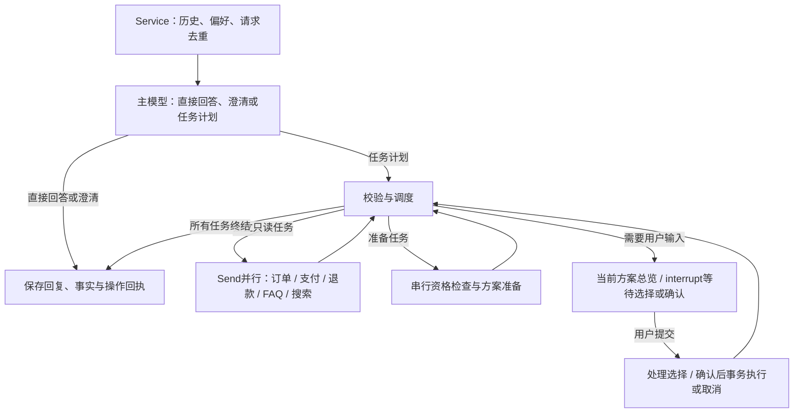

# 电商订单与售后助手

一个可以本地运行的小型多 Agent 业务应用。主对话层结合历史直接回答、澄清，或将业务请求拆成多个领域任务，交给订单、支付、退款、FAQ及搜索执行器按需协作。独立只读任务可以并行，存在条件或先后关系的任务按依赖执行；支付、退款由用户逐项确认后才修改 SQLite 业务数据。应用按会话保存最近讨论订单组，未指定订单的独立退款申请先查询本人全部订单并通过开关选单；客户偏好则独立保存，供新会话继续读取。

应用使用 DeepSeek 在线模型，默认 `deepseek-flash`，通过 OpenAI 格式的 Chat Completions 生成任务计划及资料回答。主图按能力登记调用领域工具，订单、支付、退款查询不再分别运行一轮模型选工具。已移除 demo 和运行模式切换。支付、退款先生成待确认方案，用户逐项确认后才修改本地样例数据；等待选单或确认时当前会话暂停输入，其他客户会话可独立使用。

**所有订单、客户、支付和退款均为本地样例，不连接真实电商、支付、物流或人工客服平台。** 操作会改变样例数据库，但不会产生真实扣款、退款或通知。

最近功能更新见 [优化成果](improve.md)：阶段4完成按需多专家协作、统一持久化主图、条件调度、混合方案和确认后续跑，并修复支付方式与付款后查订单的状态解释。各项成果保留最新阶段编号；完整调用链见 [架构说明](ARCHITECTURE.md)。

## 1 先理解项目提供什么

| 能力 | 当前实现 | 边界 |
| --- | --- | --- |
| 主对话与多 Agent | 主层生成结构化任务，支持只读并行、依赖和条件，确认后继续原计划 | 领域专家在主图中以受控执行器实现；不要求每个专家独立调用模型 |
| 工具调用 | 领域执行器先调用受控工具，政策、搜索和综合解释由模型组织说明 | 模型仍可能选错参数；工具负责校验 |
| 订单详情与支付事实 | 完整详情由订单、支付两个领域分别取数，区分订单状态、支付状态和支付方式 | `placed`只表示已下单，不能推断是否付款 |
| 混合方案与续跑 | 收集当前必要选择，展示当前全部可准备方案；按钮确认后继续后续任务 | 后续依赖未满足时不提前准备，聊天“确认”不执行资金操作 |
| 业务规则 | 退款统一检查付款、已有退款、余额及已下单/已签收状态；支付只接受 pending | 不是完整真实商家退款规则 |
| 会话 Memory | 展示最近 50 轮，保存最近订单与累计 Token；请求记录独立保留 | 整张主图按节点持久化，未完成节点内调用可能重做 |
| 长期客户偏好 | 按客户编号保存回复与联系偏好 | 用户明确填写，模型不自动更新；不会实际发消息 |
| 上下文 | 最近 6 个完整用户轮次与会话内订单组 | 不是精确 Token 预算或摘要系统 |
| 模拟升级 | 明确转人工或正式投诉时生成原有本地工单 | 技术失败、含糊和闲聊不升级，没有外部通知 |
| 客户范围 | 页面、当前会话、偏好及订单按客户隔离 | 编号可编辑，仅为本地身份切换，没有登录认证 |
| FAQ | 程序读取单项、多项或全部政策，模型据此回答，理解“其他”“都告诉我” | 五类15组样例，不是RAG |
| 通用联网 | DeepSeek 搜索接口检索后由模型组织回答，显示来源链接 | 复用 DEEPSEEK_API_KEY；搜索与模型调用分别计费，失败不编造实时信息 |
| 操作确认与幂等 | 支付、退款逐项确认，按请求编号和动作结果重放 | 单实例验证，不等于真实资金渠道的完整幂等 |

可以把本项目理解为“业务工具可验证、多角色切换可观察、记忆生命周期清楚”的独立应用。不要把它当成已经可以公开处理真实客户订单的生产系统。

## 2 目录与阅读顺序

### 2.1 当前文件与职责

```text
ecommerce-support-agent/
  app.py                      中文 Streamlit 页面
  api.py                      FastAPI 接口
  src/
    service.py                页面与 API 共用的应用服务
    orchestrator.py            唯一持久化协作主图
    planning.py               能力登记、任务与条件契约、语义规划
    tools.py                  订单、支付、退款、政策和本地工单工具
    actions.py                待确认动作、事务执行与结果回放
    dialogue.py               依据资料回答、风格约束与联网查询
    payment_methods.py        页面与后端共用的支付方式表
    llm.py                    DeepSeek 客户端与 Token 提取
    errors.py                 模型调用局部重试
    storage.py                会话快照、客户当前会话与档案存储
    memory.py                 历史消息组件及保留的单订单上下文方法
    runtime_context.py        客户、请求编号与偏好的 ContextVar
    logging_config.py         可选 JSON 日志配置，入口未自动启用
    confirmation.py           独立确认图组件，当前主图不调用
    refund_flow.py            独立退款意图解析与订单号提取组件
    agents/
      base.py                 文本、Token 工具及独立工具调用循环
      order_agent.py          独立订单 Agent 与工具包装
      payment_agent.py        独立支付 Agent 与工具包装
      refund_agent.py         独立退款意图入口与工具包装
      faq_agent.py            政策读取函数及独立 FAQ 入口
    backend/
      db.py                   SQLAlchemy 数据表、连接与建表
      seed.py                 10 笔样例订单及状态
    __init__.py               src、agents、backend 均有包标识文件
  tests/                      业务、协议、确认恢复与页面回归用例
    conftest.py               隔离数据库、离线模型与测试适配
    fake_model.py             离线规划及工具调用测试模型
  scripts/
    check_ui.py               真实模型页面交互检查
    check_restart.py          真实模型跨进程会话检查
  eval/
    scenarios.json            当前22组场景；页面展示前16组
    run_eval.py               当前合成数据端到端评估入口
    eval_dataset.json         保留的旧单路由数据集，当前评估不读取
    results/                  阶段4初始失败、最终报告及说明
  docs/                       历史深挖文档与架构图
  README.md                   运行、代码导航与行为说明
  ARCHITECTURE.md              当前架构与调用链
  improve.md                   分阶段优化成果与验收记录
  requirements.txt            本次验证的精确依赖
  requirements.in             顶层依赖范围
  pytest.ini                  pytest 的模块路径与测试目录
  Dockerfile                  单实例容器入口
  .dockerignore               排除密钥、虚拟环境与运行数据
  .gitignore                  版本控制忽略规则
  .env.example                配置模板
  LICENSE                     必要版权与开源许可
  NOTICE.md                   修改范围与版本标识
```

`data/`、`.env`、`.venv/` 和缓存属于本地运行产物，不是需要复制到源码中的模块。文件树列出当前主要文件，测试用例按主题分布在 `tests/test_*.py`。

### 2.2 建议阅读顺序与实际入口

1. `app.py` / `api.py`：了解页面交互和接口请求。
2. `service.py`：了解请求去重、历史组织、结果保存和原请求恢复。
3. `planning.py`：了解可用能力、任务契约、条件校验和模型规划。
4. `orchestrator.py`：了解并行查询、串行准备、等待输入和确认后续跑。
5. `tools.py` / `actions.py` / `backend/db.py`：核对业务事实、归属、资格和事务更新。
6. `storage.py` / `memory.py` / `dialogue.py`：了解会话、偏好与资料回答。
7. `tests/` / `eval/run_eval.py`：对照离线断言与真实模型评估。

页面与 API 的业务入口都是 `SupportService`，其主图由 `build_workflow()` 构建。主图直接调用 `src/tools.py` 的领域函数，复用 `get_policies()`、`as_text()` 和 `sum_usage()`；**不经过 `run_order_agent()`、`run_payment_agent()`、`run_refund_agent()`、`run_faq_agent()` 或 `build_confirmation_graph()`**。这些独立组件仍在仓库中，阅读时应与当前入口区分。

### 2.3 主流程函数与类型索引

以下名称对应当前源码；以下划线开头的方法是内部实现，不是 HTTP 接口。

| 文件 / 类型 | 函数或方法 | 当前职责 |
| --- | --- | --- |
| `app.py` | `service()` | 缓存服务实例；页面布局、内嵌方式选择和动作确认在模块顶层执行 |
| `api.py` | `lifespan()`、`health()`、`chat()`、`get_request()`、`resume()`、`select_orders()`、`select_payment_method()` | 服务关闭、健康检查、聊天、读取原请求和三类恢复接口 |
| `api.py` | `ChatRequest`、`ResumeRequest`、`SelectOrdersRequest`、`SelectPaymentMethodRequest` | 四类请求契约，禁止额外字段；字段与错误码见第7节 |
| `service.py` / `SupportService` | `__init__()`、`close()`、`validate()` | 初始化存储与主图、关闭检查点连接、校验编号 |
| 同上 | `chat()`、`get_request()`、`resume()`、`select_orders()`、`select_payment_method()` | 应用公开入口：聊天、查状态、确认/取消、选单、选支付方式 |
| 同上 | `snapshot()`、`_scoped_response()`、`_load()`、`_save()` | 重建会话快照、重查结果归属、读取及保存请求结果 |
| 同上 | `_config()`、`_invoke()`、`_graph_result()`、`_submit()` | 图标识与调用、结果投影、统一提交恢复事件；`ConflictError` 表示请求或阶段冲突 |
| `planning.py` | `CAPABILITIES`、`Condition.check_status()`、`Task.check_operation()`、`Plan.check_dependencies()` | 能力登记；条件枚举、操作授权、重复任务与前置引用校验 |
| 同上 | `make_plan()` | 生成 `DIRECT` / `CLARIFY` / `PLAN`，校验本轮原文依据并修复格式 |
| `orchestrator.py` | `State`、`merge_results()`、`scope()`、`reset()` | 主图状态、按任务合并并行结果、绑定和恢复请求上下文 |
| 同上 | `plan_node()`、`facts_for()`、`matches()` | 生成计划、取某订单的事实、计算受控条件 |
| 同上 | `schedule()`、`dispatch()`、`expert()`、`prepare()` | 选择就绪任务、分发只读并行任务、执行查询、串行准备动作或建本地工单 |
| 同上 | `review()`、`after_review()`、`wait()`、`apply_input()` | 生成阶段响应、判断是否等待、执行 `interrupt`、处理选择或动作决定 |
| 同上 | `response()`、`build_workflow()` | 汇总任务、轨迹与确定性业务回执；连接并编译唯一主图 |
| `actions.py` | `prepare_action()`、`decide_action()` | 保存固定参数的待确认动作；重查资格并事务执行、取消或回放 |
| 同上 | `_amount()`、`_lock_transaction()`、`_serialize()` | 金额规范化、事务锁及动作序列化 |
| `tools.py` | `get_order_status()`、`get_order_details()`、`track_shipment()` | 查询原始订单字段或样例物流；详情函数本身不联查支付 |
| 同上 | `get_payment_status()`、`refund_eligibility()`、`check_refund_eligibility()` | 查询支付记录；在已有会话或独立会话中检查统一退款规则 |
| 同上 | `inaccessible()`、`owned_order()` | 统一不可访问结果和订单归属判断 |
| 同上 | `_process_payment()`、`_initiate_refund()` | 在调用方事务中执行条件更新，不自行提交；主图经 `decide_action()` 调用 |
| 同上 | `process_payment()`、`initiate_refund()` | 自行提交事务的底层包装；直接调用会改样例库，不提供页面确认流程 |
| 同上 | `answer_faq()`、`escalate_to_human()` | 读取本地政策字典、创建去重的本地待处理工单 |
| 同上 | `_ensure_seeded()`、`configure_db()`、`_session()` | 空订单表填样例、测试/评估切换引擎、创建数据库会话 |
| `dialogue.py` | `invoke()`、`compose()`、`search_web()`、`checked_reply()` | 模型调用、据资料回答、搜索和有限的工单声明检查；不是通用事实验证器 |
| `llm.py` / `errors.py` | `get_llm()`、`extract_usage()` / `call_with_retry()` | 创建模型客户端、提取 Token、局部失败重试 |

### 2.4 持久化、上下文与辅助组件索引

| 文件 / 类型 | 函数、方法或常量 | 当前职责 |
| --- | --- | --- |
| `storage.py` / `SupportStore` | `__init__()`、`connect()`、`current_session()` | 创建记忆表、连接 SQLite、读取或更新客户当前会话 |
| 同上 | `load_session()`、`save_session()`、`profile()`、`save_profile()` | 会话快照和跨会话客户偏好读写 |
| `memory.py` / `ConversationMemory` | `add_turn()` | 主服务用它把最近6个已完成轮次转换成成对历史消息 |
| 同上 | `update_last_order_id()`、`context_note()` | 保留的单订单上下文方法，当前主服务不调用；最近订单由任务事实重建 |
| `runtime_context.py` | `active_customer`、`active_profile`、`active_request` | 单次节点执行的客户、偏好和请求上下文；该模块无函数 |
| `payment_methods.py` | `PAYMENT_METHODS` | 五种模拟支付方式的编号与名称；该模块无函数 |
| `backend/db.py` | `Base`、`Order`、`Payment`、`Refund`、`Ticket`、`PendingAction`、`RequestRecord` | 业务、工单、待确认动作和请求表模型 |
| 同上 | `get_engine()`、`init_db()`、`get_session_factory()` | 选业务库地址、建表、创建 SQLAlchemy 会话工厂 |
| `backend/seed.py` | `ORDERS`、`PAYMENTS`、`REFUNDS`、`seed()` | 10笔初始合成数据；主动调用 `seed()` 会按主键覆盖样例行 |
| `logging_config.py` | `JsonFormatter.format()`、`configure_logging()` | 可选 JSON 日志格式；页面和 API 未自动调用配置函数 |

### 2.5 保留的独立 Agent、确认组件与验证入口

| 文件 | 函数或入口 | 与当前主流程的关系 |
| --- | --- | --- |
| `agents/base.py` | `as_text()`、`sum_usage()`、`run_tool_agent()` | 前两个被主流程复用；工具循环供独立 Agent 使用 |
| `agents/order_agent.py` | `get_order_status()`、`get_order_details()`、`track_shipment()`、`run_order_agent()` | 订单工具包装与独立模型循环，不是主图订单入口 |
| `agents/payment_agent.py` | `get_payment_status()`、`prepare_payment()`、`run_payment_agent()` | 独立支付组件；`prepare_payment(order_id)` 不接收方式参数、不执行扣款 |
| `agents/refund_agent.py` | `check_refund_eligibility()`、`prepare_refund()`、`get_order_status()`、`run_refund_agent()` | 保留退款工具包装；当前 `run_refund_agent()` 只解析意图，不遍历执行工具 |
| `agents/faq_agent.py` | `get_policies()`、`run_faq_agent()` | 主图使用前者取政策；后者是独立资料回答入口 |
| `refund_flow.py` | `explicit_orders()`、`parse_intent()` | 独立订单号提取和退款意图解析；主图使用 `make_plan()`，不靠这里匹配本轮订单号 |
| `confirmation.py` | `ConfirmationState`、`wait_for_decision()`、`execute_decision()`、`summarize()`、`build_confirmation_graph()` | 保留并单独测试的确认图；主流程使用 `wait()` / `apply_input()` |
| `eval/run_eval.py` | `main()` | 读取 `scenarios.json`；支持 `--dry-run`、`--case`、`--repeats`、`--report` |
| `scripts/check_ui.py` / `scripts/check_restart.py` | 模块顶层脚本，无 `main()` 函数 | 临时库中的真实模型页面检查、两进程会话和偏好恢复检查 |

第8节说明主图调度，第9～10节说明存储生命周期；不能仅凭文件名推断某个独立组件已接入页面。

## 3 环境准备

推荐使用 Python 3.11，首次安装需要可用的包下载网络和数百 MB 空间；正常使用需要 DeepSeek API Key 和模型服务网络。已有阶段验证记录基于 macOS 的独立 Python 3.11 环境，本次文档同步未重新安装依赖。

解压后进入包含 `app.py` 的目录，后续命令均从这个目录运行。不要在另一个虚拟环境安装依赖后，又用系统解释器启动页面。

### 3.1 macOS 或 Linux

```bash
python3.11 -m venv .venv
source .venv/bin/activate
python -m pip install --upgrade pip
python -m pip install -r requirements.txt
python -m streamlit run app.py
```

### 3.2 Windows PowerShell

```powershell
py -3.11 -m venv .venv
.\.venv\Scripts\Activate.ps1
python -m pip install --upgrade pip
python -m pip install -r requirements.txt
python -m streamlit run app.py
```

如果激活脚本被执行策略阻止，直接使用解释器即可：

```powershell
.\.venv\Scripts\python.exe -m pip install -r requirements.txt
.\.venv\Scripts\python.exe -m streamlit run app.py
```

依赖快照对 `uvloop` 增加了 Windows 排除标记。Windows 的完整安装未在本次环境实测；如遇原生扩展安装问题，先确认 Python 版本、CPU 架构与可用 wheel。

### 3.3 使用 uv

```bash
uv venv --python 3.11
uv pip install --python .venv/bin/python -r requirements.txt
uv run --no-project --python .venv/bin/python streamlit run app.py
```

Windows 将解释器路径换成 `.venv/Scripts/python.exe`。没有 uv 时使用标准 venv 即可，不必额外引入依赖管理工具。

### 3.4 检查实际解释器

```bash
python --version
python -c "import sys; print(sys.executable)"
python -c "import langgraph, streamlit, sqlalchemy; print('依赖导入成功')"
```

第二条应显示当前 `.venv` 中的解释器。建议始终使用 `python -m pip`、`python -m streamlit`，减少命令指向不同环境的问题。

按第 6 节填写模型配置后，启动并访问 `http://localhost:8501`。客户编号默认为 `customer_a`，会话编号为 `case_1`。按 Ctrl+C 停止服务。默认会在项目 `data` 目录自动创建数据库并填入样例，不需要单独执行初始化。

## 4 第一遍完整体验

### 4.1 保存客户偏好

进入“记忆与客户偏好”，填写：

- 回复偏好：简洁，先结论后解释。
- 联系偏好：优先站内文字联系。

点击“保存客户偏好”。下方 JSON 应显示刚保存的值。它由应用直接写库，不需要模型抽取。每个新聊天请求读取档案，规划和资料回答使用该快照；同一待确认计划恢复时继续使用原快照。联系偏好不会触发发送消息。

### 4.2 查询订单与跨专家指代

进入“客服对话”，依次输入：

> 查询订单 1002 的物流。

> 帮我申请退款。

第一轮返回订单 1002 的 shipped 状态。第二轮未指定退款订单，因此查询本人全部订单并展示选择列表，不自动沿用 1002。可退款订单按订单号优先排列，其余订单按订单号排列；默认显示前三笔，勾选“查看我的全部订单”后显示全部。不可退款订单只显示信息及原因，不提供开关。

可以反复切换可退款订单的开关；选择后点击准备，或先取消选单，再输入明确的订单退款请求。

### 4.3 明确新编号覆盖旧上下文

先在上一步点击“取消选单”，再输入：

> 帮我申请订单 1001 的退款。

显式编号优先于最近订单组。样例订单 1001 已送达且没有已有申请，系统会先在当前消息下显示订单、金额和动作。点击“确认办理”后，对应退款行才从 `none` 改成 `requested`；点击“取消本项”则不修改退款。再次申请不应生成第二条同订单退款。

确认卡跟随当前聊天消息显示，等待期间禁用该会话输入。一个专家可为多个订单准备方案，系统逐项确认；取消只影响当前项。刷新或重启后可继续处理。待确认方案的金额和参数固定，当前个人验证不支持外部修改支付金额，因此不再使用操作版本号。订单归属已由后端校验；公开部署前仍需增加真实身份认证。

### 4.4 查看与办理本地支付

输入：

> 查询订单 1003 的支付状态。

预期为 `pending`。再输入：

> 帮我付款。

规划器根据当前会话历史将付款任务绑定到1003，支付执行器查询状态后在当前聊天消息下显示内嵌支付卡片，不弹出遮罩窗口。卡片展示后端金额及银行卡 / Card、Visa卡、支付宝、微信支付、PayPal五种方式，初始不默认选择。选择方式后自动准备方案，不扣款；同一处卡片显示金额和所选方式，点击一次“确认付款”才将本地支付记录改为 `paid`。取消不会付款，方式记录不限制本次选择。

同轮多项操作按任务顺序串行准备、按顺序逐项确认；独立只读任务仍可并行，明确先后关系由依赖控制。页面按任务顺序预先展示后续业务的等待卡片，金额和资格尚未核实，也不能提前操作；每项业务完成确认、取消或拒绝后再处理下一项，下一项的支付方式也不会提前询问。已付款订单直接说明“已付款，无需再次支付”，不创建重复支付动作。

阶段4将支付方式从模型工具参数中移出，避免原来只接受小写`card`、`paypal`而拒绝`PayPal`或“银行卡”的问题。付款成功后输入“查询订单1003详情”，会分别查询订单和支付数据：订单仍可能为`placed`（已下单、未发货），支付状态应为`paid`，并显示实际选择的方式。

### 4.5 规则问答与工单

输入：

> 退货政策是什么？

主图的 FAQ 执行器通过 `get_policies()` 读取规则，再由模型据此回答。退货说明与实际执行规则对齐：统一检查支付已完成、有可退余额、无已有退款，且订单为已下单或已签收，没有实现完整退货期限、商品类别和包装状态判断。

再输入：

> 我要投诉这个问题。

预期进入升级分支，生成并保存一条本地待处理工单。页面会明确说尚未连接人工通知渠道。生成编号不等于真人已接单。

### 4.6 验证 Memory 生命周期

停止并重启页面，保持相同数据目录、客户编号和会话编号。已保存的对话、最近订单、Token 累计及待确认操作应能恢复。

点击“新建会话”：旧对话与最近订单不自动继承，但客户偏好仍然存在。这样可以避免新问题在没有明确编号时，错误地沿用上一次售后事项中的订单。

将客户编号改为 `customer_b`：首次显示 B 的空白独立页面，只能访问 1008–1010。A 只能访问 1001–1007。切回 A 恢复 A 最后使用的会话与待确认退款，再回 B 恢复 B 的会话。新建会话只影响当前客户；客户当前会话指针持久保存。


### 4.7 多订单退款与可反复切换的选择

查询“1001和1006”后输入“退款”：查询本人全部订单，可退款优先、同组按订单号排列，默认只显示前三笔；可退款订单的开关默认不选，可反复切换，其他订单只展示原因。勾选“查看我的全部订单”后显示全部。选择后点击“准备所选订单退款”，仅此时生成待确认动作；零选择不能提交。选单期间可切换客户，回到原客户保留草稿；完整刷新或进程重启后草稿默认全不选，选单阶段仍可恢复。这里的资格取当前库状态：如果前面的演示已提交1001退款或支付1003，候选资格会随之变化。

列表说明使用颜色区分：符合退款条件、已有申请正在处理中为绿色；未付款、无可退余额、订单状态不符合等拒绝原因为红色；已完成退款等其他说明为蓝色。不可退款订单不显示选择开关。展开、折叠或客户往返切换不会丢失当前选择草稿。

直接输入“退款1006和1005”：1006 自动准备并等待确认，1005 返回 ALREADY_REFUNDED。同轮逐单汇总，确认后仍保留被拒绝订单的原因。询问“1006能退款吗”只查询，不准备申请。

### 4.8 主对话、政策与实时信息

“你好”“谢谢”和常识由主对话层直接回答。输入“全部政策”，直接汇总五类；继续说“其他呢”“都告诉我”，结合当前会话理解。政策上下文中的“查配送”查询配送政策，无上下文且无法确定时才澄清。

“北京现在天气如何”经联网检索后回答，不调用业务专家。搜索接口复用 .env 中的 DEEPSEEK_API_KEY，无需额外搜索密钥；查询失败时如实说明。来源提供观测/预报时间时据此说明，不把查询时间当作实况时间。来源链接显示在回答下方。

规划提示要求仅“转人工”“请主管处理”“我要投诉”等明确介入诉求进入模拟工单流程；“服务太差了”“如何投诉”“不要转人工”和无法分类应回答或澄清。这是模型需要识别的语义边界，不是代码中的关键词匹配规则。技术失败的重试路径不会自动建工单。问候和澄清的工具轨迹为空是正常行为。

普通回复可使用少量Emoji，投诉、失败、资金操作保持认真；遵守保存的客户回复偏好，不在每轮追加无关问题。

### 4.9 阶段4：同一请求内的专家协作

在“样例场景”中可复制16组输入并查看预期表现。以下资金操作的预期基于初始样例；前面的演示若已改变订单状态，请按第10节手动重置后再验证，新建会话不会重置业务数据。

| 模拟输入 | 预期协作与表现 |
| --- | --- |
| 同时查询订单1002的物流和订单1003的支付状态，只查询，不办理。 | 订单与支付两个领域实际查询，分别回答物流和支付事实，不准备动作。 |
| 先说明退款条件和到账规则，再检查订单1001能否退款，只查询。 | FAQ提供本地政策，退款执行器检查具体资格；不生成退款确认卡。 |
| 为订单1001申请退款，同时支付订单1003，两笔分别让我确认。 | 先展示1001退款79.99并等待确认或取消，再选择1003支付方式并确认支付34.50。 |
| 先为订单1003准备支付，付款成功后检查它的退款资格，只检查，不申请退款。 | 支付确认成功后自动重新检查资格；取消或失败时跳过依赖成功的后续检查。 |

页面显示实际参与者、任务进度与带`task_id`的工具轨迹，可核对各子问题是否真正完成。任务目标固定绑定到对应订单；一项失败保留独立任务的结果，条件不满足时说明未执行原因。

这些输入和第11～16号样例用于验收。新的合法任务组合仍使用相同的能力登记、依赖与条件调度规则，范围限于当前工具支持的业务能力。

## 5 不打开页面也能验证

```bash
python -m pytest -q
python scripts/check_ui.py
python scripts/check_restart.py
```

`pytest` 使用测试模型或模拟 HTTP，并在隔离数据库中验证业务逻辑，不调用真实 DeepSeek。`check_ui.py` 和 `check_restart.py` 使用临时数据目录，但会调用真实模型，需要配置 Key，并会产生模型请求。前者覆盖查询、退款选单与确认、工单、新会话和客户切换；后者用两个独立进程验证偏好、聊天及近期订单恢复，不等于逐项测试所有主图检查点。

阶段4此前已记录的验收结果如下，详情与完整轨迹见[验证记录](eval/results/README.md)：

| 验证范围 | 结果 | 主要检查内容 |
| --- | --- | --- |
| 离线自动化回归 | 141项通过 | 业务工具与API、客户权限、条件与筛选、多项输入、确认/取消、请求重放、并发确认、重启及响应丢失恢复、页面交互 |
| 真实DeepSeek基础与泛化场景 | 22/22通过 | 原16组输入及6组新增组合，在临时合成库中执行并断言结果 |
| 真实DeepSeek重复验证 | 36/36通过 | 第11～22组各执行3次，每次使用新临时合成库 |

初始失败报告也保留在`eval/results/`：发现过政策问题误入直接回答、任务成功值错误以及未付款条件使用未定义值`unpaid`。修复采用通用政策规划约束、任务与业务状态枚举校验及跨任务证据解释。

自动化测试不调用真实模型。阶段4另使用全新临时合成库完成真实DeepSeek流程联调；报告包括初始失败、修复及最终复测，不能据此保证任意自然语言都能无误识别。真实电商、资金渠道、Docker与云部署未实测。

```bash
python eval/run_eval.py --dry-run
python eval/run_eval.py --case 11 12 13 14 15 16 17 --repeats 3 --report /tmp/support-eval.json
```

`--dry-run` 只校验场景登记的操作是否在能力表内，不验证模型回答。在线评估会调用模型/搜索，并按脚本规则确认或取消临时合成库的动作，不读取现有业务库；每个场景、每次重复使用新的库。无参数运行会评估全部22组，默认报告为 `eval/live-results.json`。页面从同一份 `eval/scenarios.json` 读取前16组；`eval/eval_dataset.json` 是保留的旧数据，不参与当前评估。上表是已保存的阶段4结果，不代表每次修改文档都重新执行了在线联调。

## 6 接入在线模型

应用仅使用 DeepSeek 在线模型，先复制配置模板。

macOS/Linux：

```bash
cp .env.example .env
```

Windows：

```powershell
Copy-Item .env.example .env
```

已有 `.env` 时直接编辑，保留原来的密钥，不要重新复制模板覆盖。填写 `.env`：

```dotenv
DEEPSEEK_API_KEY=你的密钥
DEEPSEEK_BASE_URL=https://api.deepseek.com
DEEPSEEK_MODEL=deepseek-flash
SUPPORT_DATA_DIR=data
SUPPORT_AGENT_DB_URL=
```

模型配置由 `src/llm.py` 的 `load_dotenv()` 加载，已设置的进程环境变量优先。**自定义数据配置需在启动 Python 前设置到进程环境中**：`src/tools.py` 在导入时就创建业务连接、建表并检查样例，而 `SupportService` 也先确定记忆路径，再导入模型模块；只修改 `.env` 中的数据变量不能可靠地配置本次启动的全部数据库。

| 配置 | 当前读取方式与作用 |
| --- | --- |
| `DEEPSEEK_API_KEY` | 必填；模型与搜索共用 |
| `DEEPSEEK_BASE_URL` | 默认 `https://api.deepseek.com`，模型和搜索均使用 |
| `DEEPSEEK_MODEL` | 默认 `deepseek-flash`，可覆盖；`get_llm(model=...)` 的显式参数优先 |
| `SUPPORT_DATA_DIR` | 启动前设置；默认项目根目录下的 `data/`，决定默认业务库、记忆库和检查点目录 |
| `SUPPORT_AGENT_DB_URL` | 启动前设置；非空时仅覆盖业务库地址，不移动记忆库和检查点 |

例如，在 macOS/Linux 使用独立数据目录启动页面：

```bash
SUPPORT_DATA_DIR=/absolute/path/support-data python -m streamlit run app.py
```

Windows PowerShell：

```powershell
$env:SUPPORT_DATA_DIR = 'C:\support-data'
python -m streamlit run app.py
```

启动 API 时使用同样的环境设置。Python 代码显式传入 `SupportService(path=...)` 时只改变记忆文件及同目录检查点，业务连接仍由 `tools.py` 的引擎决定；测试和评估会分别隔离两者。

对话和联网搜索共用 `DEEPSEEK_API_KEY`，无需额外搜索密钥。当前 `search_web()` 调用路径为 `/v1/tools/search`（服务说明见 [DeepSeek Search API](https://api-docs.deepseek.com/guides/search/)）；沿用 `DEEPSEEK_BASE_URL`，处理官方根地址和带 `/v1` 的地址。自定义兼容服务还必须实现此搜索接口，仅兼容 Chat Completions 不够。

每次请求最多5条结果，超时15秒；网络故障、限流或服务端错误最多重试一次，鉴权失败不重复请求。搜索词为1至128个字符；结果摘要、链接和可用的来源发布时间随原请求保存。搜索与模型调用分别计费。修改配置后停止并重新启动 Streamlit 即可，无需删库或重新安装依赖。可输入“北京现在天气如何”，在回答下方检查来源链接，并在工具轨迹中查看 `search_web`。

模型可用性、配额和收费以服务提供方当前说明为准。模板中的模型名只是配置起点，不能保证某个账号一直可用。不要把 Key 写进源码或 README。

页面和 API 均直接使用在线模型，不再传入 mode。改环境变量后重启进程，避免导入时读取的配置仍是旧值。

`src/llm.py` 使用 `ChatOpenAI` 连接 DeepSeek 的 OpenAI 格式 Chat Completions，默认 temperature 为0，固定关闭 thinking 和 Responses API，单次请求超时60秒。已移除 Gemini、Groq 和模型池轮换。若更换兼容端点，应验证主图的 JSON 规划、消息和 usage；只有继续使用独立工具 Agent 时才还涉及 `bind_tools`。

客户端 SDK 重试为零，`call_with_retry()` 默认最多尝试两次、失败后立即重试。规划格式另允许初次输出后最多3次修复，因此不能把两次尝试当作整轮模型调用上限。服务只在已有计划检查点时最多额外恢复一次图执行；继续失败则保留原请求为 `processing`。已完成节点从检查点恢复，未完成节点内的模型或查询可能重做；被领域执行器捕获并标为 `failed` 的任务不会因此自动重试。正常 `interrupt` 不作为失败处理，资金动作由事务结果防重。

## 7 使用 FastAPI

```bash
python -m uvicorn api:app --host 127.0.0.1 --port 8000
```

健康检查：`http://127.0.0.1:8000/health`。

交互文档：`http://127.0.0.1:8000/docs`。

| 方法与路径 | 对应服务方法 | 用途 |
| --- | --- | --- |
| `GET /health` | 无业务调用 | 返回 `{"status":"ok"}`；不检查模型可用性 |
| `POST /chat` | `chat()` | 新建或继续原聊天请求 |
| `GET /requests/{request_id}` | `get_request()` | 按 `user_id`、`session_id` 读取原聊天请求；不推进图 |
| `POST /requests/{chat_request_id}/resume` | `resume()` | 确认或取消当前 `action_id` |
| `POST /requests/{chat_request_id}/select-orders` | `select_orders()` | 提交或取消指定选单输入 |
| `POST /requests/{chat_request_id}/select-payment-method` | `select_payment_method()` | 提交或取消指定支付方式输入 |

所有 POST 请求模型禁止额外字段。`/chat` 的消息长度为1～2000字符，`user_id` 默认 `customer_a`，客户和会话编号限1～40位字母、数字、下划线或短横线，`request_id` 限1～64位且可自动生成。恢复接口须显式传入客户、会话和本次操作的 `request_id`，编号由服务校验为1～64位；`order_ids` 必须为严格整数数组，不能传字符串或布尔值。页面直接使用服务层的64位编号限制。

请求示例：

```bash
curl -X POST http://127.0.0.1:8000/chat \
  -H 'Content-Type: application/json' \
  -d '{"user_id":"customer_a","session_id":"case_api","request_id":"query_001","message":"查询订单 1002 的物流"}'
```

同一客户、会话再发一个新的请求编号：

```bash
curl -X POST http://127.0.0.1:8000/chat \
  -H 'Content-Type: application/json' \
  -d '{"user_id":"customer_a","session_id":"case_api","request_id":"refund_001","message":"帮我申请退款"}'
```

Windows PowerShell 可使用：

```powershell
$body = @{user_id='customer_a'; session_id='case_api'; request_id='query_001'; message='查询订单 1002 的物流'} | ConvertTo-Json
Invoke-RestMethod -Uri 'http://127.0.0.1:8000/chat' -Method Post -ContentType 'application/json; charset=utf-8' -Body $body
```

新请求省略会话编号时生成新编号；用相同请求编号重试时可复用已记录的会话。后续新请求必须复用返回的 `session_id` 才能沿用上下文。响应提供 `reply`、`agent`、`trace`、`usage` 和 `sources`。多个有执行轨迹的主体参与时，`agent=collaboration`，页面显示“协作处理”及参与者；直接回答、澄清和单独搜索使用 `agent=assistant`，`agents` 仍可记录 `search`。`sources` 保存来源标题、URL、摘要内容、`published_at` 和 `retrieved_at`，随请求重放。澄清属于正常完成的聊天，不锁定输入。

响应另提供 `user_id`、`session_id`、`request_id`、`status`、`actions` 和 `current_action`。相同请求编号与输入重发时，已完成或等待用户的响应直接重放；处理中则恢复原图，未完成节点内的模型或只读调用可能重做，业务执行由动作结果防重。**请求去重键是 `user_id + request_id`，同一客户跨会话也不能复用编号处理不同内容**，聊天与恢复操作同样占用该编号空间。冲突返回409。省略 `request_id` 会生成新编号，需要重试去重时应由客户端提供稳定编号。当前主流程不返回旧的 `routing` 或 `cached` 字段；已移除的 `mode` 请求字段返回422。

阶段4的协作字段与交互编号如下：

| 字段 | 含义与用途 |
| --- | --- |
| `tasks` / `task_id` | 各子任务的操作、目标、依赖、状态、事实与轨迹；全局`trace`也附带`task_id` |
| `agents` | 本轮实际参与的执行主体，用于核对是否发生协作 |
| `pending_inputs` / `input_id` | 全部当前等待的选单或支付方式输入；提交选择时定位具体输入项 |
| `selection` / `payment_selection` | 首个选单 / 首个支付方式输入的便捷投影；不能据此判断只有一个输入 |
| `actions` / `action_id` | 已准备的业务动作；确认和取消使用`action_id`，只处理当前项 |
| `current_action` | 当前可确认动作；必要选择未完成时为空，先处理`pending_inputs` |

选单与支付方式接口支持`input_id`，从对应`pending_inputs`项读取。只有唯一匹配项时可省略；多项时必须提供，不能让服务猜测目标。恢复始终使用原聊天请求编号，不创建另一份计划。

`GET /requests/{chat_request_id}?user_id=customer_a&session_id=case_api` 查询原请求状态。前面的无订单号退款示例进入 `awaiting_selection`，需要选单或取消才能在该会话发新消息。下面另用 `case_refund` 演示明确订单1001的申请及确认；订单仍须满足当前资格：

```bash
curl -X POST http://127.0.0.1:8000/chat \
  -H 'Content-Type: application/json' \
  -d '{"user_id":"customer_a","session_id":"case_refund","request_id":"refund_002","message":"帮我申请订单 1001 的退款"}'

curl -X POST http://127.0.0.1:8000/requests/refund_002/resume \
  -H 'Content-Type: application/json' \
  -d '{"user_id":"customer_a","session_id":"case_refund","request_id":"confirm_001","action_id":"返回的动作编号","decision":"confirm"}'
```

恢复接口路径使用原聊天的 `refund_002`，请求体中的 `confirm_001` 是这次决定的新编号。取消使用 `decision=cancel`；同一次决定重试应复用它自己的 request_id。

HTTP 状态按接口区分，不能把所有参数错误都归为422：

| 情况 | 当前返回 |
| --- | --- |
| `/chat` 或读取原请求成功 | `processing` 为202，其余已保存结果为200 |
| 三类恢复接口成功 | 200，响应体给出当前业务阶段 |
| 请求体或查询参数不符合 FastAPI / Pydantic 契约 | 422，例如缺少必填参数、额外请求体字段、无效决定或非整数订单号 |
| `/chat` 服务层校验失败 / 请求冲突 | 400 / 409，例如纯空白消息 / 未处理完就发新请求 |
| 读取或确认的目标无效、阶段冲突 | 409；`/resume` 的服务层 `ValueError` 也映射为409 |
| 选单或方式提交的冲突 / 其他服务校验失败 | 409 / 422，例如候选集合已不匹配 / 空选择、无效方式 |
| 聊天或恢复抛出 `RuntimeError` | 503，例如规划阶段模型不可用；原请求可保留为 `processing` |

业务资格拒绝及被执行器捕获的子任务失败通常仍是200，需检查任务和动作结果。原请求 `completed` 只表示本轮不再等待，不代表所有子任务成功，状态层次见第8.3节。

API 和页面使用同一数据目录时能读到已保存会话，但若作为两个独立进程同时修改同一会话，进程内锁不能防止相互覆盖。当前推荐单入口、单实例运行。不要将无认证接口直接暴露为处理真实订单的公网服务。


多订单选单响应增加 `status=awaiting_selection` 和 `selection`（本人候选订单及近期订单编号）。提交选择：

```http
POST /requests/{chat_request_id}/select-orders
Content-Type: application/json

{"user_id":"customer_a","session_id":"case_api","request_id":"selection_001","input_id":"返回的input_id","decision":"submit","order_ids":[1006]}
```

取消使用 `decision=cancel`。列表须非空、去重后属于候选集合；参数错误为 422，阶段或候选冲突为 409。同一操作编号相同内容重试返回已有结果。响应 `order_results` 保存每笔资格、准备、确认及取消结果。退款原因码包括 ORDER_NOT_ACCESSIBLE、ALREADY_REFUNDED、REFUND_IN_PROGRESS、UNPAID、NO_REFUNDABLE_BALANCE、STATUS_NOT_ELIGIBLE 和 ELIGIBLE。

付款请求先返回 `status=awaiting_payment_method`，`payment_selection` 提供订单、金额和方式选项。选择方式后才准备确认动作，页面自动提交选择，无需额外点击“下一步”：

```http
POST /requests/{chat_request_id}/select-payment-method
Content-Type: application/json

{"user_id":"customer_a","session_id":"case_api","request_id":"method_001","input_id":"返回的input_id","decision":"submit","method":"paypal"}
```

以上两处`返回的input_id`均替换为实际响应值。方式编号为`card`、`visa`、`alipay`、`wechat_pay`、`paypal`；取消使用`decision=cancel`，不传`method`。同一请求有多笔待付订单时逐项选择，提交时传对应`input_id`；全部当前选择完成后再逐项确认。返回`awaiting_confirmation`后使用原`/resume`接口确认或取消；仅选择方式不会付款。请求去重、客户归属和支付状态校验仍在后端执行。

## 8 LangGraph 多专家怎样协作

### 8.1 任务计划与调度



一条原请求对应一次持久化主图。入口模型输出 `DIRECT`（直接回答）、`CLARIFY`（澄清）或 `PLAN`（任务计划）；已有计划恢复时不重新规划整句。格式错误最多修复3次。程序合并除任务编号与原文片段外各字段相同的任务，重绑定引用，再校验能力与前置依赖，禁止循环。工具校验订单归属和业务资格，条件不执行模型代码，技术失败不升级人工。

当前能力表如下，`agent` 由能力登记派生，不由模型任意指定：

| `operation` | 执行主体 | 主图实际调用或行为 |
| --- | --- | --- |
| `order.list` | order | 查询本人订单集合，逐笔读取 `get_order_details()` |
| `order.details` | order | `get_order_details()` |
| `order.status` | order | `get_order_status()` |
| `order.shipment` | order | `track_shipment()`，仅样例运输状态 |
| `payment.status` | payment | `get_payment_status()` |
| `payment.prepare` | payment | 查询付款状态、收集方式选择、`prepare_action()`；已付款则无需再次支付 |
| `refund.check` | refund | `check_refund_eligibility()`，只检查 |
| `refund.prepare` | refund | 无目标时本人选单；有目标时检查资格并调用 `prepare_action()` |
| `faq.policies` | faq | `get_policies()` → `answer_faq()` → `compose()` |
| `search.web` | search | `search_web()` → `compose()` |
| `escalate.ticket` | escalate | `escalate_to_human()`，生成本地工单 |
| `answer.explain` | assistant | `compose()` 基于依赖任务解释、比较或指出证据不足 |

任务契约的关键字段：

| 字段 | 校验或调度含义 |
| --- | --- |
| `task_id` / `operation` | 编号为 `t1`、`t2` 等，必须唯一；操作须在能力表内 |
| `targets` / `target_from` | 本任务的正整数订单号并去重，或引用上游返回且无错误的订单集合 |
| `source_text` | 非空，且必须是本轮用户消息的原文片段；仅验证片段存在，不能证明语义规划一定正确 |
| `depends_on` | 只引用排在前面的任务；`target_from`、条件引用也自动加入依赖，前置任务须成功 |
| `conditions` / `condition_mode` | 只接受登记字段与枚举，`eq` / `ne` 用单值、`in` / `not_in` 用列表；组合为 `all` 或 `any` |
| `intent` | 普通查询为 `query`，两类准备为 `prepare`，工单为 `escalate`，必须与操作匹配 |
| `topics` / `query` / `reason` | 政策限定五类；搜索问题非空且最多128字符；原因最多300字符，退款默认“客户申请退款”，工单只接受 `human` / `complaint` |

`schedule()` 计算就绪任务，`dispatch()` 优先用 `Send` 完成一轮只读任务，再逐项执行准备或工单任务；每次执行后回到调度。遇到等待输入或待确认动作时先由 `review()` 汇总并进入 `wait()`，收到事件后由 `apply_input()` 处理并继续调度。主图使用 `recursion_limit=1000`，不是无限循环执行器。

领域执行器实际调用工具取数；FAQ、搜索以及跨任务解释还调用模型组织回答。固定订单查询和业务回执由程序生成，不要求每个领域节点独立调用模型。并行结果按 `task_id` 合并；一个查询任务出错会保留失败事实或原因，不抹掉其他任务的结果。

规划提示要求完整订单详情通过 `order.details` 和 `payment.status` 两个领域取数，主图再把原始工具的 `status` 分别标记为 `order_status` 和 `payment_status`。`get_order_details()` 本身仍只返回订单字段，不会联查支付；应在任务及轨迹中核对两个领域是否真正执行。单查物流或支付只调用必要领域。付款后仍未发货的订单可以同时具有以下值：

| 任务事实字段 | 示例值 | 解释 |
| --- | --- | --- |
| `order_status` | `placed` | 已下单、尚未发货，不用于推断是否付款 |
| `payment_status` | `paid` | 已付款，来自支付记录或实际执行回执 |
| `method` | `wechat_pay` | 本次已完成支付使用微信支付 |

这些业务事实、金额及资金回执由程序构造。`answer.explain`根据上游资料进行比较或综合解释，不具有业务写权限；资料没有运输异常原因时，不能据天气推断某笔订单延误的原因。

混合操作按任务顺序逐项完成：当前任务需要的选择、确认或取消处理完后，再准备下一项。未来任务等待前置操作，执行后自动续跑；调度按前置任务终态及逐订单错误过滤后续目标，独立任务继续处理。多订单任务可部分成功，取消一笔不等于取消同任务的其余订单。子任务固定绑定订单，不重复解析整句中的所有编号。11～16号案例是验收样例，新的合法组合使用同一调度规则。

响应增加tasks、agents、pending_inputs，工具轨迹带task_id。选单和方式提交可携带input_id，多项时必须明确；资金确认继续使用action_id。聊天中的“确认”不能执行资金操作。

### 8.2 规则必须在工具里重查

退款分支确定申请意图后，由程序遍历用户明确指定或选中的订单。资格检查、准备和确认执行复用同一规则：本人订单、支付已完成、无已有退款、有正余额、状态为 placed 或 delivered。整单退款依据支付金额，使用 Decimal 按分比较。

退款表对订单编号唯一，状态更新必须匹配 `none`。支付更新必须匹配 `pending`。多次或并发请求只有一次能完成对应状态变化。

在这些状态保护之外，`requests` 保存聊天与确认请求，`pending_actions` 保存方案和最终结果。业务变更与动作结果在同一事务内提交，重复确认回放已有结果；最终办理回执不再依赖模型总结。这是本地请求与动作的幂等处理，不代表外部资金一致性。

选择、方案准备、等待确认和执行均在唯一主图内。主图使用SQLite Checkpointer与sync持久化，interrupt等待，Command恢复。旧卡重放不会确认下一项，资金提交后会继续依赖任务。

正文按订单归纳多个工具的事实与当前办理阶段，不逐条复述工具结果；1～3笔使用加粗标题和列表，4笔及以上使用汇总表。退款准备与确认所需的资格复查仍执行，重复资格不重复展示。政策、订单结果和综合说明分段；工具轨迹与办理明细可折叠核对。资金动作回执优先于此前的查询事实，不把已提交申请描述为退款到账。

### 8.3 区分请求、任务、动作与业务状态

| 层次 | 当前状态 | 含义 |
| --- | --- | --- |
| 原聊天请求 `status` | `processing`、`awaiting_selection`、`awaiting_payment_method`、`awaiting_confirmation`、`completed` | 处理未完成、等待选单、等待方式、等待动作决定、本轮结束；重查归属失败时另返回 `failed` |
| 子任务 `tasks[].status` | `pending`、`selected`、`awaiting_input`、`awaiting_confirmation` | 未就绪、已选单待再准备、等待输入、等待动作决定；`selected` 是内部过渡态 |
| 子任务终态 | `succeeded`、`failed`、`rejected`、`skipped`、`cancelled` | 已完成、技术/查询失败、业务拒绝、条件或依赖不满足、用户取消；成功值不是 `success` 或 `completed` |
| 动作 `actions[].status` | `pending`、`completed`、`cancelled`、`rejected` | 待确认、业务提交成功、取消、执行时不再符合资格 |
| 订单 `order_status` | `placed`、`shipped`、`delivered`、`cancelled` | 履约进度 |
| 支付 `payment_status` | `pending`、`paid`、`refunded` | 支付记录的状态；`UNPAID` 是退款拒绝原因码，不是支付状态 |
| 退款 `refund_status` | `none`、`requested`、`approved`、`completed` | 数据契约支持的退款状态；当前申请工具只提交为 `requested` |

条件字段 `status` 指子任务终态，其他字段指业务事实。前置任务须先成功，事实缺失或条件不满足的目标会跳过。原请求 `completed` 可以包含拒绝、取消、失败或跳过的子任务；多订单任务即使整体成功，也应逐笔查看 `facts`、`order_results` 和动作结果。

支付动作 `completed` 表示本地支付记录已改为 `paid`；退款动作 `completed` 只表示申请写入 `requested`，不表示到账。付款不自动修改订单履约状态，申请退款不自动修改支付状态。当前没有真实支付回调或退款审批、到账处理器。

## 9 Memory 的设计

### 9.1 业务、会话与检查点分开保存

| 数据 | 文件或位置 | 键与范围 | 作用 |
| --- | --- | --- | --- |
| 订单、支付、退款、工单 | data/business.sqlite | 订单或工单编号 | 业务事实，工具直接读写 |
| 聊天及确认请求、响应、累计 Token 来源 | data/business.sqlite 的 requests | user_id + request_id | 请求重放与聊天展示的权威记录 |
| 对话展示快照、最后订单、累计 Token | data/memory.sqlite 的 sessions | user_id + session_id | 缓存最近 50 轮展示与最近订单组 |
| 待确认方案及执行结果 | data/business.sqlite 的 pending_actions | action_id | 确认、事务执行与结果回放 |
| 协作主图检查点 | data/checkpoints.sqlite | 根据客户、会话、原请求派生的 thread_id | 保存任务计划、节点结果、选择及等待位置，确认后续跑 |
| 客户当前会话 | data/memory.sqlite 的 current_sessions | user_id | 页面切换与重启后恢复各自会话 |
| 客户回复与联系偏好 | data/memory.sqlite 的 profiles | user_id | 跨会话档案 |

表中的路径为默认配置，自定义数据目录与业务库地址的启动方式见第6节。会话快照与档案由 `SupportStore` 保存，聊天从 `requests` 重建；会话快照不是 LangGraph 检查点。整张主图用 `SqliteSaver` 保存计划与节点进度，使用 `interrupt` 和 `Command` 恢复；未完成节点内部的模型或只读调用可能重新执行。业务变更依赖事务动作结果防重，不能宣称每条模型调用都独立断点恢复。

### 9.2 最近订单如何产生

服务按原请求汇总各任务工具事实中的可访问订单编号，保存`recent_order_ids`；读取已保存结果时仍重查归属。不使用自然语言回答中提到的订单号，也不使用最后一次工具调用决定退款对象。

订单组只有一笔时，会话快照提供 `last_order_id`，多笔时为空。当前服务只用 `ConversationMemory.add_turn()` 构造历史，不调用 `update_last_order_id()` 或 `context_note()`，也不把 `last_order_id` 自动填入工具参数；规划器根据近期已完成聊天理解“这笔订单”等指代，目标仍需经过工具校验。

执行目标来自计划中的本任务编号、上游结果或用户选择。无明确对象的独立退款申请返回 `awaiting_selection`，查询本人全部订单，可退款优先、同组按订单号排序；默认前三笔，可展开全部，不合格订单没有选择开关。原计划内已经绑定订单的条件退款继续使用该目标。

### 9.3 为什么新会话不自动沿用订单

“上次看的订单”并不一定是“本次售后要处理的订单”。把 last_order_id 限制在会话内，能减少把新任务写到旧订单上的风险。客户回复偏好可以跨会话共用，因为它的含义更稳定，也不会直接选择某一笔业务操作对象。

### 9.4 上下文窗口与保留策略

会话展示最多保留最近50轮，包括处理中和待确认轮次；服务从这份展示快照中取最近6个 `completed` 轮次，即最多12条 HumanMessage/AIMessage，提供给入口规划。资料回答还可使用本轮事实与相应历史。`completed` 不要求每个子任务都成功。`requests` 不随展示裁剪而删除，Token 累计按该客户、该会话的全部聊天请求统计，但仍不能视为完整业务审计系统。工具消息不会作为未配对的片段保存为下一轮模型历史。

输入最多 2000 字符。当前没有对长工具输出做总 Token 精确预算，也没有自动摘要。最近六轮可能遗漏重要旧约束；会话订单组与显式选单能缓解订单指代问题，但不能替代完整上下文管理。

### 9.5 偏好是数据 不是执行指令

客户档案作为数据提供给规划与资料回答节点。规划节点和每个领域执行器分别绑定客户、偏好与请求的ContextVar，结束后恢复；并行执行器各自使用数据库会话，避免客户上下文串用。

这不等于完整提示注入防护，也不等于认证上下文。客户编号仍可手动切换，但业务工具、准备、执行与结果读取均校验该客户的订单归属。接入真实业务前仍需从经过认证的身份确定客户。

档案字段为 `tone` 和 `contact_preference`，保存时分别截取前50、100字符；不自动抽取新偏好。已提交的选单、方式和动作记录可持久恢复，尚未提交的页面开关草稿只在 Streamlit 会话内保存，不能当作跨进程持久数据。

## 10 数据初始化 观察与重置

导入 `src/tools.py` 时执行建表和 `_ensure_seeded()`，仅在订单表为空时调用 `seed()` 填入10笔样例。初始数据如下，金额未配置币种字段：

| 订单 | 归属 | 商品 | 金额 | 订单状态 | 支付状态 | 记录方式 | 退款状态 |
| --- | --- | --- | --- | --- | --- | --- | --- |
| 1001 | customer_a | Wireless Headphones | 79.99 | delivered | paid | card | none |
| 1002 | customer_a | Mechanical Keyboard | 129.00 | shipped | paid | card | none |
| 1003 | customer_a | USB-C Hub | 34.50 | placed | pending | card | none |
| 1004 | customer_a | Standing Desk | 349.00 | delivered | paid | paypal | requested |
| 1005 | customer_a | Desk Lamp | 24.99 | cancelled | refunded | card | completed |
| 1006 | customer_a | Bluetooth Speaker | 59.99 | delivered | paid | card | none |
| 1007 | customer_a | Laptop Stand | 42.00 | shipped | paid | paypal | none |
| 1008 | customer_b | Webcam 1080p | 55.00 | placed | pending | card | none |
| 1009 | customer_b | Ergonomic Mouse | 29.99 | delivered | paid | card | none |
| 1010 | customer_b | Noise-Cancelling Earbuds | 149.00 | shipped | paid | card | none |

初始 A 可退款1001、1006，可支付1003；B 可退款1009，可支付1008。`customer_name` 是样例展示姓名，访问归属以 `customer_id` 为准，不按姓名识别客户。

正常重复运行不会重置已改状态。单独运行 `python -m src.backend.seed` 会按主键覆盖样例订单、支付和退款行，却不清空聊天请求、动作或主图检查点；它不是完整重置命令，不应作为日常启动步骤。

阶段4保持两种启动行为分开：

| 使用情形 | 启动或切换后的行为 |
| --- | --- |
| 用户停止服务并手动删除全部数据库后启动 | 创建当前结构的新库，初始化一次样例数据 |
| 正常重启、刷新或切回已有客户/会话 | 加载已有订单、聊天、已提交选择和待确认退款；恢复原计划，不重新填充样例 |
| 新建会话 | 新会话不继承聊天与近期订单；业务状态、客户偏好及原会话待确认事项仍保留 |

个人验证采用手动重置：先完全停止页面与 API，删除实际数据目录中的 `business.sqlite`、`memory.sqlite`、`checkpoints.sqlite` 及其 SQLite 附属文件，再重启。配置了 `SUPPORT_AGENT_DB_URL` 时，业务库以该地址为准，单改 `SUPPORT_DATA_DIR` 不会切换它。也可按第6节启动命令设置全新目录，并同步调整或清除业务库覆盖地址。不要在服务运行时删除数据库。

保留必要建表和空订单表填充逻辑，移除旧会话表识别/重建分支。不实现旧数据库迁移、历史归档、归属回填或历史版本隔离；本轮不安排数据库损坏、缺表与旧版本兼容专项测试。

只读观察数据库：

```bash
python - <<'PY'
import sqlite3
with sqlite3.connect('file:data/business.sqlite?mode=ro', uri=True) as db:
    print(db.execute('SELECT order_id,status,reason FROM refunds ORDER BY order_id').fetchall())
    print(db.execute('SELECT order_id,status,method FROM payments ORDER BY order_id').fetchall())
    print(db.execute('SELECT ticket_id,status FROM tickets').fetchall())
PY
```

这是 macOS/Linux Shell 示例。Windows 可将 Python 段保存为 `inspect_db.py` 后运行。自定义数据路径时同步修改查询路径。不要在示例中记录或展示真实客户信息。

## 11 部署方式

### 11.1 固定服务器

```bash
python -m streamlit run app.py --server.address=0.0.0.0 --server.port=8501
```

使用稳定的绝对数据目录。公开服务需要 HTTPS、真实身份验证、订单授权、备份和日志策略。当前代码适合本地或受控演示，不提供这些生产能力。

### 11.2 Docker

```bash
docker build -t ecommerce-support-agent .
docker run --rm -p 8501:8501 --env-file .env -v ecommerce-agent-data:/app/data ecommerce-support-agent
```

`Dockerfile` 默认设置 `SUPPORT_DATA_DIR=/app/data`，命名卷保存业务库、记忆库和协作主图检查点。若 `.env` 中保留了模板的 `SUPPORT_DATA_DIR=data`，在当前 `/app` 工作目录下也指向该位置；自定义路径须与挂载点匹配，业务库覆盖地址另计。`--env-file` 在 Python 启动前注入环境配置，`.dockerignore` 不把本地 `.env`、`.venv` 和 `data` 打进镜像。容器文件夹本身不能替代持久卷；删除卷会丢失数据。Docker 构建在本次环境未实测。

### 11.3 托管 Python 平台

需要平台支持长运行 Python、Streamlit 所需连接以及持久卷。启动命令和端口按平台要求配置，数据目录指向卷挂载点。只有临时文件系统的平台不能保证重启后状态保留。

多实例部署前应将会话和业务库迁移到可共享数据库，处理并发会话更新、连接池与事务。当前 RLock 只在一个服务对象、一个进程内有效。

### 11.4 Supabase 与 PostgreSQL

Supabase 可以作为 PostgreSQL 和认证后端，但不能直接代替 Python Agent 运行环境。

以下是未来部署改造建议，本轮没有实现 PostgreSQL 适配或旧数据库迁移。需要分别处理：

1. 业务层：SQLAlchemy 模型与连接迁移，重新初始化数据表，核对唯一约束、事务和金额类型。
2. 记忆层：SupportStore 目前使用 SQLite 的 `?` 占位符和特定 upsert，需改连接管理、SQL 与并发更新策略。

再把页面可编辑客户编号改成服务端从认证令牌获得的身份，沿用现有订单归属校验。主图使用SQLite Checkpointer；未来若部署多实例，需另行设计共享检查点与并发控制，本轮不实现数据库迁移。

### 11.5 Vercel

当前 Streamlit 应用不是静态网页，不能直接作为静态项目上传。若需要 Vercel 前端，可改为 Next.js 页面，通过 FastAPI 调后端 Agent 服务；数据库和身份系统另行持久化。这是二次架构改造，交付包没有包含该前端实现。

## 12 可以继续完成的优化

### 12.1 接入真实身份认证

当前已有 `Order.customer_id` 与全链路归属检查。后续需要把本地客户编号切换替换为服务端认证身份；订单归属校验已实现，登录认证尚未实现。

### 12.2 扩展真实资金渠道的幂等与对账

本轮已实现：支付和退款先生成 pending_action，在当前聊天消息下显示订单、金额和动作，逐项确认后才执行。协作主图使用持久化checkpointer、interrupt和恢复接口；等待节点不执行支付、退款或创建工单。

本轮使用 request_id 和 requests 表记录请求；pending_actions 的终态 result 承担动作结果日志职责，未另建 action_log 表。重复请求或确认回放已有状态和结果，业务变更与动作结果同事务提交。后续接真实资金渠道时，还需要供应商幂等、回调、对账和补偿机制。

### 12.3 给 Memory 增加来源与纠错

让用户可以更正最近订单、撤回偏好、查看来源与更新时间。本轮已实现订单组和显式选单；后续可增加上下文来源、更新时间与用户纠错。

不要把模型猜测直接写成长期事实。当前用户可重新保存偏好，但没有记忆来源追踪或自动纠错流程。本轮不引入历史版本隔离、归档或旧库迁移；若未来另做数据留存治理，应单独定义范围。

### 12.4 增加政策 RAG

新增资料导入、切块、索引、检索、引用和版本字段。先用关键词检索建立可评估基线，再考虑向量与重排。退货政策回答应展示来源和生效时间；检索到的政策不能自动替代工具里的执行规则。

不要把本项目的字典 FAQ 直接称为完整 RAG。真正的业务规则变化，还需要配置化规则引擎或受控代码更新，并验证回答与执行保持一致。

### 12.5 改进多意图与协作

阶段4已经实现结构化任务计划、独立只读并行、条件与依赖、汇总及确认后续跑。后续应基于真实失败记录扩展能力和评估集，当前可表达现有工具支持的合法有限组合。

先评估增加协作是否提高完成率，避免为了展示更多节点而增加模型费用。增加 Agent 不等于增加可靠性。

### 12.6 改进费用和错误观测

后续可完善 request_id、模型、专家、工具耗时、重试次数、Token 与最终结果的统一观测。当前有请求结果、工具轨迹、usage 及评估耗时；`logging_config.py` 具备 JSON 日志组件，但页面与 API 未自动启用，也没有完整耗时链路。不要把所有输入和密钥写到日志。usage 在 SDK 未返回时为空或零，不是准确费用账单；`answer_faq()` 的规则查询缓存不会跳过规划和资料回答所需的模型调用。

把错误区分为参数错误、业务拒绝、可重试网络错误、配额错误和程序错误。模型调用和搜索局部重试，不重跑已完成的业务操作；确认阶段按检查点和动作结果恢复，重试失败不自动转人工。

### 12.7 提示优化与参数微调

阶段4已有16组基础输入和6组泛化组合，并保存真实模型的失败与最终报告。后续继续扩展订单指代、多意图组合、否定和权限等输入，分别评估任务覆盖、参数、工具结果忠实度与执行结果，不只看文字流畅。

先修工具、状态和上下文，再改提示。只有在有足够优质样本、稳定失败模式和可微调服务时，再研究 SFT 或 LoRA。当前没有训练脚本，也不会通过保存客户偏好自动训练模型。

## 13 常见问题

| 现象 | 常见原因 | 处理方式 |
| --- | --- | --- |
| 导入失败 | 使用了不同解释器 | 检查 sys.executable，用当前环境安装 |
| 在线请求失败 | Key、模型、配额或协议不可用 | 检查 DeepSeek 配置；技术失败不自动创建工单 |
| 订单 1001 不能再次退款 | 之前演示已改成 requested | 检查数据库，或换新数据目录 |
| 支付后订单仍为 placed | 订单进度与付款进度是独立字段 | 查询完整详情，核对支付状态为 paid 及实际方式；placed 表示尚未发货 |
| 某个后续任务显示跳过 | 条件不满足、事实不足或前置任务未成功 | 查看任务进度和工具事实；取消或失败不会被当作执行成功 |
| 重启后对话不见 | 编号或数据目录改变 | 使用原客户、会话和目录 |
| 修改 .env 后数据仍写到旧目录 | 数据连接早于 .env 加载，或业务库地址单独覆盖 | 启动 Python 前设置数据环境变量，并检查 SUPPORT_AGENT_DB_URL |
| 新会话没有最近订单 | 设计上不跨会话继承 | 明确输入订单编号 |
| 输入框暂时不可用 | 当前会话正在处理、选单或等待确认 | 先继续处理、完成选单、确认或取消当前动作 |
| 天气没有最新结果 | 搜索失败、无结果或来源时效不足 | 检查 DeepSeek Key、账号额度与网络；不可把预报当实况 |
| SQLite locked | 多进程或长事务争用 | 单实例运行，或迁移数据库 |
| 请求显示处理中，暂未完成 | 节点执行或模型调用发生技术错误 | 使用“继续处理”恢复原请求，核对轨迹与动作结果，不重新提交相同资金事项 |
| 工单没人处理 | 没有外部人工渠道 | 这是本地记录，需另接工单系统 |
| 订单不存在或无权访问 | 当前客户不拥有该订单 | 检查客户编号，A 为 1001–1007，B 为 1008–1010 |

## 14 项目说明与验证边界

可以准确描述为：基于 LangGraph 实现按需多专家协作，由模型规划任务，主图的领域执行器按能力登记查询和准备操作，通过条件与依赖支持只读并行、混合方案和用户确认后续跑；将会话历史、跨会话客户档案与业务事实分离，并验证重启恢复和事务状态保护。当前实现不等于每个领域都各自运行一个自主模型循环。

当前不能描述为真实支付退款、完整 RAG、生产级认证、任意节点断点恢复、自动接通人工客服，或填写没有测量的准确率与费用优化比例。当前架构、确认恢复与取舍说明见 `ARCHITECTURE.md`；`docs/Ecommerce_Agent_Deep_Dive.docx` 及静态图片保留为历史参考。

必要开源版权与许可见 `LICENSE`，整理范围见 `NOTICE.md`。说明文档与普通源码不包含仓库链接或作者宣传信息。
