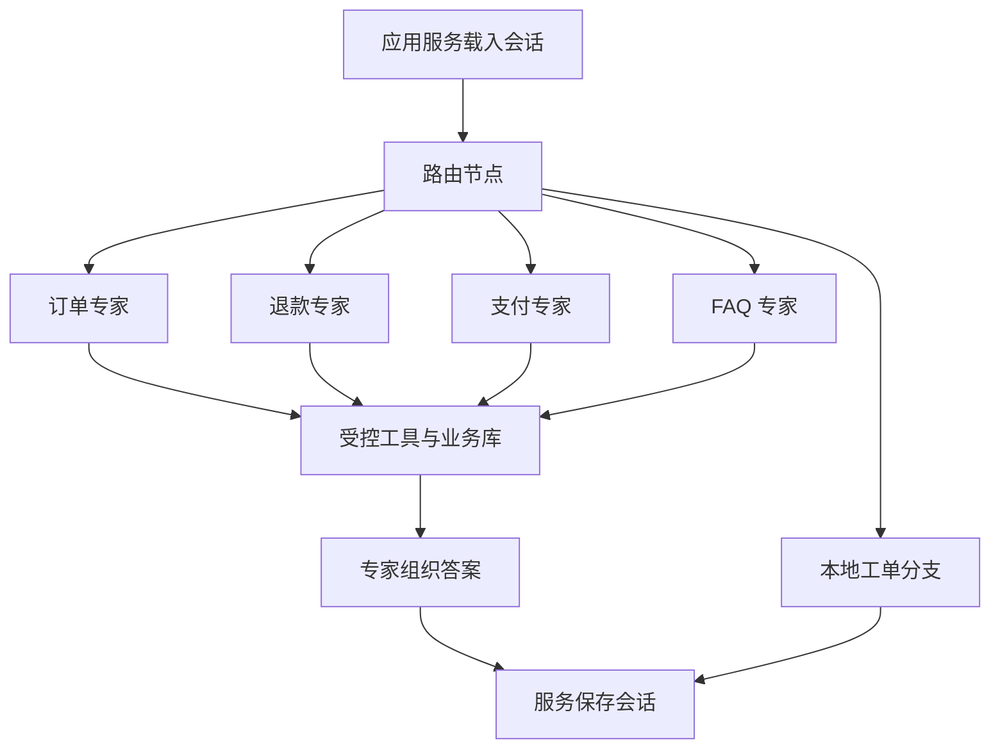

# 电商订单与售后助手

一个可以本地运行的小型多 Agent 业务应用。用户询问订单、退款、支付或商店规则时，LangGraph 路由器选择相应专家，专家通过工具查询或修改 SQLite 业务数据。应用保存最近讨论订单，使“那帮我退款”能够沿用上一轮的订单；客户偏好则独立保存，供新会话继续读取。

默认 `demo` 模式不需要 API Key。它用可预测的规则模拟模型的工具选择，执行的仍是真实 LangGraph、工具函数和本地 SQL。`online` 模式改为调用模型，业务工具和样例数据库相同。

**所有订单、客户、支付和退款均为本地样例，不连接真实电商、支付、物流或人工客服平台。** 操作会改变样例数据库，但不会产生真实扣款、退款或通知。

## 1 先理解项目提供什么

| 能力 | 当前实现 | 边界 |
| --- | --- | --- |
| 多 Agent | 路由器选择订单、退款、支付、FAQ 专家 | 每轮选择一个专家，不是并行团队 |
| 工具调用 | 专家循环调用受限工具，再组织答案 | 模型仍可能选错参数；工具负责校验 |
| 业务规则 | 退款工具检查已送达与未重复申请；支付只接受 pending | 不是完整真实商家退款规则 |
| 会话 Memory | SQLite 保存最近 50 个完整轮次、最后订单、累计 Token | 每轮结束保存；不是图节点检查点 |
| 长期客户偏好 | 按客户编号保存回复与联系偏好 | 用户明确填写，模型不自动更新；不会实际发消息 |
| 上下文 | 最近 6 个完整用户轮次与最近订单备注 | 不是精确 Token 预算或摘要系统 |
| 异常升级 | 重试后生成本地工单并保存 | 没有真人接单或外部通知 |
| 客户范围 | 会话与偏好按编号隔离 | 没有登录认证，订单工具没有归属鉴权 |
| FAQ | 关键词查找样例规则文本 | 不是文档 RAG 或语义搜索 |

可以把本项目理解为“业务工具可验证、多角色切换可观察、记忆生命周期清楚”的独立应用。不要把它当成已经可以公开处理真实客户订单的生产系统。

## 2 目录与阅读顺序

```text
ecommerce-support-agent/
  app.py                      中文 Streamlit 页面
  api.py                      FastAPI 接口
  src/
    orchestrator.py            LangGraph 路由与专家节点
    agents/
      base.py                 通用工具调用循环
      order_agent.py          订单专家
      refund_agent.py         退款专家
      payment_agent.py        支付专家
      faq_agent.py            规则问答专家
    llm.py                    在线模型、配额异常切换、Token 提取
    demo_model.py             无密钥规则模拟器
    service.py                会话恢复、上下文组织、执行与保存
    storage.py                会话与客户档案 SQLite 存储
    memory.py                 历史消息与最近订单逻辑
    runtime_context.py        请求内模式与客户偏好
    tools.py                  业务工具与本地工单
    errors.py                 重试与升级
    backend/
      db.py                   数据表与连接
      seed.py                 10 笔样例订单及状态
  tests/                      49 项回归用例
  scripts/demo.py             临时目录端到端演示
  scripts/check_ui.py         页面交互检查
  eval/                       路由评估脚本与基线样例
  docs/                       深挖文档与架构图
  requirements.txt            本次验证的精确依赖
  requirements.in             顶层依赖范围
  Dockerfile                  单实例容器入口
  .env.example                配置模板
  LICENSE                     必要版权与开源许可
  NOTICE.md                   修改范围与版本标识
```

建议先运行，再按 `service.py → orchestrator.py → agents/base.py → tools.py → storage.py` 阅读。先确定数据从哪里来、写到哪里，再研究提示词。

## 3 环境准备

本次验证环境为 Python 3.11.17、Linux。推荐使用 Python 3.11，首次安装需要可用的包下载网络和数百 MB 空间；离线演示运行时不调用模型服务。

解压后进入包含 `app.py` 的目录，后续命令均从这个目录运行。不要在另一个虚拟环境安装依赖后，又用系统解释器启动页面。

### 3.1 macOS 或 Linux

```bash
python3.11 -m venv .venv
source .venv/bin/activate
python -m pip install --upgrade pip
python -m pip install -r requirements.txt
python -m streamlit run app.py
```

### 3.2 Windows PowerShell

```powershell
py -3.11 -m venv .venv
.\.venv\Scripts\Activate.ps1
python -m pip install --upgrade pip
python -m pip install -r requirements.txt
python -m streamlit run app.py
```

如果激活脚本被执行策略阻止，直接使用解释器即可：

```powershell
.\.venv\Scripts\python.exe -m pip install -r requirements.txt
.\.venv\Scripts\python.exe -m streamlit run app.py
```

依赖快照对 `uvloop` 增加了 Windows 排除标记。macOS、Windows 的完整安装未在本次环境实测；如遇原生扩展安装问题，先确认 Python 版本、CPU 架构与可用 wheel。

### 3.3 使用 uv

```bash
uv venv --python 3.11
uv pip install --python .venv/bin/python -r requirements.txt
uv run --no-project --python .venv/bin/python streamlit run app.py
```

Windows 将解释器路径换成 `.venv/Scripts/python.exe`。没有 uv 时使用标准 venv 即可，不必额外引入依赖管理工具。

### 3.4 检查实际解释器

```bash
python --version
python -c "import sys; print(sys.executable)"
python -c "import langgraph, streamlit, sqlalchemy; print('依赖导入成功')"
```

第二条应显示当前 `.venv` 中的解释器。建议始终使用 `python -m pip`、`python -m streamlit`，减少命令指向不同环境的问题。

启动后访问 `http://localhost:8501`。页面默认模式为 `demo`，客户编号为 `customer_a`，会话编号为 `case_1`。按 Ctrl+C 停止服务。默认会在项目 `data` 目录自动创建数据库并填入样例，不需要单独执行初始化。

## 4 第一遍完整体验

### 4.1 保存客户偏好

进入“记忆与客户偏好”，填写：

- 回复偏好：简洁，先结论后解释。
- 联系偏好：优先站内文字联系。

点击“保存客户偏好”。下方 JSON 应显示刚保存的值。它由应用直接写库，不需要模型抽取。在线模型每次执行专家前读取档案；离线规则模式不模拟文风变化，也不会因为联系偏好而发送消息。

### 4.2 查询订单与跨专家指代

进入“客服对话”，依次输入：

> 查询订单 1002 的物流。

> 帮我申请退款。

第一轮进入订单专家，工具返回订单 1002 的 `shipped` 状态。第二轮进入退款专家，服务从会话 Memory 恢复 `last_order_id=1002` 并补充备注，退款资格检查应返回 `eligible=false`。

展开工具执行轨迹，检查第二轮工具参数中的编号确实是 1002，而不是只看回答是否出现“退款”。这才说明指代信息真正进入业务工具。

### 4.3 明确新编号覆盖旧上下文

继续输入：

> 帮我申请订单 1001 的退款。

显式编号优先于旧的最近订单备注。样例订单 1001 已送达且没有已有申请，工具会把对应退款行从 `none` 改成 `requested`。再次申请不应生成第二条同订单退款。

当前没有人工确认节点。用户明确提出办理后，专家可直接调用写工具；在线模式下“用户是否明确提出办理”主要由提示引导，执行层没有完整意图授权证明。公开部署前应增加确认和真实权限控制。

### 4.4 查看与办理本地支付

输入：

> 查询订单 1003 的支付状态。

预期为 `pending`。再输入：

> 帮我付款。

规则演示器会沿用 1003，调用查询后再调用 `process_payment`，将样例状态改为 `paid`。重复办理返回拒绝。这里只改变本地数据库，没有支付网关、银行卡扣款或资金清算。

### 4.5 规则问答与工单

输入：

> 退货政策是什么？

FAQ 专家调用规则工具，返回样例规则。本次已将退货说明与实际执行规则对齐：只检查已送达与不存在已有退款申请，没有实现完整退货期限、商品类别和包装状态判断。

再输入：

> 我要投诉这个问题。

预期进入升级分支，生成并保存一条本地待处理工单。页面会明确说尚未连接人工通知渠道。生成编号不等于真人已接单。

### 4.6 验证 Memory 生命周期

停止并重启页面，保持相同数据目录、客户编号、模式和会话编号。已保存的对话、最近订单和 Token 累计应能恢复。

点击“新建会话”：旧对话与最近订单不自动继承，但客户偏好仍然存在。这样可以避免新问题在没有明确编号时，错误地沿用上一次售后事项中的订单。

将客户编号改为 `customer_b`：不应显示 `customer_a` 的会话或偏好。但样例订单本身仍可按编号查询，因为业务工具尚未实现客户归属过滤。这与“会话隔离”是两件不同的事。

## 5 不打开页面也能验证

```bash
python scripts/demo.py
python -m pytest -q
python scripts/check_ui.py
python scripts/check_restart.py
```

演示脚本在临时目录执行，结束后清理，不影响正常页面数据。它实际完成：订单查询、重建服务对象后读取会话、退款资格拒绝、退款申请写入、本地工单落盘和跨会话客户偏好读取。

本次结果：49 项回归用例通过，7 个页面交互检查点通过；另已通过独立进程恢复检查，确认在进程退出后仍能恢复会话与客户偏好。覆盖原有业务工具与 API，以及新增 Memory 恢复、显式订单覆盖、非法订单不写记忆、投诉路由、并发状态更新、历史窗口与存储上限、工具额外参数拒绝等场景。

这些验证不调用真实在线模型，不能据此推导真实模型的路由准确率、退款意图识别率或响应费用。在线模型、真实电商渠道、Docker 镜像与云部署没有完成端到端实测。

## 6 接入在线模型

默认 `demo` 无需配置 Key。使用在线模式时，先复制配置模板。

macOS/Linux：

```bash
cp .env.example .env
```

Windows：

```powershell
Copy-Item .env.example .env
```

选择自己实际可用的服务，填写 `.env`。以 Gemini 为例：

```dotenv
GEMINI_API_KEY=你的密钥
GEMINI_MODEL=服务端实际支持且允许工具调用的模型标识
SUPPORT_DATA_DIR=data
```

可选 Groq：

```dotenv
GROQ_API_KEY=你的密钥
GROQ_MODEL=服务端实际支持且允许工具调用的模型标识
```

模型可用性、配额和收费以服务提供方当前说明为准。模板中的模型名只是配置起点，不能保证某个账号一直可用。不要把 Key 写进源码或 README。

页面选择 `online`，或 API 请求传入 `"mode":"online"` 后才使用真实模型。改环境变量后重启进程，避免导入时读取的配置仍是旧值。

`src/llm.py` 保留了模型池与配额错误切换逻辑：当前模型遇到配额类错误时尝试后备模型；其他错误抛回业务重试层。它不是任意服务的通用兼容接口。若接入其他 OpenAI 兼容端点，应新增适配并验证 `bind_tools`、消息格式、结果回传和 usage 字段，不能只改模型名。

客户端 SDK 本身的重试设为零，外层业务流程默认最多尝试两次。工具调用仍有错误与重复执行风险，不能把重试看成“安全地重放所有业务动作”。

## 7 使用 FastAPI

```bash
python -m uvicorn api:app --host 127.0.0.1 --port 8000
```

健康检查：`http://127.0.0.1:8000/health`。

交互文档：`http://127.0.0.1:8000/docs`。

请求示例：

```bash
curl -X POST http://127.0.0.1:8000/chat \
  -H 'Content-Type: application/json' \
  -d '{"user_id":"customer_a","session_id":"case_api","mode":"demo","message":"查询订单 1002 的物流"}'
```

同一客户、会话和模式再发：

```bash
curl -X POST http://127.0.0.1:8000/chat \
  -H 'Content-Type: application/json' \
  -d '{"user_id":"customer_a","session_id":"case_api","mode":"demo","message":"帮我申请退款"}'
```

Windows PowerShell 可使用：

```powershell
$body = @{user_id='customer_a'; session_id='case_api'; mode='demo'; message='查询订单 1002 的物流'} | ConvertTo-Json
Invoke-RestMethod -Uri 'http://127.0.0.1:8000/chat' -Method Post -ContentType 'application/json; charset=utf-8' -Body $body
```

省略会话编号时生成新编号；后续请求必须复用返回值，才能沿用上下文。响应提供 `reply`、`agent`、`trace`、`usage` 和 `cached`。当前完整 FAQ 模型回答不缓存，因此 `cached` 通常为 false；纯规则查询另有内部缓存。

API 和页面使用同一数据目录时能读到已保存会话，但若作为两个独立进程同时修改同一会话，进程内锁不能防止相互覆盖。当前推荐单入口、单实例运行。不要将无认证接口直接暴露为处理真实订单的公网服务。

## 8 LangGraph 多 Agent 怎样工作



图状态 `SupportState` 保存本轮消息、历史、路由结果、回答、轨迹、专家名和 usage。路由结果只能进入五个允许分支；识别出多个互相冲突的标签或没有合法标签时进入升级分支。

本轮只选择一个专家。每个专家内部是“模型提出工具调用 → 程序执行 → ToolMessage 回传 → 模型继续”的循环。下一轮可以选择另一位专家，所以订单查询后能切换退款处理。

这不是两个专家之间直接 handoff，也没有并行子任务汇总。不要把图中的每个节点都叫成 Agent：数据库更新、重试、会话保存是普通程序职责。

### 8.1 工具调用边界

订单专家可以查订单详情、状态与物流；退款专家可以查资格、申请退款与查订单状态；支付专家可以查支付状态并处理本地 pending；FAQ 专家只能查询规则。

`agents/base.py` 根据工具名称建立当前专家的允许集合。未知工具、额外参数会产生错误结果回传给模型，不会执行任意函数。LangChain 工具 Schema 再检查必填字段和类型。

默认最多执行四轮工具批次，每个批次最多六个请求。初始模型调用与每批工具后的模型调用要分别计算；这些限制不是整个请求的精确 Token 或费用预算。相同工具签名重复出现时停止，避免一直消耗调用。

若模型迟迟不产生最终文本，代码可能回退到最后一个工具结果。这保证页面不空白，但不代表已经完成了完整业务解释或汇总。

### 8.2 规则必须在工具里重查

退款专家提示先查资格，但 `initiate_refund` 仍会自己检查订单已送达。即使模型跳过资格查询，写工具也不能绕过此规则。

退款表对订单编号唯一，状态更新必须匹配 `none`。支付更新必须匹配 `pending`。多次或并发请求只有一次能完成对应状态变化。

这是本地状态保护，不是完整请求级幂等，也不是外部资金一致性。若第一次写入成功、模型总结阶段失败，重试可能看到“已申请”而返回拒绝，数据库没有重复变化，但用户回复可能与第一次动作不一致。

## 9 Memory 的设计

### 9.1 三类数据分开保存

| 数据 | 文件或位置 | 键与范围 | 作用 |
| --- | --- | --- | --- |
| 订单、支付、退款、工单 | data/business.sqlite | 订单或工单编号 | 业务事实，工具直接读写 |
| 对话、最后订单、累计 Token | data/memory.sqlite 的 sessions | user_id + mode + session_id | 跨重启恢复已完成轮次 |
| 客户回复与联系偏好 | data/memory.sqlite 的 profiles | user_id | 跨会话档案，跨模式共用 |
| 本轮路由与工具消息 | LangGraph 状态与专家局部变量 | 本次 invoke | 本轮执行过程，不单独逐节点保存 |

会话与档案采用应用自己的 SupportStore，不是 LangGraph 的 SqliteSaver。每轮结束后写入会话，不能从专家工具循环中的任意节点继续执行；当前没有 interrupt、Command(resume=...) 或节点级检查点。

### 9.2 最近订单如何产生

`ConversationMemory.update_last_order_id` 从实际工具轨迹读取订单编号，不直接相信模型在回答中提到的数字。工具结果有 error 时不更新，避免不存在的编号进入事实备注。

当前备注是一条显式结构化指代，而不是语义向量召回。若用户本轮明确给出订单编号，服务不再附加旧编号。离线规则只识别四至八位独立数字；复杂口语、多个订单、金额和编号混用需要进一步设计解析与澄清。

### 9.3 为什么新会话不自动沿用订单

“上次看的订单”并不一定是“本次售后要处理的订单”。把 last_order_id 限制在会话内，能减少把新任务写到旧订单上的风险。客户回复偏好可以跨会话共用，因为它的含义更稳定，也不会直接选择某一笔业务操作对象。

### 9.4 上下文窗口与保留策略

会话最多保存 50 个完整轮次，较早轮次被替换，不能视作完整审计历史。模型每次最多读取最近 6 个完整轮次，即 12 条 HumanMessage/AIMessage。专家本轮内部的工具消息另行保留到本轮结束，不会把未配对的工具片段保存为下一轮历史。

输入最多 2000 字符。当前没有对长工具输出做总 Token 精确预算，也没有自动摘要。最近六轮可能遗漏重要旧约束；最后订单备注能缓解一种指代问题，但不能替代完整上下文管理。

### 9.5 偏好是数据 不是执行指令

客户档案进入专家系统提示的事实区域，明确标识为数据。ContextVar 只在单次服务调用期间绑定，结束后恢复，避免当前客户档案残留到下一位客户。

这不等于完整提示注入防护，也不等于认证上下文。客户编号仍可手动输入，订单工具仍可查询任意样例订单。接入真实业务前，必须从经过验证的身份中确定客户，并在每个查询和写操作检查订单归属。

## 10 数据初始化 观察与重置

首次启动会在空业务库中自动填入 10 笔样例订单。常用状态如下：

| 订单 | 订单状态 | 支付状态 | 初始退款状态 | 演示用途 |
| --- | --- | --- | --- | --- |
| 1001 | delivered | paid | none | 可申请本地退款 |
| 1002 | shipped | paid | none | 未送达，拒绝退款 |
| 1003 | placed | pending | none | 可办理本地支付 |
| 1004 | delivered | paid | requested | 拒绝重复退款 |
| 1005 | cancelled | refunded | completed | 已退款不能再次支付 |

正常重复运行不会重置已改的状态。单独运行 `python -m src.backend.seed` 会按样例覆盖业务行，所以不要把它当成每次启动的固定步骤。

需要一套全新数据时，最稳妥的方式是停止服务，将 `.env` 中的 `SUPPORT_DATA_DIR` 改为一个新的目录，例如 `data_demo_2`，同时确认未设置单独的 `SUPPORT_AGENT_DB_URL`，再重新启动。这比在运行中删除数据库可靠，也方便保留之前的验证现场。

只读观察数据库：

```bash
python - <<'PY'
import sqlite3
with sqlite3.connect('data/business.sqlite') as db:
    print(db.execute('SELECT order_id,status,reason FROM refunds ORDER BY order_id').fetchall())
    print(db.execute('SELECT order_id,status FROM payments ORDER BY order_id').fetchall())
    print(db.execute('SELECT ticket_id,status FROM tickets').fetchall())
PY
```

这是 macOS/Linux Shell 示例。Windows 可将 Python 段保存为 `inspect_db.py` 后运行。自定义数据路径时同步修改查询路径。不要在示例中记录或展示真实客户信息。

## 11 部署方式

### 11.1 固定服务器

```bash
python -m streamlit run app.py --server.address=0.0.0.0 --server.port=8501
```

使用稳定的绝对数据目录。公开服务需要 HTTPS、真实身份验证、订单授权、备份和日志策略。当前代码适合本地或受控演示，不提供这些生产能力。

### 11.2 Docker

```bash
docker build -t ecommerce-support-agent .
docker run --rm -p 8501:8501 --env-file .env -v ecommerce-agent-data:/app/data ecommerce-support-agent
```

命名卷保存业务库和记忆库。若只做 demo，可省略 `--env-file .env`，默认仍为离线模式。容器文件夹本身不能替代持久卷；删除卷会丢失数据。Docker 构建在本次环境未实测。

### 11.3 托管 Python 平台

需要平台支持长运行 Python、Streamlit 所需连接以及持久卷。启动命令和端口按平台要求配置，数据目录指向卷挂载点。只有临时文件系统的平台不能保证重启后状态保留。

多实例部署前应将会话和业务库迁移到可共享数据库，处理并发会话更新、连接池与事务。当前 RLock 只在一个服务对象、一个进程内有效。

### 11.4 Supabase 与 PostgreSQL

Supabase 可以作为 PostgreSQL 和认证后端，但不能直接代替 Python Agent 运行环境。

迁移有两条独立路径：

1. 业务层：SQLAlchemy 模型与连接迁移，重新初始化数据表，核对唯一约束、事务和金额类型。
2. 记忆层：SupportStore 目前使用 SQLite 的 `?` 占位符和特定 upsert，需改连接管理、SQL 与并发更新策略。

再把页面可编辑客户编号改成服务端从认证令牌获得的身份，并给订单读写加归属验证。当前代码没有 LangGraph checkpointer，不能靠换数据库就宣称获得节点级断点恢复；该能力需要另外接入持久化图状态与恢复入口。

### 11.5 Vercel

当前 Streamlit 应用不是静态网页，不能直接作为静态项目上传。若需要 Vercel 前端，可改为 Next.js 页面，通过 FastAPI 调后端 Agent 服务；数据库和身份系统另行持久化。这是二次架构改造，交付包没有包含该前端实现。

## 12 可以继续完成的优化

### 12.1 增加真正的订单权限

在认证后得到 customer_id，订单增加归属字段。把身份从请求上下文注入工具，不让模型自由指定客户。订单查询、退款申请、支付办理都检查归属；不能只在页面判断一次。

验收：A 客户无法读取或修改 B 的订单；日志与错误信息不泄露是否存在某笔他人订单。当前测试只验证会话与偏好编号隔离，不应替代这个验收。

### 12.2 增加人工确认和请求级幂等

把写动作改为生成 pending_action，显示订单、金额、动作和版本，用户确认后才执行。需要图级暂停恢复时，引入持久化 checkpointer、interrupt 与恢复接口，并保持中断前无不可重复副作用。

增加 request_id 与 action_log，保存请求和最终业务结果。即使模型总结失败后重试，也应能返回同一次动作的原结果。现有条件更新只避免重复状态变化，不提供完整结果回放。

### 12.3 给 Memory 增加纠错和版本

让用户可以更正最近订单、撤回偏好、查看来源与更新时间。多个订单并行讨论时，使用候选集合和显式澄清，而不是只有一个 last_order_id。

为档案添加版本号、写入依据和用户确认。不要把模型猜测直接写成长期事实。对旧会话清理要区分会话快照、业务审计、客户删除请求和必要留存。

### 12.4 增加政策 RAG

新增资料导入、切块、索引、检索、引用和版本字段。先用关键词检索建立可评估基线，再考虑向量与重排。退货政策回答应展示来源和生效时间；检索到的政策不能自动替代工具里的执行规则。

不要把本项目的字典 FAQ 直接称为完整 RAG。真正的业务规则变化，还需要配置化规则引擎或受控代码更新，并验证回答与执行保持一致。

### 12.5 改进多意图与协作

当前每轮只能选一个专家。“查订单并比较退款和支付方案”可能需要拆解。可以增加计划状态、显式子任务和汇总节点，并规定写操作必须串行、只读查询才适合并行。

先评估增加协作是否提高完成率，避免为了展示更多节点而增加模型费用。增加 Agent 不等于增加可靠性。

### 12.6 改进费用和错误观测

记录 request_id、模型、专家、工具耗时、重试次数、Token 与最终结果。不要把所有输入和密钥写到日志。当前 usage 在 SDK 未返回时为空或零，不是准确费用账单；FAQ 纯查询缓存也不会跳过路由与专家模型调用。

把错误区分为参数错误、业务拒绝、可重试网络错误、配额错误和程序错误。现在的整图重试较粗，业务写入与模型回答分离后更容易精确重试。

### 12.7 提示优化与参数微调

先建立固定评估集：订单指代、显式新编号、退款资格、支付状态、无订单、投诉、多个意图、额外参数和提示注入。分别评估路由正确、参数正确、工具结果忠实度与执行结果，不只看文字流畅。

先修工具、状态和上下文，再改提示。只有在有足够优质样本、稳定失败模式和可微调服务时，再研究 SFT 或 LoRA。当前没有训练脚本，也不会通过保存客户偏好自动训练模型。

## 13 常见问题

| 现象 | 常见原因 | 处理方式 |
| --- | --- | --- |
| 导入失败 | 使用了不同解释器 | 检查 sys.executable，用当前环境安装 |
| online 失败并生成工单 | Key、模型、配额或协议不可用 | 从少量请求验证服务配置，不把生成工单当成接入成功 |
| 订单 1001 不能再次退款 | 之前演示已改成 requested | 检查数据库，或换新数据目录 |
| 重启后对话不见 | 编号、模式或数据目录改变 | 使用原组合和目录 |
| 新会话没有最近订单 | 设计上不跨会话继承 | 明确输入订单编号 |
| 偏好保存后 demo 文风没变 | 规则模型不做文风生成 | 在线模式才用于表达调整 |
| SQLite locked | 多进程或长事务争用 | 单实例运行，或迁移数据库 |
| 模型一直调用工具 | 重复签名或轮数耗尽 | 检查工具结果与提示，查看最终是否仅回退工具数据 |
| 工单没人处理 | 没有外部人工渠道 | 这是本地记录，需另接工单系统 |
| 订单可以被其他编号查询 | 工具没有归属鉴权 | 先完成认证与授权再接真实业务 |

## 14 项目说明与验证边界

可以准确描述为：基于 LangGraph 实现电商售后多专家路由，通过受控工具完成本地订单、退款、支付和规则查询；将会话指代记忆、跨会话客户档案与业务事实分离，并验证重启读取和并发状态保护。

当前不能描述为真实支付退款、完整 RAG、生产级认证、图节点断点恢复、自动接通人工客服，或填写没有测量的准确率与费用优化比例。更完整的架构、执行链与取舍说明见 `docs/Ecommerce_Agent_Deep_Dive.docx`。

必要开源版权与许可见 `LICENSE`，整理范围见 `NOTICE.md`。说明文档与普通源码不包含仓库链接或作者宣传信息。
