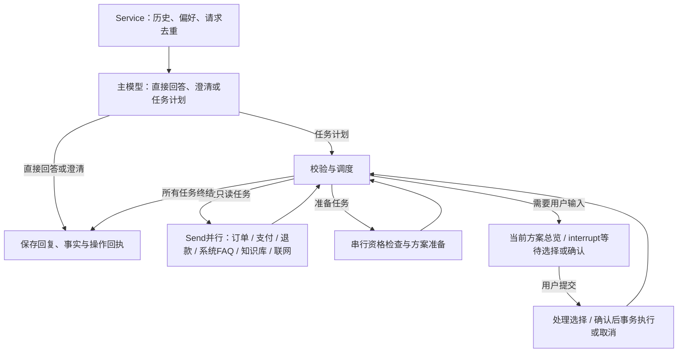

# 电商订单与售后助手

一个可以本地运行的小型多 Agent 业务应用。主对话层结合历史直接回答、澄清，或将业务请求拆成多个领域任务，交给订单、支付、退款、系统FAQ、知识库及联网搜索执行器按需协作。独立只读任务可以并行，存在条件或先后关系的任务按依赖执行；支付、退款由用户逐项确认后才修改 SQLite 业务数据。应用按会话保存最近讨论订单组，未指定订单的独立退款申请先查询本人全部订单并通过开关选单；客户偏好则独立保存，供新会话继续读取。

应用使用 DeepSeek 在线模型，默认 `deepseek-flash`，通过 OpenAI 格式的 Chat Completions 生成任务计划及资料回答。主图按能力登记调用领域工具，订单、支付、退款查询不再分别运行一轮模型选工具。已移除 demo 和运行模式切换。支付、退款先生成待确认方案，用户逐项确认后才修改本地样例数据；等待选单或确认时当前会话暂停输入，其他客户会话可独立使用。

**所有订单、客户、支付和退款均为本地样例，不连接真实电商、支付、物流或人工客服平台。** 操作会改变样例数据库，但不会产生真实扣款、退款或通知。

当前第5阶段在阶段4的持久化协作主图上增加自动回复偏好、本地多语言E5＋Qdrant知识检索、资料详情与记忆转换展示，以及五组共77轮手工验收脚本。各阶段成果见[优化成果](improve.md)，当前调用链见[架构说明](ARCHITECTURE.md)。

## 1 先理解项目提供什么


| 能力               | 当前实现                                                                          | 边界                                                              |
| ------------------ | --------------------------------------------------------------------------------- | ----------------------------------------------------------------- |
| 主对话与多 Agent   | 主层生成结构化任务，支持只读并行、依赖和条件，确认后继续原计划                    | 领域专家在主图中以受控执行器实现；不要求每个专家独立调用模型      |
| 工具调用           | 领域执行器先调用受控工具，政策、搜索和综合解释由模型组织说明                      | 模型仍可能选错参数；工具负责校验                                  |
| 订单详情与支付事实 | 完整详情由订单、支付两个领域分别取数，区分订单状态、支付状态和支付方式            | `placed`只表示已下单，不能推断是否付款                            |
| 混合方案与续跑     | 收集当前必要选择，展示当前全部可准备方案；按钮确认后继续后续任务                  | 后续依赖未满足时不提前准备，聊天“确认”不执行资金操作            |
| 业务规则           | 退款统一检查付款、已有退款、余额及已下单/已签收状态；支付只接受 pending           | 不是完整真实商家退款规则                                          |
| 会话 Memory        | 展示最近 50 轮，保存最近订单与累计 Token；请求记录独立保留                        | 整张主图按节点持久化，未完成节点内调用可能重做                    |
| 长期客户偏好       | 手动保存回复/联系偏好；模型同次规划提取最多两条回复习惯候选，观察证据累计三次生效 | 只支持详略、组织、语言、语气；不是训练模型，联系偏好不会发消息    |
| 记忆转换展示       | 候选1/3、2/3进度、已生效/撤销状态、来源原话及最近六条对话的提取记录               | 统计实际保存的证据；手动填写表单不累计观察次数                    |
| 上下文             | 最近 6 个完整用户轮次与会话内订单组                                               | 不是精确 Token 预算或摘要系统                                     |
| 模拟升级           | 明确转人工或正式投诉时生成原有本地工单                                            | 技术失败、含糊和闲聊不升级，没有外部通知                          |
| 客户范围           | 页面、当前会话、偏好及订单按客户隔离                                              | 编号可编辑，仅为本地身份切换，没有登录认证                        |
| 本地RAG            | 清单导入TXT/MD/文字PDF/DOCX，E5 Small编码，Qdrant过滤检索，综合说明引用原文       | 单平台、离线更新；没有OCR、混合检索、重排序或十万片段性能保证     |
| 系统FAQ            | 本地字典保留旧五类及新增system操作帮助；规划提示要求平台规则走RAG                 | 兼容旧FAQ能力，不作为知识库缺失的兜底                             |
| 资料浏览           | 分类、商品及关键词分页查询，展示全文与版本标签                                    | 只读页面，无上传编辑；版本标签不等于历史规则隔离                  |
| 通用联网           | DeepSeek 搜索接口检索后由模型组织回答，显示来源链接                               | 复用 DEEPSEEK_API_KEY；搜索与模型调用分别计费，失败不编造实时信息 |
| 操作确认与幂等     | 支付、退款逐项确认，按请求编号和动作结果重放                                      | 单实例验证，不等于真实资金渠道的完整幂等                          |

可以把本项目理解为“业务工具可验证、多角色切换可观察、记忆生命周期清楚”的独立应用。不要把它当成已经可以公开处理真实客户订单的生产系统。

## 2 目录与阅读顺序

### 2.1 当前文件与职责

```text
ecommerce-support-agent/
  app.py                      中文 Streamlit 页面
  api.py                      FastAPI 接口
  src/
    service.py                页面与 API 共用的应用服务
    orchestrator.py            唯一持久化协作主图
    planning.py               能力登记、任务与条件契约、语义规划
    tools.py                  订单、支付、退款、政策和本地工单工具
    actions.py                待确认动作、事务执行与结果回放
    dialogue.py               依据资料回答、风格约束与联网查询
    payment_methods.py        页面与后端共用的支付方式表
    llm.py                    DeepSeek 客户端与 Token 提取
    errors.py                 模型调用局部重试
    storage.py                会话快照、客户当前会话与档案存储
    memory.py                 历史消息、候选校验、偏好类别及三次观察阈值
    knowledge.py              文档解析、目录导入、商品定位、E5与Qdrant检索
    runtime_context.py        客户、请求编号与偏好的 ContextVar
    logging_config.py         可选 JSON 日志配置，入口未自动启用
    confirmation.py           独立确认图组件，当前主图不调用
    refund_flow.py            独立退款意图解析与订单号提取组件
    agents/
      base.py                 文本、Token 工具及独立工具调用循环
      order_agent.py          独立订单 Agent 与工具包装
      payment_agent.py        独立支付 Agent 与工具包装
      refund_agent.py         独立退款意图入口与工具包装
      faq_agent.py            政策读取函数及独立 FAQ 入口
    backend/
      db.py                   SQLAlchemy 数据表、连接与建表
      seed.py                 10 笔样例订单及状态
    __init__.py               src、agents、backend 均有包标识文件
  tests/                      业务、协议、确认恢复与页面回归用例
    conftest.py               隔离数据库、离线模型与测试适配
    fake_model.py             离线规划及工具调用测试模型
  scripts/
    check_ui.py               真实模型页面交互检查
    check_restart.py          真实模型跨进程会话检查
    ingest_knowledge.py       离线清单导入命令入口
  eval/
    scenarios.json            当前22组自动评估场景；前端另用五组长对话脚本
    run_eval.py               当前合成数据端到端评估入口
    eval_dataset.json         保留的旧单路由数据集，当前评估不读取
    results/                  阶段4评估及阶段5三组真实问答记录
  knowledge/                  manifest.json及200条政策、200件商品Markdown
  docs/
    usage_and_scenarios.md    导入说明、模型路径、五组共77轮手工脚本
    Ecommerce_Agent_Deep_Dive.docx  历史深挖文档
  README.md                   运行、代码导航与行为说明
  ARCHITECTURE.md              当前架构与调用链
  improve.md                   分阶段优化成果与验收记录
  requirements.txt            本次验证的精确依赖
  requirements.in             顶层依赖范围
  pytest.ini                  pytest 的模块路径与测试目录
  Dockerfile                  应用容器入口
  compose.yaml                仅定义本地Qdrant服务及持久卷
  .dockerignore               排除密钥、虚拟环境与运行数据
  .gitignore                  版本控制忽略规则
  .env.example                配置模板
  LICENSE                     必要版权与开源许可
  NOTICE.md                   修改范围与版本标识
```

`data/`、`.env`、`.venv/` 和缓存属于本地运行产物，不是需要复制到源码中的模块。文件树列出当前主要文件，测试用例按主题分布在 `tests/test_*.py`。

### 2.2 建议阅读顺序与实际入口

1. `app.py` / `api.py`：了解页面交互和接口请求。
2. `service.py`：了解请求去重、历史组织、结果保存和原请求恢复。
3. `planning.py`：了解可用能力、任务契约、条件校验和模型规划。
4. `orchestrator.py`：了解并行查询、串行准备、等待输入和确认后续跑。
5. `tools.py` / `actions.py` / `backend/db.py`：核对业务事实、归属、资格和事务更新。
6. `storage.py` / `memory.py`：了解会话、候选证据、升级与撤销；`knowledge.py` / `dialogue.py`：了解导入、检索与引用回答。
7. `tests/` / `eval/run_eval.py`：对照离线断言与真实模型评估。

页面与 API 的业务入口都是 `SupportService`，其主图由 `build_workflow()` 构建。主图直接调用 `src/tools.py` 的领域函数，复用 `get_policies()`、`as_text()` 和 `sum_usage()`；**不经过 `run_order_agent()`、`run_payment_agent()`、`run_refund_agent()`、`run_faq_agent()` 或 `build_confirmation_graph()`**。这些独立组件仍在仓库中，阅读时应与当前入口区分。

### 2.3 核心入口与保留组件


| 要找的逻辑       | 主要入口                                                                                                                       |
| ---------------- | ------------------------------------------------------------------------------------------------------------------------------ |
| 聊天、重放与恢复 | `SupportService.chat()`、`_graph_result()`、`_submit()`；API对应第7节                                                          |
| 规划与调度       | `make_plan()`、`Plan`校验；主图`plan_node → schedule/dispatch → expert/prepare → review`，确认经`wait/apply_input`恢复      |
| 资格与资金状态   | `tools.py`查询及资格函数；`prepare_action()`准备、`decide_action()`事务执行                                                    |
| 记忆与证据       | `memory_candidates()`校验；`SupportStore.profile()/apply_memories()/forget_memory()`读写；阈值`MEMORY_OBSERVATIONS_REQUIRED=3` |
| 文档与引用       | `KnowledgeStore.ingest()/search()/documents()/document()`；`compose()`组织回答并检查来源                                       |
| 验证             | `tests/`离线回归，`scripts/ingest_knowledge.py`导入，`eval/run_eval.py`旧场景评估；边界见第5节                                 |

`agents/`中的独立模型工具循环、`confirmation.py`的独立确认图、`refund_flow.py`的解析入口仍保留并有对应测试，当前页面不通过这些组件执行整套业务。`ConversationMemory`只有`add_turn()`用于主服务历史构造，另外两个单订单辅助方法未接入；`logging_config.py`也未由页面或API自动启用。完整任务、状态和存储逻辑分别见第8～10节，不在此逐一罗列内部函数。

## 3 环境准备

推荐使用 Python 3.11，首次安装需要可用的包下载网络，并为Python依赖、E5缓存和索引预留磁盘空间；正常使用需要 DeepSeek API Key 和模型服务网络。已有阶段验证记录基于 macOS 的独立 Python 3.11 环境，本次文档同步未重新安装依赖。

解压后进入包含 `app.py` 的目录，后续命令均从这个目录运行。不要在另一个虚拟环境安装依赖后，又用系统解释器启动页面。

### 3.1 macOS 或 Linux

**首次安装并初始化 RAG（只需首次或模型、知识库被删除后执行）：**先启动 Docker Desktop，并按第6节填写 DeepSeek 配置。下面的资料导入会下载缺失的 E5 模型并初始化知识库，必须等成功退出后再启动页面。

```bash
python3.11 -m venv .venv
source .venv/bin/activate
python -m pip install --upgrade pip
python -m pip install -r requirements.txt
docker compose up -d qdrant
python -m scripts.ingest_knowledge --root ./knowledge
python -m streamlit run app.py
```

**日常重置：只恢复十笔初始订单，清空聊天、客户偏好和任务进度，保留模型与知识库。**

1. 先完全停止 Streamlit 和 FastAPI；Qdrant 可以保持运行。
2. 在 `data/` 中手动删除下表中的三个数据库，以及它们各自的 `-wal`、`-shm`、`-journal` 附属文件（存在时一起删除）。不要清空整个 `data/`。


| 手动删除             | 重置内容                                                           |
| -------------------- | ------------------------------------------------------------------ |
| `business.sqlite`    | 订单、支付、退款、工单、请求和动作记录；下次启动初始化十笔样例订单 |
| `memory.sqlite`      | 聊天展示快照、客户偏好、自动记忆及证据                             |
| `checkpoints.sqlite` | 原任务计划、待确认事项和恢复进度                                   |

**保留 `data/models/`、`data/qdrant/`、`data/knowledge.sqlite` 和 `data/knowledge.lock`。** 这样不需要重新下载模型或导入知识资料。自定义过 `SUPPORT_DATA_DIR` 或 `SUPPORT_AGENT_DB_URL` 时，要删除实际配置位置的对应数据库，见第6节。

3. 在项目根目录重新启动。确认 Docker Desktop 正在运行，然后执行：

```bash
cd /Users/geyang/Desktop/ecommerce-support-agent
source .venv/bin/activate
docker compose up -d qdrant
python -m streamlit run app.py
```

`docker compose up -d qdrant` 在容器已运行时可以重复执行，会保留现有向量数据。启动页面后应看到全新的十笔样例订单、空聊天与偏好，资料页仍保留已导入内容。无需每次重建 `.venv`、升级 pip 或重装依赖；重建虚拟环境本身也不会重置订单，重置由前面删除的三个数据库决定。

如果只关闭页面后直接重启、没有删除数据库，会继续保留上次的业务状态。若误删 `knowledge.sqlite` 或 `data/qdrant/`，再按首次流程重新导入；若连 `data/models/` 也删除，导入时还需要联网重新下载 E5。清空整个 `data/` 的恢复流程见第3.5节。

### 3.2 Windows 使用 WSL2

当前 `service.py` 和 `knowledge.py` 直接使用Unix的`fcntl.flock`，不能按原生Windows PowerShell流程直接运行；依赖快照中的`uvloop`也没有Windows排除标记。Windows用户需在WSL2 Linux环境中按第3.1节安装和启动，并确保该环境可连接Docker。WSL2完整流程未在本轮实测；原生Windows支持属于后续适配，不作为已实现能力。

### 3.3 使用 uv

```bash
uv venv --python 3.11
uv pip install --python .venv/bin/python -r requirements.txt
uv run --no-project --python .venv/bin/python streamlit run app.py
```

运行前仍须按第3.1节启动Qdrant并完成资料导入；uv命令不代替知识库初始化。Windows使用WSL2中的Linux解释器。没有uv时使用标准venv即可。

### 3.4 检查实际解释器

```bash
python --version
python -c "import sys; print(sys.executable)"
python -c "import langgraph, streamlit, sqlalchemy; print('依赖导入成功')"
```

第二条应显示当前 `.venv` 中的解释器。建议始终使用 `python -m pip`、`python -m streamlit`，减少命令指向不同环境的问题。

按第 6 节填写模型配置后，启动并访问 `http://localhost:8501`。客户编号默认为 `customer_a`，会话编号为 `case_1`。按 Ctrl+C 停止服务。默认会在项目 `data` 目录自动创建业务、会话与检查点数据库，并填入十笔样例订单；这一步不下载 E5，也不自动导入知识库。首次 RAG 初始化、日常重置和 Docker 启动命令均在[第3.1节](#31-macos-或-linux)；清空整个 `data/` 后的详细恢复说明见第3.5节。

### 3.5 清空整个 data 后完整重建

以下步骤适用于当前 macOS/Linux 项目环境。依赖安装和 DeepSeek 配置按第3、6节完成；Docker Desktop 需要处于运行状态。若只删除了 `data/`，已有的 `.venv/` 通常不需要重新安装。

**先停止再清理：**停止 Streamlit 和 FastAPI 进程；在项目根目录执行下面命令停止使用向量目录的 Qdrant 容器。

```sh
cd /Users/geyang/Desktop/ecommerce-support-agent
docker compose stop qdrant
```

此时再按你的习惯手动清空 `data/`。首次安装不需要执行删除。清理完毕后，仍在项目根目录依次执行：

```sh
docker compose up -d qdrant
.venv/bin/python -m scripts.ingest_knowledge --root ./knowledge
.venv/bin/python -m streamlit run app.py --server.address 127.0.0.1 --server.port 8501
```

**第二条命令同时完成模型准备与知识库初始化：**读取清单和原文 → 下载或加载 E5 → 切分资料并生成向量 → 写入 Qdrant 和 `knowledge.sqlite` → 校验并标记 `ready`。不需要手动下载权重后再“导入模型”。模型缓存被删后，这一步需要联网；下载失败时应先解决网络问题再重试，不能直接启动页面当作已恢复 RAG。

请等导入成功退出后再执行页面启动命令。导入当前模拟资料的成功输出应包括：

```json
{"documents": 400, "products": 200, "status": "ready"}
```

需要使用 API 时，在另一终端、相同环境配置下启动：

```sh
.venv/bin/python -m uvicorn api:app --host 127.0.0.1 --port 8000
```

启动后打开 `http://127.0.0.1:8501`，在“平台资料详情”核对资料总数400、索引状态 `ready`，再询问“退货需要几天内申请，定制商品能退吗？”，检查回答是否有原文来源。应用启动负责新业务库与十笔订单初始化；原始资料和本地模型的恢复由前面的导入命令负责。

## 4 一条贯穿五个阶段的完整体验

先按第3节完成模型配置、Qdrant启动及400份模拟资料导入。使用**全新业务与记忆数据库**，选择`customer_a`、会话`walkthrough`；每次只发送一行对话，等待回复或完成指定页面操作再继续。本节是一条手工体验路线，不是所有轮次已经通过的自动报告。


| 轮次 | 输入或页面操作                                                                   | 关键观察点                                                                                               |
| ---- | -------------------------------------------------------------------------------- | -------------------------------------------------------------------------------------------------------- |
| 1    | “你好。以后请用中文，先给结论再解释，请记住这两项回复偏好。”                   | 消息及时展示；完成后记忆页可核对明确偏好及用户原话。                                                     |
| 2    | “请详细一点，说明查询订单和提交退款有什么不同。”                               | 详略习惯可以成为观察候选，单次不直接认定永久偏好。                                                       |
| 3    | “请详细一点，解释申请已记录与退款到账的区别。”                                 | 平台规则先检索；观察证据按不同请求累计。                                                                 |
| 4    | “请详细一点，说明新建会话后哪些信息保留。”                                     | 系统操作帮助走FAQ；若三轮提取为同类同值，可在记忆页看到1/3、2/3至生效，未提取时如实显示。                |
| 5    | “同时查1002物流和1003支付状态，只查询。”                                       | 独立只读协作；1002为shipped，1003为pending，无资金动作。                                                 |
| 6    | “查1003商品说明，解释HDMI兼容条件，并核对订单金额。”                           | 订单商品名关联扩展坞资料；DP Alt Mode来自原文，34.50来自业务库。                                         |
| 7    | “退货期限和定制商品规则是什么？再查1001本地退款资格，只查询。”                 | 引用七日与定制例外；本地程序未检查期限、品类和包装，不把eligible当作全部平台规则满足。                   |
| 8    | “我要申请退款，先让我选单，不要自动沿用刚才编号。”                             | 查看本人候选：可退者优先，默认前三笔，展开全部后不可退项无开关。                                         |
| 操作 | 选择1001和1006、提交；先确认1001，再取消1006；刷新页面。                         | 逐项确认，1001为requested，1006未申请；刷新不应重复执行。等待期间当前会话禁用聊天输入。                  |
| 9    | “核对1001与1006的退款状态，再为1001申请一次。”                                 | 使用工具重查，拒绝已有申请，不把取消或准备当成提交。                                                     |
| 10   | “1002已签收才准备退款，否则只查物流；同时查9999详情。”                         | 1002未签收，条件动作跳过；9999错误不抹掉独立成功结果，也不自动转人工。                                   |
| 11   | “先准备支付1003，成功后只检查退款资格。”                                       | 在方式界面取消支付，后续依赖成功的检查应跳过；状态仍pending。                                            |
| 12   | “重新为1003准备支付，付款成功后只检查退款资格，不申请。”                       | 选择微信支付；确认前刷新或重启（不删库），回到原会话再点确认。原计划继续，paid后重查资格，无退款申请卡。 |
| 13   | “查1003完整详情和支付方式，再为它付一次。”                                     | placed与paid可以并存；方式wechat_pay；已付款不重复支付。                                                 |
| 14   | “体验不好，我只问怎样投诉，不要转人工或建工单。”                               | 情绪与咨询不视为升级授权。                                                                               |
| 15   | “查北京最新天气与1002物流。下雨是否证明它因天气延误？”                         | 联网与本地事实分开取证，注明可用来源时间；没有因果证据就说明不足，搜索失败如实说明。                     |
| 16   | “现在我要正式投诉订单1002的处理体验，请转人工并记录诉求。”                     | 创建有编号的本地工单；没有真实通知或真人接单承诺。                                                       |
| 17   | 同一客户点击“新建会话”，再问“我的回复偏好是什么？”                           | 新会话不带旧聊天和订单指代，长期偏好及业务状态仍保留。                                                   |
| 18   | “请忘记关于回答详细程度的偏好，保留中文和先结论。”                             | 记忆页核对撤销；也可使用“忘记此偏好”按钮，旧证据不自动恢复。                                           |
| 19   | 切换`customer_b`并新建会话，输入“列出我的订单，查询1008至1010详情；也查1001。” | B只拥有1008～1010；A的1001及其客户偏好不能泄露。                                                         |
| 20   | 切回A、返回`walkthrough`，核对1001退款、1003付款和会话记录。                     | 客户独立会话恢复，真实已执行状态保留，未确认动作不算执行。                                               |

每轮可展开**任务进度、工具执行轨迹和来源**核对调用。观察次数以实际提取的同类同值证据为准，手动保存表单不累计次数；聊天中说“确认”不替代资金按钮。前端“平台资料详情”可按分类、商品和文档编号浏览全文。

这条路线串起消息展示、客户隔离、确认与状态保护、FAQ/联网、条件多任务，以及第五阶段的RAG和自动记忆。六轮上下文、五十条展示窗口、API重放和并发故障等边界，分别见第9节、第5节及[五组77轮手工脚本](docs/usage_and_scenarios.md)。各组脚本应独立初始化；仅新建会话不重置订单。

## 5 不打开页面也能验证

```bash
python -m pytest -q
python scripts/check_ui.py
python scripts/check_restart.py
```

`pytest` 使用测试模型或模拟 HTTP，并在隔离数据库中验证业务逻辑，不调用真实 DeepSeek。`check_ui.py` 和 `check_restart.py` 使用临时数据目录，但会调用真实模型，需要配置 Key，并会产生模型请求。前者覆盖查询、退款选单与确认、工单、新会话和客户切换；后者用两个独立进程验证偏好、聊天及近期订单恢复，不等于逐项测试所有主图检查点。

第五阶段当前离线回归为**161项通过**，覆盖新增的候选校验、1/3与2/3显示、第三次升级、重复证据、撤销、客户隔离、文档数量/格式、重复导入、商品过滤及检索后说明。离线测试的Qdrant使用SDK本地内存模式、固定向量，不等于实际服务的索引性能测试。

[第五阶段真实问答记录](eval/results/memory-rag-live.json)保存三组DeepSeek＋真实E5问答及一条有效偏好：耳机连接、退货期限/定制例外、英文签收问题。该JSON不是通用评估器的全量断言报告。本地Qdrant容器已完成400份资料导入、中文政策与英文商品检索及页面ready检查；未完成十万片段压测或应用Docker镜像构建验收。五组77轮前端脚本仍是手工验收说明，不标记为全部已运行通过。

阶段4此前已记录的验收结果如下，详情与完整轨迹见[验证记录](eval/results/README.md)：


| 验证范围                   | 结果      | 主要检查内容                                                                                               |
| -------------------------- | --------- | ---------------------------------------------------------------------------------------------------------- |
| 离线自动化回归             | 141项通过 | 业务工具与API、客户权限、条件与筛选、多项输入、确认/取消、请求重放、并发确认、重启及响应丢失恢复、页面交互 |
| 真实DeepSeek基础与泛化场景 | 22/22通过 | 原16组输入及6组新增组合，在临时合成库中执行并断言结果                                                      |
| 真实DeepSeek重复验证       | 36/36通过 | 第11～22组各执行3次，每次使用新临时合成库                                                                  |

初始失败报告也保留在`eval/results/`：发现过政策问题误入直接回答、任务成功值错误以及未付款条件使用未定义值`unpaid`。修复采用通用政策规划约束、任务与业务状态枚举校验及跨任务证据解释。

自动化测试不调用真实模型。阶段4另使用全新临时合成库完成真实DeepSeek流程联调；报告包括初始失败、修复及最终复测，不能据此保证任意自然语言都能无误识别。真实电商、资金渠道和云部署未实测；阶段4报告没有覆盖第五阶段RAG，Qdrant本地运行检查与应用容器构建须分别看待。

```bash
python eval/run_eval.py --dry-run
python eval/run_eval.py --case 11 12 13 14 15 16 17 --repeats 3 --report /tmp/support-eval.json
```

`--dry-run` 只校验场景登记的操作是否在能力表内，不验证模型回答。在线评估会调用模型/搜索，并按脚本规则确认或取消临时合成库的动作，不读取现有业务库；每个场景、每次重复使用新的库。无参数运行会评估全部22组，默认报告为 `eval/live-results.json`。页面旧16组已撤下，现从 `docs/usage_and_scenarios.md` 展示五组长对话；`eval/scenarios.json`继续供自动评估使用；`eval/eval_dataset.json` 是保留的旧数据，不参与当前评估。上表是已保存的阶段4结果，不代表当前源码的22组已重新通过。现有run_eval.py只初始化临时业务/记忆库，没有导入临时知识库，不能直接把它当作第五阶段完整RAG评估；相应适配尚待完成。

## 6 接入在线模型

回答与规划使用DeepSeek在线模型；E5 Small仅用于本地检索编码。先复制配置模板。

macOS/Linux：

```bash
cp .env.example .env
```

Windows：

```powershell
Copy-Item .env.example .env
```

已有 `.env` 时直接编辑，保留原来的密钥，不要重新复制模板覆盖。填写 `.env`：

```dotenv
DEEPSEEK_API_KEY=你的密钥
DEEPSEEK_BASE_URL=https://api.deepseek.com
DEEPSEEK_MODEL=deepseek-flash
SUPPORT_DATA_DIR=data
SUPPORT_AGENT_DB_URL=
SUPPORT_QDRANT_URL=http://127.0.0.1:6333
```

模型配置由 `src/llm.py` 的 `load_dotenv()` 加载，已设置的进程环境变量优先。**自定义数据配置需在启动 Python 前设置到进程环境中**：`src/tools.py` 在导入时就创建业务连接、建表并检查样例，而 `SupportService` 也先确定记忆路径，再导入模型模块；只修改 `.env` 中的数据变量不能可靠地配置本次启动的全部数据库。


| 配置                   | 当前读取方式与作用                                                                                      |
| ---------------------- | ------------------------------------------------------------------------------------------------------- |
| `DEEPSEEK_API_KEY`     | 必填；模型与搜索共用                                                                                    |
| `DEEPSEEK_BASE_URL`    | 默认`https://api.deepseek.com`，模型和搜索均使用                                                        |
| `DEEPSEEK_MODEL`       | 默认`deepseek-flash`，可覆盖；`get_llm(model=...)` 的显式参数优先                                       |
| `SUPPORT_DATA_DIR`     | 启动前设置；默认项目根目录下的`data/`，决定默认业务库、记忆库、检查点、知识目录库、锁文件和模型缓存位置 |
| `SUPPORT_QDRANT_URL`   | 默认`http://127.0.0.1:6333`；Qdrant连接在需要时创建，导入与应用须使用同一设置                           |
| `SUPPORT_AGENT_DB_URL` | 启动前设置；非空时仅覆盖业务库地址，不移动记忆库和检查点                                                |

例如，在 macOS/Linux 使用独立数据目录启动页面：

```bash
SUPPORT_DATA_DIR=/absolute/path/support-data python -m streamlit run app.py
```

Windows需在WSL2内按上面的Linux方式配置；第7节PowerShell示例仅作为访问已运行API的HTTP客户端。

启动 API 时使用同样的环境设置。Python 代码显式传入 `SupportService(path=...)` 时改变记忆文件及同目录检查点、知识目录、模型缓存和锁文件，业务连接仍由 `tools.py` 的引擎决定；测试和评估会分别隔离两者。

对话和联网搜索共用 `DEEPSEEK_API_KEY`，无需额外搜索密钥。当前 `search_web()` 调用路径为 `/v1/tools/search`（服务说明见 [DeepSeek Search API](https://api-docs.deepseek.com/guides/search/)）；沿用 `DEEPSEEK_BASE_URL`，处理官方根地址和带 `/v1` 的地址。自定义兼容服务还必须实现此搜索接口，仅兼容 Chat Completions 不够。

每次请求最多5条结果，超时15秒；网络故障、限流或服务端错误最多重试一次，鉴权失败不重复请求。搜索词为1至128个字符；结果摘要、链接和可用的来源发布时间随原请求保存。搜索与模型调用分别计费。修改配置后停止并重新启动 Streamlit 即可，无需删库或重新安装依赖。可输入“北京现在天气如何”，在回答下方检查来源链接，并在工具轨迹中查看 `search_web`。

模型可用性、配额和收费以服务提供方当前说明为准。模板中的模型名只是配置起点，不能保证某个账号一直可用。不要把 Key 写进源码或 README。

页面和 API 均直接使用在线模型，不再传入 mode。改环境变量后重启进程，避免导入时读取的配置仍是旧值。

`src/llm.py` 使用 `ChatOpenAI` 连接 DeepSeek 的 OpenAI 格式 Chat Completions，默认 temperature 为0，固定关闭 thinking 和 Responses API，单次请求超时60秒。已移除 Gemini、Groq 和模型池轮换。若更换兼容端点，应验证主图的 JSON 规划、消息和 usage；只有继续使用独立工具 Agent 时才还涉及 `bind_tools`。

客户端 SDK 重试为零，`call_with_retry()` 默认最多尝试两次、失败后立即重试。规划格式另允许初次输出后最多3次修复，因此不能把两次尝试当作整轮模型调用上限。服务只在已有计划检查点时最多额外恢复一次图执行；继续失败则保留原请求为 `processing`。已完成节点从检查点恢复，未完成节点内的模型或查询可能重做；被领域执行器捕获并标为 `failed` 的任务不会因此自动重试。正常 `interrupt` 不作为失败处理，资金动作由事务结果防重。

## 7 使用 FastAPI

```bash
python -m uvicorn api:app --host 127.0.0.1 --port 8000
```

健康检查：`http://127.0.0.1:8000/health`。

交互文档：`http://127.0.0.1:8000/docs`。


| 方法与路径                                               | 对应服务方法                           | 用途                                                               |
| -------------------------------------------------------- | -------------------------------------- | ------------------------------------------------------------------ |
| `GET /health`                                            | 无业务调用                             | 返回`{"status":"ok"}`；不检查模型可用性                            |
| `POST /chat`                                             | `chat()`                               | 新建或继续原聊天请求                                               |
| `GET /requests/{request_id}`                             | `get_request()`                        | 按`user_id`、`session_id` 读取原聊天请求；不推进图                 |
| `POST /requests/{chat_request_id}/resume`                | `resume()`                             | 确认或取消当前`action_id`                                          |
| `POST /requests/{chat_request_id}/select-orders`         | `select_orders()`                      | 提交或取消指定选单输入                                             |
| `POST /requests/{chat_request_id}/select-payment-method` | `select_payment_method()`              | 提交或取消指定支付方式输入                                         |
| `GET /users/{user_id}/memories`                          | `store.profile()` / `store.memories()` | 手动档案、候选、有效/撤销记忆及原话证据                            |
| `DELETE /users/{user_id}/memories/{key}`                 | `store.forget_memory()`                | 撤销detail/format/language/tone之一，无请求体                      |
| `GET /knowledge/documents`                               | `knowledge.documents()`                | kind/category/product_id/q筛选，offset默认0、limit默认20且限1～100 |
| `GET /knowledge/documents/{document_id}`                 | `knowledge.document()`                 | 文档元数据及完整sections，未找到返回404                            |

记忆与知识目录接口同样没有登录认证。`GET /users/.../memories`直接调用编号校验，当前未捕获其`ValueError`，不能宣称所有无效编号都返回400；删除接口的`ValueError`映射400。目录列表的无效kind或分页范围返回422，单文档不存在返回404。接口不提供文件上传或在线导入。

所有 POST 请求模型禁止额外字段。`/chat` 的消息长度为1～2000字符，`user_id` 默认 `customer_a`，客户和会话编号限1～40位字母、数字、下划线或短横线，`request_id` 限1～64位且可自动生成。恢复接口须显式传入客户、会话和本次操作的 `request_id`，编号由服务校验为1～64位；`order_ids` 必须为严格整数数组，不能传字符串或布尔值。页面直接使用服务层的64位编号限制。

请求示例：

```bash
curl -X POST http://127.0.0.1:8000/chat \
  -H 'Content-Type: application/json' \
  -d '{"user_id":"customer_a","session_id":"case_api","request_id":"query_001","message":"查询订单 1002 的物流"}'
```

同一客户、会话再发一个新的请求编号：

```bash
curl -X POST http://127.0.0.1:8000/chat \
  -H 'Content-Type: application/json' \
  -d '{"user_id":"customer_a","session_id":"case_api","request_id":"refund_001","message":"帮我申请退款"}'
```

Windows PowerShell 可使用：

```powershell
$body = @{user_id='customer_a'; session_id='case_api'; request_id='query_001'; message='查询订单 1002 的物流'} | ConvertTo-Json
Invoke-RestMethod -Uri 'http://127.0.0.1:8000/chat' -Method Post -ContentType 'application/json; charset=utf-8' -Body $body
```

新请求省略会话编号时生成新编号；用相同请求编号重试时可复用已记录的会话。后续新请求必须复用返回的 `session_id` 才能沿用上下文。响应提供 `reply`、`agent`、`trace`、`usage` 和 `sources`。多个有执行轨迹的主体参与时，`agent=collaboration`，页面显示“协作处理”及参与者；直接回答、澄清和单独搜索使用 `agent=assistant`，`agents` 仍可记录 `search`。网页`sources`保存标题、URL、摘要及可用时间；知识库来源保存id、doc_id、标题、版本、章节/页码及原文content，不保证有URL。来源随请求重放。澄清属于正常完成的聊天，不锁定输入。

完成请求还可能包含`memory={status,candidates}`：`pending`表示记忆待写入，`applied`表示已检查/应用候选，不等于每条候选都已升级。候选可能为空或仍待累计，见第9.6节。

响应另提供 `user_id`、`session_id`、`request_id`、`status`、`actions` 和 `current_action`。相同请求编号与输入重发时，已完成或等待用户的响应直接重放；处理中则恢复原图，未完成节点内的模型或只读调用可能重做，业务执行由动作结果防重。**请求去重键是 `user_id + request_id`，同一客户跨会话也不能复用编号处理不同内容**，聊天与恢复操作同样占用该编号空间。冲突返回409。省略 `request_id` 会生成新编号，需要重试去重时应由客户端提供稳定编号。当前主流程不返回旧的 `routing` 或 `cached` 字段；已移除的 `mode` 请求字段返回422。

阶段4的协作字段与交互编号如下：


| 字段                              | 含义与用途                                                               |
| --------------------------------- | ------------------------------------------------------------------------ |
| `tasks` / `task_id`               | 各子任务的操作、目标、依赖、状态、事实与轨迹；全局`trace`也附带`task_id` |
| `agents`                          | 本轮实际参与的执行主体，用于核对是否发生协作                             |
| `pending_inputs` / `input_id`     | 全部当前等待的选单或支付方式输入；提交选择时定位具体输入项               |
| `selection` / `payment_selection` | 首个选单 / 首个支付方式输入的便捷投影；不能据此判断只有一个输入          |
| `actions` / `action_id`           | 已准备的业务动作；确认和取消使用`action_id`，只处理当前项                |
| `current_action`                  | 当前可确认动作；必要选择未完成时为空，先处理`pending_inputs`             |

选单与支付方式接口支持`input_id`，从对应`pending_inputs`项读取。只有唯一匹配项时可省略；多项时必须提供，不能让服务猜测目标。恢复始终使用原聊天请求编号，不创建另一份计划。

`GET /requests/{chat_request_id}?user_id=customer_a&session_id=case_api` 查询原请求状态。前面的无订单号退款示例进入 `awaiting_selection`，需要选单或取消才能在该会话发新消息。下面另用 `case_refund` 演示明确订单1001的申请及确认；订单仍须满足当前资格：

```bash
curl -X POST http://127.0.0.1:8000/chat \
  -H 'Content-Type: application/json' \
  -d '{"user_id":"customer_a","session_id":"case_refund","request_id":"refund_002","message":"帮我申请订单 1001 的退款"}'

curl -X POST http://127.0.0.1:8000/requests/refund_002/resume \
  -H 'Content-Type: application/json' \
  -d '{"user_id":"customer_a","session_id":"case_refund","request_id":"confirm_001","action_id":"返回的动作编号","decision":"confirm"}'
```

恢复接口路径使用原聊天的 `refund_002`，请求体中的 `confirm_001` 是这次决定的新编号。取消使用 `decision=cancel`；同一次决定重试应复用它自己的 request_id。

HTTP 状态按接口区分，不能把所有参数错误都归为422：


| 情况                                           | 当前返回                                                      |
| ---------------------------------------------- | ------------------------------------------------------------- |
| `/chat` 或读取原请求成功                       | `processing` 为202，其余已保存结果为200                       |
| 三类恢复接口成功                               | 200，响应体给出当前业务阶段                                   |
| 请求体或查询参数不符合 FastAPI / Pydantic 契约 | 422，例如缺少必填参数、额外请求体字段、无效决定或非整数订单号 |
| `/chat` 服务层校验失败 / 请求冲突              | 400 / 409，例如纯空白消息 / 未处理完就发新请求                |
| 读取或确认的目标无效、阶段冲突                 | 409；`/resume` 的服务层 `ValueError` 也映射为409              |
| 选单或方式提交的冲突 / 其他服务校验失败        | 409 / 422，例如候选集合已不匹配 / 空选择、无效方式            |
| 聊天或恢复抛出`RuntimeError`                   | 503，例如规划阶段模型不可用；原请求可保留为`processing`       |

业务资格拒绝及被执行器捕获的子任务失败通常仍是200，需检查任务和动作结果。原请求 `completed` 只表示本轮不再等待，不代表所有子任务成功，状态层次见第8.3节。

API 和页面使用同一数据目录时能读到已保存会话，但若作为两个独立进程同时修改同一会话，进程内锁不能防止相互覆盖。当前推荐单入口、单实例运行。不要将无认证接口直接暴露为处理真实订单的公网服务。

多订单选单响应增加 `status=awaiting_selection` 和 `selection`（本人候选订单及近期订单编号）。提交选择：

```http
POST /requests/{chat_request_id}/select-orders
Content-Type: application/json

{"user_id":"customer_a","session_id":"case_api","request_id":"selection_001","input_id":"返回的input_id","decision":"submit","order_ids":[1006]}
```

取消使用 `decision=cancel`。列表须非空、去重后属于候选集合；参数错误为 422，阶段或候选冲突为 409。同一操作编号相同内容重试返回已有结果。响应 `order_results` 保存每笔资格、准备、确认及取消结果。退款原因码包括 ORDER_NOT_ACCESSIBLE、ALREADY_REFUNDED、REFUND_IN_PROGRESS、UNPAID、NO_REFUNDABLE_BALANCE、STATUS_NOT_ELIGIBLE 和 ELIGIBLE。

付款请求先返回 `status=awaiting_payment_method`，`payment_selection` 提供订单、金额和方式选项。选择方式后才准备确认动作，页面自动提交选择，无需额外点击“下一步”：

```http
POST /requests/{chat_request_id}/select-payment-method
Content-Type: application/json

{"user_id":"customer_a","session_id":"case_api","request_id":"method_001","input_id":"返回的input_id","decision":"submit","method":"paypal"}
```

以上两处`返回的input_id`均替换为实际响应值。方式编号为`card`、`visa`、`alipay`、`wechat_pay`、`paypal`；取消使用`decision=cancel`，不传`method`。同一请求有多笔待付订单时逐项选择，提交时传对应`input_id`；全部当前选择完成后再逐项确认。返回`awaiting_confirmation`后使用原`/resume`接口确认或取消；仅选择方式不会付款。请求去重、客户归属和支付状态校验仍在后端执行。

## 8 LangGraph 多专家怎样协作

### 8.1 任务计划与调度



一条原请求对应一次持久化主图。入口模型输出 `DIRECT`（直接回答）、`CLARIFY`（澄清）或 `PLAN`（任务计划）；已有计划恢复时不重新规划整句。格式错误最多修复3次。程序合并除任务编号与原文片段外各字段相同的任务，重绑定引用，再校验能力与前置依赖，禁止循环。工具校验订单归属和业务资格，条件不执行模型代码，技术失败不升级人工。

当前能力表如下，`agent` 由能力登记派生，不由模型任意指定：


| `operation`        | 执行主体  | 主图实际调用或行为                                                            |
| ------------------ | --------- | ----------------------------------------------------------------------------- |
| `order.list`       | order     | 查询本人订单集合，逐笔读取`get_order_details()`                               |
| `order.details`    | order     | `get_order_details()`                                                         |
| `order.status`     | order     | `get_order_status()`                                                          |
| `order.shipment`   | order     | `track_shipment()`，仅样例运输状态                                            |
| `payment.status`   | payment   | `get_payment_status()`                                                        |
| `payment.prepare`  | payment   | 查询付款状态、收集方式选择、`prepare_action()`；已付款则无需再次支付          |
| `refund.check`     | refund    | `check_refund_eligibility()`，只检查                                          |
| `refund.prepare`   | refund    | 无目标时本人选单；有目标时检查资格并调用`prepare_action()`                    |
| `faq.policies`     | faq       | `get_policies()` → `answer_faq()` → `compose()`                             |
| `knowledge.search` | knowledge | 本地目录/别名定位与E5＋Qdrant检索；只返回证据，要求后置`answer.explain`依赖它 |
| `search.web`       | search    | `search_web()` → `compose()`                                                 |
| `escalate.ticket`  | escalate  | `escalate_to_human()`，生成本地工单                                           |
| `answer.explain`   | assistant | `compose()` 基于依赖任务解释、比较或指出证据不足                              |

任务契约的关键字段：


| 字段                                          | 校验或调度含义                                                                                                                          |
| --------------------------------------------- | --------------------------------------------------------------------------------------------------------------------------------------- |
| `task_id` / `operation`                       | 编号为`t1`、`t2` 等，必须唯一；操作须在能力表内                                                                                         |
| `targets` / `target_from`                     | 本任务的正整数订单号并去重，或引用上游返回且无错误的订单集合                                                                            |
| `source_text`                                 | 非空，且必须是本轮用户消息的原文片段；仅验证片段存在，不能证明语义规划一定正确                                                          |
| `depends_on`                                  | 只引用排在前面的任务；`target_from`、条件引用也自动加入依赖，前置任务须成功                                                             |
| `conditions` / `condition_mode`               | 只接受登记字段与枚举，`eq` / `ne` 用单值、`in` / `not_in` 用列表；组合为 `all` 或 `any`                                                 |
| `intent`                                      | 普通查询为`query`，两类准备为 `prepare`，工单为 `escalate`，必须与操作匹配                                                              |
| `topics` / `query` / `reason`                 | FAQ接受旧五类及system；知识查询最多512字符，联网仍限128且二者非空；原因最多300字符，退款默认“客户申请退款”，工单只接受human/complaint |
| `knowledge_kind` / `product_ref` / `category` | policy/product/all；商品引用及可选分类，默认分类为空；未知分类不强制过滤                                                                |
| 计划级`memory_candidates`                     | 默认空数组；独立校验最多两条有效候选，错误项丢弃，不作为业务任务执行                                                                    |

`schedule()` 计算就绪任务，`dispatch()` 优先用 `Send` 完成一轮只读任务，再逐项执行准备或工单任务；每次执行后回到调度。遇到等待输入或待确认动作时先由 `review()` 汇总并进入 `wait()`，收到事件后由 `apply_input()` 处理并继续调度。主图使用 `recursion_limit=1000`，不是无限循环执行器。

领域执行器实际调用工具取数；FAQ、联网搜索以及跨任务解释还调用模型组织回答。知识检索本身不调用DeepSeek，由后置综合任务统一生成答案。固定订单查询和业务回执由程序生成，不要求每个领域节点独立调用模型。并行结果按 `task_id` 合并；一个查询任务出错会保留失败事实或原因，不抹掉其他任务的结果。

规划提示要求完整订单详情通过 `order.details` 和 `payment.status` 两个领域取数，主图再把原始工具的 `status` 分别标记为 `order_status` 和 `payment_status`。`get_order_details()` 本身仍只返回订单字段，不会联查支付；应在任务及轨迹中核对两个领域是否真正执行。单查物流或支付只调用必要领域。付款后仍未发货的订单可以同时具有以下值：


| 任务事实字段     | 示例值       | 解释                                 |
| ---------------- | ------------ | ------------------------------------ |
| `order_status`   | `placed`     | 已下单、尚未发货，不用于推断是否付款 |
| `payment_status` | `paid`       | 已付款，来自支付记录或实际执行回执   |
| `method`         | `wechat_pay` | 本次已完成支付使用微信支付           |

这些业务事实、金额及资金回执由程序构造。`answer.explain`根据上游资料进行比较或综合解释，不具有业务写权限；资料没有运输异常原因时，不能据天气推断某笔订单延误的原因。

混合操作按任务顺序逐项完成：当前任务需要的选择、确认或取消处理完后，再准备下一项。未来任务等待前置操作，执行后自动续跑；调度按前置任务终态及逐订单错误过滤后续目标，独立任务继续处理。多订单任务可部分成功，取消一笔不等于取消同任务的其余订单。子任务固定绑定订单，不重复解析整句中的所有编号。11～16号案例是验收样例，新的合法组合使用同一调度规则。

响应增加tasks、agents、pending_inputs，工具轨迹带task_id。选单和方式提交可携带input_id，多项时必须明确；资金确认继续使用action_id。聊天中的“确认”不能执行资金操作。

### 8.2 规则必须在工具里重查

退款分支确定申请意图后，由程序遍历用户明确指定或选中的订单。资格检查、准备和确认执行复用同一规则：本人订单、支付已完成、无已有退款、有正余额、状态为 placed 或 delivered。整单退款依据支付金额，使用 Decimal 按分比较。

退款表对订单编号唯一，状态更新必须匹配 `none`。支付更新必须匹配 `pending`。多次或并发请求只有一次能完成对应状态变化。

在这些状态保护之外，`requests` 保存聊天与确认请求，`pending_actions` 保存方案和最终结果。业务变更与动作结果在同一事务内提交，重复确认回放已有结果；最终办理回执不再依赖模型总结。这是本地请求与动作的幂等处理，不代表外部资金一致性。

选择、方案准备、等待确认和执行均在唯一主图内。主图使用SQLite Checkpointer与sync持久化，interrupt等待，Command恢复。旧卡重放不会确认下一项，资金提交后会继续依赖任务。

正文按订单归纳多个工具的事实与当前办理阶段，不逐条复述工具结果；1～3笔使用加粗标题和列表，4笔及以上使用汇总表。退款准备与确认所需的资格复查仍执行，重复资格不重复展示。政策、订单结果和综合说明分段；工具轨迹与办理明细可折叠核对。资金动作回执优先于此前的查询事实，不把已提交申请描述为退款到账。

### 8.3 区分请求、任务、动作与业务状态


| 层次                   | 当前状态                                                                                            | 含义                                                                                            |
| ---------------------- | --------------------------------------------------------------------------------------------------- | ----------------------------------------------------------------------------------------------- |
| 原聊天请求`status`     | `processing`、`awaiting_selection`、`awaiting_payment_method`、`awaiting_confirmation`、`completed` | 处理未完成、等待选单、等待方式、等待动作决定、本轮结束；重查归属失败时另返回`failed`            |
| 子任务`tasks[].status` | `pending`、`selected`、`awaiting_input`、`awaiting_confirmation`                                    | 未就绪、已选单待再准备、等待输入、等待动作决定；`selected` 是内部过渡态                         |
| 子任务终态             | `succeeded`、`failed`、`rejected`、`skipped`、`cancelled`                                           | 已完成、技术/查询失败、业务拒绝、条件或依赖不满足、用户取消；成功值不是`success` 或 `completed` |
| 动作`actions[].status` | `pending`、`completed`、`cancelled`、`rejected`                                                     | 待确认、业务提交成功、取消、执行时不再符合资格                                                  |
| 订单`order_status`     | `placed`、`shipped`、`delivered`、`cancelled`                                                       | 履约进度                                                                                        |
| 支付`payment_status`   | `pending`、`paid`、`refunded`                                                                       | 支付记录的状态；`UNPAID` 是退款拒绝原因码，不是支付状态                                         |
| 退款`refund_status`    | `none`、`requested`、`approved`、`completed`                                                        | 数据契约支持的退款状态；当前申请工具只提交为`requested`                                         |

条件字段 `status` 指子任务终态，其他字段指业务事实。前置任务须先成功，事实缺失或条件不满足的目标会跳过。原请求 `completed` 可以包含拒绝、取消、失败或跳过的子任务；多订单任务即使整体成功，也应逐笔查看 `facts`、`order_results` 和动作结果。

支付动作 `completed` 表示本地支付记录已改为 `paid`；退款动作 `completed` 只表示申请写入 `requested`，不表示到账。付款不自动修改订单履约状态，申请退款不自动修改支付状态。当前没有真实支付回调或退款审批、到账处理器。

### 8.4 第五阶段：本地知识库与有来源的回答

`knowledge/manifest.json`登记200条平台政策（20类各10条）和200件虚构商品：前50件包含订单中的10种商品及40件相近款，后150件为15个其他品类。原文在`knowledge/policies/`和`knowledge/products/`；这些不是现实商家的条款或真实品牌规格，也不会新增业务订单。

检索使用固定的`intfloat/multilingual-e5-small`，CPU运行、384维归一化向量，资料使用`passage: `、问题使用`query: `前缀。首次导入允许下载，普通查询仅加载本地缓存。`get_knowledge()`按数据目录缓存最多4个存储对象，编码锁避免同一对象重复加载及并行编码。Qdrant集合`support_knowledge`使用余弦距离、磁盘向量及doc_id/kind/product_id/category索引。

导入解析TXT/MD、文字PDF（保留页码）、DOCX段落与表格；没有OCR或复杂版面识别。政策合并各章节后切片，商品按章节切片，按tokenizer为标题预留长度，正文窗口按预算切分并重叠60 tokens；导入设置模型最大长度480，批量32条编码。SQLite保存全文、目录、别名和索引状态，Qdrant保存片段原文、元数据和向量。

商品定位先规范化编号、名称、型号和清单别名并做精确匹配；商品查询缺少引用或出现多个匹配时返回需明确身份的信息，不自动挑相似款。主图可复用依赖订单结果中唯一的商品名称。`all`类型指定商品时同时允许平台通用政策，`policy`查询不以商品引用限制通用规则。检索先取12个候选，以文档＋章节去重，最多保留6项；完整章节不超过1000 tokens且预算允许时补全文，否则保留命中片段。单次检索有6000个E5 tokenizer tokens预算，综合任务还对多个检索结果轮流取证、去重并限制到6000；不是整份DeepSeek输入的精确token上限。

`Plan`校验要求每个`knowledge.search`都有后置`answer.explain`依赖。综合说明仅保留上游status/facts/answer/reason，避免把整份轨迹重复放进prompt。`compose()`识别知识证据后要求JSON中的answer、source_ids、insufficient，检查来源编号属于本轮证据及部分UUID引用一致性；校验失败返回可核验回答生成失败提示。此检查不能证明每句结论都由原文支持。空结果可解释资料不足，技术失败成为任务failed，不静默回退为联网或模型常识。

更新采用维护窗口：应用持有共享文件锁，导入取得独占锁；拒绝与运行中的同目录应用同时导入。校验、解析和模型准备发生在写索引状态前，进入导入后状态为importing，失败记为failed，成功核对片段总数后为ready；搜索只允许ready。前期校验失败可能仍保留此前ready索引。未变化文件跳过编码，变化或移除文件同步更新/删除片段；失败后重试重新编码，模型/切片指纹变化会重建集合。版本字符串用于展示，不实现多版本历史隔离或按订单日期回溯规则。

平台资料页只读浏览，每页20条，按类型、完整分类名和标题/文档编号/商品名/商品编号等筛选；全文来自SQLite，不从向量片段拼接。界面关键字筛选没有实现型号或别名搜索，这两者用于聊天商品定位。新增资料仍需下面的命令导入。

### 8.5 导入你自己的外部知识资料

支持 UTF-8 TXT、Markdown、文字型 PDF 和 DOCX，不支持直接导入扫描件图片或 CSV/XLSX。把资料放在例如 `my_knowledge/` 的目录中，并编写 `manifest.json`：登记商品编号、名称、型号、别名，以及文档编号、相对路径、类型、分类、版本和商品引用。仅复制文件到目录不会自动导入。下面是最小目录与清单，路径均相对资料根目录：

```text
my_knowledge/
  manifest.json
  policies/returns.md
  products/headphones.md
```

```json
{
  "products": [
    {
      "id": "MY-001",
      "name": "我的无线耳机",
      "model": "MY-H01",
      "aliases": ["Wireless Headphones", "我的耳机"]
    }
  ],
  "documents": [
    {
      "id": "MY-POL-001",
      "file": "policies/returns.md",
      "title": "退货期限与例外",
      "kind": "policy",
      "category": "退货",
      "version": "1"
    },
    {
      "id": "MY-DOC-001",
      "file": "products/headphones.md",
      "title": "我的无线耳机说明",
      "kind": "product",
      "category": "耳机",
      "version": "1",
      "product_id": "MY-001"
    }
  ]
}
```

把实际条款写入`returns.md`、规格和兼容限制写入`headphones.md`。`file`不能指向资料根目录外；商品文档须引用已登记的`product_id`。要关联订单1001，保留其商品名`Wireless Headphones`作为别名；其他订单同理。跨语言语义检索不代替商品身份的精确别名匹配。

停止页面和 API、保持 Qdrant 运行，然后执行：

```sh
.venv/bin/python -m scripts.ingest_knowledge --root ./my_knowledge
```

导入成功后重启应用，并在资料详情页核对实际数量与原文。**清单表示当前整套知识库，不是追加列表：未在新清单中登记的旧文档会从当前目录和向量索引移除。** 如果需要同时保留模拟资料和自己的资料，要把它们放进同一套完整清单，并准备好对应文件。原始文档不会被导入程序删除。

后续修改原文或清单后需要重新运行导入，未变化的文件会跳过编码；只改文件但不导入，聊天仍使用上一次的内容。进入索引写入后失败会阻止检索，修复后重新运行；前期文件或清单校验失败可能仍保留此前可用的旧索引。导入不需要 DeepSeek 回答调用；正式聊天仍需要第6节的在线模型配置。仅向量生成和检索在本地运行，命中片段会交给在线 DeepSeek 综合回答。

以上路径按默认配置书写。使用自定义目录时，在启动 Python **之前**导出 `SUPPORT_DATA_DIR` 和需要的 `SUPPORT_QDRANT_URL`，导入与应用必须使用相同设置；仅修改 `.env` 不能可靠地配置全部数据连接。`compose.yaml` 的宿主机卷仍固定为 `./data/qdrant`，不会随 `SUPPORT_DATA_DIR` 自动移动；如需改变向量文件位置，应同时修改卷映射。业务库若被 `SUPPORT_AGENT_DB_URL` 覆盖，则应重置该地址对应的库，详见第6节。

资料详情在页面第四个标签；记忆与知识目录的API参数、响应及错误边界统一见第7节。

## 9 Memory 的设计

### 9.1 业务、会话与检查点分开保存


| 数据                                  | 文件或位置                              | 键与范围                               | 作用                                               |
| ------------------------------------- | --------------------------------------- | -------------------------------------- | -------------------------------------------------- |
| 订单、支付、退款、工单                | data/business.sqlite                    | 订单或工单编号                         | 业务事实，工具直接读写                             |
| 聊天及确认请求、响应、累计 Token 来源 | data/business.sqlite 的 requests        | user_id + request_id                   | 请求重放与聊天展示的权威记录                       |
| 对话展示快照、最后订单、累计 Token    | data/memory.sqlite 的 sessions          | user_id + session_id                   | 缓存最近 50 轮展示与最近订单组                     |
| 待确认方案及执行结果                  | data/business.sqlite 的 pending_actions | action_id                              | 确认、事务执行与结果回放                           |
| 协作主图检查点                        | data/checkpoints.sqlite                 | 根据客户、会话、原请求派生的 thread_id | 保存任务计划、节点结果、选择及等待位置，确认后续跑 |
| 客户当前会话                          | data/memory.sqlite 的 current_sessions  | user_id                                | 页面切换与重启后恢复各自会话                       |
| 手动回复与联系偏好                    | data/memory.sqlite 的 profiles          | user_id                                | tone/contact_preference及手动更新时间              |
| 自动回复记忆                          | data/memory.sqlite 的 memories          | user_id + key                          | 每类一条当前值、来源、状态和时间                   |
| 用户原话证据                          | data/memory.sqlite 的 memory_evidence   | user_id + request_id + key             | 去重证据、偏好值和原请求时间                       |
| 知识目录和原文                        | data/knowledge.sqlite                   | 文档、别名与索引状态                   | 只读浏览与检索定位；向量另存在Qdrant               |

表中的路径为默认配置，自定义数据目录与业务库地址的启动方式见第6节。会话快照与档案由 `SupportStore` 保存，聊天从 `requests` 重建；会话快照不是 LangGraph 检查点。整张主图用 `SqliteSaver` 保存计划与节点进度，使用 `interrupt` 和 `Command` 恢复；未完成节点内部的模型或只读调用可能重新执行。业务变更依赖事务动作结果防重，不能宣称每条模型调用都独立断点恢复。

### 9.2 最近订单如何产生

服务按原请求汇总各任务工具事实中的可访问订单编号，保存`recent_order_ids`；读取已保存结果时仍重查归属。不使用自然语言回答中提到的订单号，也不使用最后一次工具调用决定退款对象。

订单组只有一笔时，会话快照提供 `last_order_id`，多笔时为空。当前服务只用 `ConversationMemory.add_turn()` 构造历史，不调用 `update_last_order_id()` 或 `context_note()`，也不把 `last_order_id` 自动填入工具参数；规划器根据近期已完成聊天理解“这笔订单”等指代，目标仍需经过工具校验。

执行目标来自计划中的本任务编号、上游结果或用户选择。无明确对象的独立退款申请返回 `awaiting_selection`，查询本人全部订单，可退款优先、同组按订单号排序；默认前三笔，可展开全部，不合格订单没有选择开关。原计划内已经绑定订单的条件退款继续使用该目标。

### 9.3 为什么新会话不自动沿用订单

“上次看的订单”并不一定是“本次售后要处理的订单”。把 last_order_id 限制在会话内，能减少把新任务写到旧订单上的风险。客户回复偏好可以跨会话共用，因为它的含义更稳定，也不会直接选择某一笔业务操作对象。

### 9.4 上下文窗口与保留策略

会话展示最多保留最近50轮，包括处理中和待确认轮次；服务从这份展示快照中取最近6个 `completed` 轮次，即最多12条 HumanMessage/AIMessage，提供给入口规划。资料回答还可使用本轮事实与相应历史。`completed` 不要求每个子任务都成功。`requests` 不随展示裁剪而删除，Token 累计按该客户、该会话的全部聊天请求统计，但仍不能视为完整业务审计系统。工具消息不会作为未配对的片段保存为下一轮模型历史。

输入最多2000字符。第五阶段对知识证据限制6000个E5 tokenizer tokens，但没有对历史、系统提示、业务事实等完整模型输入做精确总预算，也没有自动摘要。最近六轮可能遗漏重要旧约束；会话订单组与显式选单能缓解订单指代问题，但不能替代完整上下文管理。

### 9.5 偏好是数据 不是执行指令

客户档案作为数据提供给规划与资料回答节点。规划节点和每个领域执行器分别绑定客户、偏好与请求的ContextVar，结束后恢复；并行执行器各自使用数据库会话，避免客户上下文串用。

这不等于完整提示注入防护，也不等于认证上下文。客户编号仍可手动切换，但业务工具、准备、执行与结果读取均校验该客户的订单归属。接入真实业务前仍需从经过认证的身份确定客户。

档案字段为 `tone` 和 `contact_preference`，保存时分别截取前50、100字符；自动提炼另存于`memories`与`memory_evidence`，不写回这两个手动字段。已提交的选单、方式和动作记录可持久恢复，尚未提交的页面开关草稿只在 Streamlit 会话内保存，不能当作跨进程持久数据。

### 9.6 第五阶段：从对话提炼长期回复偏好

`make_plan()`在同一次DeepSeek规划调用中提取候选，不新增Memory Agent、后台队列或单独的提炼模型调用。`memory_candidates()`只接受detail/format/language/tone四类、explicit/observed两种来源及set/forget操作；value为1～100字符，evidence必须逐字存在于本轮用户原文。空值的明确forget归一为“已撤销”。候选错误独立丢弃，不阻断业务计划；不是把每条聊天都强行转成习惯。

本轮响应最终completed后（包括DIRECT/CLARIFY），服务先保存候选，再调用`apply_memories()`。明确要求可直接active；观察习惯按同一用户、类别、相同value的证据计数，默认三次才active，前两次为candidate。同一user_id/request_id/key只记一次；记录原请求时间，不把恢复确认当成新的观察。每类只保留一个当前状态，并非维护所有历史候选的完整版本库；同义改写的归一仍依赖模型，数据库不做语义聚类。

较早的时间不覆盖较新设置；observed不覆盖explicit或revoked，未满三次的观察也不替换已有active。忘记操作保留revoked状态，新的明确设置可再次启用；无登录认证前，不能把这个用户编号当成可信身份。

`profile()`返回手动字段、manual_updated_at以及候选candidate_preferences、有效learned_preferences，规划和回答使用该数据快照；候选被标为候选，不应作为已生效偏好。手动文本与自动偏好的冲突主要由提示解释，尚未实现统一的字段级优先级解析器或自动纠错引擎。保存偏好不会训练模型、选择支付方式或授权退款。

记忆写入异常记日志，不回滚已完成业务；原请求memory状态保留pending，重放同一请求可补做。applied只表示已检查这批候选，不表示全部升级，也没有后台自动重试。包含资金确认的原聊天须等整轮结束才处理记忆。

### 9.7 第五阶段：记忆转换页面与手工脚本

“记忆与客户偏好”展示候选、有效和撤销数量；待转换项从实际证据计算1/3、2/3及还差几次，支持展开原话和撤销。明确设置显示直接保存。转换表达示例、当前会话最近六条请求的提取/待写入记录、手动表单和原始档案分别展示；表单本身不累计观察次数。当前没有真实候选时显示空状态，不注入示例记忆。

“使用说明与多轮测试”从`docs/usage_and_scenarios.md`渲染五组共77轮脚本：记忆20轮、RAG18轮、支付12轮、条件退款12轮、客户隔离/联网/人工15轮。导入路径和模型说明集中在本README。旧16组已从前端撤下，原自动评估文件仍保留。脚本含按钮和重启步骤，不是77轮已全部通过的报告；API并发、事务和故障边界仍由自动测试检查。

## 10 数据初始化 观察与重置

导入 `src/tools.py` 时执行建表和 `_ensure_seeded()`，仅在订单表为空时调用 `seed()` 填入10笔样例。初始数据如下，金额未配置币种字段：


| 订单 | 归属       | 商品                     | 金额   | 订单状态  | 支付状态 | 记录方式 | 退款状态  |
| ---- | ---------- | ------------------------ | ------ | --------- | -------- | -------- | --------- |
| 1001 | customer_a | Wireless Headphones      | 79.99  | delivered | paid     | card     | none      |
| 1002 | customer_a | Mechanical Keyboard      | 129.00 | shipped   | paid     | card     | none      |
| 1003 | customer_a | USB-C Hub                | 34.50  | placed    | pending  | card     | none      |
| 1004 | customer_a | Standing Desk            | 349.00 | delivered | paid     | paypal   | requested |
| 1005 | customer_a | Desk Lamp                | 24.99  | cancelled | refunded | card     | completed |
| 1006 | customer_a | Bluetooth Speaker        | 59.99  | delivered | paid     | card     | none      |
| 1007 | customer_a | Laptop Stand             | 42.00  | shipped   | paid     | paypal   | none      |
| 1008 | customer_b | Webcam 1080p             | 55.00  | placed    | pending  | card     | none      |
| 1009 | customer_b | Ergonomic Mouse          | 29.99  | delivered | paid     | card     | none      |
| 1010 | customer_b | Noise-Cancelling Earbuds | 149.00 | shipped   | paid     | card     | none      |

初始 A 可退款1001、1006，可支付1003；B 可退款1009，可支付1008。`customer_name` 是样例展示姓名，访问归属以 `customer_id` 为准，不按姓名识别客户。

正常重复运行不会重置已改状态。单独运行 `python -m src.backend.seed` 会按主键覆盖样例订单、支付和退款行，却不清空聊天请求、动作或主图检查点；它不是完整重置命令，不应作为日常启动步骤。

当前启动与切换行为如下：


| 使用情形                               | 启动或切换后的行为                                                     |
| -------------------------------------- | ---------------------------------------------------------------------- |
| 用户停止服务并手动删除全部数据库后启动 | 创建当前结构的新库，初始化一次样例数据                                 |
| 正常重启、刷新或切回已有客户/会话      | 加载已有订单、聊天、已提交选择和待确认退款；恢复原计划，不重新填充样例 |
| 新建会话                               | 新会话不继承聊天与近期订单；业务状态、客户偏好及原会话待确认事项仍保留 |

个人验证采用手动重置：先完全停止页面与 API，删除实际数据目录中的 `business.sqlite`、`memory.sqlite`、`checkpoints.sqlite` 及其 SQLite 附属文件，再重启。保留 E5 模型与已导入知识库的清理列表和 Docker 启动命令已放在[第3.1节的日常重置步骤](#31-macos-或-linux)。如果清空整个 `data/`，还会删除模型缓存、知识目录和向量索引；清理前须停止 Qdrant，之后按[第3.5节](#35-清空整个-data-后完整重建)重新下载模型并导入资料。配置了 `SUPPORT_AGENT_DB_URL` 时，业务库以该地址为准，单改 `SUPPORT_DATA_DIR` 不会切换它。也可按第6节启动命令设置全新目录，并同步调整或清除业务库覆盖地址。不要在服务运行时删除数据库。

保留必要建表和空订单表填充逻辑，移除旧会话表识别/重建分支。不实现旧数据库迁移、历史归档、归属回填或历史版本隔离；本轮不安排数据库损坏、缺表与旧版本兼容专项测试。

只读观察数据库：

```bash
python - <<'PY'
import sqlite3
with sqlite3.connect('file:data/business.sqlite?mode=ro', uri=True) as db:
    print(db.execute('SELECT order_id,status,reason FROM refunds ORDER BY order_id').fetchall())
    print(db.execute('SELECT order_id,status,method FROM payments ORDER BY order_id').fetchall())
    print(db.execute('SELECT ticket_id,status FROM tickets').fetchall())
PY
```

这是 macOS/Linux Shell 示例。Windows 可将 Python 段保存为 `inspect_db.py` 后运行。自定义数据路径时同步修改查询路径。不要在示例中记录或展示真实客户信息。

### 10.1 清空 data 会删除什么

**清空整个 `data/`（包括子文件夹内容）会删掉本地 E5 模型缓存和知识索引。** 即使模型已经加载进当前进程内存，重启后也需要重新从磁盘加载，不能依靠删除前的运行状态继续使用。

以下是默认配置下各项内容的区别：


| 路径                                               | 保存内容                                                           | 删除后的恢复方式                                                   |
| -------------------------------------------------- | ------------------------------------------------------------------ | ------------------------------------------------------------------ |
| `data/models/`                                     | `intfloat/multilingual-e5-small` 的模型权重、配置和 tokenizer 缓存 | 运行资料导入命令时联网重新下载                                     |
| `data/qdrant/`                                     | Qdrant 的知识片段、向量和索引；容器`/qdrant/storage` 的宿主机目录  | 启动 Qdrant 后重新导入资料                                         |
| `data/knowledge.sqlite`                            | 导入后的文档全文、商品别名、目录和索引状态                         | 重新导入原始资料；只保留 Qdrant 向量不够                           |
| `data/business.sqlite` 及其 `-wal`、`-shm` 文件    | 样例订单、付款、退款、工单、请求与动作记录                         | 应用启动时创建新库并初始化十笔样例订单                             |
| `data/memory.sqlite` 及其附属文件                  | 会话快照、客户偏好、自动记忆及证据                                 | 应用启动时新建；偏好与证据丢失，聊天仍可从保留的业务库requests重建 |
| `data/checkpoints.sqlite` 及其 `-wal`、`-shm` 文件 | 原任务计划、节点进度和待确认事项                                   | 应用启动时新建；旧任务不能继续恢复                                 |
| `data/knowledge.lock`                              | 导入与应用之间的文件锁入口                                         | 使用时自动创建；不能通过删除运行中的锁文件来解除占用               |

原始 Markdown 和清单位于项目的 `knowledge/`，不在 `data/` 中。只清空 `data/` 不会删除这400份原始资料，也不会删除 `.venv/`、`.env` 或 Docker Desktop 中的 Qdrant 镜像。Qdrant 是数据库服务，不是另一个语言模型；DeepSeek 仍是在线回答模型，本机没有下载它的权重。

E5 的缓存目录为 `data/models/models--intfloat--multilingual-e5-small/`，其中 `snapshots/` 与 `blobs/` 共同组成模型缓存。需要保留或备份模型时保留完整目录，不要只留部分权重文件。

## 11 部署方式

### 11.1 固定服务器

```bash
python -m streamlit run app.py --server.address=0.0.0.0 --server.port=8501
```

使用稳定的绝对数据目录。公开服务需要 HTTPS、真实身份验证、订单授权、备份和日志策略。当前代码适合本地或受控演示，不提供这些生产能力。

### 11.2 Docker：Qdrant服务与应用容器

`compose.yaml`只定义Qdrant，不包含Streamlit或FastAPI。按第3.1节在宿主机运行Python应用时，用`docker compose up -d qdrant`启动向量服务；它把127.0.0.1:6333映射到容器6333，`./data/qdrant`映射到`/qdrant/storage`。模型下载、离线导入和全部清理后重建统一见第3.5节，避免在本节重复另一套初始化步骤。

`Dockerfile`另定义Python 3.11应用镜像，默认Streamlit监听容器8501、数据目录`/app/data`，不启动Qdrant，也不下载模型或自动导入。若将应用也容器化，必须先完成资料初始化、共享完整数据目录，并让应用通过Docker网络访问Qdrant，不能使用容器自身的127.0.0.1作为Qdrant地址。例如在默认项目名下：

```bash
docker compose -p ecommerce-support-agent up -d qdrant
docker build -t ecommerce-support-agent .
docker run --rm --network ecommerce-support-agent_default \
  -p 127.0.0.1:8501:8501 --env-file .env \
  -e SUPPORT_DATA_DIR=/app/data -e SUPPORT_AGENT_DB_URL= \
  -e SUPPORT_QDRANT_URL=http://qdrant:6333 \
  -v "$PWD/data:/app/data" ecommerce-support-agent
```

上述应用容器命令依据当前Dockerfile与Compose网络编写；应用镜像构建及整套应用容器端到端流程尚未验收。已有本地运行检查仅覆盖Qdrant容器、宿主机导入/检索和Streamlit页面，不能据此宣称完整容器部署已验证。自定义项目名时同步调整网络名，避免与宿主机应用同时写同一数据目录。

`--env-file`在Python前注入配置；`.dockerignore`排除本地.env、.venv和data，模型缓存不会随镜像复制，原始knowledge资料会随源码复制。持久卷须包含业务、记忆、检查点、知识目录和模型缓存；Qdrant使用自己的数据映射。自定义SUPPORT_DATA_DIR不会自动修改Compose卷。清空整个data前先停止页面/API和Qdrant。

### 11.3 托管 Python 平台

需要平台支持长运行 Python、Streamlit 所需连接以及持久卷。启动命令和端口按平台要求配置，数据目录指向卷挂载点。只有临时文件系统的平台不能保证重启后状态保留。

多实例部署前应将会话和业务库迁移到可共享数据库，处理并发会话更新、连接池与事务。当前 RLock 只在一个服务对象、一个进程内有效。

### 11.4 Supabase 与 PostgreSQL

Supabase 可以作为 PostgreSQL 和认证后端，但不能直接代替 Python Agent 运行环境。

以下是未来部署改造建议，本轮没有实现 PostgreSQL 适配或旧数据库迁移。需要分别处理：

1. 业务层：SQLAlchemy 模型与连接迁移，重新初始化数据表，核对唯一约束、事务和金额类型。
2. 记忆层：SupportStore 目前使用 SQLite 的 `?` 占位符和特定 upsert，需改连接管理、SQL 与并发更新策略。

再把页面可编辑客户编号改成服务端从认证令牌获得的身份，沿用现有订单归属校验。主图使用SQLite Checkpointer；未来若部署多实例，需另行设计共享检查点与并发控制，本轮不实现数据库迁移。

### 11.5 Vercel

当前 Streamlit 应用不是静态网页，不能直接作为静态项目上传。若需要 Vercel 前端，可改为 Next.js 页面，通过 FastAPI 调后端 Agent 服务；数据库和身份系统另行持久化。这是二次架构改造，交付包没有包含该前端实现。

## 12 可以继续完成的优化

### 12.1 真实身份认证

从服务端认证令牌确定客户身份，替换可编辑的演示客户编号，并补充登录、令牌和授权测试。

### 12.2 真实资金渠道

增加支付供应商幂等键、回调验签、对账和异常补偿；本地事务防重不能替代渠道一致性。

### 12.3 记忆质量与纠错

评估同义偏好规范化、多候选冲突，以及手动/自动偏好的确定性合并；按需求设计后台补写、过期策略和用户纠错。数据留存治理需另定范围，不将迁移或历史隔离混入当前初始化流程。

### 12.4 RAG质量与规模

建立可复跑的知识库评估集，适配当前只初始化业务数据的旧评估器；测量召回、证据覆盖、回答忠实度及十万片段性能，再决定混合召回或重排序。OCR、在线上传发布、规则生效日期回溯仍需独立实现；政策执行规则也需受控改造与验证。

### 12.5 协作评估与观测

基于实际失败补充指代、否定、多意图和权限场景；完善模型/工具耗时、重试、token与最终结果的统一观测，以及完整输入预算。提示优化或微调应建立在稳定的工具、数据和评估上，不仅比较文字流畅度。

### 12.6 部署适配

验证应用Docker镜像与完整容器流程，对齐Qdrant客户端/服务端版本；如需原生Windows、多进程或多实例部署，再改造Unix文件锁、共享存储及并发控制。生产部署仍需认证、HTTPS、备份和日志留存策略。

## 13 常见问题


| 现象                         | 常见原因                                          | 处理方式                                                                 |
| ---------------------------- | ------------------------------------------------- | ------------------------------------------------------------------------ |
| 导入失败                     | 使用了不同解释器                                  | 检查 sys.executable，用当前环境安装                                      |
| 在线请求失败                 | Key、模型、配额或协议不可用                       | 检查 DeepSeek 配置；技术失败不自动创建工单                               |
| 订单 1001 不能再次退款       | 之前演示已改成 requested                          | 检查数据库，或换新数据目录                                               |
| 支付后订单仍为 placed        | 订单进度与付款进度是独立字段                      | 查询完整详情，核对支付状态为 paid 及实际方式；placed 表示尚未发货        |
| 某个后续任务显示跳过         | 条件不满足、事实不足或前置任务未成功              | 查看任务进度和工具事实；取消或失败不会被当作执行成功                     |
| 重启后对话不见               | 编号或数据目录改变                                | 使用原客户、会话和目录                                                   |
| 修改 .env 后数据仍写到旧目录 | 数据连接早于 .env 加载，或业务库地址单独覆盖      | 启动 Python 前设置数据环境变量，并检查 SUPPORT_AGENT_DB_URL              |
| 新会话没有最近订单           | 设计上不跨会话继承                                | 明确输入订单编号                                                         |
| 输入框暂时不可用             | 当前会话正在处理、选单或等待确认                  | 先继续处理、完成选单、确认或取消当前动作                                 |
| 天气没有最新结果             | 搜索失败、无结果或来源时效不足                    | 检查 DeepSeek Key、账号额度与网络；不可把预报当实况                      |
| SQLite locked                | 多进程或长事务争用                                | 单实例运行，或迁移数据库                                                 |
| 请求显示处理中，暂未完成     | 节点执行或模型调用发生技术错误                    | 使用“继续处理”恢复原请求，核对轨迹与动作结果，不重新提交相同资金事项   |
| 记忆一直显示0或候选未升级    | 表单不计观察；模型未提取，或同义值被拆开计数      | 查看最近提取记录与原话；三次要求是不同请求、同类同值，明确要求可直接保存 |
| RAG提示未导入完成            | 索引状态不是ready或目录被删除                     | 停止应用，启动Qdrant，按第3.5节重新导入                                  |
| 导入提示先停止应用           | 同目录应用持有共享文件锁                          | 停止Streamlit与API，不能靠删除锁文件解除                                 |
| 改了Markdown回答没变         | 未执行导入，或导入/应用使用不同目录               | 按第8.5节导入并核对环境与资料版本                                        |
| Qdrant客户端版本警告         | 锁定客户端1.20.0，Compose服务器1.16.2存在版本差距 | 本地基础读写已检查，版本对齐及升级后的回归仍需验证；不隐藏兼容性检查     |
| 工单没人处理                 | 没有外部人工渠道                                  | 这是本地记录，需另接工单系统                                             |
| 订单不存在或无权访问         | 当前客户不拥有该订单                              | 检查客户编号，A 为 1001–1007，B 为 1008–1010                           |

## 14 项目说明与验证边界

可以准确描述为：基于 LangGraph 实现按需多专家协作，由模型规划任务，主图的领域执行器按能力登记查询和准备操作，通过条件与依赖支持只读并行、混合方案和用户确认后续跑；将会话历史、跨会话客户档案与业务事实分离，并验证重启恢复和事务状态保护。第五阶段仍复用同一主图，增加知识证据与偏好候选，不等于每个领域都各自运行一个自主模型循环。

当前已实现基础本地RAG和有证据的自动回复记忆，但不能描述为真实支付退款、生产级认证、任意节点断点恢复、自动接通人工客服、在线知识发布、历史规则隔离或已验证的十万片段检索性能；不填写没有测量的准确率与费用优化比例。当前架构、确认恢复与取舍说明见 `ARCHITECTURE.md`；`docs/Ecommerce_Agent_Deep_Dive.docx` 及静态图片保留为历史参考。

必要开源版权与许可见 `LICENSE`，整理范围见 `NOTICE.md`。说明文档与普通源码不包含仓库链接或作者宣传信息。
