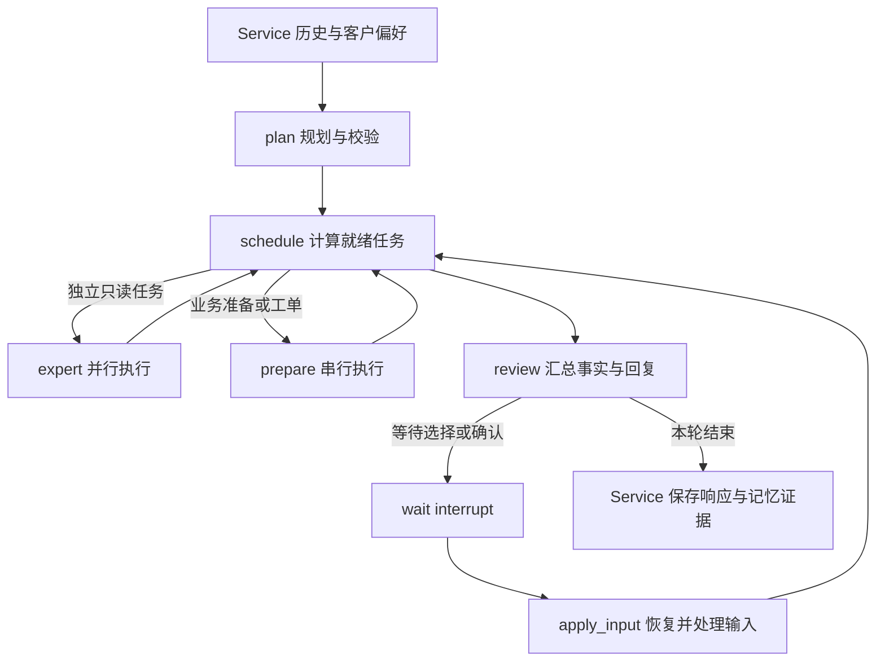

# 电商订单与售后助手

[English](README.en.md) · 中文

一个可以本地运行的小型多 Agent 业务应用。主对话层结合历史直接回答、澄清，或将业务请求拆成多个领域任务，交给订单、支付、退款、系统FAQ、知识库及联网搜索执行器按需协作。独立只读任务可以并行，存在条件或先后关系的任务按依赖执行；支付、退款由用户逐项确认后才修改 SQLite 业务数据。应用按会话保存最近讨论订单组，未指定订单的独立退款申请先查询本人全部订单并通过开关选单；客户偏好则独立保存，供新会话继续读取。

应用使用 DeepSeek 在线模型，默认 `deepseek-flash`，通过 OpenAI 格式的 Chat Completions 生成任务计划及资料回答。主图按能力登记调用领域工具，订单、支付、退款查询不再分别运行一轮模型选工具。支付、退款先生成待确认方案，用户逐项确认后才修改本地样例数据；等待选单或确认时当前会话暂停输入，其他客户会话可独立使用。

**所有订单、客户、支付和退款均为本地样例，不连接真实电商、支付、物流或人工客服平台。** 操作会改变样例数据库，但不会产生真实扣款、退款或通知。


## 1 先理解项目提供什么


| 能力               | 当前实现                                                                          | 边界                                                              |
| ------------------ | --------------------------------------------------------------------------------- | ----------------------------------------------------------------- |
| 主对话与多 Agent   | 主层生成结构化任务，支持只读并行、依赖和条件，确认后继续原计划                    | 领域专家在主图中以受控执行器实现；不要求每个专家独立调用模型      |
| 工具调用           | 领域执行器先调用受控工具，政策、搜索和综合解释由模型组织说明                      | 模型仍可能选错参数；工具负责校验                                  |
| 订单详情与支付事实 | 完整详情由订单、支付两个领域分别取数，区分订单状态、支付状态和支付方式            | `placed`只表示已下单，不能推断是否付款                            |
| 混合方案与续跑     | 收集当前必要选择，展示当前全部可准备方案；按钮确认后继续后续任务                  | 后续依赖未满足时不提前准备，聊天“确认”不执行资金操作            |
| 业务规则           | 退款统一检查付款、已有退款、余额及已下单/已签收状态；支付只接受 pending           | 不是完整真实商家退款规则                                          |
| 会话 Memory        | 展示最近 50 轮，保存最近订单与累计 Token；请求记录独立保留                        | 整张主图按节点持久化，未完成节点内调用可能重做                    |
| 长期客户偏好       | 手动保存回复/联系偏好；模型同次规划提取最多七类偏好候选，观察证据累计三次生效 | 支持回复习惯及购物品牌、品类、预算；不是训练模型，联系偏好不会发消息    |
| 记忆转换展示       | 候选1/3、2/3进度、已生效/撤销状态、来源原话及最近六条对话的提取记录               | 统计实际保存的证据；手动填写表单不累计观察次数                    |
| 上下文             | 最近 6 个完整用户轮次与会话内订单组                                               | 不是精确 Token 预算或摘要系统                                     |
| 模拟升级           | 明确转人工或正式投诉时生成原有本地工单                                            | 技术失败、含糊和闲聊不升级，没有外部通知                          |
| 客户范围           | 页面、当前会话、偏好及订单按客户隔离                                              | 编号可编辑，仅为本地身份切换，没有登录认证                        |
| 本地RAG            | 清单导入TXT/MD/文字PDF/DOCX，E5 Small编码，Qdrant过滤检索，综合说明引用原文       | 单平台、离线更新；没有OCR、混合检索、重排序或十万片段性能保证     |
| 系统FAQ            | 本地字典保留旧五类及新增system操作帮助；规划提示要求平台规则走RAG                 | 兼容旧FAQ能力，不作为知识库缺失的兜底                             |
| 资料浏览           | 分类、商品及关键词分页查询，展示全文与版本标签                                    | 只读页面，无上传编辑；版本标签不等于历史规则隔离                  |
| 通用联网           | DeepSeek 搜索接口检索后由模型组织回答，显示来源链接                               | 复用 DEEPSEEK_API_KEY；搜索与模型调用分别计费，失败不编造实时信息 |
| 操作确认与幂等     | 支付、退款逐项确认，按请求编号和动作结果重放                                      | 单实例验证，不等于真实资金渠道的完整幂等                          |

可以把本项目理解为“业务工具可验证、多角色切换可观察、记忆生命周期清楚”的独立应用。不要把它当成已经可以公开处理真实客户订单的生产系统。

## 2 目录与阅读顺序

### 2.1 当前文件与职责

```text
ecommerce-support-agent/
  app.py                      Streamlit 页面入口
  ui/
    chat.py                   消息、选单、支付方式及逐项确认展示
    memory.py                 偏好分类、证据、撤销与手动档案表单
    knowledge.py              目录筛选、分页和原文双栏浏览
    guide.py                  从Markdown加载使用说明与验收脚本
    i18n.py                   中英文界面文本与显示格式转换
    __init__.py               展示包标识
  api.py                      FastAPI 接口
  src/
    service.py                页面与 API 共用的应用服务
    orchestrator.py            唯一持久化协作主图
    planning.py               能力登记、任务与条件契约、语义规划
    tools.py                  订单、支付、退款、政策和本地工单工具
    actions.py                待确认动作、事务执行与结果回放
    dialogue.py               依据资料回答、风格约束与联网查询
    payment_methods.py        页面与后端共用的支付方式表
    llm.py                    DeepSeek 客户端与 Token 提取
    errors.py                 模型调用局部重试
    storage.py                会话快照、客户当前会话与档案存储
    memory.py                 历史消息、候选校验、偏好类别及三次观察阈值
    knowledge.py              文档解析、目录导入、商品定位、E5与Qdrant检索
    runtime_context.py        客户、请求编号与偏好的 ContextVar
    logging_config.py         可选 JSON 日志配置，入口未自动启用
    confirmation.py           独立确认图组件，当前主图不调用
    refund_flow.py            独立退款意图解析与订单号提取组件
    agents/
      base.py                 文本、Token 工具及独立工具调用循环
      order_agent.py          独立订单 Agent 与工具包装
      payment_agent.py        独立支付 Agent 与工具包装
      refund_agent.py         独立退款意图入口与工具包装
      faq_agent.py            政策读取函数及独立 FAQ 入口
    backend/
      db.py                   SQLAlchemy 数据表、连接与建表
      seed.py                 10 笔样例订单及状态
    __init__.py               src、agents、backend 均有包标识文件
  tests/                      隔离数据的离线业务、API、恢复与页面回归测试
  scripts/                    知识导入、真实模型页面及跨进程检查命令
  eval/                       自动评估场景、运行器与历史验证报告
  knowledge/                  manifest.json及200条政策、200件商品Markdown
  docs/                       业务实现文档、多轮使用说明和参考图片
  README.md / README.en.md    中英文运行、代码导航与行为说明
  IMPROVE*.md                  中英文分阶段优化成果与验收记录
  requirements.txt            本次验证的精确依赖
  requirements.in             顶层依赖范围
  pytest.ini                  pytest 的模块路径与测试目录
  Dockerfile                  应用容器入口
  compose.yaml                仅定义本地Qdrant服务及持久卷
  .dockerignore               排除密钥、虚拟环境与运行数据
  .gitignore                  版本控制忽略规则
  .streamlit/config.toml      默认浅色主题
  .env.example                配置模板
  LICENSE                     必要版权与开源许可
  NOTICE.md                   修改范围与版本标识
```

`data/`、`.env`、`.venv/` 和缓存属于本地运行产物，不是需要复制到源码中的模块。文件树列出当前主要文件，测试用例按主题分布在 `tests/test_*.py`。

### 2.2 建议阅读顺序与实际入口

1. `app.py` / `api.py`：了解页面交互和接口请求。
2. `service.py`：了解请求去重、历史组织、结果保存和原请求恢复。
3. `planning.py`：了解可用能力、任务契约、条件校验和模型规划。
4. `orchestrator.py`：了解并行查询、串行准备、等待输入和确认后续跑。
5. `tools.py` / `actions.py` / `backend/db.py`：核对业务事实、归属、资格和事务更新。
6. `storage.py` / `memory.py`：了解会话、候选证据、升级与撤销；`knowledge.py` / `dialogue.py`：了解导入、检索与引用回答。
7. `tests/` / `eval/run_eval.py`：对照离线断言与真实模型评估。

页面与 API 的业务入口都是 `SupportService`，其主图由 `build_workflow()` 构建。主图直接调用 `src/tools.py` 的领域函数，复用 `get_policies()`、`as_text()` 和 `sum_usage()`；**不经过 `run_order_agent()`、`run_payment_agent()`、`run_refund_agent()`、`run_faq_agent()` 或 `build_confirmation_graph()`**。这些独立组件仍在仓库中，阅读时应与当前入口区分。

### 2.3 核心入口与保留组件


| 要找的逻辑       | 主要入口                                                                                                                       |
| ---------------- | ------------------------------------------------------------------------------------------------------------------------------ |
| 聊天、重放与恢复 | `SupportService.chat()`、`_graph_result()`、`_submit()`；API对应第7节                                                          |
| 规划与调度       | `make_plan()`、`Plan`校验；主图`plan_node → schedule/dispatch → expert/prepare → review`，确认经`wait/apply_input`恢复      |
| 资格与资金状态   | `tools.py`查询及资格函数；`prepare_action()`准备、`decide_action()`事务执行                                                    |
| 记忆与证据       | `memory_candidates()`校验；`SupportStore.profile()/apply_memories()/forget_memory()`读写；阈值`MEMORY_OBSERVATIONS_REQUIRED=3` |
| 文档与引用       | `KnowledgeStore.ingest()/search()/documents()/document()`；`compose()`组织回答并检查来源                                       |
| 验证             | `tests/`离线回归，`scripts/ingest_knowledge.py`导入，`eval/run_eval.py`旧场景评估；边界见第5节                                 |

`agents/`中的独立模型工具循环、`confirmation.py`的独立确认图、`refund_flow.py`的解析入口仍保留并有对应测试，当前页面不通过这些组件执行整套业务。`ConversationMemory`只有`add_turn()`用于主服务历史构造，另外两个单订单辅助方法未接入；`logging_config.py`也未由页面或API自动启用。完整任务、状态和存储逻辑分别见第8～10节，不在此逐一罗列内部函数。

## 3 环境准备

推荐使用 Python 3.11，首次安装需要可用的包下载网络，并为Python依赖、E5缓存和索引预留磁盘空间；正常使用需要 DeepSeek API Key 和模型服务网络。已有阶段验证记录基于 macOS 的独立 Python 3.11 环境，本次文档同步未重新安装依赖。

解压后进入包含 `app.py` 的目录，后续命令均从这个目录运行。不要在另一个虚拟环境安装依赖后，又用系统解释器启动页面。

### 3.1 macOS 或 Linux

**首次安装并初始化 RAG（只需首次或模型、知识库被删除后执行）：**先启动 Docker Desktop，并按第6节填写 DeepSeek 配置。下面的资料导入会下载缺失的 E5 模型并初始化知识库，必须等成功退出后再启动页面。

```bash
python3.11 -m venv .venv
source .venv/bin/activate
python -m pip install --upgrade pip
python -m pip install -r requirements.txt
docker compose up -d qdrant
python -m scripts.ingest_knowledge --root ./knowledge
python -m streamlit run app.py
```

**日常重置：只恢复十笔初始订单，清空聊天、客户偏好和任务进度，保留模型与知识库。**

1. 先完全停止 Streamlit 和 FastAPI；Qdrant 可以保持运行。
2. 在 `data/` 中手动删除下表中的三个数据库，以及它们各自的 `-wal`、`-shm`、`-journal` 附属文件（存在时一起删除）。不要清空整个 `data/`。


| 手动删除             | 重置内容                                                           |
| -------------------- | ------------------------------------------------------------------ |
| `business.sqlite`    | 订单、支付、退款、工单、请求和动作记录；下次启动初始化十笔样例订单 |
| `memory.sqlite`      | 聊天展示快照、客户偏好、自动记忆及证据                             |
| `checkpoints.sqlite` | 原任务计划、待确认事项和恢复进度                                   |

**保留 `data/models/`、`data/qdrant/`、`data/knowledge.sqlite` 和 `data/knowledge.lock`。** 这样不需要重新下载模型或导入知识资料。自定义过 `SUPPORT_DATA_DIR` 或 `SUPPORT_AGENT_DB_URL` 时，要删除实际配置位置的对应数据库，见第6节。

3. 在项目根目录重新启动。确认 Docker Desktop 正在运行，然后执行：

```bash
cd /path/to/ecommerce-support-agent
source .venv/bin/activate
docker compose up -d qdrant
python -m streamlit run app.py
```

`docker compose up -d qdrant` 在容器已运行时可以重复执行，会保留现有向量数据。启动页面后应看到全新的十笔样例订单、空聊天与偏好，资料页仍保留已导入内容。无需每次重建 `.venv`、升级 pip 或重装依赖；重建虚拟环境本身也不会重置订单，重置由前面删除的三个数据库决定。

如果只关闭页面后直接重启、没有删除数据库，会继续保留上次的业务状态。若误删 `knowledge.sqlite` 或 `data/qdrant/`，再按首次流程重新导入；若连 `data/models/` 也删除，导入时还需要联网重新下载 E5。清空整个 `data/` 的恢复流程见第3.5节。

### 3.2 Windows 使用 WSL2

当前 `service.py` 和 `knowledge.py` 直接使用Unix的`fcntl.flock`，不能按原生Windows PowerShell流程直接运行；依赖快照中的`uvloop`也没有Windows排除标记。Windows用户需在WSL2 Linux环境中按第3.1节安装和启动，并确保该环境可连接Docker。WSL2完整流程未在本轮实测；原生Windows支持属于后续适配，不作为已实现能力。

### 3.3 使用 uv

```bash
uv venv --python 3.11
uv pip install --python .venv/bin/python -r requirements.txt
uv run --no-project --python .venv/bin/python streamlit run app.py
```

运行前仍须按第3.1节启动Qdrant并完成资料导入；uv命令不代替知识库初始化。Windows使用WSL2中的Linux解释器。没有uv时使用标准venv即可。

### 3.4 检查实际解释器

```bash
python --version
python -c "import sys; print(sys.executable)"
python -c "import langgraph, streamlit, sqlalchemy; print('依赖导入成功')"
```

第二条应显示当前 `.venv` 中的解释器。建议始终使用 `python -m pip`、`python -m streamlit`，减少命令指向不同环境的问题。

按第 6 节填写模型配置后，启动并访问 `http://localhost:8501`。客户编号默认为 `customer_a`，会话编号为 `case_1`。按 Ctrl+C 停止服务。默认会在项目 `data` 目录自动创建业务、会话与检查点数据库，并填入十笔样例订单；这一步不下载 E5，也不自动导入知识库。首次 RAG 初始化、日常重置和 Docker 启动命令均在[第3.1节](#31-macos-或-linux)；清空整个 `data/` 后的详细恢复说明见第3.5节。

### 3.5 清空整个 data 后完整重建

以下步骤适用于当前 macOS/Linux 项目环境。依赖安装和 DeepSeek 配置按第3、6节完成；Docker Desktop 需要处于运行状态。若只删除了 `data/`，已有的 `.venv/` 通常不需要重新安装。

**先停止再清理：**停止 Streamlit 和 FastAPI 进程；在项目根目录执行下面命令停止使用向量目录的 Qdrant 容器。

```sh
cd /path/to/ecommerce-support-agent
docker compose stop qdrant
```

此时再按你的习惯手动清空 `data/`。首次安装不需要执行删除。清理完毕后，仍在项目根目录依次执行：

```sh
docker compose up -d qdrant
.venv/bin/python -m scripts.ingest_knowledge --root ./knowledge
.venv/bin/python -m streamlit run app.py --server.address 127.0.0.1 --server.port 8501
```

**第二条命令同时完成模型准备与知识库初始化：**读取清单和原文 → 下载或加载 E5 → 切分资料并生成向量 → 写入 Qdrant 和 `knowledge.sqlite` → 校验并标记 `ready`。不需要手动下载权重后再“导入模型”。模型缓存被删后，这一步需要联网；下载失败时应先解决网络问题再重试，不能直接启动页面当作已恢复 RAG。

请等导入成功退出后再执行页面启动命令。导入当前模拟资料的成功输出应包括：

```json
{"documents": 400, "products": 200, "status": "ready"}
```

需要使用 API 时，在另一终端、相同环境配置下启动：

```sh
.venv/bin/python -m uvicorn api:app --host 127.0.0.1 --port 8000
```

启动后打开 `http://127.0.0.1:8501`，在“平台资料详情”核对资料总数400、索引状态 `ready`，再询问“退货需要几天内申请，定制商品能退吗？”，检查回答是否有原文来源。应用启动负责新业务库与十笔订单初始化；原始资料和本地模型的恢复由前面的导入命令负责。

## 4 完整业务体验

先按第3节完成模型配置、Qdrant启动及400份模拟资料导入。使用**全新业务与记忆数据库**，选择`customer_a`、会话`walkthrough`；每次只发送一行对话，等待回复或完成指定页面操作再继续。本节是一条手工体验路线，不是所有轮次已经通过的自动报告。


| 轮次 | 输入或页面操作                                                                   | 关键观察点                                                                                               |
| ---- | -------------------------------------------------------------------------------- | -------------------------------------------------------------------------------------------------------- |
| 1    | “你好。以后请用中文，先给结论再解释，请记住这两项回复偏好。”                   | 消息及时展示；完成后记忆页可核对明确偏好及用户原话。                                                     |
| 2    | “请详细一点，说明查询订单和提交退款有什么不同。”                               | 详略习惯可以成为观察候选，单次不直接认定永久偏好。                                                       |
| 3    | “请详细一点，解释申请已记录与退款到账的区别。”                                 | 平台规则先检索；观察证据按不同请求累计。                                                                 |
| 4    | “请详细一点，说明新建会话后哪些信息保留。”                                     | 系统操作帮助走FAQ；若三轮提取为同类同值，可在记忆页看到1/3、2/3至生效，未提取时如实显示。                |
| 5    | “同时查1002物流和1003支付状态，只查询。”                                       | 独立只读协作；1002为shipped，1003为pending，无资金动作。                                                 |
| 6    | “查1003商品说明，解释HDMI兼容条件，并核对订单金额。”                           | 订单商品名关联扩展坞资料；DP Alt Mode来自原文，34.50来自业务库。                                         |
| 7    | “退货期限和定制商品规则是什么？再查1001本地退款资格，只查询。”                 | 引用七日与定制例外；本地程序未检查期限、品类和包装，不把eligible当作全部平台规则满足。                   |
| 8    | “我要申请退款，先让我选单，不要自动沿用刚才编号。”                             | 查看本人候选：可退者优先，默认前三笔，展开全部后不可退项无开关。                                         |
| 操作 | 选择1001和1006、提交；先确认1001，再取消1006；刷新页面。                         | 逐项确认，1001为requested，1006未申请；刷新不应重复执行。等待期间当前会话禁用聊天输入。                  |
| 9    | “核对1001与1006的退款状态，再为1001申请一次。”                                 | 使用工具重查，拒绝已有申请，不把取消或准备当成提交。                                                     |
| 10   | “1002已签收才准备退款，否则只查物流；同时查9999详情。”                         | 1002未签收，条件动作跳过；9999错误不抹掉独立成功结果，也不自动转人工。                                   |
| 11   | “先准备支付1003，成功后只检查退款资格。”                                       | 在方式界面取消支付，后续依赖成功的检查应跳过；状态仍pending。                                            |
| 12   | “重新为1003准备支付，付款成功后只检查退款资格，不申请。”                       | 选择微信支付；确认前刷新或重启（不删库），回到原会话再点确认。原计划继续，paid后重查资格，无退款申请卡。 |
| 13   | “查1003完整详情和支付方式，再为它付一次。”                                     | placed与paid可以并存；方式wechat_pay；已付款不重复支付。                                                 |
| 14   | “体验不好，我只问怎样投诉，不要转人工或建工单。”                               | 情绪与咨询不视为升级授权。                                                                               |
| 15   | “查北京最新天气与1002物流。下雨是否证明它因天气延误？”                         | 联网与本地事实分开取证，注明可用来源时间；没有因果证据就说明不足，搜索失败如实说明。                     |
| 16   | “现在我要正式投诉订单1002的处理体验，请转人工并记录诉求。”                     | 创建有编号的本地工单；没有真实通知或真人接单承诺。                                                       |
| 17   | 同一客户点击“新建会话”，再问“我的回复偏好是什么？”                           | 新会话不带旧聊天和订单指代，长期偏好及业务状态仍保留。                                                   |
| 18   | “请忘记关于回答详细程度的偏好，保留中文和先结论。”                             | 记忆页核对撤销；也可使用“忘记此偏好”按钮，旧证据不自动恢复。                                           |
| 19   | 切换`customer_b`并新建会话，输入“列出我的订单，查询1008至1010详情；也查1001。” | B只拥有1008～1010；A的1001及其客户偏好不能泄露。                                                         |
| 20   | 切回A、返回`walkthrough`，核对1001退款、1003付款和会话记录。                     | 客户独立会话恢复，真实已执行状态保留，未确认动作不算执行。                                               |

侧栏可切换中文/English界面，不会改写历史消息、原话证据、知识原文或长期回复语言偏好。每轮可展开**任务进度、工具执行轨迹和来源**核对调用。观察次数以实际提取的同类同值证据为准，手动保存表单不累计次数；聊天中说“确认”不替代资金按钮。前端“平台资料详情”可按分类、商品和文档编号浏览全文。

这条路线串起消息展示、客户隔离、确认与状态保护、FAQ/联网、条件多任务、RAG和自动记忆。六轮上下文、五十条展示窗口、API重放和并发故障等边界，分别见第9节、第5节及[五组77轮手工脚本](docs/usage_and_scenarios.md)。各组脚本应独立初始化；仅新建会话不重置订单。

## 5 不打开页面也能验证

```bash
python -m pytest -q                         # 离线回归
python scripts/check_ui.py                  # 真实模型页面检查
python scripts/check_restart.py             # 真实模型跨进程恢复检查
python eval/run_eval.py --dry-run           # 仅检查场景操作登记
```

`pytest`不调用真实模型；两个check脚本使用临时数据库，但需要模型密钥并产生请求费用。页面多轮脚本是手工验收说明，不等于已全部执行。

`eval/run_eval.py`在线运行会调用模型并按场景处理模拟动作；每次使用新库。该评估器尚未导入临时知识库，不能作为完整RAG验收。历史真实模型及RAG记录见[验证说明](eval/results/README.md)。

三组长对话可运行`python eval/run_long_conversations.py --report eval/results/long-conversations-new.json`：使用真实API、现有中文知识索引及隔离模拟业务库，包含交互和重放，会产生调用费用；需先完成知识库导入。

## 6 接入在线模型

首次复制 `.env.example` 为 `.env`，填入以下配置；已有配置时直接编辑，避免覆盖密钥。

```dotenv
DEEPSEEK_API_KEY=你的密钥
DEEPSEEK_BASE_URL=https://api.deepseek.com
DEEPSEEK_MODEL=deepseek-flash
```

规划与资料回答使用在线DeepSeek；E5只负责本地向量编码。模型采用Chat Completions，默认非思考、非流式、temperature=0、60秒超时；技术失败局部重试，规划格式另可修复三次。模型名可配置，账号可用性与价格以供应商为准。

联网搜索共用密钥与地址，调用`/v1/tools/search`，最多5条结果、15秒超时；仅兼容Chat Completions的替代服务不一定支持搜索。

| 数据配置 | 默认值与用途 |
| --- | --- |
| `SUPPORT_DATA_DIR` | 项目`data/`；业务、记忆、检查点、知识目录与模型缓存 |
| `SUPPORT_AGENT_DB_URL` | 留空；非空时仅覆盖业务库地址 |
| `SUPPORT_QDRANT_URL` | `http://127.0.0.1:6333` |

**数据配置须在启动Python前导出为进程环境变量。** 业务连接与记忆路径可能早于`.env`加载；只修改`.env`不能可靠地移动全部数据。导入和应用必须使用相同配置；Compose的`./data/qdrant`卷需独立调整。

```bash
SUPPORT_DATA_DIR=/absolute/path/support-data python -m streamlit run app.py
```

配置修改后重启服务；不要提交`.env`。

## 7 使用 FastAPI

```bash
python -m uvicorn api:app --host 127.0.0.1 --port 8000
```

打开[交互文档](http://127.0.0.1:8000/docs)查看请求模型，健康检查为`GET /health`（不检查模型或索引）。

| 接口 | 用途 |
| --- | --- |
| `POST /chat` | 发起聊天；返回会话、回复、任务、来源及办理状态 |
| `GET /requests/{request_id}` | 用客户和会话编号读取原请求 |
| `POST /requests/{chat_request_id}/select-orders` | 提交或取消退款选单 |
| `POST /requests/{chat_request_id}/select-payment-method` | 选择或取消支付方式 |
| `POST /requests/{chat_request_id}/resume` | 确认或取消当前资金动作 |
| `GET /users/{user_id}/memories` | 读取档案、候选及已保存/撤销记忆 |
| `DELETE /users/{user_id}/memories/{key}` | 撤销七类偏好中的指定类别 |
| `GET /knowledge/documents` | 按类型、分类、商品或关键词分页浏览 |
| `GET /knowledge/documents/{document_id}` | 读取元数据与原文 |

```bash
curl -X POST http://127.0.0.1:8000/chat \
  -H 'Content-Type: application/json' \
  -d '{"user_id":"customer_a","session_id":"case_api","request_id":"query_001","message":"查询订单1002的物流"}'
```

同一会话的新消息使用新`request_id`；重试相同请求使用原编号。去重范围是客户＋请求编号，跨会话也不能复用编号处理不同内容。消息最多2000字符，POST请求禁止额外字段。

等待选择时提交对应`input_id`，等待确认时提交`current_action.action_id`；恢复路径始终使用原聊天编号，操作请求另用新编号。支付方式为`card/visa/alipay/wechat_pay/paypal`，只选择方式不会付款。聊天“确认”不执行资金操作。

聊天处理中返回202，其他正常响应通常为200；请求体校验失败422，请求冲突409，聊天服务校验失败400，未捕获的聊天/恢复运行错误503。业务拒绝或子任务失败可能仍返回200，应检查任务和动作结果。具体错误映射以接口代码为准；记忆读取的无效编号目前未统一映射为客户端错误。

接口没有登录认证或上传发布功能。页面与API共用服务逻辑，但不建议多个进程同时写同一会话。

## 8 LangGraph 多专家怎样协作

### 8.1 任务计划与调度

入口模型直接回答、澄清，或生成经过校验的领域任务。调度器并行执行独立只读任务，串行准备业务动作；依赖成功且条件满足才继续。知识检索只返回证据，后置综合任务组织回答。模型规划不是业务事实，工具仍须校验客户归属和资格。



`SupportService.chat()`先按客户与请求编号查重，再把最近六个完成轮次及客户档案送入主图。规划结果是直接回答、澄清或任务计划；任务的来源片段必须出现在本轮输入中。相同任务合并，依赖只能指向前置任务，知识检索必须交给依赖它的综合任务回答。

完整订单详情由订单、支付两个领域取数；单查物流或付款只调用必要领域。订单已下单不代表未付款，两类状态分别展示。任务依赖、条件、结果和真实参与者可在页面展开查看；操作登记与字段契约见`src/planning.py`，不在此重复完整schema。

### 8.2 确认与业务规则

退款检查本人订单、已付款、正余额、无已有退款，且订单为已下单或已签收。支付只处理待付款记录。选择、准备和最终确认分开；每次只确认当前动作，旧按钮不能推进下一项。退款申请已记录不代表到账。

主图通过SQLite检查点保存进度，选择和确认恢复原计划。业务变更与动作结果在同一事务内提交，重复确认回放已有结果；未完成节点内的模型或只读调用仍可能重做。

### 8.3 请求、任务与业务状态

请求完成只表示本轮不再等待，不代表所有子任务成功。独立失败保留其他任务结果；取消或失败不满足后续成功依赖。知识政策用于解释，不直接改变本地退款资格。只有明确人工介入或正式投诉才生成本地工单，技术失败不会自动升级。

### 8.4 本地知识库与有来源的回答

随项目提供200条虚构平台政策与200件商品资料。多语言E5 Small在CPU生成384维归一化向量，文档与问题分别带passage/query前缀。Qdrant检索片段，SQLite保存目录、别名和全文；首次导入可下载模型，普通查询只读本地缓存。

商品通过编号、名称、型号或别名精确定位，不用相似商品替代未知对象。普通检索召回12项，按文档与章节去重后最多保留6项；检索与综合说明各限制6000个E5 tokenizer tokens的证据，不是完整模型输入预算。综合任务只传入所需事实和证据，由模型返回回答、使用的来源编号与资料是否不足；程序检查来源编号是否属于本轮证据。来源编号合法不代表每句回答都忠实。

应用运行与导入使用共享/独占文件锁，更新资料前须停止应用。进入索引写入后失败会阻止检索，前期校验失败可能保留旧索引。资料页提供分类筛选、分页与全文浏览；标题/商品名/编号关键词查询不等于型号或别名检索。资料缺失不以通用常识或联网替代平台规则。

### 8.5 导入你自己的外部知识资料

支持 UTF-8 TXT、Markdown、文字型 PDF 和 DOCX，不支持直接导入扫描件图片或 CSV/XLSX。把资料放在例如 `my_knowledge/` 的目录中，并编写 `manifest.json`：登记商品编号、名称、型号、别名，以及文档编号、相对路径、类型、分类、版本和商品引用。仅复制文件到目录不会自动导入。下面是最小目录与清单，路径均相对资料根目录：

```text
my_knowledge/
  manifest.json
  policies/returns.md
  products/headphones.md
```

```json
{
  "products": [
    {
      "id": "MY-001",
      "name": "我的无线耳机",
      "model": "MY-H01",
      "aliases": ["Wireless Headphones", "我的耳机"]
    }
  ],
  "documents": [
    {
      "id": "MY-POL-001",
      "file": "policies/returns.md",
      "title": "退货期限与例外",
      "kind": "policy",
      "category": "退货",
      "version": "1"
    },
    {
      "id": "MY-DOC-001",
      "file": "products/headphones.md",
      "title": "我的无线耳机说明",
      "kind": "product",
      "category": "耳机",
      "version": "1",
      "product_id": "MY-001"
    }
  ]
}
```

把实际条款写入`returns.md`、规格和兼容限制写入`headphones.md`。`file`不能指向资料根目录外；商品文档须引用已登记的`product_id`。要关联订单1001，保留其商品名`Wireless Headphones`作为别名；其他订单同理。跨语言语义检索不代替商品身份的精确别名匹配。

停止页面和 API、保持 Qdrant 运行，然后执行：

```sh
.venv/bin/python -m scripts.ingest_knowledge --root ./my_knowledge
```

导入成功后重启应用，并在资料详情页核对实际数量与原文。**清单表示当前整套知识库，不是追加列表：未在新清单中登记的旧文档会从当前目录和向量索引移除。** 如果需要同时保留模拟资料和自己的资料，要把它们放进同一套完整清单，并准备好对应文件。原始文档不会被导入程序删除。

后续修改原文或清单后需要重新运行导入，未变化的文件会跳过编码；只改文件但不导入，聊天仍使用上一次的内容。进入索引写入后失败会阻止检索，修复后重新运行；前期文件或清单校验失败可能仍保留此前可用的旧索引。导入不需要 DeepSeek 回答调用；正式聊天仍需要第6节的在线模型配置。仅向量生成和检索在本地运行，命中片段会交给在线 DeepSeek 综合回答。

以上路径按默认配置书写。使用自定义目录时，在启动 Python **之前**导出 `SUPPORT_DATA_DIR` 和需要的 `SUPPORT_QDRANT_URL`，导入与应用必须使用相同设置；仅修改 `.env` 不能可靠地配置全部数据连接。`compose.yaml` 的宿主机卷仍固定为 `./data/qdrant`，不会随 `SUPPORT_DATA_DIR` 自动移动；如需改变向量文件位置，应同时修改卷映射。业务库若被 `SUPPORT_AGENT_DB_URL` 覆盖，则应重置该地址对应的库，详见第6节。

中英文问题共用这一份中文知识库，不维护第二份英文清单。英文问题可在已有规划调用中拆成独立检索任务，并生成等价中文检索词；商品仍按SKU、型号、名称和已登记别名精确定位。英文政策概览同样支持。资料回答优先遵守本轮明确语言要求，其次是已生效的回复语言偏好，否则跟随问题主要语言；中文原文可用英文解释，引用标题与原文仍保留中文。界面语言开关只改变控件文案。跨语言检索仍可能漏召回，证据不足时应明确说明。

资料详情在页面第三个标签；记忆与知识目录的API参数、响应及错误边界统一见第7节。

## 9 Memory 的设计

### 9.1 业务、会话与检查点分开保存


| 数据                                  | 文件或位置                              | 键与范围                               | 作用                                               |
| ------------------------------------- | --------------------------------------- | -------------------------------------- | -------------------------------------------------- |
| 订单、支付、退款、工单                | data/business.sqlite                    | 订单或工单编号                         | 业务事实，工具直接读写                             |
| 聊天及确认请求、响应、累计 Token 来源 | data/business.sqlite 的 requests        | user_id + request_id                   | 请求重放与聊天展示的权威记录                       |
| 对话展示快照、最后订单、累计 Token    | data/memory.sqlite 的 sessions          | user_id + session_id                   | 缓存最近 50 轮展示与最近订单组                     |
| 待确认方案及执行结果                  | data/business.sqlite 的 pending_actions | action_id                              | 确认、事务执行与结果回放                           |
| 协作主图检查点                        | data/checkpoints.sqlite                 | 根据客户、会话、原请求派生的 thread_id | 保存任务计划、节点结果、选择及等待位置，确认后续跑 |
| 客户当前会话                          | data/memory.sqlite 的 current_sessions  | user_id                                | 页面切换与重启后恢复各自会话                       |
| 手动回复与联系偏好                    | data/memory.sqlite 的 profiles          | user_id                                | tone/contact_preference及手动更新时间              |
| 自动回复记忆                          | data/memory.sqlite 的 memories          | user_id + key                          | 每类一条当前值、来源、状态和时间                   |
| 用户原话证据                          | data/memory.sqlite 的 memory_evidence   | user_id + request_id + key             | 去重证据、偏好值和原请求时间                       |
| 知识目录和原文                        | data/knowledge.sqlite                   | 文档、别名与索引状态                   | 只读浏览与检索定位；向量另存在Qdrant               |

表中的路径为默认配置，自定义数据目录与业务库地址的启动方式见第6节。会话快照与档案由 `SupportStore` 保存，聊天从 `requests` 重建；会话快照不是 LangGraph 检查点。整张主图用 `SqliteSaver` 保存计划与节点进度，使用 `interrupt` 和 `Command` 恢复；未完成节点内部的模型或只读调用可能重新执行。业务变更依赖事务动作结果防重，不能宣称每条模型调用都独立断点恢复。

### 9.2 最近订单如何产生

服务按原请求汇总各任务工具事实中的可访问订单编号，保存`recent_order_ids`；读取已保存结果时仍重查归属。不使用自然语言回答中提到的订单号，也不使用最后一次工具调用决定退款对象。

订单组只有一笔时，会话快照提供 `last_order_id`，多笔时为空。当前服务只用 `ConversationMemory.add_turn()` 构造历史，不调用 `update_last_order_id()` 或 `context_note()`，也不把 `last_order_id` 自动填入工具参数；规划器根据近期已完成聊天理解“这笔订单”等指代，目标仍需经过工具校验。

执行目标来自计划中的本任务编号、上游结果或用户选择。无明确对象的独立退款申请返回 `awaiting_selection`，查询本人全部订单，可退款优先、同组按订单号排序；默认前三笔，可展开全部，不合格订单没有选择开关。原计划内已经绑定订单的条件退款继续使用该目标。

### 9.3 为什么新会话不自动沿用订单

“上次看的订单”并不一定是“本次售后要处理的订单”。把 last_order_id 限制在会话内，能减少把新任务写到旧订单上的风险。客户回复偏好可以跨会话共用，因为它的含义更稳定，也不会直接选择某一笔业务操作对象。

### 9.4 上下文窗口与保留策略

会话展示最多保留最近50轮，包括处理中和待确认轮次；服务从这份展示快照中取最近6个 `completed` 轮次，即最多12条 HumanMessage/AIMessage，提供给入口规划。资料回答还可使用本轮事实与相应历史。`completed` 不要求每个子任务都成功。`requests` 不随展示裁剪而删除，Token 累计按该客户、该会话的全部聊天请求统计，但仍不能视为完整业务审计系统。工具消息不会作为未配对的片段保存为下一轮模型历史。

输入最多2000字符。当前对知识证据限制6000个E5 tokenizer tokens，但没有对历史、系统提示、业务事实等完整模型输入做精确总预算，也没有自动摘要。最近六轮可能遗漏重要旧约束；会话订单组与显式选单能缓解订单指代问题，但不能替代完整上下文管理。

### 9.5 偏好是数据 不是执行指令

客户档案作为数据提供给规划与资料回答节点。规划节点和每个领域执行器分别绑定客户、偏好与请求的ContextVar，结束后恢复；并行执行器各自使用数据库会话，避免客户上下文串用。

这不等于完整提示注入防护，也不等于认证上下文。客户编号仍可手动切换，但业务工具、准备、执行与结果读取均校验该客户的订单归属。接入真实业务前仍需从经过认证的身份确定客户。

档案字段为 `tone` 和 `contact_preference`，保存时分别截取前50、100字符；自动提炼另存于`memories`与`memory_evidence`，不写回这两个手动字段。已提交的选单、方式和动作记录可持久恢复，尚未提交的页面开关草稿只在 Streamlit 会话内保存，不能当作跨进程持久数据。

### 9.6 从对话提炼长期回复偏好

候选随同一次规划提取，不额外调用Memory Agent。回复偏好包括详略、组织、语言与语气；购物偏好包括下面三类。候选必须带本轮用户原话，每类最多一条、总共最多七条；无效候选单独丢弃。

明确长期要求直接生效，普通观察按不同请求的同类同值证据累计三次；前两次仍为候选。同义表达的归一依赖模型。观察不覆盖明确设置或撤销；购物偏好生效后只能明确修改。忘记后可用新的明确要求重新启用。

只有原聊天全部结束才写入记忆，表单保存和恢复确认不累计观察。写入失败保留pending状态，不回滚业务；重放原请求可补写，没有后台补写队列。“已检查”不等于每条候选已生效。资料回答不接收候选偏好，手动与自动设置的冲突仍主要由提示解释。

### 9.6.1 购物偏好

对话可提取品牌、品类、预算三类摘要；明确长期设置直接生效，同类同值在不同请求中观察三次才首次生效。单次需求、代购和购买付款行为不应形成长期偏好。已生效购物偏好只接受明确修改；撤销后观察不会恢复。候选不用于资料回答，当前要求优先。预算保留用户说明的适用范围，不自动推断全局预算。页面支持查看证据与忘记，API沿用记忆查询和撤销接口。模型提取依赖自然语言理解，原话证据校验不能保证分类一定正确。现有商品资料没有品牌和售价字段，不能据此证明商品满足偏好。


## 10 数据初始化 观察与重置

导入 `src/tools.py` 时执行建表和 `_ensure_seeded()`，仅在订单表为空时调用 `seed()` 填入10笔样例。初始数据如下，金额未配置币种字段：


| 订单 | 归属       | 商品                     | 金额   | 订单状态  | 支付状态 | 记录方式 | 退款状态  |
| ---- | ---------- | ------------------------ | ------ | --------- | -------- | -------- | --------- |
| 1001 | customer_a | Wireless Headphones      | 79.99  | delivered | paid     | card     | none      |
| 1002 | customer_a | Mechanical Keyboard      | 129.00 | shipped   | paid     | card     | none      |
| 1003 | customer_a | USB-C Hub                | 34.50  | placed    | pending  | card     | none      |
| 1004 | customer_a | Standing Desk            | 349.00 | delivered | paid     | paypal   | requested |
| 1005 | customer_a | Desk Lamp                | 24.99  | cancelled | refunded | card     | completed |
| 1006 | customer_a | Bluetooth Speaker        | 59.99  | delivered | paid     | card     | none      |
| 1007 | customer_a | Laptop Stand             | 42.00  | shipped   | paid     | paypal   | none      |
| 1008 | customer_b | Webcam 1080p             | 55.00  | placed    | pending  | card     | none      |
| 1009 | customer_b | Ergonomic Mouse          | 29.99  | delivered | paid     | card     | none      |
| 1010 | customer_b | Noise-Cancelling Earbuds | 149.00 | shipped   | paid     | card     | none      |

初始 A 可退款1001、1006，可支付1003；B 可退款1009，可支付1008。`customer_name` 是样例展示姓名，访问归属以 `customer_id` 为准，不按姓名识别客户。

正常重复运行不会重置已改状态。单独运行 `python -m src.backend.seed` 会按主键覆盖样例订单、支付和退款行，却不清空聊天请求、动作或主图检查点；它不是完整重置命令，不应作为日常启动步骤。

当前启动与切换行为如下：


| 使用情形                               | 启动或切换后的行为                                                     |
| -------------------------------------- | ---------------------------------------------------------------------- |
| 用户停止服务并手动删除全部数据库后启动 | 创建当前结构的新库，初始化一次样例数据                                 |
| 正常重启、刷新或切回已有客户/会话      | 加载已有订单、聊天、已提交选择和待确认退款；恢复原计划，不重新填充样例 |
| 新建会话                               | 新会话不继承聊天与近期订单；业务状态、客户偏好及原会话待确认事项仍保留 |

个人验证采用手动重置：先完全停止页面与 API，删除实际数据目录中的 `business.sqlite`、`memory.sqlite`、`checkpoints.sqlite` 及其 SQLite 附属文件，再重启。保留 E5 模型与已导入知识库的清理列表和 Docker 启动命令已放在[第3.1节的日常重置步骤](#31-macos-或-linux)。如果清空整个 `data/`，还会删除模型缓存、知识目录和向量索引；清理前须停止 Qdrant，之后按[第3.5节](#35-清空整个-data-后完整重建)重新下载模型并导入资料。配置了 `SUPPORT_AGENT_DB_URL` 时，业务库以该地址为准，单改 `SUPPORT_DATA_DIR` 不会切换它。也可按第6节启动命令设置全新目录，并同步调整或清除业务库覆盖地址。不要在服务运行时删除数据库。

保留必要建表和空订单表填充逻辑，移除旧会话表识别/重建分支。不实现旧数据库迁移、历史归档、归属回填或历史版本隔离；本轮不安排数据库损坏、缺表与旧版本兼容专项测试。

只读观察数据库：

```bash
python - <<'PY'
import sqlite3
with sqlite3.connect('file:data/business.sqlite?mode=ro', uri=True) as db:
    print(db.execute('SELECT order_id,status,reason FROM refunds ORDER BY order_id').fetchall())
    print(db.execute('SELECT order_id,status,method FROM payments ORDER BY order_id').fetchall())
    print(db.execute('SELECT ticket_id,status FROM tickets').fetchall())
PY
```

这是 macOS/Linux Shell 示例。Windows 可将 Python 段保存为 `inspect_db.py` 后运行。自定义数据路径时同步修改查询路径。不要在示例中记录或展示真实客户信息。

### 10.1 清空 data 会删除什么

**清空整个 `data/`（包括子文件夹内容）会删掉本地 E5 模型缓存和知识索引。** 即使模型已经加载进当前进程内存，重启后也需要重新从磁盘加载，不能依靠删除前的运行状态继续使用。

以下是默认配置下各项内容的区别：


| 路径                                               | 保存内容                                                           | 删除后的恢复方式                                                   |
| -------------------------------------------------- | ------------------------------------------------------------------ | ------------------------------------------------------------------ |
| `data/models/`                                     | `intfloat/multilingual-e5-small` 的模型权重、配置和 tokenizer 缓存 | 运行资料导入命令时联网重新下载                                     |
| `data/qdrant/`                                     | Qdrant 的知识片段、向量和索引；容器`/qdrant/storage` 的宿主机目录  | 启动 Qdrant 后重新导入资料                                         |
| `data/knowledge.sqlite`                            | 导入后的文档全文、商品别名、目录和索引状态                         | 重新导入原始资料；只保留 Qdrant 向量不够                           |
| `data/business.sqlite` 及其 `-wal`、`-shm` 文件    | 样例订单、付款、退款、工单、请求与动作记录                         | 应用启动时创建新库并初始化十笔样例订单                             |
| `data/memory.sqlite` 及其附属文件                  | 会话快照、客户偏好、自动记忆及证据                                 | 应用启动时新建；偏好与证据丢失，聊天仍可从保留的业务库requests重建 |
| `data/checkpoints.sqlite` 及其 `-wal`、`-shm` 文件 | 原任务计划、节点进度和待确认事项                                   | 应用启动时新建；旧任务不能继续恢复                                 |
| `data/knowledge.lock`                              | 导入与应用之间的文件锁入口                                         | 使用时自动创建；不能通过删除运行中的锁文件来解除占用               |

原始 Markdown 和清单位于项目的 `knowledge/`，不在 `data/` 中。只清空 `data/` 不会删除这400份原始资料，也不会删除 `.venv/`、`.env` 或 Docker Desktop 中的 Qdrant 镜像。Qdrant 是数据库服务，不是另一个语言模型；DeepSeek 仍是在线回答模型，本机没有下载它的权重。

E5 的缓存目录为 `data/models/models--intfloat--multilingual-e5-small/`，其中 `snapshots/` 与 `blobs/` 共同组成模型缓存。需要保留或备份模型时保留完整目录，不要只留部分权重文件。

## 11 部署方式

### 11.1 固定服务器

```bash
python -m streamlit run app.py --server.address=0.0.0.0 --server.port=8501
```

使用稳定的绝对数据目录。公开服务需要 HTTPS、真实身份验证、订单授权、备份和日志策略。当前代码适合本地或受控演示，不提供这些生产能力。

### 11.2 Docker：Qdrant服务与应用容器

`compose.yaml`只定义Qdrant，不包含Streamlit或FastAPI。按第3.1节在宿主机运行Python应用时，用`docker compose up -d qdrant`启动向量服务；它把127.0.0.1:6333映射到容器6333，`./data/qdrant`映射到`/qdrant/storage`。模型下载、离线导入和全部清理后重建统一见第3.5节，避免在本节重复另一套初始化步骤。

`Dockerfile`另定义Python 3.11应用镜像，默认Streamlit监听容器8501、数据目录`/app/data`，不启动Qdrant，也不下载模型或自动导入。若将应用也容器化，必须先完成资料初始化、共享完整数据目录，并让应用通过Docker网络访问Qdrant，不能使用容器自身的127.0.0.1作为Qdrant地址。例如在默认项目名下：

```bash
docker compose -p ecommerce-support-agent up -d qdrant
docker build -t ecommerce-support-agent .
docker run --rm --network ecommerce-support-agent_default \
  -p 127.0.0.1:8501:8501 --env-file .env \
  -e SUPPORT_DATA_DIR=/app/data -e SUPPORT_AGENT_DB_URL= \
  -e SUPPORT_QDRANT_URL=http://qdrant:6333 \
  -v "$PWD/data:/app/data" ecommerce-support-agent
```

上述应用容器命令依据当前Dockerfile与Compose网络编写；应用镜像构建及整套应用容器端到端流程尚未验收。已有本地运行检查仅覆盖Qdrant容器、宿主机导入/检索和Streamlit页面，不能据此宣称完整容器部署已验证。自定义项目名时同步调整网络名，避免与宿主机应用同时写同一数据目录。

`--env-file`在Python前注入配置；`.dockerignore`排除本地.env、.venv和data，模型缓存不会随镜像复制，原始knowledge资料会随源码复制。持久卷须包含业务、记忆、检查点、知识目录和模型缓存；Qdrant使用自己的数据映射。自定义SUPPORT_DATA_DIR不会自动修改Compose卷。清空整个data前先停止页面/API和Qdrant。

### 11.3 托管 Python 平台

需要平台支持长运行 Python、Streamlit 所需连接以及持久卷。启动命令和端口按平台要求配置，数据目录指向卷挂载点。只有临时文件系统的平台不能保证重启后状态保留。

多实例部署前应将会话和业务库迁移到可共享数据库，处理并发会话更新、连接池与事务。当前 RLock 只在一个服务对象、一个进程内有效。

### 11.4 Supabase 与 PostgreSQL

Supabase 可以作为 PostgreSQL 和认证后端，但不能直接代替 Python Agent 运行环境。

以下是未来部署改造建议，本轮没有实现 PostgreSQL 适配或旧数据库迁移。需要分别处理：

1. 业务层：SQLAlchemy 模型与连接迁移，重新初始化数据表，核对唯一约束、事务和金额类型。
2. 记忆层：SupportStore 目前使用 SQLite 的 `?` 占位符和特定 upsert，需改连接管理、SQL 与并发更新策略。

再把页面可编辑客户编号改成服务端从认证令牌获得的身份，沿用现有订单归属校验。主图使用SQLite Checkpointer；未来若部署多实例，需另行设计共享检查点与并发控制，本轮不实现数据库迁移。

### 11.5 Vercel

当前 Streamlit 应用不是静态网页，不能直接作为静态项目上传。若需要 Vercel 前端，可改为 Next.js 页面，通过 FastAPI 调后端 Agent 服务；数据库和身份系统另行持久化。这是二次架构改造，交付包没有包含该前端实现。

## 12 可以继续完成的优化

### 12.1 真实身份认证

从服务端认证令牌确定客户身份，替换可编辑的演示客户编号，并补充登录、令牌和授权测试。

### 12.2 真实资金渠道

增加支付供应商幂等键、回调验签、对账和异常补偿；本地事务防重不能替代渠道一致性。

### 12.3 记忆质量与纠错

评估同义偏好规范化、多候选冲突，以及手动/自动偏好的确定性合并；按需求设计后台补写、过期策略和用户纠错。数据留存治理需另定范围，不将迁移或历史隔离混入当前初始化流程。

### 12.4 RAG质量与规模

建立可复跑的知识库评估集，适配当前只初始化业务数据的旧评估器；测量召回、证据覆盖、回答忠实度及十万片段性能，再决定混合召回或重排序。OCR、在线上传发布、规则生效日期回溯仍需独立实现；政策执行规则也需受控改造与验证。

### 12.5 协作评估与观测

基于实际失败补充指代、否定、多意图和权限场景；完善模型/工具耗时、重试、token与最终结果的统一观测，以及完整输入预算。提示优化或微调应建立在稳定的工具、数据和评估上，不仅比较文字流畅度。

### 12.6 部署适配

验证应用Docker镜像与完整容器流程，对齐Qdrant客户端/服务端版本；如需原生Windows、多进程或多实例部署，再改造Unix文件锁、共享存储及并发控制。生产部署仍需认证、HTTPS、备份和日志留存策略。

## 13 常见问题


| 现象                         | 常见原因                                          | 处理方式                                                                 |
| ---------------------------- | ------------------------------------------------- | ------------------------------------------------------------------------ |
| 导入失败                     | 使用了不同解释器                                  | 检查 sys.executable，用当前环境安装                                      |
| 在线请求失败                 | Key、模型、配额或协议不可用                       | 检查 DeepSeek 配置；技术失败不自动创建工单                               |
| 订单 1001 不能再次退款       | 之前演示已改成 requested                          | 检查数据库，或换新数据目录                                               |
| 支付后订单仍为 placed        | 订单进度与付款进度是独立字段                      | 查询完整详情，核对支付状态为 paid 及实际方式；placed 表示尚未发货        |
| 某个后续任务显示跳过         | 条件不满足、事实不足或前置任务未成功              | 查看任务进度和工具事实；取消或失败不会被当作执行成功                     |
| 重启后对话不见               | 编号或数据目录改变                                | 使用原客户、会话和目录                                                   |
| 修改 .env 后数据仍写到旧目录 | 数据连接早于 .env 加载，或业务库地址单独覆盖      | 启动 Python 前设置数据环境变量，并检查 SUPPORT_AGENT_DB_URL              |
| 新会话没有最近订单           | 设计上不跨会话继承                                | 明确输入订单编号                                                         |
| 输入框暂时不可用             | 当前会话正在处理、选单或等待确认                  | 先继续处理、完成选单、确认或取消当前动作                                 |
| 天气没有最新结果             | 搜索失败、无结果或来源时效不足                    | 检查 DeepSeek Key、账号额度与网络；不可把预报当实况                      |
| SQLite locked                | 多进程或长事务争用                                | 单实例运行，或迁移数据库                                                 |
| 请求显示处理中，暂未完成     | 节点执行或模型调用发生技术错误                    | 使用“继续处理”恢复原请求，核对轨迹与动作结果，不重新提交相同资金事项   |
| 记忆一直显示0或候选未升级    | 表单不计观察；模型未提取，或同义值被拆开计数      | 查看最近提取记录与原话；三次要求是不同请求、同类同值，明确要求可直接保存 |
| RAG提示未导入完成            | 索引状态不是ready或目录被删除                     | 停止应用，启动Qdrant，按第3.5节重新导入                                  |
| 导入提示先停止应用           | 同目录应用持有共享文件锁                          | 停止Streamlit与API，不能靠删除锁文件解除                                 |
| 改了Markdown回答没变         | 未执行导入，或导入/应用使用不同目录               | 按第8.5节导入并核对环境与资料版本                                        |
| Qdrant客户端版本警告         | 锁定客户端1.20.0，Compose服务器1.16.2存在版本差距 | 本地基础读写已检查，版本对齐及升级后的回归仍需验证；不隐藏兼容性检查     |
| 工单没人处理                 | 没有外部人工渠道                                  | 这是本地记录，需另接工单系统                                             |
| 订单不存在或无权访问         | 当前客户不拥有该订单                              | 检查客户编号，A 为 1001–1007，B 为 1008–1010                           |

## 14 项目说明

本项目是使用模拟业务数据的电商订单与售后助手。模型理解请求并组织说明，程序负责订单归属、业务资格、动作确认与状态更新；知识资料提供解释依据，客户偏好提供交流参考。所有订单、资金状态及工单均保存在本地，不连接真实支付、物流或人工客服渠道。

README说明使用方式、架构和数据关系；[项目深挖文档](docs/Ecommerce_Agent_Deep_Dive.docx)展开业务流程与具体实现。[English deep dive](docs/Ecommerce_Agent_Deep_Dive.en.docx)提供对应英文说明。静态图片仅作参考，实际流程以当前源码和本文为准。版权与许可见`LICENSE`，修改说明见`NOTICE.md`。
