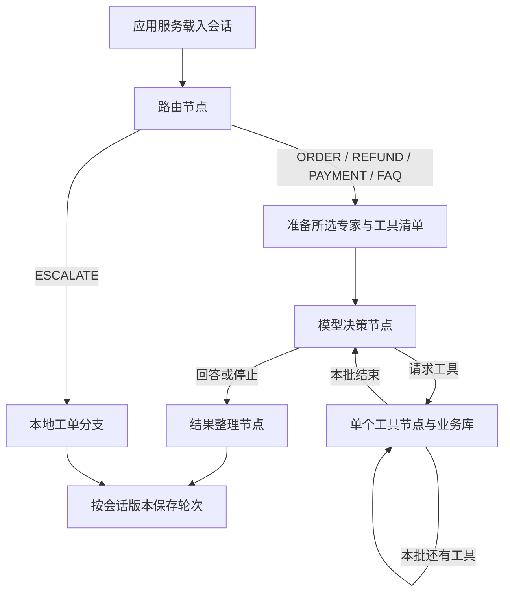

# 电商订单与售后助手

一个可以本地运行的小型多 Agent 业务应用。用户询问订单、退款、支付或商店规则时，LangGraph 路由器选择相应专家，专家通过工具查询或修改 SQLite 业务数据。应用保存最近讨论订单，使“那帮我退款”能够沿用上一轮的订单；客户偏好则独立保存，供新会话继续读取。

默认 `demo` 模式不需要模型 API Key，但页面和 API 均需要本地测试账户令牌。它用可预测的规则模拟模型的工具选择，执行的仍是真实 LangGraph、工具函数和本地 SQL。`online` 模式改为调用模型，业务工具和样例数据库相同。退款和支付先生成提案，用户独立确认后才执行。

**所有订单、客户、支付和退款均为本地样例，不连接真实电商、支付、物流或人工客服平台。** 操作会改变样例数据库，但不会产生真实扣款、退款或通知。

## 1 先理解项目提供什么


| 能力         | 当前实现                                            | 边界                                         |
| ------------ | --------------------------------------------------- | -------------------------------------------- |
| 多 Agent     | 路由器选择订单、退款、支付、FAQ 专家                | 每轮选择一个专家，不是并行团队               |
| 工具调用     | 专家循环调用受限工具，再组织答案                    | 模型仍可能选错参数；工具负责校验             |
| 业务规则     | 退款工具检查已送达与未重复申请；支付只接受 pending  | 不是完整真实商家退款规则                     |
| 会话 Memory  | SQLite 保存最近 50 个完整轮次、最后订单、累计 Token | 会话版本检查；与图检查点分开保存             |
| 执行恢复     | SQLite 检查点保存路由、模型、单个工具与整理进度     | 手动恢复，业务写入仍通过动作记录查重         |
| 长期客户偏好 | 按客户编号保存回复与联系偏好                        | 用户明确填写，模型不自动更新；不会实际发消息 |
| 上下文       | 最近 6 个完整用户轮次与最近订单备注                 | 不是精确 Token 预算或摘要系统                |
| 异常升级     | 模型调用按错误类型重试，耗尽后保存本地工单          | 不重跑整图，没有真人接单或外部通知           |
| 请求与动作   | 稳定请求编号、事务内动作记录、结果回放与记忆补写    | 本地同机请求锁；没有真实身份或外部资金幂等   |
| 客户范围     | 本地账户令牌绑定身份，订单工具检查客户归属          | 不是生产登录、账号管理或真实商家授权系统     |
| 写入确认     | 页面按钮或确认 API 再次校验对象、参数和业务版本     | 模型只能提案，不能自动确认；只办理本地样例   |
| FAQ          | 关键词查找样例规则文本                              | 不是文档 RAG 或语义搜索                      |

可以把本项目理解为“业务工具可验证、多角色切换可观察、记忆生命周期清楚”的独立应用。不要把它当成已经可以公开处理真实客户订单的生产系统。

## 2 目录与阅读顺序

```text
ecommerce-support-agent/
  app.py                      中文 Streamlit 页面
  api.py                      FastAPI 接口
  src/
    orchestrator.py            LangGraph 路由与专家节点
    agents/
      base.py                 通用工具调用循环
      order_agent.py          订单专家
      refund_agent.py         退款专家
      payment_agent.py        支付专家
      faq_agent.py            规则问答专家
    llm.py                    在线模型、配额异常切换、Token 提取
    demo_model.py             无密钥规则模拟器
    service.py                会话恢复、上下文组织、执行与保存
    storage.py                会话版本、轮次去重、运行登记与客户档案
    requests.py               本地请求锁、请求记录与事务内动作回放
    results.py                结构化业务状态与确定性回退
    auth.py                   本地测试账户令牌与服务端身份
    actions.py                待确认动作、版本校验、确认与取消
    memory.py                 历史消息与最近订单逻辑
    runtime_context.py        请求内身份、模式、偏好、确认凭据与图运行
    tools.py                  业务工具与本地工单
    errors.py                 错误分类与单次模型调用重试
    backend/
      db.py                   数据表与连接
      seed.py                 10 笔样例订单及状态
  tests/                      业务、请求恢复、页面重试与模型协议回归
  scripts/demo.py             临时目录端到端演示
  scripts/check_ui.py         页面交互检查
  eval/                       路由评估脚本与基线样例
  docs/                       深挖文档与架构图
  requirements.txt            本次验证的精确依赖
  requirements.in             顶层依赖范围
  Dockerfile                  单实例容器入口
  .env.example                配置模板
  LICENSE                     必要版权与开源许可
  NOTICE.md                   修改范围与版本标识
```

建议先运行，再按 `service.py → orchestrator.py → agents/base.py → tools.py → storage.py` 阅读。先确定数据从哪里来、写到哪里，再研究提示词。

## 3 环境准备

原始验证环境为 Python 3.11.17、Linux；第一、二阶段改造另在 macOS、Python 3.11.1 验证。推荐使用 Python 3.11，首次安装需要可用的包下载网络和数百 MB 空间；离线演示运行时不调用模型服务。

解压后进入包含 `app.py` 的目录，后续命令均从这个目录运行。不要在另一个虚拟环境安装依赖后，又用系统解释器启动页面。

### 3.1 macOS 或 Linux

```bash
python3.11 -m venv .venv
source .venv/bin/activate
python -m pip install --upgrade pip
python -m pip install -r requirements.txt
python -m streamlit run app.py
```

### 3.2 Windows PowerShell

```powershell
py -3.11 -m venv .venv
.\.venv\Scripts\Activate.ps1
python -m pip install --upgrade pip
python -m pip install -r requirements.txt
python -m streamlit run app.py
```

如果激活脚本被执行策略阻止，直接使用解释器即可：

```powershell
.\.venv\Scripts\python.exe -m pip install -r requirements.txt
.\.venv\Scripts\python.exe -m streamlit run app.py
```

依赖快照对 `uvloop` 增加了 Windows 排除标记。macOS 使用现有虚拟环境验证，Windows 及从空环境完整安装未在本次改造中实测；如遇原生扩展安装问题，先确认 Python 版本、CPU 架构与可用 wheel。

### 3.3 使用 uv

```bash
uv venv --python 3.11
uv pip install --python .venv/bin/python -r requirements.txt
uv run --no-project --python .venv/bin/python streamlit run app.py
```

Windows 将解释器路径换成 `.venv/Scripts/python.exe`。没有 uv 时使用标准 venv 即可，不必额外引入依赖管理工具。

### 3.4 检查实际解释器

```bash
python --version
python -c "import sys; print(sys.executable)"
python -c "import langgraph, streamlit, sqlalchemy; print('依赖导入成功')"
```

第二条应显示当前 `.venv` 中的解释器。建议始终使用 `python -m pip`、`python -m streamlit`，减少命令指向不同环境的问题。

启动后访问 `http://localhost:8501`。页面默认模式为 `demo`，会话编号为 `case_1`，先填写下面配置的账户令牌，客户身份由后端确定。按 Ctrl+C 停止服务。默认会在项目 `data` 目录自动创建数据库并填入样例，不需要单独初始化。升级已有项目时先停止旧页面和 API 进程，再启动新版本，避免旧代码继续访问同一数据库。

### 3.5 配置本地测试账户

本地账户令牌用于区分客户，和智谱等服务商的模型 API Key 是两类配置。即使使用 `demo`，也需要配置账户令牌。已有 `.env` 时直接编辑并保留原配置；没有时从 `.env.example` 复制。

可以在 Terminal 生成两个不同的随机令牌：

```bash
python -c "import secrets; print(secrets.token_urlsafe(32)); print(secrets.token_urlsafe(32))"
```

将输出的两个值分别填入 `.env` 的 JSON 映射，下面只是格式示例：

```dotenv
SUPPORT_ACCOUNT_TOKENS='{"customer_a":"替换为令牌A","customer_b":"替换为不同的令牌B"}'
```

保存后重启服务，在页面左侧“测试账户令牌”输入 A 的令牌。页面显示当前客户为 `customer_a`，不再通过自由填写客户编号选择身份。配置为空、格式错误或两个账户令牌相同都会拒绝使用；程序不提供默认有效令牌，也不输出已有令牌。

样例订单 1001—1007 属于 `customer_a`，1008—1010 属于 `customer_b`。这是固定的本地样例映射，不按样例客户姓名判断归属。未知旧订单保持未分配，不能被任一测试账户访问。本地令牌方案没有注册、密码恢复或外部身份服务，不应当作生产认证系统。

## 4 第一遍完整体验

### 4.1 保存客户偏好

进入“记忆与客户偏好”，填写：

- 回复偏好：简洁，先结论后解释。
- 联系偏好：优先站内文字联系。

点击“保存客户偏好”。下方 JSON 应显示刚保存的值。它由应用直接写库，不需要模型抽取。在线模型每次执行专家前读取档案；离线规则模式不模拟文风变化，也不会因为联系偏好而发送消息。

### 4.2 查询订单与跨专家指代

进入“客服对话”，依次输入：

> 查询订单 1002 的物流。

> 帮我申请退款。

第一轮进入订单专家，工具返回订单 1002 的 `shipped` 状态。第二轮进入退款专家，服务从会话 Memory 恢复 `last_order_id=1002` 并补充备注，退款资格检查应返回 `eligible=false`。

展开工具执行轨迹，检查第二轮工具参数中的编号确实是 1002，而不是只看回答是否出现“退款”。这才说明指代信息真正进入业务工具。

### 4.3 明确新编号覆盖旧上下文

继续输入：

> 帮我申请订单 1001 的退款。

显式编号优先于旧的最近订单备注。样例订单 1001 已送达且没有已有申请，先显示待确认的退款申请、订单、样例金额与原因；此时退款状态仍为 `none`。检查后点击“确认申请”，才改成 `requested`；点击“取消操作”则不办理。重复确认回放同一结果，不生成第二次申请。

确认入口会重新检查账户归属、订单版本、金额及支付退款状态；数据变化后旧提案会被拒绝，需要重新查询和发起。模型工具只创建提案，不能调用确认接口，用户在聊天里写“已确认”也不会代替按钮或 API 确认。确认仍由普通应用服务与数据库实现；第三阶段的图恢复不会自动确认动作。

### 4.4 查看与办理本地支付

输入：

> 查询订单 1003 的支付状态。

预期为 `pending`。再输入：

> 帮我付款。

规则演示器沿用 1003，调用查询和 `process_payment` 生成待确认提案，支付状态仍为 `pending`。检查金额和方式后点击“确认付款”，才改为 `paid`。重复确认回放成功结果，新的重复付款提案会被拒绝。这里只改变本地数据库，没有支付网关、银行卡扣款或资金清算。

### 4.5 规则问答与工单

输入：

> 退货政策是什么？

FAQ 专家调用规则工具，返回样例规则。本次已将退货说明与实际执行规则对齐：只检查已送达与不存在已有退款申请，没有实现完整退货期限、商品类别和包装状态判断。

再输入：

> 我要投诉这个问题。

预期进入升级分支，生成并保存一条本地待处理工单。页面会明确说尚未连接人工通知渠道。生成编号不等于真人已接单。

### 4.6 验证 Memory 生命周期

停止并重启页面，保持相同数据目录、账户、模式和会话编号；重新输入该账户令牌。已保存的对话、最近订单、Token 累计和待确认动作应能恢复。

点击“新建会话”：旧对话与最近订单不自动继承，但客户偏好仍然存在。这样可以避免新问题在没有明确编号时，错误地沿用上一次售后事项中的订单。

将左侧令牌换成 B 的令牌：不应显示 A 的会话、偏好或待确认动作。B 查询 1001 和查询不存在的订单都得到“未找到可访问的订单”，可以查询自己的 1008—1010。改回 A 的令牌可读取原会话。若旧历史或旧请求结果含有现已不属于该账户的订单事实，展示及模型上下文会过滤这些事实，不删除原数据库记录。

## 5 不打开页面也能验证

```bash
python scripts/demo.py
python -m pytest -q
python scripts/check_ui.py
python scripts/check_restart.py
```

演示脚本在临时目录执行，结束后清理，不影响正常页面数据。它实际完成：订单查询、重建服务对象后读取会话、退款资格拒绝、退款申请写入、本地工单落盘和跨会话客户偏好读取。

原始 49 项回归基础上，第一阶段通过 81 项，第二阶段通过 124 项。第三阶段加入图检查点、恢复授权、会话版本冲突及页面恢复测试，本次共 144 项通过；后续数量以 `python -m pytest -q` 为准。七个页面检查点继续保留，重启脚本另验证工具提交后强制退出、跨进程恢复和动作查重。

测试收集和上述三个验证脚本均强制使用临时业务库与记忆库，不受 `.env` 的自定义业务库影响。这些验证不调用真实在线模型，不能据此推导真实模型的路由准确率、退款意图识别率或响应费用。智谱协议测试使用实际 SDK 与模拟 HTTP 响应；账号权限、真实网络、真实业务渠道、Docker 镜像与云部署没有完成端到端实测。

## 6 接入在线模型

默认 `demo` 无需配置 Key。使用在线模式时，先复制配置模板。

macOS/Linux：

```bash
cp -n .env.example .env
```

Windows：

```powershell
if (-not (Test-Path .env)) { Copy-Item .env.example .env }
```

已有 `.env` 时保留文件，手动补充配置。选择实际可用的服务，例如智谱 BigModel：

```dotenv
LLM_PROVIDER=zhipu
ZHIPU_API_KEY=你的智谱密钥
ZHIPU_MODEL=glm-4.7-flash
ZHIPU_BASE_URL=https://open.bigmodel.cn/api/paas/v4/
SUPPORT_DATA_DIR=data
```

智谱基础地址不附加 `chat/completions`，程序通过 Chat Completions 接口发送请求，关闭 SDK 自动重试与深度思考，并验证工具消息及 Token 用量映射。模型接口说明见[智谱官方文档](https://docs.bigmodel.cn/cn/guide/develop/openai/introduction)。依赖清单已包含 `langchain-openai`，无需替换源码。

Gemini 配置：

```dotenv
GEMINI_API_KEY=你的密钥
LLM_PROVIDER=gemini
GEMINI_MODEL=服务端实际支持且允许工具调用的模型标识
SUPPORT_DATA_DIR=data
```

可选 Groq：

```dotenv
GROQ_API_KEY=你的密钥
LLM_PROVIDER=groq
GROQ_MODEL=服务端实际支持且允许工具调用的模型标识
```

模型可用性、配额和收费以服务提供方当前说明为准。模板中的模型名只是配置起点，不能保证某个账号一直可用。不要把 Key 写进源码或 README。

页面选择 `online`，或 API 请求传入 `"mode":"online"` 后才使用真实模型。改环境变量后重启进程，避免导入时读取的配置仍是旧值。

`LLM_PROVIDER` 支持 `auto`、`zhipu`、`gemini`、`groq`。为兼容旧配置，默认 `auto` 有智谱 Key 时只使用智谱，否则使用原 Gemini/Groq 池。显式指定服务商时不会切换到其他服务商；单个智谱客户端没有备用模型。`src/llm.py` 对池内配额错误保留切换逻辑，其他错误交给单次模型调用的重试层。接入其他兼容端点仍需验证工具协议，不能只换模型名。

客户端 SDK 重试为零，单次模型调用对限流、超时和可恢复服务异常最多尝试两次；配置、认证、参数和程序错误不自动重试。不自动重跑整图；中断运行可通过第 7.3 节的受控入口从检查点继续。模型总结失败时直接说明已保存的工具结果，不重新执行已成功的业务操作。

路由效果评估默认离线，显式在线评估会调用真实服务：

```bash
python eval/run_eval.py --dry-run
python eval/run_eval.py --mode demo
python eval/run_eval.py --mode online
```

## 7 使用 FastAPI

```bash
python -m uvicorn api:app --host 127.0.0.1 --port 8000
```

健康检查：`http://127.0.0.1:8000/health`。

交互文档：`http://127.0.0.1:8000/docs`。

`/health` 无需令牌，聊天和动作接口均要求 `Authorization: Bearer <账户令牌>`。在 `/docs` 点击 Authorize 填入账户令牌；旧版未带认证头的请求现在返回 401。请求中的 `user_id` 可省略，保留时必须和令牌身份一致，否则返回 403；它不能选择客户身份。

下面的 macOS Terminal 示例先读取 A 的账户令牌，输入不显示，也不需要把它写进 curl 命令：

```bash
read -r -s ACCOUNT_TOKEN
```

请求示例：

```bash
curl -X POST http://127.0.0.1:8000/chat \
  -H "Authorization: Bearer $ACCOUNT_TOKEN" \
  -H 'Content-Type: application/json' \
  -d '{"user_id":"customer_a","session_id":"case_api","mode":"demo","message":"查询订单 1002 的物流"}'
```

同一客户、会话和模式再发：

```bash
curl -X POST http://127.0.0.1:8000/chat \
  -H "Authorization: Bearer $ACCOUNT_TOKEN" \
  -H 'Content-Type: application/json' \
  -d '{"user_id":"customer_a","session_id":"case_api","mode":"demo","message":"帮我申请退款"}'
```

Windows PowerShell 可使用：

```powershell
$body = @{user_id='customer_a'; session_id='case_api'; mode='demo'; message='查询订单 1002 的物流'} | ConvertTo-Json
$headers = @{Authorization='Bearer 替换为账户令牌'}
Invoke-RestMethod -Uri 'http://127.0.0.1:8000/chat' -Method Post -Headers $headers -ContentType 'application/json; charset=utf-8' -Body $body
```

省略会话编号时生成新编号；后续请求必须复用返回值，才能沿用上下文。响应提供 `reply`、`agent`、`trace`、`usage` 和 `cached`。当前完整 FAQ 模型回答不缓存，因此 `cached` 通常为 false；纯规则查询另有内部缓存。

### 7.1 请求重放与故障恢复

需要可重试的调用方应主动提供稳定的 `request_id`，例如：

```bash
curl -X POST http://127.0.0.1:8000/chat \
  -H "Authorization: Bearer $ACCOUNT_TOKEN" \
  -H 'Content-Type: application/json' \
  -d '{"user_id":"customer_a","session_id":"case_api","request_id":"refund_demo_001","mode":"demo","message":"帮我申请订单 1001 的退款"}'
```

重试时重复原请求体，不更改客户、模式、会话、消息或请求编号。若首次省略会话编号，重放也继续省略，服务返回原会话。一个新问题应使用新编号；未传编号时服务会生成并返回编号，但调用方在丢失首次响应后无法据此去重。请求编号允许 1 至 64 位字母、数字、下划线和短横线。

| 响应 | 含义 |
| --- | --- |
| HTTP 200 | 检查 `status` 判断完成、待确认、取消、拒绝、部分完成或失败；不等于已经办理。 |
| HTTP 202，`status=in_progress` | 同一请求正被处理，稍后使用相同请求体查询，不启动第二次执行。 |
| HTTP 409 | 同一请求编号更换内容，或会话版本冲突；后者保留业务结果，检查 `memory_status`。 |
| `replayed=true` | 已有请求的回放或显式恢复；已提交动作不会重复办理，恢复可能继续未完成的模型调用。 |
| `reply_source=model/demo/fallback` | 分别表示模型回答、离线规则回答或确定性工具结果回退。 |
| `memory_saved=false` | 聊天尚未写入。最终响应已保存时，同编号重试可补写；中断运行需显式恢复。 |
| `memory_status=conflict` | 执行时读取的会话版本已过期；业务 `status` 仍保留，重读后同编号重试补写。 |
| `status=interrupted` | 未完成运行未被自动重跑；使用 `run_id` 显式恢复。 |
| `status=pending_confirmation` | 只创建待确认提案，查看 `pending_actions` 后独立确认。 |

请求记录与动作记录保存在业务库。提案只写待确认记录；确认后的退款、支付、动作结果和提案终态在同一事务中提交。记忆库通过独立去重表补写轮次，重放不重复累计 Token。页面遇到未确认完成的聊天提交时显示“重试同一请求”，确认或取消的结果未写入记忆时显示“重试动作结果”。

本地请求锁在进程退出时释放。第三阶段的新图请求中断且没有最终响应时，普通重试返回 `status=interrupted` 和 `run_id`，显式恢复见第 7.3 节；恢复会复用已提交动作，提案仍需独立确认。升级前没有运行记录的旧请求继续按动作回放，不能获得追溯检查点。已保存的失败响应仍原样回放，修复模型配置后重新执行需要新的聊天请求编号。

第一版迁移增加请求、动作、聊天去重和版本表；第二版升级归属字段、订单版本和待确认记录，具体备份与映射见第 10 节。请求记录、动作记录、聊天去重表及锁文件目前不自动清理；不能删除仍有请求使用的锁文件。

同机进程针对同一请求编号共享本地文件锁，不支持跨主机部署。不同请求仍可能读取同一份旧上下文；第三阶段在保存时检查会话版本，发现冲突返回 HTTP 409、`memory_saved=false` 和 `memory_status=conflict`，保留业务结果。客户端重读会话后重试同一请求，只把已保存结果追加到当前会话，不重跑业务；较晚补写不会覆盖当前最近订单。当前仍推荐单入口、本地运行，本地令牌方案不足以支撑真实订单的公网服务。

### 7.2 确认和取消动作

退款或付款提案响应中的 `pending_actions` 包含 `action_id`、订单、样例金额、固定参数和状态。把返回的动作编号填入下面变量，继续使用同一个账户令牌：

```bash
ACTION_ID=替换为返回的动作编号
curl "http://127.0.0.1:8000/actions/$ACTION_ID" \
  -H "Authorization: Bearer $ACCOUNT_TOKEN"
curl -X POST "http://127.0.0.1:8000/actions/$ACTION_ID/confirm" \
  -H "Authorization: Bearer $ACCOUNT_TOKEN"
```

不办理时使用取消接口：

```bash
curl -X POST "http://127.0.0.1:8000/actions/$ACTION_ID/cancel" \
  -H "Authorization: Bearer $ACCOUNT_TOKEN"
```

同账户、同会话与模式的待确认列表：

```bash
curl 'http://127.0.0.1:8000/actions?session_id=case_api&mode=demo' \
  -H "Authorization: Bearer $ACCOUNT_TOKEN"
```

确认和取消不接受新的客户、订单、金额、方式或 `confirmed` 参数，额外字段返回 422。后台重新校验动作所属客户、订单归属、订单版本及支付退款事实，并使用冻结参数执行。状态变化后的旧提案标记为 `rejected`；不能修改旧提案继续执行，需要重新发起。未知或非本人的动作统一返回 404。

重复确认返回原结果；重复取消也可重放；取消后确认、执行后取消返回 409。确认与取消内部使用动作编号生成稳定请求编号，并复用第一阶段的锁及动作事务；客户端聊天不能使用保留的 `confirm_`、`cancel_` 请求编号前缀。

确认或取消在进程退出前尚未保存最终响应时，再次调用会安全恢复这一确定性事务：已有动作结果直接回放，没有提交结果则重新校验并执行。不调用模型、不重跑业务图，也不要求通过新聊天再次发起同一动作。

动作状态为 `pending`、`executed`、`cancelled` 或 `rejected`。聊天提案重放不重新创建动作，`actions` 和 `pending_actions` 会按当前状态刷新；动作已完成或取消时，返回确定性状态说明。确认不调用模型，账户也不能通过换 `mode` 来确认他人的动作。

### 7.3 恢复中断运行与会话冲突

升级后，正常图请求会返回独立的 `run_id`。页面重启后，重新输入同一账户令牌并选择原模式、会话，页面会从数据库列出未完成运行；点击“恢复执行”。若运行结果已保存但聊天未写入，按钮显示“补写运行结果”。运行恢复不代替退款或付款确认，待确认卡片仍需单独操作。

API 可先列出当前账户在指定会话、模式中需要恢复或补写的运行：

```bash
curl 'http://127.0.0.1:8000/runs?session_id=case_api&mode=demo' \
  -H "Authorization: Bearer $ACCOUNT_TOKEN"
```

取响应中的 `run_id`，替换下面的 `RUN_ID`，查询状态并显式恢复：

```bash
curl 'http://127.0.0.1:8000/runs/RUN_ID' \
  -H "Authorization: Bearer $ACCOUNT_TOKEN"

curl -X POST 'http://127.0.0.1:8000/runs/RUN_ID/resume' \
  -H "Authorization: Bearer $ACCOUNT_TOKEN"
```

恢复入口只接受原运行，不接受新的客户、会话、模式、消息或 `checkpoint_id`。后端验证当前账户，使用原请求编号和会话；未知或他人运行统一返回 404。同一请求仍被另一进程处理时返回 202。列表中的 `status=unfinished` 表示没有最终响应，可能仍在运行，也可能中断；以恢复时的请求锁判断能否继续。

图按路由、准备专家、模型决策、单个工具执行和结果整理分别保存检查点，采用同步持久化。恢复先读取已有步骤；若动作提交后尚未保存工具节点，动作记录会回放原结果。已完成图只取保存状态，不再次调用模型。模型返回后尚未落盘就退出时，该次模型调用可能重做，不能承诺模型只调用一次或用量完整；只读查询在同类间隙也可能重新读取。恢复仍检查当前订单归属，已变化的权限不会因旧检查点而绕过。

会话冲突示例：请求 A 读取版本 0；请求 B 先保存，版本变成 1；A 保存时返回 HTTP 409，`memory_status=conflict`，同时保留 A 的业务 `status`、工具结果与动作。重读会话后重试 A 的同一请求，或点击“补写运行结果”，只追加已保存结果并登记去重；较晚补写保留当前最近订单，不覆盖 B 的内容。若补写期间再次发生并发更新，会再次提示冲突，不自动重放业务。

保留 `SUPPORT_DATA_DIR` 下的业务库、记忆库和检查点库；三者职责不同，不具有跨库原子提交。不要在运行中单独删除或复制检查点文件。运行记录、检查点和动作审计目前不自动清理，统一备份恢复及保留策略仍属于后续阶段。

## 8 LangGraph 多 Agent 怎样工作



图状态 `SupportState` 保存本轮消息、历史、路由结果、回答、轨迹、专家名和 usage。路由结果只能进入五个允许分支；识别出多个互相冲突的标签或没有合法标签时进入升级分支。

本轮只选择一个专家。每个专家内部是“模型提出工具调用 → 程序执行 → ToolMessage 回传 → 模型继续”的循环。下一轮可以选择另一位专家，所以订单查询后能切换退款处理。

这不是两个专家之间直接 handoff，也没有并行子任务汇总。不要把图中的每个节点都叫成 Agent：数据库更新、重试、会话保存是普通程序职责。

### 8.1 工具调用边界

订单专家可以查自己的订单详情、状态与物流；退款专家可以查资格、创建退款提案与查状态；支付专家可以查支付状态并创建付款提案；FAQ 专家只能查询公共规则。确认和取消函数不在模型工具清单中。

`agents/base.py` 根据工具名称建立当前专家的允许集合。未知工具、额外参数会产生错误结果回传给模型，不会执行任意函数。LangChain 工具 Schema 再检查必填字段和类型。

默认最多执行四轮工具批次，每个批次最多六个请求。初始模型调用与每批工具后的模型调用要分别计算；这些限制不是整个请求的精确 Token 或费用预算。相同工具签名重复出现时停止，避免一直消耗调用。

若模型迟迟不产生最终文本，代码可能回退到最后一个工具结果。这保证页面不空白，但不代表已经完成了完整业务解释或汇总。

### 8.2 规则必须在工具里重查

退款专家提示先查资格，提案工具也会自己检查订单归属和资格。`initiate_refund`、`process_payment` 目前只创建提案；实际修改的 `apply_refund`、`apply_payment` 要求后端确认凭据，并在同一事务中重新检查归属与业务规则，不能直接作为模型工具调用。

退款表对订单编号唯一，状态更新必须匹配 `none`。支付更新必须匹配 `pending`。多次或并发请求只有一次能完成对应状态变化。

条件更新继续保护状态；第一阶段增加请求、动作记录与回放；第二阶段增加本地身份、订单归属、版本检查及独立用户确认。模型总结失败不会重跑整图，甚至模型错误地声称“已办理”，存在待确认提案时服务仍明确返回“尚未办理”。这些保证限于本地账户和工具，不代表真实认证或外部资金一致性。

## 9 Memory 的设计

### 9.1 各类数据分开保存


| 数据                       | 文件或位置                     | 键与范围                    | 作用                           |
| -------------------------- | ------------------------------ | --------------------------- | ------------------------------ |
| 订单、支付、退款、工单     | data/business.sqlite           | 订单或工单编号              | 业务事实，工具直接读写         |
| 对话、最后订单、累计 Token、会话版本 | data/memory.sqlite 的 sessions | user_id + mode + session_id | 跨重启恢复轮次，检测并发覆盖 |
| 请求、动作与已保存结果 | data/business.sqlite 的 request_records、action_records | 客户 + 模式 + 请求编号；动作增加动作键 | 事务内动作记录与中断结果回放 |
| 待确认动作 | data/business.sqlite 的 pending_actions | 账户 + 动作编号，绑定原会话和模式 | 保存固定参数、业务版本与确认结果 |
| 聊天请求去重 | data/memory.sqlite 的 session_requests | 客户 + 模式 + 会话 + 请求编号 | 补写不重复轮次或 Token |
| 客户回复与联系偏好         | data/memory.sqlite 的 profiles | user_id                     | 跨会话档案，跨模式共用         |
| 图运行登记与原输入快照 | data/memory.sqlite 的 graph_runs | 运行编号，绑定客户、模式、会话及请求 | 保存原上下文和执行时会话版本 |
| 本轮路由、模型消息、工具进度 | data/memory.checkpoints.sqlite | 服务端运行编号作为 thread_id | SqliteSaver 持久检查点，逐节点恢复 |

会话、档案与运行登记由 SupportStore 保存；LangGraph 的 SqliteSaver 单独保存执行检查点。第三阶段把专家循环拆成节点，通过原运行的 `graph.invoke(None, ...)` 恢复。确认等待仍由 `pending_actions` 保存，不依赖 `interrupt` 或 `Command(resume=...)`，不会因恢复图而自动确认。自定义记忆文件路径时，检查点使用同路径的 `.checkpoints.sqlite` 后缀；只修改业务库 URL 不改变记忆或检查点路径。

### 9.2 最近订单如何产生

`ConversationMemory.update_last_order_id` 从实际工具轨迹读取订单编号，不直接相信模型在回答中提到的数字。工具结果有 error 时不更新，避免不存在的编号进入事实备注。

当前备注是一条显式结构化指代，而不是语义向量召回。若用户本轮明确给出订单编号，服务不再附加旧编号。离线规则只识别四至八位独立数字；复杂口语、多个订单、金额和编号混用需要进一步设计解析与澄清。

### 9.3 为什么新会话不自动沿用订单

“上次看的订单”并不一定是“本次售后要处理的订单”。把 last_order_id 限制在会话内，能减少把新任务写到旧订单上的风险。客户回复偏好可以跨会话共用，因为它的含义更稳定，也不会直接选择某一笔业务操作对象。

### 9.4 上下文窗口与保留策略

会话最多保存 50 个完整轮次，较早轮次被替换，不能视作完整审计历史。模型每次最多读取最近 6 个完整轮次，即 12 条 HumanMessage/AIMessage。专家本轮内部的工具消息另行保留到本轮结束，不会把未配对的工具片段保存为下一轮历史。

输入最多 2000 字符。当前没有对长工具输出做总 Token 精确预算，也没有自动摘要。最近六轮可能遗漏重要旧约束；最后订单备注能缓解一种指代问题，但不能替代完整上下文管理。

### 9.5 偏好是数据 不是执行指令

客户档案进入专家系统提示的事实区域，明确标识为数据。ContextVar 只在单次服务调用期间绑定，结束后恢复，避免当前客户档案残留到下一位客户。

客户身份现在由单独的 `Principal` 上下文绑定，来源是本地账户令牌；不让模型填写身份。订单工具逐次检查归属，确认凭据仅由独立的确认入口建立，执行后恢复。客户偏好的数据标记本身仍不能替代这些程序校验，也不提供完整提示注入防护；真实业务接入时仍需替换为可信认证和商家授权规则。

## 10 数据初始化 观察与重置

首次启动会在空业务库中自动填入 10 笔样例订单。常用状态如下：

1001—1007 固定归 customer_a，1008—1010 固定归 customer_b。升级第二阶段时先停止所有旧服务；首次打开旧 SQLite 业务库会使用 SQLite backup 生成同目录的 `business.sqlite.before-v2-<随机编号>.bak`，再增加归属、订单版本及待确认表。已办理的状态和金额保留，已明确的归属不覆盖，未知旧订单保持未分配；重复启动不再次迁移或重置。自动旧库迁移仅支持 SQLite，正式数据接入前需另行确认归属映射，不能沿用样例编号规则。

第三阶段首次升级旧记忆库时，同样使用 SQLite backup 保存 `memory.sqlite.before-v2-<随机编号>.bak`，再增加 `sessions.version` 和 `graph_runs`，在记忆库自己的迁移表登记版本 2；这与业务库的版本 2 是独立的迁移序列。原对话、偏好、轮次去重记录和累计 Token 保留，旧会话从版本 0 开始。正常启动不删除或重新播种旧数据。新的 `memory.checkpoints.sqlite` 只为升级后的运行保存检查点，无法还原升级前未记录的执行步骤。


| 订单 | 订单状态  | 支付状态 | 初始退款状态 | 演示用途           |
| ---- | --------- | -------- | ------------ | ------------------ |
| 1001 | delivered | paid     | none         | 可申请本地退款     |
| 1002 | shipped   | paid     | none         | 未送达，拒绝退款   |
| 1003 | placed    | pending  | none         | 可办理本地支付     |
| 1004 | delivered | paid     | requested    | 拒绝重复退款       |
| 1005 | cancelled | refunded | completed    | 已退款不能再次支付 |

正常重复运行不会重置已改的状态。单独运行 `python -m src.backend.seed` 会按样例覆盖业务行，并递增已有订单版本，使旧提案不能因状态被重置而重新生效；它不会清空请求和待确认记录，所以不能当作每次启动或完整重置的步骤。

需要一套全新数据时，最稳妥的方式是停止服务，将 `.env` 中的 `SUPPORT_DATA_DIR` 改为一个新的目录，例如 `data_demo_2`，同时确认未设置单独的 `SUPPORT_AGENT_DB_URL`，再重新启动。这比在运行中删除数据库可靠，也方便保留之前的验证现场。

只读观察数据库：

```bash
python - <<'PY'
import sqlite3
with sqlite3.connect('data/business.sqlite') as db:
    print(db.execute('SELECT order_id,status,reason FROM refunds ORDER BY order_id').fetchall())
    print(db.execute('SELECT order_id,status FROM payments ORDER BY order_id').fetchall())
    print(db.execute('SELECT ticket_id,status FROM tickets').fetchall())
PY
```

这是 macOS/Linux Shell 示例。Windows 可将 Python 段保存为 `inspect_db.py` 后运行。自定义数据路径时同步修改查询路径。不要在示例中记录或展示真实客户信息。

## 11 部署方式

### 11.1 固定服务器

```bash
python -m streamlit run app.py --server.address=0.0.0.0 --server.port=8501
```

使用稳定的绝对数据目录。公开服务需要 HTTPS、真实身份验证、订单授权、备份和日志策略。当前代码适合本地或受控演示，不提供这些生产能力。

### 11.2 Docker

```bash
docker build -t ecommerce-support-agent .
docker run --rm -p 8501:8501 --env-file .env -v ecommerce-agent-data:/app/data ecommerce-support-agent
```

命名卷保存业务库、记忆库和检查点库。demo 仍需要 `.env` 中的本地账户令牌映射，但无需模型 Key。容器文件夹本身不能替代持久卷；删除卷会丢失数据。Docker 构建在本次环境未实测。

### 11.3 托管 Python 平台

需要平台支持长运行 Python、Streamlit 所需连接以及持久卷。启动命令和端口按平台要求配置，数据目录指向卷挂载点。只有临时文件系统的平台不能保证重启后状态保留。

多实例部署前应将会话、检查点和业务库迁移到可共享的持久服务，处理连接池与事务。当前 RLock 只在一个服务对象、一个进程内有效；同机请求文件锁和会话版本检查已通过独立进程测试，不等于支持跨主机部署。

### 11.4 Supabase 与 PostgreSQL

Supabase 可以作为 PostgreSQL 和认证后端，但不能直接代替 Python Agent 运行环境。

迁移有三条独立路径：

1. 业务层：SQLAlchemy 模型与连接迁移，重新初始化数据表，核对唯一约束、事务和金额类型。
2. 记忆层：SupportStore 目前使用 SQLite 的 `?` 占位符和特定 upsert，需改连接管理、SQL 与并发更新策略。
3. 检查点：将本地 SqliteSaver 替换为目标存储的持久检查点实现，保留原运行绑定、同步持久化和动作查重规则。

第二阶段已将客户身份改为本地令牌解析并检查订单归属；接 Supabase 时应替换这一身份来源，重新验证账户与商家订单的映射，不能把本地示例令牌当作生产登录。第三阶段的检查点目前仅验证本地 SQLite；只换业务库连接字符串不会迁移图进度或会话。

### 11.5 Vercel

当前 Streamlit 应用不是静态网页，不能直接作为静态项目上传。若需要 Vercel 前端，可改为 Next.js 页面，通过 FastAPI 调后端 Agent 服务；数据库和身份系统另行持久化。这是二次架构改造，交付包没有包含该前端实现。

## 12 可以继续完成的优化

### 12.1 增加真正的订单权限

第二阶段已实现本地令牌解析、订单归属字段、工具级检查和客户端身份一致性校验。后续接真实认证时替换身份来源和样例映射，保留工具与确认入口的归属检查，不能退回只在页面判断。

现有测试覆盖 A 不能读取或修改 B 的订单、他人订单与不存在订单统一提示、动作跨客户访问统一 404，以及归属变更后的历史和请求结果过滤。生产认证、账户恢复和外部商家权限仍未实现。

### 12.2 增加人工确认和请求级幂等

第二阶段已将模型写工具改为创建 `pending_actions`，展示订单、金额、方式或原因，用户独立确认后才执行；后台校验版本。第三阶段已拆分专家节点、接入 SQLite 检查点和受控恢复入口；确认继续通过独立接口完成，不需要把确认再迁移为图中断。新增写工具必须有事务内动作记录，不能依赖检查点代替业务幂等。

第一阶段的请求与动作层已被提案、确认和取消复用；不能添加绕过这一层的模型写工具或“自动确认”提示。

### 12.3 给 Memory 增加纠错和版本

第三阶段已增加会话版本，保存冲突时保留业务结果并提示补写；下面的事项纠错、偏好来源和档案版本仍属于第四阶段。

让用户可以更正最近订单、撤回偏好、查看来源与更新时间。多个订单并行讨论时，使用候选集合和显式澄清，而不是只有一个 last_order_id。

为档案添加版本号、写入依据和用户确认。不要把模型猜测直接写成长期事实。对旧会话清理要区分会话快照、业务审计、客户删除请求和必要留存。

### 12.4 增加政策 RAG

新增资料导入、切块、索引、检索、引用和版本字段。先用关键词检索建立可评估基线，再考虑向量与重排。退货政策回答应展示来源和生效时间；检索到的政策不能自动替代工具里的执行规则。

不要把本项目的字典 FAQ 直接称为完整 RAG。真正的业务规则变化，还需要配置化规则引擎或受控代码更新，并验证回答与执行保持一致。

### 12.5 改进多意图与协作

当前每轮只能选一个专家。“查订单并比较退款和支付方案”可能需要拆解。可以增加计划状态、显式子任务和汇总节点，并规定写操作必须串行、只读查询才适合并行。

先评估增加协作是否提高完成率，避免为了展示更多节点而增加模型费用。增加 Agent 不等于增加可靠性。

### 12.6 改进费用和错误观测

记录 request_id、模型、专家、工具耗时、重试次数、Token 与最终结果。不要把所有输入和密钥写到日志。当前 usage 在 SDK 未返回时为空或零，不是准确费用账单；FAQ 纯查询缓存也不会跳过路由与专家模型调用。

第一阶段已将配置、参数、网络、配额和程序错误分类，业务拒绝作为正常工具结果，取消整图重试。后续继续补齐分阶段耗时、全部调用用量和费用核对，不能把当前基本事件视为完整账单。

### 12.7 提示优化与参数微调

先建立固定评估集：订单指代、显式新编号、退款资格、支付状态、无订单、投诉、多个意图、额外参数和提示注入。分别评估路由正确、参数正确、工具结果忠实度与执行结果，不只看文字流畅。

先修工具、状态和上下文，再改提示。只有在有足够优质样本、稳定失败模式和可微调服务时，再研究 SFT 或 LoRA。当前没有训练脚本，也不会通过保存客户偏好自动训练模型。

## 13 常见问题


| 现象                     | 常见原因                    | 处理方式                                         |
| ------------------------ | --------------------------- | ------------------------------------------------ |
| 导入失败                 | 使用了不同解释器            | 检查 sys.executable，用当前环境安装              |
| online 失败并生成工单    | Key、模型、配额或协议不可用 | 从少量请求验证服务配置，不把生成工单当成接入成功 |
| 订单 1001 不能再次退款   | 之前演示已改成 requested    | 检查数据库，或换新数据目录                       |
| 重启后对话不见           | 编号、模式或数据目录改变    | 使用原组合和目录                                 |
| 新会话没有最近订单       | 设计上不跨会话继承          | 明确输入订单编号                                 |
| 偏好保存后 demo 文风没变 | 规则模型不做文风生成        | 在线模式才用于表达调整                           |
| SQLite locked            | 多进程或长事务争用          | 单实例运行，或迁移数据库                         |
| 模型一直调用工具         | 重复签名或轮数耗尽          | 检查工具结果与提示，查看最终是否仅回退工具数据   |
| 工单没人处理             | 没有外部人工渠道            | 这是本地记录，需另接工单系统                     |
| 页面无聊天输入或 API 401 | 未配置或未提供账户令牌      | 配置 SUPPORT_ACCOUNT_TOKENS，重启后输入令牌或加 Bearer 头 |
| API 403                 | user_id 与账户令牌不一致     | 省略 user_id 或保持与已认证账户一致，不能用它切换身份 |
| 订单显示不可访问         | 订单不属于当前账户或未分配   | 核对令牌与固定样例归属，不通过修改请求体冒充其他账户 |
| 退款、付款尚未办理       | 已创建提案，尚未独立确认     | 检查待确认操作并点击确认，或调用对应确认接口      |
| 旧提案被拒绝             | 订单版本或业务事实已经变化   | 重新查询并创建新提案，不修改旧动作参数            |

## 14 项目说明与验证边界

可以准确描述为：基于 LangGraph 实现电商售后多专家路由，通过受控工具完成本地订单、退款、支付和规则查询；将会话指代记忆、跨会话客户档案与业务事实分离，并验证重启读取和并发状态保护。

当前不能描述为真实支付退款、完整 RAG、生产级认证、图节点断点恢复、自动接通人工客服，或填写没有测量的准确率与费用优化比例。更完整的架构、执行链与取舍说明见 `docs/Ecommerce_Agent_Deep_Dive.docx`。

DOCX 保留迭代前的架构说明；请求回放、精确重试、本地身份和独立确认的最新行为，以本 README 和 NOTICE 的完成记录为准。

必要开源版权与许可见 `LICENSE`，整理范围见 `NOTICE.md`。说明文档与普通源码不包含仓库链接或作者宣传信息。
