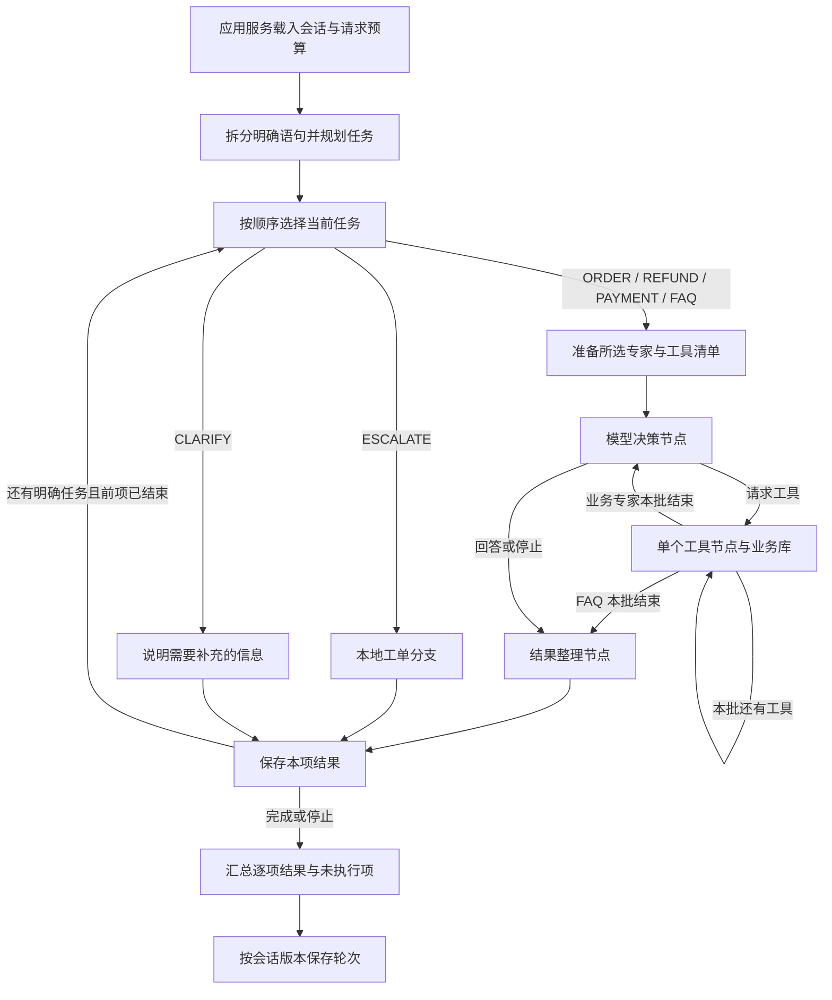

# 电商订单与售后助手

一个可以本地运行的小型多 Agent 业务应用。用户询问订单、退款、支付或商店规则时，LangGraph 根据明确的子任务顺序选择相应专家，专家通过工具查询或修改 SQLite 业务数据。应用保存当前订单事项，使“那帮我退款”能够沿用已明确的订单；客户偏好则独立保存，供新会话继续读取。

默认 `demo` 模式不需要模型 API Key，但页面和 API 均需要本地测试账户令牌。它用可预测的规则模拟模型的工具选择，执行的仍是真实 LangGraph、工具函数和本地 SQL。`online` 模式改为调用模型，业务工具和样例数据库相同。退款和支付先生成提案，用户独立确认后才执行。

**所有订单、客户、支付和退款均为本地样例，不连接真实电商、支付、物流或人工客服平台。** 操作会改变样例数据库，但不会产生真实扣款、退款或通知。

## 1 先理解项目提供什么


| 能力         | 当前实现                                            | 边界                                         |
| ------------ | --------------------------------------------------- | -------------------------------------------- |
| 多 Agent     | 按明确语句规划最多六项任务，顺序选择四类专家        | 有限规则拆分，不提供任意复杂规划或并行       |
| 工具调用     | 专家循环调用受限工具，再组织答案                    | 模型仍可能选错参数；工具负责校验             |
| 业务规则     | 退款工具检查已送达与未重复申请；支付只接受 pending  | 不是完整真实商家退款规则                     |
| 会话 Memory  | SQLite 保存最近 50 个完整轮次、最后订单、累计 Token | 会话版本检查；与图检查点分开保存             |
| 执行恢复     | SQLite 检查点保存路由、模型、单个工具与整理进度     | 手动恢复，业务写入仍通过动作记录查重         |
| 长期客户偏好 | 按客户编号保存回复与联系偏好                        | 用户明确填写，模型不自动更新；不会实际发消息 |
| 上下文       | 结构化订单事项、相关完整轮次及输入估算预算           | 估算不是计费值；未使用模型摘要或向量库       |
| 异常升级     | 模型调用按错误类型重试，耗尽后保存本地工单          | 不重跑整图，没有真人接单或外部通知           |
| 请求与动作   | 稳定请求编号、事务内动作记录、结果回放与记忆补写    | 本地同机请求锁；没有真实身份或外部资金幂等   |
| 客户范围     | 本地账户令牌绑定身份，订单工具检查客户归属          | 不是生产登录、账号管理或真实商家授权系统     |
| 写入确认     | 页面按钮或确认 API 再次校验对象、参数和业务版本     | 模型只能提案，不能自动确认；只办理本地样例   |
| FAQ          | Markdown 政策分段、SQLite 关键词检索、版本与来源引用 | 本地检索基线，没有向量搜索或模型改写          |
| 金额         | 整数分、明确币种、十进制校验与旧库备份迁移           | 本地样例 CNY，不接真实资金渠道               |
| 执行预算     | 请求统一限制模型尝试、工具尝试和墙钟耗时             | 持久计数，恢复不重置；不是费用账单           |
| 澄清与评估   | 意图不明先追问；路由及工作流分别评估                 | 离线规则成绩不能代表真实模型效果             |

可以把本项目理解为“业务工具可验证、多角色切换可观察、记忆生命周期清楚”的独立应用。不要把它当成已经可以公开处理真实客户订单的生产系统。

## 2 目录与阅读顺序

```text
ecommerce-support-agent/
  app.py                      中文 Streamlit 页面
  api.py                      FastAPI 接口
  src/
    orchestrator.py            LangGraph 路由与专家节点
    agents/
      base.py                 通用工具调用循环
      order_agent.py          订单专家
      refund_agent.py         退款专家
      payment_agent.py        支付专家
      faq_agent.py            规则问答专家
    llm.py                    在线模型、配额异常切换、Token 提取
    demo_model.py             无密钥规则模拟器
    service.py                会话恢复、上下文组织、执行与保存
    storage.py                会话版本、轮次去重、运行登记与客户档案
    requests.py               本地请求锁、请求记录与事务内动作回放
    results.py                结构化业务状态与确定性回退
    auth.py                   本地测试账户令牌与服务端身份
    actions.py                待确认动作、版本校验、确认与取消
    memory.py                 历史消息与最近订单逻辑
    context.py                相关历史选择、输入估算预算与工具结果裁剪
    planning.py               明确语句拆分、TaskPlan、权限与逐项结果汇总
    budget.py                 持久请求调用计数、耗时预算与模型调用边界
    runtime_context.py        请求内身份、模式、偏好、确认凭据与图运行
    tools.py                  业务工具与本地工单
    policy.py                 政策导入、检索、版本缓存与原文回答
    rules.py                  资格查询与实际执行共用的退款规则
    money.py                  整数分校验、币种与精确展示
    errors.py                 错误分类与单次模型调用重试
    backend/
      db.py                   数据表与连接
      seed.py                 10 笔样例订单及状态
      migrations.py           旧浮点金额到整数分的事务迁移
  policies/                   带版本与生效日期的本地 Markdown 样例政策
  tests/                      业务、请求恢复、页面重试与模型协议回归
  scripts/demo.py             临时目录端到端演示
  scripts/check_ui.py         页面交互检查
  scripts/import_policies.py  导入政策目录，不重新播种订单
  eval/                       路由评估脚本与基线样例
  docs/                       深挖文档与架构图
  requirements.txt            本次验证的精确依赖
  requirements.in             顶层依赖范围
  Dockerfile                  单实例容器入口
  .env.example                配置模板
  LICENSE                     必要版权与开源许可
  NOTICE.md                   修改范围与版本标识
```

建议先运行，再按 `service.py → orchestrator.py → agents/base.py → tools.py → storage.py` 阅读。先确定数据从哪里来、写到哪里，再研究提示词。

## 3 环境准备

原始验证环境为 Python 3.11.17、Linux；第一、二阶段改造另在 macOS、Python 3.11.1 验证。推荐使用 Python 3.11，首次安装需要可用的包下载网络和数百 MB 空间；离线演示运行时不调用模型服务。

解压后进入包含 `app.py` 的目录，后续命令均从这个目录运行。不要在另一个虚拟环境安装依赖后，又用系统解释器启动页面。

### 3.1 macOS 或 Linux

```bash
python3.11 -m venv .venv
source .venv/bin/activate
python -m pip install --upgrade pip
python -m pip install -r requirements.txt
python -m streamlit run app.py
```

### 3.2 Windows PowerShell

```powershell
py -3.11 -m venv .venv
.\.venv\Scripts\Activate.ps1
python -m pip install --upgrade pip
python -m pip install -r requirements.txt
python -m streamlit run app.py
```

如果激活脚本被执行策略阻止，直接使用解释器即可：

```powershell
.\.venv\Scripts\python.exe -m pip install -r requirements.txt
.\.venv\Scripts\python.exe -m streamlit run app.py
```

依赖快照对 `uvloop` 增加了 Windows 排除标记。macOS 使用现有虚拟环境验证，Windows 及从空环境完整安装未在本次改造中实测；如遇原生扩展安装问题，先确认 Python 版本、CPU 架构与可用 wheel。

### 3.3 使用 uv

```bash
uv venv --python 3.11
uv pip install --python .venv/bin/python -r requirements.txt
uv run --no-project --python .venv/bin/python streamlit run app.py
```

Windows 将解释器路径换成 `.venv/Scripts/python.exe`。没有 uv 时使用标准 venv 即可，不必额外引入依赖管理工具。

### 3.4 检查实际解释器

```bash
python --version
python -c "import sys; print(sys.executable)"
python -c "import langgraph, streamlit, sqlalchemy; print('依赖导入成功')"
```

第二条应显示当前 `.venv` 中的解释器。建议始终使用 `python -m pip`、`python -m streamlit`，减少命令指向不同环境的问题。

启动后访问 `http://localhost:8501`。页面默认模式为 `demo`，会话编号为 `case_1`，先填写下面配置的账户令牌，客户身份由后端确定。按 Ctrl+C 停止服务。默认会在项目 `data` 目录自动创建数据库并填入样例，不需要单独初始化。升级已有项目时先停止旧页面和 API 进程，再启动新版本，避免旧代码继续访问同一数据库。

### 3.5 配置本地测试账户

本地账户令牌用于区分客户，和智谱等服务商的模型 API Key 是两类配置。即使使用 `demo`，也需要配置账户令牌。已有 `.env` 时直接编辑并保留原配置；没有时从 `.env.example` 复制。

可以在 Terminal 生成两个不同的随机令牌：

```bash
python -c "import secrets; print(secrets.token_urlsafe(32)); print(secrets.token_urlsafe(32))"
```

将输出的两个值分别填入 `.env` 的 JSON 映射，下面只是格式示例：

```dotenv
SUPPORT_ACCOUNT_TOKENS='{"customer_a":"替换为令牌A","customer_b":"替换为不同的令牌B"}'
```

保存后重启服务，在页面左侧“测试账户令牌”输入 A 的令牌。页面显示当前客户为 `customer_a`，不再通过自由填写客户编号选择身份。配置为空、格式错误或两个账户令牌相同都会拒绝使用；程序不提供默认有效令牌，也不输出已有令牌。

样例订单 1001—1007 属于 `customer_a`，1008—1010 属于 `customer_b`。这是固定的本地样例映射，不按样例客户姓名判断归属。未知旧订单保持未分配，不能被任一测试账户访问。本地令牌方案没有注册、密码恢复或外部身份服务，不应当作生产认证系统。

## 4 第一遍完整体验

### 4.1 保存客户偏好

进入“记忆与客户偏好”，填写：

- 回复偏好：简洁，先结论后解释。
- 联系偏好：优先站内文字联系。

点击“保存客户偏好”。下方 JSON 应显示刚保存的值，并显示来源、更新时间和版本。可以使用“删除回复偏好”“删除联系偏好”分别撤回。它由应用直接写库，不需要模型抽取；聊天里提到的偏好不会自动进入档案。在线模型读取当前保存值，恢复运行中的新模型调用也会刷新已删除偏好；离线规则不模拟文风变化，也不会因联系偏好发送消息。

### 4.2 查询订单与跨专家指代

进入“客服对话”，依次输入：

> 查询订单 1002 的物流。

> 帮我申请退款。

第一轮进入订单专家，工具返回订单 1002 的 `shipped` 状态，并记住用户明确指定的当前订单。第二轮进入退款专家，服务解析出本会话当前订单为 1002 并补充备注，退款资格检查应返回 `eligible=false`。若候选订单有多个且尚未选择，服务会先澄清，不自动选最后一个编号。

展开工具执行轨迹，检查第二轮工具参数中的编号确实是 1002，而不是只看回答是否出现“退款”。这才说明指代信息真正进入业务工具。

### 4.3 明确新编号覆盖旧上下文

继续输入：

> 帮我申请订单 1001 的退款。

显式编号优先于旧的最近订单备注。样例订单 1001 已送达且没有已有申请，先显示待确认的退款申请、订单、样例金额与原因；此时退款状态仍为 `none`。检查后点击“确认申请”，才改成 `requested`；点击“取消操作”则不办理。重复确认回放同一结果，不生成第二次申请。

确认入口会重新检查账户归属、订单版本、金额及支付退款状态；数据变化后旧提案会被拒绝，需要重新查询和发起。模型工具只创建提案，不能调用确认接口，用户在聊天里写“已确认”也不会代替按钮或 API 确认。确认仍由普通应用服务与数据库实现；第三阶段的图恢复不会自动确认动作。

### 4.4 查看与办理本地支付

输入：

> 查询订单 1003 的支付状态。

预期为 `pending`。再输入：

> 帮我付款。

规则演示器沿用 1003，调用查询和 `process_payment` 生成待确认提案，支付状态仍为 `pending`。检查金额和方式后点击“确认付款”，才改为 `paid`。重复确认回放成功结果，新的重复付款提案会被拒绝。这里只改变本地数据库，没有支付网关、银行卡扣款或资金清算。

### 4.5 规则问答与工单

输入：

> 退货政策是什么？

FAQ 专家检索本地 Markdown 政策，回复原文片段、文件来源、章节、版本与生效日期。聊天下方的“政策来源与版本”可查看依据。退款资格查询与确认执行共用 `evaluate_refund_policy()`：只检查已送达与不存在已有退款申请，没有实现退货期限、商品类别和包装状态判断；政策文字不能修改执行规则。

再输入：

> 我要投诉这个问题。

预期进入升级分支，生成并保存一条本地待处理工单。页面会明确说尚未连接人工通知渠道。生成编号不等于真人已接单。

### 4.6 验证 Memory 生命周期

停止并重启页面，保持相同数据目录、账户、模式和会话编号；重新输入该账户令牌。已保存的对话、最近订单、Token 累计和待确认动作应能恢复。

点击“新建会话”：旧对话与最近订单不自动继承，但客户偏好仍然存在。这样可以避免新问题在没有明确编号时，错误地沿用上一次售后事项中的订单。

将左侧令牌换成 B 的令牌：不应显示 A 的会话、偏好或待确认动作。B 查询 1001 和查询不存在的订单都得到“未找到可访问的订单”，可以查询自己的 1008—1010。改回 A 的令牌可读取原会话。若旧历史或旧请求结果含有现已不属于该账户的订单事实，展示及模型上下文会过滤这些事实，不删除原数据库记录。

### 4.7 验证多订单澄清、纠错与偏好撤回

在 `demo` 模式新建会话，输入：

> 查一下1001和1002，再退掉那笔。

预期提示选择哪笔订单，状态为 `needs_clarification`，不出现新的退款确认卡片。这一步只校验候选编号的归属，不承诺同时完成两笔订单查询；“那笔”的对象尚未明确。独立任务的写法见第 4.9 节。

进入“记忆与客户偏好”，应看到候选 `[1001, 1002]`、尚未明确选择当前订单。在“更正当前订单编号”填写 `1001`，点击“设置当前订单”，再回到聊天输入：

> 查询当前订单的详情。

工具参数应为 `order_id=1001`。也可以在聊天中输入“不是1001，是1002”或直接回复“1002”，系统只更正当前事项，不自动接着办理上一笔退款。设置他人或不存在订单会被拒绝；“清除当前订单与候选”后，无编号的订单操作会重新要求提供编号。

输入“帮我申请订单1001的退款，金额1002元”时，`1002元` 不会当作另一笔订单，实际金额仍取业务库。裸金额“退款1001元”在没有已确定订单时会要求提供订单编号。此处是有限的中英文规则解析，不提供任意口语的完整理解。

保存一项客户偏好，观察来源、更新时间和版本，然后点击对应删除按钮；JSON 中应不再有这一项。“清除当前会话聊天”只清理可见轮次，保留当前事项、累计用量、去重登记、待确认动作和业务审计。取消动作、清除事项与删除偏好分别操作，避免把清聊天误认为撤销付款或退款。

### 4.8 验证政策依据与金额

重启服务后，在 `demo` 模式输入“配送政策是什么”或“退货政策是什么”。回答应引用 `policies/` 文件、`local-v1` 和生效日期；页面同时显示可展开的来源。输入“火星保修政策是什么”，没有对应资料时应提示依据不足，状态为 `partial`，不会编造条款或联系渠道。

输入“帮我付款订单1003”（该订单仍为 `pending` 时），回复下方的确认卡片应显示 `34.50 CNY`。工具轨迹和动作响应同时提供 `amount_minor=3450`、`currency=CNY`、`amount_display="34.50"`。确认前仍未办理；已付款时会拒绝重新创建付款动作。

政策更新与导入见第 7.5 节；旧库金额迁移与备份见第 10 节。升级不需要删除数据库或重新执行 seed。

### 4.9 验证澄清、顺序多任务与独立确认

在 `demo` 模式输入“帮我处理一下”，应要求说明任务，状态为 `needs_clarification`，不会因为意图模糊就生成工单；明确输入“我要投诉”仍生成本地工单。

输入：

> 查订单1002的物流，再看能否退款。

“逐项任务结果”应显示订单专家的物流查询完成、退款专家拒绝未送达退款，两个工具都使用 `1002`。总体为 `partial`，不会隐藏第一项结果，也不会把业务拒绝冒充已办理退款。“不要退款，只查订单1001的物流”只查询；模型提出的写入请求也受服务端任务权限约束。

下面的双确认示例要求 1001 尚未申请退款、1003 尚未付款；之前已经办理过时，请按第 10 节使用新的样例目录，不要对运行中的服务重新 seed：

> 帮我申请订单1001的退款，并帮我付款订单1003。

系统顺序生成两项待确认动作，在回复下方分别显示退款和付款按钮。只确认退款时，付款仍为 `pending`；每项都需要独立确认。两个对象分别绑定到各自任务，不把 1003 的付款错误套用到 1001。完成本轮后，后续不明确的“那笔”仍要求选择订单。

首版按“再、然后、并、以及、标点”等明确边界拆分，最多六项，不声称理解所有口语。“订单1001退款成功后再付款”等依赖尚未完成业务的条件任务先澄清，不自动批准退款、等待真实到账或继续付款。前项失败、缺信息或预算耗尽时，后续项标为 `not_started`；部分结果和待确认动作保留。专家轮数耗尽、重复工具或预算停止也会显示明确原因。

## 5 不打开页面也能验证

```bash
python scripts/demo.py
python -m pytest -q
python scripts/check_ui.py
python scripts/check_restart.py
```

演示脚本在临时目录执行，结束后清理，不影响正常页面数据。它实际完成：订单查询、重建服务对象后读取会话、退款资格拒绝、退款申请写入、本地工单落盘和跨会话客户偏好读取。

原始 49 项回归基础上，第一阶段通过 81 项，第二阶段通过 124 项，第三阶段通过 144 项，第四阶段通过 176 项，第五阶段通过 215 项。第六阶段新增 50 项澄清、多任务、权限、预算、恢复、模型契约和评估场景，共 265 项通过；后续数量以 `python -m pytest -q` 为准。七个页面检查点继续保留，重启脚本另验证工具提交后强制退出、跨进程恢复和动作查重。

测试收集和上述三个验证脚本均强制使用临时业务库与记忆库，不受 `.env` 的自定义业务库影响。这些验证不调用真实在线模型，不能据此推导真实模型的路由准确率、退款意图识别率或响应费用。智谱、Gemini、Groq 契约验证使用实际 SDK 与模拟 HTTP 响应；账号权限、真实网络、真实业务渠道、Docker 镜像与云部署没有完成端到端实测。

## 6 接入在线模型

默认 `demo` 无需配置 Key。使用在线模式时，先复制配置模板。

macOS/Linux：

```bash
cp -n .env.example .env
```

Windows：

```powershell
if (-not (Test-Path .env)) { Copy-Item .env.example .env }
```

已有 `.env` 时保留文件，手动补充配置。选择实际可用的服务，例如智谱 BigModel：

```dotenv
LLM_PROVIDER=zhipu
ZHIPU_API_KEY=你的智谱密钥
ZHIPU_MODEL=glm-4.7-flash
ZHIPU_BASE_URL=https://open.bigmodel.cn/api/paas/v4/
SUPPORT_DATA_DIR=data
```

智谱基础地址不附加 `chat/completions`，程序通过 Chat Completions 接口发送请求，关闭 SDK 自动重试与深度思考，并验证工具消息及 Token 用量映射。模型接口说明见[智谱官方文档](https://docs.bigmodel.cn/cn/guide/develop/openai/introduction)。依赖清单已包含 `langchain-openai`，无需替换源码。

Gemini 配置：

```dotenv
GEMINI_API_KEY=你的密钥
LLM_PROVIDER=gemini
GEMINI_MODEL=服务端实际支持且允许工具调用的模型标识
SUPPORT_DATA_DIR=data
```

可选 Groq：

```dotenv
GROQ_API_KEY=你的密钥
LLM_PROVIDER=groq
GROQ_MODEL=服务端实际支持且允许工具调用的模型标识
```

模型可用性、配额和收费以服务提供方当前说明为准。模板中的模型名只是配置起点，不能保证某个账号一直可用。不要把 Key 写进源码或 README。

页面选择 `online`，或 API 请求传入 `"mode":"online"` 后才使用真实模型。改环境变量后重启进程，避免导入时读取的配置仍是旧值。

`LLM_PROVIDER` 支持 `auto`、`zhipu`、`gemini`、`groq`。第六阶段统一由 `create_chat_model()` 创建客户端，原 `get_llm()` 入口保留。`auto` 仅选择主服务：有智谱 Key 时用智谱，否则有 Gemini Key 时用 Gemini，最后尝试 Groq；其他已配置服务的 Key 不再自动加入备用池。

默认 `LLM_FALLBACKS=[]`。需要备用模型时，在 `.env` 显式写入 JSON，例如 `LLM_FALLBACKS=[{"provider":"zhipu","model":"替换为账号实际可用的备用模型标识"}]`，密钥仍读取对应服务的环境变量。最多八项，模型必须事先核实可用且允许工具调用；配置错误不偷偷跳过。`GEMINI_API_KEYS` 仍是用户显式配置的同模型密钥列表。若之前依赖 `auto` 自动切换到 Groq，现在需要明确配置备用列表。

模型池仅在配额/限流错误时尝试下一个已配置客户端；网络等可恢复错误交给外层具体调用重试。接入其他兼容端点仍需验证工具协议，不能只换模型名。

客户端 SDK 重试为零，单次模型调用对限流、超时和可恢复服务异常最多尝试两次；配置、认证、参数和程序错误不自动重试。池内切换和外层重试分别计数，并受第 7.6 节的请求总预算限制。不自动重跑整图；中断运行可通过第 7.3 节的受控入口从检查点继续。模型总结失败时直接说明已保存的工具结果，不重新执行已成功的业务操作。

评估默认离线，使用独立临时数据库，不 seed 或修改正常演示数据。路由集为 21 条；新增工作流集 14 条，分别报告路由、参数、事实断言、任务完成和副作用。可保存 JSON 报告：

```bash
python eval/run_eval.py --dry-run
python eval/run_eval.py --mode demo --suite all --output /tmp/support-demo-eval.json
```

只有下面的显式在线命令会调用真实服务；先用少量案例验证账号和协议，结果与离线报告分开：

```bash
python eval/run_eval.py --mode online --suite all --limit 3 --sleep 2 --output /tmp/support-online-eval.json
```

`--suite` 可选 `routing`（默认）、`workflow`、`all`；`--limit` 对各组分别限量。报告包含模式、配置模型、每项结果和调用计数；配置缺失时标记 `configuration` 并以非零退出，不误报接入成功。`--dry-run` 只校验数据，不打开业务库或调用模型。

事实指标采用样例中的工具事实与回复必要短语断言，不能替代人工语义审核；同样不能把固定离线样例全部通过解释为真实模型准确率 100%。评估会在临时库生成提案和本地工单，不点击业务确认、不连接资金渠道。

## 7 使用 FastAPI

```bash
python -m uvicorn api:app --host 127.0.0.1 --port 8000
```

健康检查：`http://127.0.0.1:8000/health`。

交互文档：`http://127.0.0.1:8000/docs`。

`/health` 无需令牌，聊天和动作接口均要求 `Authorization: Bearer <账户令牌>`。在 `/docs` 点击 Authorize 填入账户令牌；旧版未带认证头的请求现在返回 401。请求中的 `user_id` 可省略，保留时必须和令牌身份一致，否则返回 403；它不能选择客户身份。

下面的 macOS Terminal 示例先读取 A 的账户令牌，输入不显示，也不需要把它写进 curl 命令：

```bash
read -r -s ACCOUNT_TOKEN
```

请求示例：

```bash
curl -X POST http://127.0.0.1:8000/chat \
  -H "Authorization: Bearer $ACCOUNT_TOKEN" \
  -H 'Content-Type: application/json' \
  -d '{"user_id":"customer_a","session_id":"case_api","mode":"demo","message":"查询订单 1002 的物流"}'
```

同一客户、会话和模式再发：

```bash
curl -X POST http://127.0.0.1:8000/chat \
  -H "Authorization: Bearer $ACCOUNT_TOKEN" \
  -H 'Content-Type: application/json' \
  -d '{"user_id":"customer_a","session_id":"case_api","mode":"demo","message":"帮我申请退款"}'
```

Windows PowerShell 可使用：

```powershell
$body = @{user_id='customer_a'; session_id='case_api'; mode='demo'; message='查询订单 1002 的物流'} | ConvertTo-Json
$headers = @{Authorization='Bearer 替换为账户令牌'}
Invoke-RestMethod -Uri 'http://127.0.0.1:8000/chat' -Method Post -Headers $headers -ContentType 'application/json; charset=utf-8' -Body $body
```

省略会话编号时生成新编号；后续请求必须复用返回值，才能沿用上下文。响应提供 `reply`、`agent`、`trace`、`usage` 和 `cached`。完整新请求不使用回答缓存，`cached=false`；公共政策检索有独立缓存，用 `policy_cached` 标识。已有请求编号的结果回放使用 `replayed`，三者含义不同。

### 7.1 请求重放与故障恢复

需要可重试的调用方应主动提供稳定的 `request_id`，例如：

```bash
curl -X POST http://127.0.0.1:8000/chat \
  -H "Authorization: Bearer $ACCOUNT_TOKEN" \
  -H 'Content-Type: application/json' \
  -d '{"user_id":"customer_a","session_id":"case_api","request_id":"refund_demo_001","mode":"demo","message":"帮我申请订单 1001 的退款"}'
```

重试时重复原请求体，不更改客户、模式、会话、消息或请求编号。若首次省略会话编号，重放也继续省略，服务返回原会话。一个新问题应使用新编号；未传编号时服务会生成并返回编号，但调用方在丢失首次响应后无法据此去重。请求编号允许 1 至 64 位字母、数字、下划线和短横线。

| 响应 | 含义 |
| --- | --- |
| HTTP 200 | 检查 `status` 判断完成、待确认、取消、拒绝、部分完成或失败；不等于已经办理。 |
| HTTP 202，`status=in_progress` | 同一请求正被处理，稍后使用相同请求体查询，不启动第二次执行。 |
| HTTP 409 | 同一请求编号更换内容，或会话版本冲突；后者保留业务结果，检查 `memory_status`。 |
| `replayed=true` | 已有请求的回放或显式恢复；已提交动作不会重复办理，恢复可能继续未完成的模型调用。 |
| `reply_source=model/demo/fallback/policy` | 分别表示模型回答、离线规则回答、确定性工具结果回退或带来源的政策原文回答。 |
| `memory_saved=false` | 聊天尚未写入。最终响应已保存时，同编号重试可补写；中断运行需显式恢复。 |
| `memory_status=conflict` | 执行时读取的会话版本已过期；业务 `status` 仍保留，重读后同编号重试补写。 |
| `status=interrupted` | 未完成运行未被自动重跑；使用 `run_id` 显式恢复。 |
| `status=pending_confirmation` | 只创建待确认提案，查看 `pending_actions` 后独立确认。 |
| `status=needs_clarification` | 本轮订单不明确，需要提供编号或更正事项，尚未生成新的写入提案。 |

请求记录与动作记录保存在业务库。提案只写待确认记录；确认后的退款、支付、动作结果和提案终态在同一事务中提交。记忆库通过独立去重表补写轮次，重放不重复累计 Token。页面遇到未确认完成的聊天提交时显示“重试同一请求”，确认或取消的结果未写入记忆时显示“重试动作结果”。

本地请求锁在进程退出时释放。第三阶段的新图请求中断且没有最终响应时，普通重试返回 `status=interrupted` 和 `run_id`，显式恢复见第 7.3 节；恢复会复用已提交动作，提案仍需独立确认。升级前没有运行记录的旧请求继续按动作回放，不能获得追溯检查点。已保存的失败响应仍原样回放，修复模型配置后重新执行需要新的聊天请求编号。

第一版迁移增加请求、动作、聊天去重和版本表；第二版升级归属字段、订单版本和待确认记录，具体备份与映射见第 10 节。请求记录、动作记录、聊天去重表及锁文件目前不自动清理；不能删除仍有请求使用的锁文件。

同机进程针对同一请求编号共享本地文件锁，不支持跨主机部署。不同请求仍可能读取同一份旧上下文；第三阶段在保存时检查会话版本，发现冲突返回 HTTP 409、`memory_saved=false` 和 `memory_status=conflict`，保留业务结果。客户端重读会话后重试同一请求，只把已保存结果追加到当前会话，不重跑业务；较晚补写不会覆盖当前最近订单。当前仍推荐单入口、本地运行，本地令牌方案不足以支撑真实订单的公网服务。

### 7.2 确认和取消动作

退款或付款提案响应中的 `pending_actions` 包含 `action_id`、订单、样例金额、固定参数和状态。把返回的动作编号填入下面变量，继续使用同一个账户令牌：

```bash
ACTION_ID=替换为返回的动作编号
curl "http://127.0.0.1:8000/actions/$ACTION_ID" \
  -H "Authorization: Bearer $ACCOUNT_TOKEN"
curl -X POST "http://127.0.0.1:8000/actions/$ACTION_ID/confirm" \
  -H "Authorization: Bearer $ACCOUNT_TOKEN"
```

不办理时使用取消接口：

```bash
curl -X POST "http://127.0.0.1:8000/actions/$ACTION_ID/cancel" \
  -H "Authorization: Bearer $ACCOUNT_TOKEN"
```

同账户、同会话与模式的待确认列表：

```bash
curl 'http://127.0.0.1:8000/actions?session_id=case_api&mode=demo' \
  -H "Authorization: Bearer $ACCOUNT_TOKEN"
```

确认和取消不接受新的客户、订单、金额、方式或 `confirmed` 参数，额外字段返回 422。后台重新校验动作所属客户、订单归属、订单版本及支付退款事实，并使用冻结参数执行。状态变化后的旧提案标记为 `rejected`；不能修改旧提案继续执行，需要重新发起。未知或非本人的动作统一返回 404。

重复确认返回原结果；重复取消也可重放；取消后确认、执行后取消返回 409。确认与取消内部使用动作编号生成稳定请求编号，并复用第一阶段的锁及动作事务；客户端聊天不能使用保留的 `confirm_`、`cancel_` 请求编号前缀。

确认或取消在进程退出前尚未保存最终响应时，再次调用会安全恢复这一确定性事务：已有动作结果直接回放，没有提交结果则重新校验并执行。不调用模型、不重跑业务图，也不要求通过新聊天再次发起同一动作。

动作状态为 `pending`、`executed`、`cancelled` 或 `rejected`。聊天提案重放不重新创建动作，`actions` 和 `pending_actions` 会按当前状态刷新；动作已完成或取消时，返回确定性状态说明。确认不调用模型，账户也不能通过换 `mode` 来确认他人的动作。

### 7.3 恢复中断运行与会话冲突

升级后，正常图请求会返回独立的 `run_id`。页面重启后，重新输入同一账户令牌并选择原模式、会话，页面会从数据库列出未完成运行；点击“恢复执行”。若运行结果已保存但聊天未写入，按钮显示“补写运行结果”。运行恢复不代替退款或付款确认，待确认卡片仍需单独操作。

API 可先列出当前账户在指定会话、模式中需要恢复或补写的运行：

```bash
curl 'http://127.0.0.1:8000/runs?session_id=case_api&mode=demo' \
  -H "Authorization: Bearer $ACCOUNT_TOKEN"
```

取响应中的 `run_id`，替换下面的 `RUN_ID`，查询状态并显式恢复：

```bash
curl 'http://127.0.0.1:8000/runs/RUN_ID' \
  -H "Authorization: Bearer $ACCOUNT_TOKEN"

curl -X POST 'http://127.0.0.1:8000/runs/RUN_ID/resume' \
  -H "Authorization: Bearer $ACCOUNT_TOKEN"
```

恢复入口只接受原运行，不接受新的客户、会话、模式、消息或 `checkpoint_id`。后端验证当前账户，使用原请求编号和会话；未知或他人运行统一返回 404。同一请求仍被另一进程处理时返回 202。列表中的 `status=unfinished` 表示没有最终响应，可能仍在运行，也可能中断；以恢复时的请求锁判断能否继续。

图按路由、准备专家、模型决策、单个工具执行和结果整理分别保存检查点，采用同步持久化。恢复先读取已有步骤；若动作提交后尚未保存工具节点，动作记录会回放原结果。已完成图只取保存状态，不再次调用模型。模型返回后尚未落盘就退出时，该次模型调用可能重做，不能承诺模型只调用一次或用量完整；只读查询在同类间隙也可能重新读取。恢复仍检查当前订单归属，已变化的权限不会因旧检查点而绕过。

会话冲突示例：请求 A 读取版本 0；请求 B 先保存，版本变成 1；A 保存时返回 HTTP 409，`memory_status=conflict`，同时保留 A 的业务 `status`、工具结果与动作。重读会话后重试 A 的同一请求，或点击“补写运行结果”，只追加已保存结果并登记去重；较晚补写保留当前最近订单，不覆盖 B 的内容。若补写期间再次发生并发更新，会再次提示冲突，不自动重放业务。

保留 `SUPPORT_DATA_DIR` 下的业务库、记忆库和检查点库；三者职责不同，不具有跨库原子提交。不要在运行中单独删除或复制检查点文件。运行记录、检查点和动作审计目前不自动清理，统一备份恢复及保留策略仍属于后续阶段。

### 7.4 事项纠错与客户偏好 API

以下入口均使用当前 Bearer 令牌身份，不接受客户端改写 `user_id`。先 GET 读取版本，修改时携带 `expected_version`；事项使用会话版本，偏好使用档案自己的版本，不能混用。版本冲突返回 409，需刷新后重试。

| 接口 | 用途 |
| --- | --- |
| `GET /memory/session?session_id=case_api&mode=demo` | 查看自己的会话、`issue` 和会话 `version` |
| `PATCH /memory/session/order` | 选择或清除当前订单，带会话、模式和预期版本 |
| `DELETE /memory/session/history` | 清除可见轮次，带会话、模式和预期版本 |
| `GET /profile` | 查看偏好 `values`、字段 `fields` 元数据与档案 `version` |
| `PATCH /profile` | 更新明确提交的偏好，来源由服务端标记 `user_api` |
| `DELETE /profile/tone` 或 `/profile/contact_preference` | 删除单项偏好，带档案预期版本 |

设置当前订单的请求体示例，`expected_version` 要替换为实际读取的会话版本：

```json
{"session_id":"case_api","mode":"demo","order_id":1001,"expected_version":0}
```

`order_id=null` 清除当前订单与候选。偏好更新与删除的请求体分别为：

```json
{"fields":{"tone":"简洁，先说结论"},"expected_version":0}
```

```json
{"expected_version":1}
```

其中版本值也需按实际 GET 结果填写。订单不存在与非本人订单统一返回 404。清聊天不删除业务请求、动作、待确认提案或图检查点；已去重的旧请求不会因清聊天而重新办理。用户显式更正事项后再恢复旧运行，系统会停止继续使用旧订单上下文，保留中断前已保存的动作，并要求按当前事项重新发起。

### 7.5 政策导入、检索与版本

首次启动把项目 `policies/` 中的样例文件导入业务库的 `policy_documents`、`policy_chunks`。可用 `.env` 的 `SUPPORT_POLICY_DIR` 指定其他本地目录；目录中只读取 `.md`，不执行文档内容。每份文件采用下面的简单元数据格式，不支持任意 YAML：

```markdown
---
policy_id: warranty
version: local-v1
title: 本地样例保修说明
effective_from: 2026-01-01
keywords: 保修,warranty
---
# 保修范围
在这里填写可核对的本地样例条款。
```

正文按 Markdown 标题分段，长段每 1000 字符切块。新建独立目录保存资料后，在项目根目录执行（替换目录路径）：

```bash
python scripts/import_policies.py /你的政策目录
```

省略目录时使用配置目录或项目 `policies/`。命令只初始化必要结构和导入政策，不 seed 订单、不调用模型。导入前先验证整批文件，写入在同一 SQLite 事务中完成；完全相同的版本重复导入不增加记录。同一 `policy_id + version` 不允许修改正文或元数据；更新时提高 `version`，同时核对 `effective_from`。

检索按 UTC 当日选择已生效版本：同一政策取生效日期最新的一版；日期相同取后导入的版本，版本字符串不按大小排序。未来生效的版本提前导入后，生效日前仍读取旧版本。导入保留历史版本，删除文件或改目录不会撤回已经导入的政策；政策撤回管理尚未实现。

SQLite 使用参数化关键词匹配并按命中数排序，中英文均为有限规则，没有向量检索、语义重排或模型摘要。只返回原文片段及来源，不让模型改写条款；未检索或无结果时返回依据不足。资料中的指令不执行，FAQ 仅有只读查询工具；退款、付款继续受归属、提案和独立确认约束。

直接检索公共资料也需要本地账户令牌，接口不会进入模型或新增聊天轮次：

```bash
curl -G 'http://127.0.0.1:8000/policies/search' \
  -H "Authorization: Bearer $ACCOUNT_TOKEN" \
  --data-urlencode 'question=配送政策是什么'
```

检索响应包含 `answer`、`found`、`sources`、`catalog_revision`、`as_of` 与 `cached`。`sources` 提供政策编号、标题、源文件、章节、片段编号、版本、生效日期和原文。`/chat` 的 FAQ 结果提供 `sources`、`policy_found`、`catalog_revision`、`policy_cached`，并标记 `reply_source=policy`；原始证据也保存在工具轨迹中。

进程内缓存最多保存 128 条公共查询及片段，键包含数据库、资料修订号、UTC 日期、问题和条数，不缓存客户历史或完整模型回答。独立进程导入新版本后，服务下一次查询读取新修订号，无需重启。已完成请求的同编号重放仍返回原回答及当时版本；要查询更新后的政策应发起新请求。

### 7.6 任务结果、停止原因与请求预算

`POST /chat` 继续接受原字段，客户端不能提交 `tasks`、身份上下文或确认权限。服务按本轮文字形成 `TaskPlan`，返回 `tasks`、`clarification_question`、`stop_reason`、`execution_budget`、`planning_usage`。每项任务包含编号、原语句、路由、确定的订单、前项编号、状态、回答、轨迹和用量；总 `usage` 包含规划/路由与所有专家调用，规划用量单列，不重复归到第一位专家。

前项编号表示顺序执行，业务拒绝后可以继续其他明确任务；它不表示前项退款已批准或资金已到账。条件任务、意图不明或订单指代不明进入 `CLARIFY`，返回 `needs_clarification`；未解决时不继续后项。待确认动作仍从 `pending_actions` 取得，每项独立调用原确认/取消接口；模型无权确认。

`tasks` 和聊天保留执行时的结果。重放原请求会查询动作当前状态，对已确认或取消的任务刷新响应视图；原数据库请求结果及已保存聊天不追溯改写。`actions` 是当前状态，不能只看历史聊天中的“待确认”字样。多个不同订单明确分属不同任务时允许顺序处理；“1001和1002，再退那笔”仍然需要澄清。

`stop_reason` 主要值：

| 值 | 含义 |
| --- | --- |
| `completed` | 本项执行已结束；是否等待确认或业务拒绝仍查看 `status`。 |
| `needs_clarification` / `invalid_order` | 缺少明确任务/对象，或没有可访问订单。 |
| `repeated_tool_call` / `round_limit` / `batch_limit` | 重复工具、四轮工具批次耗尽或单批超过六个工具；标记部分完成。 |
| `budget_exhausted` | 请求调用数或耗时已用完，保留已有事实和提案。 |
| `context_budget` / `model_error` | 输入上下文预算不足或模型失败，核对已保存结果。 |
| `missing_action` | 用户要求办理，但只完成查询，没有创建待确认操作；不能声称已办理。 |
| `dependency_unresolved` | 该项没有开始，前一步仍未解决。 |

可选 `.env` 配置（省略时使用下面默认值）：

```dotenv
SUPPORT_REQUEST_MAX_MODEL_CALLS=24
SUPPORT_REQUEST_MAX_TOOL_CALLS=24
SUPPORT_REQUEST_TIMEOUT_SECONDS=120
LLM_FALLBACKS=[]
```

模型与工具上限分别支持 1—256，耗时支持 1—3600 秒。计数和首次设定的上限保存在业务库 `execution_budgets`，按客户、模式和请求编号隔离，模型尝试在调用前预约一次额度；重试、池内每个客户端、每个任务共用上限，进程退出和显式恢复不会重新获得额度。恢复只回放已提交动作时不再次消耗办理额度；结果重放不调用模型或增加用量。

例如两客户端都限流，一轮池内调用就消耗两次，外层重试还可能再消耗两次。单个简单查询通常包含路由、专家选工具、工具后回答共三次模型尝试；“物流，再看退款资格”通常为两次路由和四次专家尝试。FAQ 检索后直接返回原文，通常为两次。`demo` 将这些记录为模拟次数，`real_model_calls=0`；在线则记录客户端尝试数。

耗时采用首次请求开始执行时的墙钟截止时间，包含中断期间；检查点恢复不重新计时。真实 SDK 每次请求的超时设为剩余时间与 60 秒中的较小值。程序在调用边界检查预算，不能强制中止已经开始的本地 SQL；若提交之后才发现超时，已成功的提案或动作仍保留并展示，不能用失败提示掩盖它。

页面在“记忆与客户偏好”可展开最近一轮预算。预算耗尽返回部分结果和未执行任务，新任务需使用新请求编号；确认入口仍独立去重，未办成的旧提案应核对后重新发起提案，不把旧失败请求当作自动重试。计数是保守上限：进程可能在预约后、真正发送前退出；它不是服务方费用账单，未知 Token 观测仍待第七阶段完善。

## 8 LangGraph 多 Agent 怎样工作



图状态 `SupportState` 保存任务计划、当前任务位置、已完成任务及轨迹、专家消息、路由、回答和 usage。路由只能进入六个允许分支；多个互相冲突的标签或没有合法标签时进入澄清，明确投诉或转人工才进入工单分支。

`plan_tasks()` 先按明确语句边界拆分，再为每项分类；demo 用有限规则，online 对每个语句调用路由模型。程序解析订单与写入意图，不允许模型自行授权写入。`execute_tasks()` 顺序选择下一项，`complete_task()` 保存本项结果，`summarize_task_results()` 汇总。路由、模型、单个工具、任务切换与汇总都沿用持久检查点，不在一个节点内运行整个嵌套图。

FAQ 是有依据的原文回答：检索批次完成后直接整理片段，不再调用模型重写；本批每个工具仍保存对应的 ToolMessage。模型未调用检索工具时不能用猜测条款作为最终回答。在线请求通常仍需要路由和专家选工具调用，检索缓存不代表没有模型消耗。

当前按任务顺序调用专家，没有只读并行。数据库更新、预算计数、会话保存和结果汇总是普通程序职责，不额外调用模型。

### 8.1 工具调用边界

订单专家可以查自己的订单详情、状态与物流；退款专家可以查资格、创建退款提案与查状态；支付专家可以查支付状态并创建付款提案；FAQ 专家只能查询公共规则。确认和取消函数不在模型工具清单中。

`agents/base.py` 根据工具名称建立当前专家的允许集合。未知工具、额外参数会产生错误结果回传给模型，不会执行任意函数。LangChain 工具 Schema 再检查必填字段和类型。

每个专家最多执行四轮工具批次，每批最多六个请求；整个请求还受第 7.6 节的统一调用和耗时预算限制。模型池切换、具体调用重试、专家循环限制分别生效，不代表一次页面请求只有一次模型调用或数据库事务。

重复工具、轮数或批量上限停止时，返回实际工具结果并明确 `partial` 与停止原因，舍弃“全部完成”等未核实的模型文本。预算中途停止一批工具时，未执行调用补上标明未执行的工具结果消息，保证调用编号配对，不实际执行它们。工具拒绝或报错时也使用事实回退，不能让模型成功文字覆盖业务拒绝。

### 8.2 规则必须在工具里重查

退款专家提示先查资格，提案工具也会自己检查订单归属和资格。`initiate_refund`、`process_payment` 目前只创建提案；实际修改的 `apply_refund`、`apply_payment` 要求后端确认凭据，并在同一事务中重新检查归属与业务规则，不能直接作为模型工具调用。

退款表对订单编号唯一，状态更新必须匹配 `none`。支付更新必须匹配 `pending`。多次或并发请求只有一次能完成对应状态变化。

条件更新继续保护状态；第一阶段增加请求、动作记录与回放；第二阶段增加本地身份、订单归属、版本检查及独立用户确认。模型总结失败不会重跑整图，甚至模型错误地声称“已办理”，存在待确认提案时服务仍明确返回“尚未办理”。这些保证限于本地账户和工具，不代表真实认证或外部资金一致性。

## 9 Memory 的设计

### 9.1 各类数据分开保存


| 数据                       | 文件或位置                     | 键与范围                    | 作用                           |
| -------------------------- | ------------------------------ | --------------------------- | ------------------------------ |
| 订单、支付、退款、工单     | data/business.sqlite           | 订单或工单编号              | 业务事实，工具直接读写         |
| 对话、订单事项、累计 Token、会话版本 | data/memory.sqlite 的 sessions | user_id + mode + session_id | 跨重启恢复轮次与事项，检测并发覆盖 |
| 请求、动作与已保存结果 | data/business.sqlite 的 request_records、action_records | 客户 + 模式 + 请求编号；动作增加动作键 | 事务内动作记录与中断结果回放 |
| 待确认动作 | data/business.sqlite 的 pending_actions | 账户 + 动作编号，绑定原会话和模式 | 保存固定参数、业务版本与确认结果 |
| 聊天请求去重 | data/memory.sqlite 的 session_requests | 客户 + 模式 + 会话 + 请求编号 | 补写不重复轮次或 Token |
| 客户回复与联系偏好、字段来源与版本 | data/memory.sqlite 的 profiles | user_id | 跨会话档案，跨模式共用，可单项删除 |
| 图运行登记与原输入快照 | data/memory.sqlite 的 graph_runs | 运行编号，绑定客户、模式、会话及请求 | 保存原上下文和执行时会话版本 |
| 请求调用数、上限及截止时间 | data/business.sqlite 的 execution_budgets | 客户 + 模式 + 请求编号 | 恢复不重置调用和耗时额度 |
| 任务计划、逐项结果、模型消息、工具进度 | data/memory.checkpoints.sqlite | 服务端运行编号作为 thread_id | SqliteSaver 持久检查点，逐节点恢复 |

会话、档案与运行登记由 SupportStore 保存；LangGraph 的 SqliteSaver 单独保存执行检查点。第三阶段把专家循环拆成节点，通过原运行的 `graph.invoke(None, ...)` 恢复。确认等待仍由 `pending_actions` 保存，不依赖 `interrupt` 或 `Command(resume=...)`，不会因恢复图而自动确认。自定义记忆文件路径时，检查点使用同路径的 `.checkpoints.sqlite` 后缀；只修改业务库 URL 不改变记忆或检查点路径。

### 9.2 候选订单、当前选择与纠错

`resolve_order_reference()` 从用户本轮文字识别订单标签与独立编号，排除常见金额和被否定的编号，并在业务库检查归属。会话 `issue` 保存 `candidate_order_ids`、`active_order_id`、选择来源、更新时间与显式纠错修订号；`last_order_id` 继续保留为兼容字段，不再单独决定写入对象。

本轮明确的一笔有效订单优先；多笔订单未明确分属不同任务时清除当前选择并澄清。明确的“1001退款，并付款1003”可拆分，每项分别绑定订单，且都校验归属；本轮结束保留多个候选，不替后续的“那笔”猜对象。没有新编号时使用当前明确选择；只有一个历史候选时可以解析指代，但不会把历史候选标记成新的用户明确选择。`propose_action()` 同时检查服务端任务的订单与办理权限，模型填写另一笔有权订单、将只读或否定请求改成提案，都会被拒绝。

“不是1002，是1001”、单独回复“1001”或页面/API 选择都会明确纠正事项，且不自动执行之前的退款意图。显式纠错递增事项修订号；恢复旧运行时发现修订号变化，会停止继续旧上下文，保留已提交提案或动作供单独核对。普通新聊天与第三阶段会话版本冲突仍按原请求结果恢复、补写；纠错不会改写已有动作的冻结参数。

该解析与任务拆分支持有限的中英文写法，不是通用语义理解或自由规划。裸编号主要识别四至八位数字，明确“订单/order”标签可以识别其他长度；复杂口语可能仍需用户重新提供明确编号。用户声明的金额不参与选择业务金额，实际金额和资格仍由工具检查。

### 9.3 为什么新会话不自动沿用订单

“上次看的订单”并不一定是“本次售后要处理的订单”。候选集合、当前选择及纠错修订号都限制在客户、模式和会话内。新会话不会继承旧事项；客户明确保存的回复偏好仍按客户跨会话、跨模式读取，不会直接替用户选择订单。

### 9.4 上下文窗口与保留策略

会话最多保存 50 个完整轮次，较早轮次被替换，不能视作完整审计历史。`build_context()` 在这些轮次中按当前订单、关键词相关性和时间选择，再按原时间排序，整对保留 HumanMessage/AIMessage；不再固定只读取最近六轮。结构化事项和当前用户明确保存的偏好单独加入事实区域，不使用模型自动摘要或向量召回。

输入最多 2000 字符。新增可选 `.env` 配置 `SUPPORT_CONTEXT_TOKEN_BUDGET=6000`，有效范围 256—128000。`estimate_context_tokens()` 对消息和工具定义采用 UTF-8 字节数除以三的估算，所有模型均标记 `is_estimate=true`；未知模型也不声称精确。它限制的是本地估算输入预算，不是服务端实际上下文上限、Token 计费或输出限制。

模型调用前会再次核算提示、完整历史轮次、工具定义及当前配对工具消息；必要时删除整对历史、缩短长工具结果。缩短结果保留标量业务字段并标记 `context_truncated=true`，完整工具轨迹与业务记录不改动。若必要输入仍超预算，停止继续调用模型并返回已有结果，不能为凑预算重跑动作或切断工具调用配对。页面显示预算与最近一轮的 `context_info`，实际消耗仍单独使用 SDK 返回的 usage。

相关性采用订单与关键词规则，不能保证保留所有隐含约束；旧轮次超出五十轮保留范围后，也不会被自动找回。调用次数、总耗时和输出预算仍属于第六阶段。

### 9.5 偏好是数据 不是执行指令

客户档案进入专家系统提示的事实区域，明确标识为数据。ContextVar 只在单次服务调用期间绑定，结束后恢复，避免当前客户档案残留到下一位客户。

客户身份现在由单独的 `Principal` 上下文绑定，来源是本地账户令牌；不让模型填写身份。订单工具逐次检查归属，确认凭据仅由独立的确认入口建立，执行后恢复。客户偏好的数据标记本身仍不能替代这些程序校验，也不提供完整提示注入防护；真实业务接入时仍需替换为可信认证和商家授权规则。

档案只在页面提交或受认证 API 请求时更新，字段元数据记录来源、时间和版本。修改与删除带预期版本，冲突时拒绝覆盖。删除偏好后，后续模型调用使用当前档案；从检查点继续时也刷新系统提示中的偏好。删除不追溯擦除旧聊天、请求结果或检查点中的历史快照，这些数据与业务审计分别管理。

## 10 数据初始化 观察与重置

首次启动会在空业务库中自动填入 10 笔样例订单。常用状态如下：

1001—1007 固定归 customer_a，1008—1010 固定归 customer_b。升级第二阶段时先停止所有旧服务；首次打开旧 SQLite 业务库会使用 SQLite backup 生成同目录的 `business.sqlite.before-v2-<随机编号>.bak`，再增加归属、订单版本及待确认表。已办理的状态和金额保留，已明确的归属不覆盖，未知旧订单保持未分配；重复启动不再次迁移或重置。自动旧库迁移仅支持 SQLite，正式数据接入前需另行确认归属映射，不能沿用样例编号规则。

第三阶段首次升级旧记忆库时，同样使用 SQLite backup 保存 `memory.sqlite.before-v2-<随机编号>.bak`，再增加 `sessions.version` 和 `graph_runs`，在记忆库自己的迁移表登记版本 2；这与业务库的版本 2 是独立的迁移序列。原对话、偏好、轮次去重记录和累计 Token 保留，旧会话从版本 0 开始。正常启动不删除或重新播种旧数据。新的 `memory.checkpoints.sqlite` 只为升级后的运行保存检查点，无法还原升级前未记录的执行步骤。

第四阶段把记忆库升级到版本 3：增加会话 JSON 内的 `issue`、档案版本与字段元数据。已有版本 2 的记忆库会先备份为 `memory.sqlite.before-v3-<随机编号>.bak`；从更旧版本直接升级时，已有的升级前备份仍保留。历史最近订单只迁为带来源标记的候选，不伪造当前用户的明确选择；历史偏好来源标记为 `legacy_user_saved`。原会话版本、Token、去重和运行登记均保留，不改业务库与已有提案。

第五阶段把业务库升级到版本 3，与记忆库的版本 3 分别管理。先停止页面与 API，核对旧金额原本使用的币种：`.env` 可设置 `SUPPORT_LEGACY_CURRENCY=CNY`（默认）或 `USD`；它只用于首次转换缺少币种的旧金额，不按客户姓名猜测，也不做汇率换算。全新样例明确使用 `CNY`。迁移完成后修改该变量不会改写已存币种。

首次打开旧业务库会先生成 `business.sqlite.before-v3-<随机编号>.bak`，以 Decimal 验证订单、支付和待确认金额，然后在一个事务中改存 `amount_minor` 整数分与 `currency`、移除旧浮点 `amount` 列并登记版本。要求 SQLite 3.35 或以上。负数、非有限值、超出整数范围或不能精确表示为分的旧值会阻止迁移，不静默四舍五入。若自定义索引等依赖旧 `amount` 列，迁移失败并整体回滚，保留原库和备份；应先核查并设计自定义迁移，不通过删库或 seed 绕过错误。

旧订单归属、状态、业务版本、请求和动作结果保留；只有旧业务快照及冻结金额均仍匹配的待确认动作会换成新格式的快照指纹，原已过期的动作继续拒绝。历史请求结果、动作回执和检查点中的旧数字是当时的记录，不批量重写。正常启动不重新播种已有订单。

工具与确认卡片以 `amount_minor`、`currency`、`amount_display` 为准，例如 `7999 / CNY / "79.99"`。为兼容原客户端，响应保留数字 `amount`，仅供旧界面展示，禁止用于金额运算。数据库不再保存该浮点金额列；时间戳的浮点字段仍为时间用途。

第六阶段在业务库登记版本 4，追加 `execution_budgets`。已有业务库在首次增加该表前先备份为 `business.sqlite.before-v4-<随机编号>.bak`，不覆盖业务行、不重新 seed；重复启动不再次备份。记忆库仍为版本 3，任务和预算快照写入聊天 JSON，图计划保存在原检查点文件。旧单任务检查点保留原节点恢复方式，并应用新的任务写入检查；首次恢复旧运行时初始化预算，无法补算升级前没有记录的调用。


| 订单 | 订单状态  | 支付状态 | 初始退款状态 | 演示用途           |
| ---- | --------- | -------- | ------------ | ------------------ |
| 1001 | delivered | paid     | none         | 可申请本地退款     |
| 1002 | shipped   | paid     | none         | 未送达，拒绝退款   |
| 1003 | placed    | pending  | none         | 可办理本地支付     |
| 1004 | delivered | paid     | requested    | 拒绝重复退款       |
| 1005 | cancelled | refunded | completed    | 已退款不能再次支付 |

正常重复运行不会重置已改的状态。单独运行 `python -m src.backend.seed` 会按样例覆盖业务行，并递增已有订单版本，使旧提案不能因状态被重置而重新生效；它不会清空请求和待确认记录，所以不能当作每次启动或完整重置的步骤。

需要一套全新数据时，最稳妥的方式是停止服务，将 `.env` 中的 `SUPPORT_DATA_DIR` 改为一个新的目录，例如 `data_demo_2`，同时确认未设置单独的 `SUPPORT_AGENT_DB_URL`，再重新启动。这比在运行中删除数据库可靠，也方便保留之前的验证现场。

只读观察数据库：

```bash
python - <<'PY'
import sqlite3
with sqlite3.connect('data/business.sqlite') as db:
    print(db.execute('SELECT order_id,status,reason FROM refunds ORDER BY order_id').fetchall())
    print(db.execute('SELECT order_id,status,amount_minor,currency FROM payments ORDER BY order_id').fetchall())
    print(db.execute('SELECT policy_id,version,effective_from,revision FROM policy_documents ORDER BY revision').fetchall())
    print(db.execute('SELECT ticket_id,status FROM tickets').fetchall())
PY
```

这是 macOS/Linux Shell 示例。Windows 可将 Python 段保存为 `inspect_db.py` 后运行。自定义数据路径时同步修改查询路径。不要在示例中记录或展示真实客户信息。

## 11 部署方式

### 11.1 固定服务器

```bash
python -m streamlit run app.py --server.address=0.0.0.0 --server.port=8501
```

使用稳定的绝对数据目录。公开服务需要 HTTPS、真实身份验证、订单授权、备份和日志策略。当前代码适合本地或受控演示，不提供这些生产能力。

### 11.2 Docker

```bash
docker build -t ecommerce-support-agent .
docker run --rm -p 8501:8501 --env-file .env -v ecommerce-agent-data:/app/data ecommerce-support-agent
```

命名卷保存业务库、记忆库和检查点库。demo 仍需要 `.env` 中的本地账户令牌映射，但无需模型 Key。容器文件夹本身不能替代持久卷；删除卷会丢失数据。Docker 构建在本次环境未实测。

### 11.3 托管 Python 平台

需要平台支持长运行 Python、Streamlit 所需连接以及持久卷。启动命令和端口按平台要求配置，数据目录指向卷挂载点。只有临时文件系统的平台不能保证重启后状态保留。

多实例部署前应将会话、检查点和业务库迁移到可共享的持久服务，处理连接池与事务。当前 RLock 只在一个服务对象、一个进程内有效；同机请求文件锁和会话版本检查已通过独立进程测试，不等于支持跨主机部署。

### 11.4 Supabase 与 PostgreSQL

Supabase 可以作为 PostgreSQL 和认证后端，但不能直接代替 Python Agent 运行环境。

迁移有三条独立路径：

1. 业务层：SQLAlchemy 模型与连接迁移，重新初始化数据表，核对唯一约束、事务和金额类型。
2. 记忆层：SupportStore 目前使用 SQLite 的 `?` 占位符和特定 upsert，需改连接管理、SQL 与并发更新策略。
3. 检查点：将本地 SqliteSaver 替换为目标存储的持久检查点实现，保留原运行绑定、同步持久化和动作查重规则。

第二阶段已将客户身份改为本地令牌解析并检查订单归属；接 Supabase 时应替换这一身份来源，重新验证账户与商家订单的映射，不能把本地示例令牌当作生产登录。第三阶段的检查点目前仅验证本地 SQLite；只换业务库连接字符串不会迁移图进度或会话。

第五阶段的政策检索与金额约束也采用 SQLite 的 `instr`、`typeof` 和 `BEGIN IMMEDIATE`。迁移到 PostgreSQL 时需替换对应检索表达式、约束和事务方法，重新验证金额与政策版本，不支持只改 URL 后直接使用。

### 11.5 Vercel

当前 Streamlit 应用不是静态网页，不能直接作为静态项目上传。若需要 Vercel 前端，可改为 Next.js 页面，通过 FastAPI 调后端 Agent 服务；数据库和身份系统另行持久化。这是二次架构改造，交付包没有包含该前端实现。

## 12 可以继续完成的优化

### 12.1 增加真正的订单权限

第二阶段已实现本地令牌解析、订单归属字段、工具级检查和客户端身份一致性校验。后续接真实认证时替换身份来源和样例映射，保留工具与确认入口的归属检查，不能退回只在页面判断。

现有测试覆盖 A 不能读取或修改 B 的订单、他人订单与不存在订单统一提示、动作跨客户访问统一 404，以及归属变更后的历史和请求结果过滤。生产认证、账户恢复和外部商家权限仍未实现。

### 12.2 增加人工确认和请求级幂等

第二阶段已将模型写工具改为创建 `pending_actions`，展示订单、金额、方式或原因，用户独立确认后才执行；后台校验版本。第三阶段已拆分专家节点、接入 SQLite 检查点和受控恢复入口；确认继续通过独立接口完成，不需要把确认再迁移为图中断。新增写工具必须有事务内动作记录，不能依赖检查点代替业务幂等。

第一阶段的请求与动作层已被提案、确认和取消复用；不能添加绕过这一层的模型写工具或“自动确认”提示。

### 12.3 给 Memory 增加纠错和版本

第三、四阶段已增加会话版本、候选订单、当前选择、事项纠错、偏好来源与档案版本、单项删除，以及相关历史选择和输入估算预算。页面可分别更正事项、删除偏好和清除聊天；业务动作与审计保留独立边界。

后续仍可改进复杂口语指代、相关性选择和数据保留策略；当前不提供通用语义记忆、模型摘要或删除全部历史快照的个人数据擦除流程，不把模型猜测写成长期事实。

### 12.4 扩展政策检索与业务规则

第五阶段已完成本地 Markdown 导入、分段、SQLite 关键词检索、来源与生效版本，以及按资料修订号失效的公共查询缓存。退款资格查询与执行共用版本化函数；金额改为整数分并完成旧库备份迁移。操作入口见第 4.8、7.5、10 节。

后续可用评估数据决定是否增加向量、重排和更细的版本撤回管理。当前返回原文片段，不声称完整语义问答；期限、类别等真实规则需先增加业务字段、明确配置与边界测试，再通过受控代码更新，不能仅修改检索文档。

### 12.5 改进多意图与协作

第六阶段已增加澄清分支、最多六项的顺序任务、按任务确定订单与办理权限、独立动作确认、逐项结果和统一执行预算。任务切换也保存检查点；普通重放不重新执行模型或业务。使用示例见第 4.9 节，协议与预算见第 7.6 节。

复杂条件、自由语义任务拆解与只读并行仍待后续评估，真实模型的任务完成率也需显式在线验证。不要把固定离线案例全部通过当作任意语言理解已解决。

### 12.6 改进费用和错误观测

记录 request_id、模型、专家、工具耗时、重试次数、Token 与最终结果。不要把所有输入和密钥写到日志。当前 usage 在 SDK 未返回时为空或零，不是准确费用账单；FAQ 纯查询缓存也不会跳过路由与专家模型调用。

第一阶段已将配置、参数、网络、配额和程序错误分类，业务拒绝作为正常工具结果，取消整图重试。后续继续补齐分阶段耗时、全部调用用量和费用核对，不能把当前基本事件视为完整账单。

### 12.7 提示优化与参数微调

先建立固定评估集：订单指代、显式新编号、退款资格、支付状态、无订单、投诉、多个意图、额外参数和提示注入。分别评估路由正确、参数正确、工具结果忠实度与执行结果，不只看文字流畅。

先修工具、状态和上下文，再改提示。只有在有足够优质样本、稳定失败模式和可微调服务时，再研究 SFT 或 LoRA。当前没有训练脚本，也不会通过保存客户偏好自动训练模型。

## 13 常见问题


| 现象                     | 常见原因                    | 处理方式                                         |
| ------------------------ | --------------------------- | ------------------------------------------------ |
| 导入失败                 | 使用了不同解释器            | 检查 sys.executable，用当前环境安装              |
| online 失败并生成工单    | Key、模型、配额或协议不可用 | 从少量请求验证服务配置，不把生成工单当成接入成功 |
| 订单 1001 不能再次退款   | 之前演示已改成 requested    | 检查数据库，或换新数据目录                       |
| 重启后对话不见           | 编号、模式或数据目录改变    | 使用原组合和目录                                 |
| 新会话没有最近订单       | 设计上不跨会话继承          | 明确输入订单编号                                 |
| 偏好保存后 demo 文风没变 | 规则模型不做文风生成        | 在线模式才用于表达调整                           |
| SQLite locked            | 多进程或长事务争用          | 单实例运行，或迁移数据库                         |
| 模型一直调用工具         | 重复签名或轮数耗尽          | 检查工具结果与提示，查看最终是否仅回退工具数据   |
| 工单没人处理             | 没有外部人工渠道            | 这是本地记录，需另接工单系统                     |
| 页面无聊天输入或 API 401 | 未配置或未提供账户令牌      | 配置 SUPPORT_ACCOUNT_TOKENS，重启后输入令牌或加 Bearer 头 |
| API 403                 | user_id 与账户令牌不一致     | 省略 user_id 或保持与已认证账户一致，不能用它切换身份 |
| 订单显示不可访问         | 订单不属于当前账户或未分配   | 核对令牌与固定样例归属，不通过修改请求体冒充其他账户 |
| 退款、付款尚未办理       | 已创建提案，尚未独立确认     | 检查待确认操作并点击确认，或调用对应确认接口      |
| 旧提案被拒绝             | 订单版本或业务事实已经变化   | 重新查询并创建新提案，不修改旧动作参数            |

## 14 项目说明与验证边界

可以准确描述为：基于 LangGraph 实现电商售后多专家路由，通过受控工具完成本地订单、退款、支付和规则查询；将会话指代记忆、跨会话客户档案与业务事实分离，并验证重启读取和并发状态保护。

当前不能描述为真实支付退款、完整 RAG、生产级认证、图节点断点恢复、自动接通人工客服，或填写没有测量的准确率与费用优化比例。更完整的架构、执行链与取舍说明见 `docs/Ecommerce_Agent_Deep_Dive.docx`。

DOCX 保留迭代前的架构说明；请求回放、精确重试、本地身份和独立确认的最新行为，以本 README 和 NOTICE 的完成记录为准。

必要开源版权与许可见 `LICENSE`，整理范围见 `NOTICE.md`。说明文档与普通源码不包含仓库链接或作者宣传信息。
