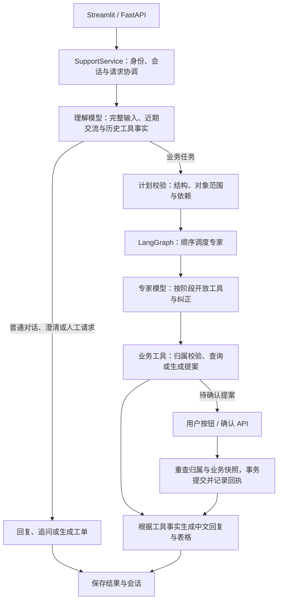

# 电商订单与售后助手

基于 LangGraph 的多 Agent 客服应用，提供 Streamlit 页面和 FastAPI 接口，支持订单、物流、付款、退款、政策查询与人工工单。

## 1. 先理解项目

**模型负责理解需求和选择工具，程序负责权限、业务校验与执行。** 用户可以单笔查询、批量查询、连续追问，或一次提出多个任务；付款与退款先生成待确认操作，再由用户独立确认。

| 能力 | 当前实现 |
| --- | --- |
| Agent 编排 | 模型规划任务，四类专家分工，LangGraph 按顺序执行并汇总结果 |
| 业务工具 | 查询本地订单、物流状态、付款状态和退款资格；办理付款、提交退款申请、生成工单 |
| 对话记忆 | 保存会话、当前订单、待澄清问题和客户明确提交的偏好 |
| 执行保护 | 客户归属校验、独立确认、请求与动作去重、事务回执、检查点恢复和调用预算 |

当前调用真实模型 API，业务后端使用本地 SQLite 样例数据。付款、物流、退款到账和人工通知尚未接入外部服务。

## 2. 快速启动

### 2.1 安装

建议 Python 3.11，在项目根目录执行：

```bash
python3.11 -m venv .venv
source .venv/bin/activate
python -m pip install -r requirements.txt
```

Windows 使用 `py -3.11 -m venv .venv` 创建环境，执行 `.venv\Scripts\Activate.ps1` 激活，再安装同一份依赖。

### 2.2 配置账户与模型

首次使用将 `.env.example` 复制为 `.env`；已有 `.env` 直接编辑。下面启用智谱与 DeepSeek 自动切换，替换密钥与两个不同的随机账户令牌：

```dotenv
SUPPORT_ACCOUNT_TOKENS={"customer_a":"替换为账户A令牌","customer_b":"替换为另一个账户B令牌"}
LLM_PROVIDER=auto
ZHIPU_API_KEY=替换为智谱API密钥
ZHIPU_MODEL=glm-4-flash-250414
ZHIPU_BASE_URL=https://open.bigmodel.cn/api/paas/v4/
DEEPSEEK_API_KEY=替换为DeepSeekAPI密钥
DEEPSEEK_MODEL=deepseek-flash
DEEPSEEK_BASE_URL=https://api.deepseek.com
LLM_FALLBACKS=[]
SUPPORT_DATA_DIR=data
SUPPORT_AGENT_DB_URL=
```

可用 `python -c "import secrets; print(secrets.token_urlsafe(32)); print(secrets.token_urlsafe(32))"` 生成两个账户令牌。**账户令牌用于登录本地测试账户，模型 API Key 用于调用模型服务。**

模型名称填写账户可用且支持 JSON 输出和工具调用的版本。`auto` 使用下面两家中配置完整的服务；也可显式选择单家。

| LLM_PROVIDER | 对应配置 |
| --- | --- |
| `auto` | DeepSeek 优先、智谱备用；各家分别配置 API_KEY 与 MODEL |
| `zhipu` | `ZHIPU_API_KEY`、`ZHIPU_MODEL`，可选 `ZHIPU_BASE_URL` |
| `deepseek` | `DEEPSEEK_API_KEY`、`DEEPSEEK_MODEL`，可选 `DEEPSEEK_BASE_URL` |
| `gemini` | `GEMINI_API_KEY`、`GEMINI_MODEL` |
| `groq` | `GROQ_API_KEY`、`GROQ_MODEL` |

`LLM_PROVIDER=auto`、`LLM_FALLBACKS=[]` 会自动使用配置完整的 DeepSeek 与智谱，默认优先 DeepSeek。单服务可设 `LLM_PROVIDER=zhipu` 或 `deepseek` 并保留空备用列表；要指定智谱优先、DeepSeek 备用，设 `LLM_PROVIDER=zhipu`、`LLM_FALLBACKS=["deepseek"]`。备用列表也支持 `{"provider":"deepseek","model":"账户可用模型"}`，不接收密钥字段。

限流、网络、服务异常、认证、余额或模型不存在时尝试另一家；请求参数、模型 JSON、程序错误和预算不足不会触发切换。切换兼容 JSON 规划与工具调用，每次真实尝试都计入同一请求预算；本请求后续步骤沿用成功服务，若再次故障可切回。全部失败才按错误类型重试或报告失败。不会自动换密钥。修改 `.env` 后重启页面和 API；终端已有的同名环境变量优先。

### 2.3 启动页面

```bash
python -m streamlit run app.py
```

打开 [本地页面](http://localhost:8501)，在侧栏填写账户令牌。customer_a 拥有1001—1007，customer_b 拥有1008—1010。首次启动自动建库并填入十笔样例，正常重启保留修改后的状态。

需要 HTTP 接口时，在另一个终端激活同一环境并启动：

```bash
python -m uvicorn api:app --host 127.0.0.1 --port 8000
```

页面与 API 使用同一数据目录。交互文档见 [Swagger UI](http://127.0.0.1:8000/docs)，点击 Authorize 填写账户令牌。

## 3. Agent 架构



| 专家 | 职责 | 主要工具 |
| --- | --- | --- |
| Order Agent | 订单详情、订单状态、物流，支持批量查询 | `get_order_details`、`get_order_status`、`track_shipment` 及对应批量工具 |
| Refund Agent | 查询资格、创建退款待确认提案 | `check_refund_eligibility`、`initiate_refund` |
| Payment Agent | 查询付款状态、创建付款待确认提案 | `get_payment_status`、`get_payment_status_batch`、`process_payment` |
| FAQ Agent | 检索已生效政策，提供原文、来源与版本 | `answer_faq` |

理解层和四类专家共用 `.env` 选择的服务与模型，通过不同提示词和工具清单分工。普通对话、澄清和转人工由编排分支处理；转人工直接创建本地工单。

理解模型接收完整当前输入、当前订单、结构化待澄清需求、明确偏好，以及近期完整交流和带来源的历史工具快照。专家在上下文预算内使用当前任务相关的问答与事实；订单当前状态每次重新查工具。程序校验模型计划和工具范围，业务正文按工具事实生成，普通回复与追问保留模型表达。付款方式缺失时提供银行卡与 PayPal 供客户选择，不把旧支付记录当成本次授权；技术故障直接说明失败，仅在客户明确要求人工时生成工单。

结构化计划错误允许一次模型重规划，纠正时缩小可选历史并保留当前输入与待办；指代核验的格式错误也回传到核验阶段，避免重复同一错误。专家每阶段允许一次工具纠正，仍不满足要求就返回未完成结果。参数澄清必须标明具体受支持参数，例如付款方式、逐笔选择或请求限额；不能发明工具没有的必填项。解释目的也必须对应能返回所需事实的操作，例如退款进度必须取得退款状态。

DeepSeek 在结构化理解与指代核验阶段启用 thinking，输出预算至少8192 Token，包含推理与 JSON；普通专家工具调用保持关闭，避免工具历史的推理字段不兼容。退款原因与付款方式使用结构字段传给专家；已识别参数被改写时由工具校验拒绝，再由模型修正。客户原话由模型理解，不使用关键词路由。

## 4. 业务逻辑

| 业务 | 当前规则 |
| --- | --- |
| 订单归属 | 账户令牌绑定客户；查询、提案、确认、历史与恢复均校验归属。他人订单与不存在订单统一提示“未找到可访问的订单。” |
| 退款资格 | 仅 `order.status=delivered` 且 `refund.status=none` 可以申请；已有申请或退款记录不能重复申请。当前没有退款期限或部分退款规则。 |
| 退款办理 | 先查资格，再生成订单全额的待确认提案；确认后退款状态变为 `requested`，订单和付款状态保持不变，表示已申请、尚未到账。 |
| 付款办理 | 仅 `payment.status=pending` 可办理，支持 `card`、`paypal`；确认后更新为 `paid` 和所选方式，不自动发货。 |
| 确认与取消 | 聊天文字不能代替独立确认。确认时重查业务快照，变化则拒绝旧提案；取消只撤销待确认动作，不取消订单。 |
| 多任务与条件 | 最多6项逻辑任务、20个不同订单，范围查询算一项。条件只取前置只读任务的资格、付款状态或订单状态；不满足则跳过，未知则阻止后续任务。 |
| 批量办理 | 只读支持列表和范围；写操作必须逐笔明确、分别确认，不能直接执行范围批量退款或付款。 |
| 取消订单与工单 | 没有直接取消订单的工具；人工请求生成 `pending` 工单，不代表已分配或通知真人。 |
| 金额 | 使用整数分 `amount_minor` 和明确币种；样例为 CNY，金额工具支持 CNY、USD。 |

退款资格查询与确认执行共用 [src/rules.py](src/rules.py)。政策文件提供解释依据，不改变可执行规则。物流工具根据订单状态返回进度说明，没有真实运单或预计到达时间。

## 5. 页面使用

页面包含三个标签：“客服对话”“记忆与客户偏好”“使用示例”。以 customer_a 为例：

| 聊天输入 | 预期结果 |
| --- | --- |
| 查询订单1002的物流 | 运输中 |
| 帮我申请1001退款，原因是个人不需要了 | 79.99 CNY退款待确认卡；点击“确认申请”后才提交 |
| 用银行卡支付1003 | 34.50 CNY付款待确认卡；点击“确认付款”后才更新付款状态 |
| 展示1001到1006的付款状态 | 按指定顺序展示六笔付款状态和金额 |
| 先查1001能否退款，符合条件再申请 | 先查资格，符合才生成待确认提案 |

用户输入提交后立即显示，模型等待、异常和重试期间持续可见；重试复用原请求编号，已保存历史按编号去重，待处理消息按账户与会话隔离。助手回复采用 Markdown：单项状态用短句，订单详情用要点，多订单查询用表格，多任务用列表，待确认与成功结果少量使用 emoji。理解模型同时选择解释目的，程序基于本轮工具事实说明到达时间、提案与订单的区别、退款进度与到账边界，避免仅报状态却漏答追问。

回复下方可查看卡片、处理状态、逐项任务结果和工具轨迹。`pending_confirmation` 表示等待确认；`partial` 表示部分完成。`completed` 表示本轮处理完成，仍需看具体业务事实，例如查询到“已付款”不代表本轮又付款一次。

完整样本见 [三轮连续对话验证](docs/manual_validation.md)：customer_a 每轮25次聊天，共75次，覆盖片段补充、歧义、列表指代、话题切换、多任务、独立确认、越权和能力边界。每轮从截图初始订单启动；同一轮保持上下文和业务变化，按钮步骤另计。

## 6. FastAPI 使用

除 `GET /health` 外，接口使用 `Authorization: Bearer <账户令牌>`。在 Swagger UI 执行 `POST /chat`，请求体例如：

```json
{"session_id":"case_api","request_id":"query_001","message":"查询订单1002的物流"}
```

| 接口 | 用途 |
| --- | --- |
| `POST /chat` | 发起查询或办理请求；返回回复、任务、工具轨迹、用量和待确认动作 |
| `GET /actions?session_id=case_api`、`GET /actions/{action_id}` | 查看待确认列表或指定动作 |
| `POST /actions/{action_id}/confirm`、`POST /actions/{action_id}/cancel` | 独立确认或取消，参数冻结，正文可用 `{}` |
| `GET /runs?session_id=case_api`、`GET /runs/{run_id}`、`POST /runs/{run_id}/resume` | 查看运行或恢复中断步骤 |
| `GET /memory/session?session_id=case_api` | 查看会话、当前事项与版本 |
| `PATCH /memory/session/order`、`DELETE /memory/session/history` | 更正当前订单或清除聊天 |
| `GET /profile`、`PATCH /profile`、`DELETE /profile/{field}` | 查看、更新或删除明确偏好 |
| `GET /policies/search?question=退款条件是什么` | 检索政策依据 |

事项与偏好修改先读取版本，再提交实际 `expected_version`，请求结构以 Swagger UI 为准。身份由令牌决定；可省略 `user_id`，传入时必须与认证客户一致。消息最长2000字符；会话编号最长40位，请求编号最长64位，均使用字母、数字、下划线或短横线；`confirm_`、`cancel_` 请求编号前缀为系统保留。

重试原请求必须保持消息、会话参数和 `request_id` 一致；新问题使用新编号。HTTP 200仍须检查业务 `status`；202表示处理中；409表示请求、版本或动作终态冲突；401/403/404表示认证或访问问题。接口不接收 `mode`，携带该字段返回422。

## 7. Memory、持久化与恢复

### 7.1 会话与执行

- 会话保留最近50个完整轮次、当前订单和待澄清问题，支持“这笔”“第二笔”等后续输入；当前事项保留已明确的只读业务主题，用于“1005呢”等续接。批量查询不自动选择最后一笔。
- `online-v4` 规划输入保留最近最多6轮客户原话与最终回复（12条消息）和8条精简历史工具事实；超预算先淘汰较早事实，再按完整问答轮次淘汰，不截断当前请求或待澄清需求。专家只接收当前任务相关的上下文。历史快照用于理解指代与追问，新查询和办理仍需本轮真实工具结果。
- 有序订单列表与当前单笔事项分别保存。最近6组列表记录来源请求、任务和原始顺序；单笔查询、问候、取消提案不覆盖列表。模型选择来源列表及位置，程序只校验来源、边界并解析编号；旧会话缺失列表字段时从原批量任务恢复。清除聊天会清除列表和待澄清需求。
- 新的明确业务优先于旧主题，程序不再用旧操作强制改写模型任务。退款/付款提案涉及上下文对象时，额外一次模型调用独立核验唯一对象；该核验不接收规划器选择的编号，不能确定就澄清，分歧则限一次重新规划。每次新办理仍重新查工具。两次模型一致选择且已存在于可信历史的对象可继续办理，不因最近单笔查询切换对象而错误拒绝“另一笔”；模型一致猜出的未知历史编号仍会拒绝。
- 规划历史保存当时的最终回答；界面可刷新旧提案卡片的当前状态。独立确认/取消作为历史事件传入，不混为客户的新聊天请求；取消只针对具体提案，不取消订单，也不妨碍重新申请。新办理专家接收已解析对象与相关只读事实，旧提案和取消事件由规划器处理，不作为本轮执行状态。
- 模型规划只选择业务操作、对象、依赖与 `answer_mode`，程序按唯一映射生成专家和读写属性；无依赖的独立任务可由程序补齐内部编号，有依赖关系时仍要求模型明确编号。退款与付款分为前置查询、生成提案两个阶段，每阶段只开放对应工具，允许一次模型纠正；每次工具调用仍由模型发起。
- 回复与会话中的 `model_diagnostics` 保存失败阶段、字段路径、合法枚举、尝试次数和上下文估算；默认不额外保存原始模型文本。工具轨迹中可查看恢复记录，业务拒绝与技术失败分别说明。
- 客户偏好跨会话保存，仅由用户在表单或 API 明确提交，支持更正、删除及版本检查；聊天推测不自动写档案。
- 新建会话不会重置业务订单；清除聊天也不会删除待确认动作、业务回执或累计用量。
- 同一请求结果可回放，已提交动作按回执查重。业务修改与动作回执同事务；业务、记忆和检查点之间通过去重与补写协调。
- 页面提供“重试同一请求”“恢复执行”和“补写运行结果”。恢复仍受原身份、流程版本和预算约束；已保存的失败结果重放后不重新调用模型，修复后应发起新请求。
- 已完成的旧版请求继续回放；旧版未完成运行不会自动按 `online-v4` 重跑，请发起新的请求。

默认整次请求限24次模型尝试、24次工具尝试、120秒，包含纠正和重试，恢复不重置。分别通过 `SUPPORT_REQUEST_MAX_MODEL_CALLS`、`SUPPORT_REQUEST_MAX_TOOL_CALLS`、`SUPPORT_REQUEST_TIMEOUT_SECONDS` 调整；模型输入估算预算由 `SUPPORT_CONTEXT_TOKEN_BUDGET` 设置，默认12000 Token。

### 7.2 数据与初始订单

| 默认位置 | 内容 |
| --- | --- |
| `data/business.sqlite` | 订单、付款、退款、提案、请求/动作回执、工单、政策与预算 |
| `data/memory.sqlite` | 会话、客户偏好、版本与运行登记 |
| `data/memory.checkpoints.sqlite` | LangGraph执行检查点 |

`SUPPORT_DATA_DIR` 设置整组数据目录；`SUPPORT_AGENT_DB_URL` 只覆盖业务库。旧库按版本迁移并生成迁移前备份；完整备份需先停所有写入进程，保留业务、记忆与检查点这一整组文件。

初始数据来自 [src/backend/seed.py](src/backend/seed.py)，只在空订单表自动填入：

| 订单 | 客户 | 订单状态 | 付款状态 | 退款状态 | 金额 CNY |
| --- | --- | --- | --- | --- | --- |
| 1001 | customer_a | delivered | paid | none | 79.99 |
| 1002 | customer_a | shipped | paid | none | 129.00 |
| 1003 | customer_a | placed | pending | none | 34.50 |
| 1004 | customer_a | delivered | paid | requested | 349.00 |
| 1005 | customer_a | cancelled | refunded | completed | 24.99 |
| 1006 | customer_a | delivered | paid | none | 59.99 |
| 1007 | customer_a | shipped | paid | none | 42.00 |
| 1008 | customer_b | placed | pending | none | 55.00 |
| 1009 | customer_b | delivered | paid | none | 29.99 |
| 1010 | customer_b | shipped | paid | none | 149.00 |

### 7.3 每轮从初始状态测试

macOS停止原服务后，用临时目录启动；终端 `Control+C` 退出时清理本轮数据，原 `data` 与 `.env` 保留：

```bash
(
  set -e
  TEST_DATA_DIR="$(mktemp -d "${TMPDIR:-/tmp}/ecommerce-support-test.XXXXXXXX")"
  trap 'rm -rf -- "$TEST_DATA_DIR"' EXIT
  trap 'exit 130' INT
  trap 'exit 143' TERM
  trap 'exit 129' HUP
  printf '本轮数据：%s\n' "$TEST_DATA_DIR"
  SUPPORT_DATA_DIR="$TEST_DATA_DIR" SUPPORT_AGENT_DB_URL= python -m streamlit run app.py
)
```

仅测 API 时替换最后一条启动命令为 `python -m uvicorn api:app --host 127.0.0.1 --port 8000`，保留前面的环境变量。自动清理目录仅供单个服务使用；同时运行页面与 API 时手动管理同一目录，全部停止后再删除。关闭浏览器不结束本轮；不要通过重复执行 seed 或单独替换业务库来重置整组状态。

新建会话只清空对话，不重置订单。三轮连续手测必须为每轮更换临时数据目录；完整输入与预期见[三轮验证表](docs/manual_validation.md)。

## 8. 政策维护、验证与部署

政策在 `policies/`，使用元数据和版本管理；修改正文须递增 `version`。启动时自动导入，也可执行 `python scripts/import_policies.py policies`。检索采用 SQLite关键词匹配，返回生效原文、来源和版本；删除文件不会自动撤回已导入政策。

```bash
python -m pytest -q
python scripts/check_ui.py
python scripts/check_restart.py
python eval/run_eval.py --dry-run
python scripts/validate_manual_conversations.py --dry-run
```

自动回归和页面/恢复检查使用临时数据库、脚本模型或模拟 HTTP。三轮连续对话在专用脚本中执行，每轮25条，独立按钮动作不计聊天条数；默认 dry-run 不调用模型或打开业务库，真实调用须显式使用 `--live`，会消耗模型额度：

```bash
python scripts/validate_manual_conversations.py --live --round 1 --output eval/reports/manual-round-1.json
python scripts/validate_manual_conversations.py --live --round 2 --output eval/reports/manual-round-2.json
python scripts/validate_manual_conversations.py --live --round 3 --output eval/reports/manual-round-3.json
```

省略 `--round` 会顺序执行三轮。快速定位加 `--max-turns 8`，只运行从头开始的前8条并标为部分执行；`--provider zhipu|deepseek|auto` 仅覆盖该脚本进程。三轮分别创建全新的临时业务库与记忆库，同轮持续保留上下文和确认后的状态，不改当前 `data/`。

报告逐条保存实际回复、工具事实、结构指标、解释意图、参数、按钮回执和用量，附数据及实现摘要。未点击独立按钮不能改账；按钮另查冻结金额、目标字段变化、其他订单不变及零模型调用。合理等价拆分与澄清在数据中明确列为 alternatives；自然程度和语义完整性仍需人工复核。

已有补充评估集可少量定位使用，例如 `python eval/run_eval.py --live --dataset eval/context_binding_cases.json --limit 1 --output /tmp/support-context.json`。不要把 dry-run、脚本模型通过、部分执行或旧版本报告当作当前真实模型验收。

评估隔离业务与记忆数据，记录任务、事实、副作用、动作参数和用量。新增回归集覆盖追问、补槽、多任务和0/20/50轮历史；历史夹具从隔离数据库的真实只读结果构造，不执行确认。`--repeat` 为每次重复创建独立数据。替代的合理任务拆分及追问仍需人工复核。自动回归结果和真实模型语义效果分别评估。

`context_binding_cases.json` 专门覆盖同一会话的泛查询澄清、问候后补编号、切换当前订单和续接退款主题；澄清指标同时检查缺失项及保存的业务操作，不能仅凭回复问了订单号就判通过。

`conversation_cases.json` 覆盖两段用户完整失败会话、重复含糊申请、反向列表顺序、取消后重办、付款位置指代和20/50轮历史。取消步骤调用独立入口。报告记录 `online-v4`、模型、上下文预算及实现摘要；中途修正前的试跑报告不能当作最终验收。

本次验收：三轮各25条真实模型连续对话，75/75条结构与业务检查通过，13/13次独立按钮操作通过；未确认账务变更和跨账户数据泄漏均为0。逐条输入、实际回复、工具轨迹及按钮回执见 [第一轮](eval/reports/manual-round-1.json)、[第二轮](eval/reports/manual-round-2.json)、[第三轮](eval/reports/manual-round-3.json)，汇总见 [验收记录](eval/reports/manual-acceptance.json)。此前失败、格式修复前和机器休眠导致超时的报告均保留，不与最终结果混计。

真实验收后仅补充了回复展示：物流明确说明尚未发货/无配送包裹，重复付款明确拒绝，政策正文保留可读内容而来源版本在单独区域查看。该收尾使用 [4条真实工具结果回放](eval/reports/manual-presentation-replay.json) 和本地回归验证，没有额外模型调用。本地全量回归542项通过（结果见验收汇总）；页面检查10项、重启/恢复检查15项通过。双方 API 的 JSON 与工具调用连通性见 [服务连通记录](eval/reports/provider-smoke.json)，双向故障切换由模拟HTTP回归验证。

这些结果只证明本次样本和本地规则的行为；付款、退款到账、物流与人工通知仍使用模拟后端，不能把有限样本通过率当作所有未来问法的准确率承诺。

项目提供 Dockerfile：

```bash
docker build -t ecommerce-support-agent .
docker run --rm -p 8501:8501 --env-file .env -v ecommerce-agent-data:/app/data ecommerce-support-agent
```

上述挂载对应默认 `SUPPORT_DATA_DIR=data` 或 `/app/data`，自定义路径需同步调整。当前适合本地或受控单机运行；请求锁只协调同机进程。

## 9. 代码导航与常见问题

| 入口 | 职责 |
| --- | --- |
| `app.py`、`api.py` | 页面与 HTTP 入口 |
| `src/service.py` | 会话、身份上下文、请求协调与结果保存 |
| `src/understanding.py`、`src/planning.py` | 模型理解、计划校验、范围与条件 |
| `src/orchestrator.py`、`src/agents/` | LangGraph流程与专家工具循环 |
| `src/tools.py`、`src/rules.py`、`src/actions.py` | 业务工具、可执行规则、提案确认 |
| `src/requests.py`、`src/storage.py`、`src/context.py` | 请求回执、持久化与模型上下文 |
| `src/llm.py`、`src/backend/` | 模型适配与数据库 |
| `policies/`、`tests/`、`eval/` | 政策、隔离测试与在线评估 |

- **修改配置未生效：** 重启页面和 API，检查终端同名环境变量；以日志中的 `provider:model` 为准。
- **查询失败：** 按请求编号查看 `error_type` 和工具轨迹。`auto` 或已配置备用时先按错误类型切换服务；限流、网络和服务错误还可在预算内重试（每次最多遍历一遍服务列表）。400/422、结构化输出、程序或预算错误不切换。所有调用计入预算，日志中的 `model_provider_fallback` 可核对实际切换。
- **清聊天后订单没恢复：** 聊天与业务分开保存；需要初始订单时使用新的数据目录。

许可与兼容说明见 [NOTICE.md](NOTICE.md) 和 [LICENSE](LICENSE)。架构及业务规则以当前源码为准，`docs/` 中旧图示和深挖文档可作补充阅读。
